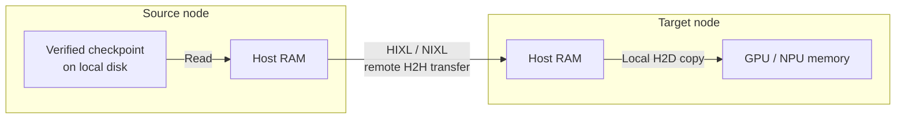

# Remote Weight Delivery

Remote weight delivery lets an engine load tensors from a prepared source node without first
copying the complete checkpoint to the serving node. The source registers weights verified by
its node cache, and the target mounts a metadata-only view. A cluster-wide policy enables delivery;
the deployment's model block does not.



*H2H* means Host-to-Host; *H2D* means Host-to-Device. Host-memory windows are bounded and reused,
so the successful remote path does not store a complete checkpoint on the target filesystem.

## Contents

- [Configuration](#configuration)
- [Source preparation](#source-preparation)
- [Replica startup](#replica-startup)
- [Benchmarks](#benchmarks)
- [Require and Prefer](#require-and-prefer)
- [Networks](#networks)
- [Observing status](#observing-status)
- [Troubleshooting](#troubleshooting)
- [Rollback](#rollback)

## Configuration

One `Setting` chooses the cluster's policy, and the chart ships it:


| `Setting`                               | Default    | Values                          |
| --------------------------------------- | ---------- | ------------------------------- |
| `model-artifact-remote-delivery-policy` | `Disabled` | `Disabled`, `Require`, `Prefer` |


- **`Disabled`** changes nothing: no `Pod`, condition or status field differs from a cluster that
never opted in. This is the default, and the worker reasserts it on every start when the chart
does not declare the variable.
- **`Require` and `Prefer` need the model-manager plugin installed.** A remote replica mounts a
metadata-only view that the plugin serves, so admission refuses the value while the `CSIDriver`
`model.csi.gpustack.ai` does not exist.

```bash
kubectl -n gpustack-system patch setting model-artifact-remote-delivery-policy \
  --type merge -p '{"spec":{"value":"Require"}}'
```

The chart declares the variable only while `modelTransfer.enabled: true`, taking the policy from
`modelTransfer.policy`; see the chart README's remote weight delivery section. With the section
disabled the worker has no key at all, and its default `Disabled` applies.
Enabling the policy is an administrator decision. The backend and engine routing allowlists
do not certify hardware or source safety; the recorded acceptance limits still apply.

The source broker's `ServiceAccount` can review audience-scoped tokens and read live workload,
artifact, placement and grant state. It pins each Binding's quota authority and updates that
authority's ConfigMap in the operator namespace. It can also acknowledge drain on source Pods in
that namespace. The model-manager remains the only writer of `NodeModelStore` status.

The chart's `modelTransfer.images` map configures full source-worker image references per supported
manufacturer (`nvidia`, `amd`, `ascend`). It renders one `DaemonSet` per configured manufacturer
with NFD PCI `nodeSelector` placement (`feature.node.kubernetes.io/pci-<vendor>.present: "true"`).
Missing entries ship no source runtime for that manufacturer.

Without cert-manager, Helm preserves the generated serving certificate by looking up its Secret.
Renderers that cannot perform this lookup, including offline GitOps rendering and
`helm template | kubectl apply`, generate a new trust anchor on every render. Configure
cert-manager for these workflows so repeated syncs do not rotate the source certificate and
interrupt sessions while tenant discovery catches up.

Nodes without accelerator labels use the NVIDIA host-memory source image; mixed-manufacturer
nodes have no implicit source selection. Image updates via Helm use `OnDelete` so each source Pod
is drained and replaced only after its current runtime instance proves release.

Removing a manufacturer entry or disabling the source runtime deletes its DaemonSet
directly through Helm. Perform this maintenance when the affected workload is stable;
it does not wait for the image-rollout drain acknowledgement.
Host driver versions do not rewrite the map. Disk warm-up retains its independent Python Alpine image.

Remote delivery targets **hub artifacts on managed roles**. The routing candidates are `nixl`
for vLLM and SGLang on NVIDIA, and `hixl` for vLLM-Ascend and SGLang on Ascend. The current
allowlist admits only the NVIDIA candidates; Ascend is not yet admitted. Routing admission does
not establish production acceptance, which remains open.

Setting `Require` or `Prefer` starts nothing on its own. A role with its own command is never
rewritten, and claim and image artifacts keep their existing delivery paths. On Ascend (`hixl`),
the engine runner image must include CANN 9.2 or newer so the Python `hixl` module is present.

## Source preparation

A [Model Prefetch](prefetch.md) pins a verified disk cache and prepares its host-memory source.
Source preparation requires explicit placement and a `ModelStoreBinding` covering those nodes.
Disk readiness is reported in *`status.readyNodes`*; transfer readiness is separate in *`status.transfer`*.

The source has three limits: the broker's node budget, the per-generation resident window, and
an optional shared Binding grant. The smallest applicable limit wins. Target staging RAM and
model device memory are separate; configure them under [Replica startup](#replica-startup).

Source Helm values with explicit runtime defaults (the chart defaults *`env`* to `{}`):

```yaml
modelTransfer:
  source:
    # Total source reservations for this broker on the node.
    # 0 uses 1/16 of MemTotal at startup, floored at minMemoryBytes.
    maxMemoryBytes: 0
    # 1 GiB floor; smaller nonnegative values resolve to 1 GiB.
    minMemoryBytes: 1073741824
    # Concurrent sessions across this source Pod; 0 resolves to 64.
    maxSessions: 64
  # Empty by default. Explicit limits must also cover non-transfer allocations.
  # Source sizing reads node RAM from /proc/meminfo.
  workerResources: {}
  # Applied to both broker and worker containers.
  env:
    # Per-generation ceiling for either backend; 0 follows admission.
    # Positive values round down to 2 MiB, with a 1 GiB floor.
    # Malformed or negative values are refused.
    GPUSTACK_MODEL_TRANSFER_SOURCE_RESIDENT_BUDGET_BYTES: "0"
    # Additional HIXL ceiling: 16 GiB; 0 retains this default.
    # Nonzero values have a 1 GiB floor and round down to 2 MiB.
    GPUSTACK_MODEL_TRANSFER_HIXL_RESIDENT_BUDGET_BYTES: "17179869184"
```

Negative *`source`* values are rejected. A ceiling reserves no memory by itself: admission checks
available RAM, node capacity and the Binding grant, including 10% reservation overhead.
Both NIXL and HIXL page checkpoints larger than the admitted window. The window must fit at least
`1 GiB` and the largest safetensors shard, including native allocation overhead; shards are not split.

The chart creates one shared source `DaemonSet` per configured manufacturer. Its privileged
containers access host devices and InfiniBand; Ascend also mounts the host driver directory.
The image supplies CANN and HIXL. Preparing a model creates no exclusive device reservation.
Vendor device use and production qualification remain separate acceptance requirements.

Vendor image references are used verbatim; *`global.imagePullPolicy`* still applies to them.
The source identity can update Binding annotations across namespaces to pin reservation authority.
Treat source Pods and their vendor images as trusted cluster infrastructure.

### Source memory examples

Use the benchmark models `Qwen/Qwen3-8B` and `Qwen/Qwen3.6-35B-A3B` in namespace
`gpustack-default`. Both sources share the `model-source-pool` store and `qwen-source` Binding.
These are configuration examples, not captured benchmark manifests. HIXL remains outside the
managed replica routing allowlist.

#### Node and source limits

Set the broker's total ceiling to `128 GiB` and each HIXL generation's ceiling to `16 GiB`:

```yaml
modelTransfer:
  source:
    maxMemoryBytes: 137438953472  # 128 GiB shared by all this broker's generations.
    minMemoryBytes: 1073741824
    maxSessions: 64
  env:
    GPUSTACK_MODEL_TRANSFER_SOURCE_RESIDENT_BUDGET_BYTES: "0"
    GPUSTACK_MODEL_TRANSFER_HIXL_RESIDENT_BUDGET_BYTES: "17179869184"  # 16 GiB per generation.
```

#### Models and shared grant

Label the source node `gpustack.ai/model-transfer-source: "true"`. Create the two artifacts,
the store and its Binding. Repository revisions and manifest digests are resolved automatically;
see [Model Artifact](artifact.md#manifest-digest) for optional digest checks.

```yaml
apiVersion: worker.gpustack.ai/v1
kind: ModelArtifact
metadata:
  name: qwen3-8b
  namespace: gpustack-default
spec:
  source:
    modelScope:
      repository: Qwen/Qwen3-8B
---
apiVersion: worker.gpustack.ai/v1
kind: ModelArtifact
metadata:
  name: qwen3-6-35b-a3b
  namespace: gpustack-default
spec:
  source:
    modelScope:
      repository: Qwen/Qwen3.6-35B-A3B
---
apiVersion: worker.gpustack.ai/v1
kind: ModelStore
metadata:
  name: model-source-pool
spec:
  nodeSelector:
    matchLabels:
      gpustack.ai/model-transfer-source: "true"
---
apiVersion: worker.gpustack.ai/v1
kind: ModelStoreBinding
metadata:
  name: qwen-source
  namespace: gpustack-default
spec:
  storeRefs:
    - name: model-source-pool  # The ModelStore above.
  quota:
    bytes: 128Gi  # Shared disk-cache quota; separate from source RAM.
  allowPinned: true  # Allow both prefetches to pin their cached weights.
  # Optional: omit this block to use node-derived limits instead.
  # Without it: node memory ceiling, 4096 registrations and source.maxSessions.
  sourceMemory:
    # 64 GiB shared by both models, across source nodes and manufacturers.
    # Includes reservations; grants no dedicated capacity against other Bindings.
    # Bytes and registrations can only grow while this block is present.
    bytes: 64Gi
    registrations: 4096
    # At least 1; can change online. Existing sessions may finish above a lowered cap.
    sessions: 64
```

#### Two model sources

Each prefetch references its own artifact and the shared `qwen-source` Binding:

```yaml
apiVersion: worker.gpustack.ai/v1
kind: ModelPrefetch
metadata:
  name: qwen3-8b-source
  namespace: gpustack-default
spec:
  artifactRef:
    name: qwen3-8b  # Qwen/Qwen3-8B above.
  bindingRef:
    name: qwen-source  # Shares the 64 GiB source grant and 128 GiB disk quota.
  placement:
    # Required for source preparation; match the ModelStore's source nodes.
    nodeSelector:
      matchLabels:
        gpustack.ai/model-transfer-source: "true"
  retention:
    pinned: true
  source: {}  # Register a host-memory source as well as warming the disk cache.
---
apiVersion: worker.gpustack.ai/v1
kind: ModelPrefetch
metadata:
  name: qwen3-6-35b-a3b-source
  namespace: gpustack-default
spec:
  artifactRef:
    name: qwen3-6-35b-a3b  # Qwen/Qwen3.6-35B-A3B above.
  bindingRef:
    name: qwen-source  # The same grant; this creates no second 64 GiB budget.
  placement:
    nodeSelector:
      matchLabels:
        gpustack.ai/model-transfer-source: "true"
  retention:
    pinned: true
  source: {}
```


| Model           | Checkpoint storage in benchmark | Effect of a 16 GiB HIXL ceiling                                   |
| --------------- | ------------------------------- | ----------------------------------------------------------------- |
| Qwen3-8B        | 15.27 GiB                       | Fits in full if admission grants enough space for native backing. |
| Qwen3.6-35B-A3B | 66.99 GiB                       | Uses successive resident batches; the largest shard must fit.     |


The `64 GiB` Binding grant cannot enlarge either `16 GiB` window. Each generation and session
keeps its own charge, even for the same digest; copies on additional nodes share the grant too.
For illustration, `16 GiB` of native backing charges about `17.6 GiB` with reservation overhead:
three such sources fit within `64 GiB`; a fourth does not, even below the node's `128 GiB` ceiling.

#### Smaller node budget

Keep the Binding and prefetches above, but lower the broker's total ceiling to `16 GiB`:

```yaml
modelTransfer:
  source:
    # Total reservations for both Qwen sources, including overhead.
    # The Binding's 64 GiB grant cannot override this node ceiling.
    maxMemoryBytes: 17179869184
    minMemoryBytes: 1073741824
    maxSessions: 64
  env:
    GPUSTACK_MODEL_TRANSFER_SOURCE_RESIDENT_BUDGET_BYTES: "0"
    GPUSTACK_MODEL_TRANSFER_HIXL_RESIDENT_BUDGET_BYTES: "17179869184"
```

With no other charges, at most about `14.54 GiB` remains for native backing after overhead and
alignment. Even 8B now needs paging; the two sources cannot each claim that much concurrently.
Admission may wait, and each admitted window must still fit its largest shard.

### Readiness and release

The model-manager verifies weights before publishing the cache. Prefetch pins that immutable tree;
transfer validates identity, layout and bounds without hashing payloads again. Keep source disk
available for page-in and restore. A page swap drains and acknowledges active work, revokes old
registrations, reuses shared files and frees evicted allocations. A queued page miss prevents
newer resident reads from extending that drain.

Idle sources release resident blocks once no native operations or unknown sessions remain.
Later sessions refill from disk and wait for registration. Failed restore or unknown release
quarantines the generation and retains its resources and reservation. Lease expiry, Pod deletion
and process exit alone do not prove release. Missing or corrupt quota authority blocks new
admissions and retains existing charges.

Remote readiness requires the current artifact, worker instance, tenant reservation, store coverage
and an unexpired lease. Unresolved or zero-sized artifacts allocate nothing and report
`SourceSizeUnresolved`. A grant unable to back the `1 GiB` minimum window reports `SourceWindowFallback` under
`Prefer` (`Progressing=True`) or `SourceWindowBelowFloor` under `Require` (`Progressing=False`).
`Prefer` can use peer sync or local CSI loading; `Require` waits.

Drain and replace the source Pod after chart argument or environment changes. An existing
generation keeps its admitted window; prepare a fresh generation for a larger budget. Binding
grants can grow online. Removing *`sourceMemory`* restores node-derived limits, not unlimited RAM.

Deploy the operator, source SDK and engine SDK together: the layout-only contract is version `2`;
version `1` readers and manifests are refused.

Inline manifests are limited to `64 MiB` raw JSON. Paged manifests use roots and pages of at most
`4 MiB`, with at most `512 MiB` of pages and `1,048,576` tensors overall. Load and source journals
cap operations at `1,048,576`; byte limits can refuse work sooner. Proven acknowledgements can
be compacted; unknown receipts remain charged.

See [source budget calculations](../../../specs/2026-10-28-model-artifact-remote-weight-loading.md#source-budget-calculations)
for admission arithmetic and available-memory sizing.

## Replica startup

The operator renders three additions to a remote replica's `Pod`:

- **A metadata-only CSI volume.** The volume carries the artifact, its UID and the digest, plus a
`model-transfer.gpustack.ai/delivery: metadata` attribute. The plugin serves configuration, tokenizer and
safetensors headers, never the complete checkpoint. This lets the engine inspect the model
configuration before loading. A target without a checkpoint fetches this bounded view through
an authenticated source endpoint using the workload's CSI token.
- **A projected ServiceAccount token** for audience `gpustack-model-transfer`, rotated within its hour.
- **The wheel, staged on the host.** The operator image ships the universal `gpustack_model_transfer` wheel
and `device-manager` stages it to `/var/lib/gpustack/operator/lib/model-transfer`; the engine container
installs it offline before start, only if it is not importable already.

The engine starts with `--load-format model-transfer` and `GPUSTACK_MODEL_TRANSFER_*` environment
variables for the artifact, UID, digest, mount path, token, wheel directory and backend. These
select and configure the engine's model-transfer adapter. The adapter checks every tensor against
its owned-output budget before opening a session. A refused plan reads no bytes.

Configure native vLLM and SGLang loading through the serving role's *`env`*. These values
show the defaults; merge the entries with any existing role environment:

```yaml
apiVersion: worker.gpustack.ai/v1
kind: ModelDeployment
metadata:
  name: qwen3-8b
  namespace: gpustack-default
spec:
  roles:
    - kind: Server
      name: server
      env:
        # broadcast (or tp0): the TP coordinator reads, then broadcasts tensors.
        # all: each TP rank opens a session and reads its own weights.
        - name: GPUSTACK_MODEL_TRANSFER_TP_MODE
          value: "broadcast"
        # 8 GiB target staging ceiling; 32 or 64 GiB allows larger windows.
        # In all mode, ranks divide this budget, with a 1 GiB minimum per rank.
        - name: GPUSTACK_MODEL_TRANSFER_MAX_WINDOW_BYTES
          value: "8589934592"
```

These entries belong to *`spec.roles[].env`*, not the source chart's *`modelTransfer.env`*.
The `all` aliases are `all_tp`, `all-tp` and `all_tps`; invalid modes fail. Each session counts
against the source session cap. Broadcast uses `torch.distributed.broadcast`.

In `all` mode, each rank's default window is
`max(GPUSTACK_MODEL_TRANSFER_MAX_WINDOW_BYTES // tp_size, 1 GiB)`, aligned down to `2 MiB`.
The per-rank minimum means the sum can exceed the configured budget for large TP groups.

The engine's *`model_loader_extra_config`* accepts the following reader budget object.
This is the decoded engine option structure, separate from the `ModelDeployment` fields;
when supplying it through a command-line argument, encode the object as JSON:

```yaml
# Explicit per-reader window; overrides the environment-derived window.
# This value is not divided by TP size. Omit it to use the default above.
window_bytes: 8589934592
# Example concurrency of 4; omit to use available CPU threads, capped at 256.
max_inflight: 4
# 4 GiB default ceiling for one owned output tensor.
owned_output_bytes: 4294967296
```

The reader coalesces contiguous safetensors spans into a registered transfer window where
possible. Window and concurrency budgets bound staging; retained output tensors still contribute
to peak device memory until load completion.

The target staging window uses pinned host RAM. Ascend uses `aclrtMallocHost` and HIXL `MEM_HOST`;
NVIDIA uses pinned `DRAM` with NIXL. The source writes into the host window, then the loader copies
to the target tensor. `GPUSTACK_MODEL_TRANSFER_TARGET_MEMORY` is no longer read. The loaders close
the session after `load_weights`; unknown native outcomes retain resources for safety.

HIXL owned host regions always use `2 MiB`-aligned addresses and registration lengths, including
small or oddly sized requests. The allocator reserves the rounded extent plus `2 MiB` for address
alignment and frees the original allocation. File and tensor read/write bounds keep their original
lengths; the registered tail is zeroed and never counted as model data.

Source admission, page selection and residency reports charge this complete backing allocation.
Target window budgets round down before dividing into slots; each slot reserves `2 MiB` for address
alignment. A direct loader window below `4 MiB` resolves to that minimum, and double buffering needs
at least `8 MiB`. Configured environment windows retain their `1 GiB` floor. Adaptive transfer spans
may end at an unaligned tensor boundary without changing the aligned memory registration.

The exported `HixlReader` also aligns its owned host windows and charges the full backing
allocation. Its per-window budget has a `4 MiB` minimum. Caller-owned tensor or byte-buffer
registrations keep their actual storage bounds; the runtime never rounds them beyond their owner.

NVIDIA pinned allocations of at least `2 MiB` retain their existing address alignment. NIXL window
sizes round down and needed tensor spans round up before clamping; smaller windows can keep their
original sizes.

When available RAM backs a source window, `POST /v1/sessions` returns `sourceWindowBytes`. The
client limits its window to the smaller of its own budget and that figure, with a `256 MiB`
adaptive floor and a further bound by the needed tensor span. Larger client windows transfer in
chunks. The response omits the source window if RAM is unreadable or cannot clear the floor.

When session capacity is exhausted, `POST /v1/sessions` returns HTTP `409`, `Retry-After: 5` and
`"retryAfter": 5`. The client tries other available peers for the same digest. If none admits the
session and a peer supplies a retry delay, it waits for the shortest delay and retries until the
startup deadline.

### Credentials

The session authority is the replica's projected token. The broker reviews its audience and
bound Pod identity, checks the live Pod and current artifact grant, and binds the session to that
owner and target process instance. Public discovery carries source Pod identities and CA bundles;
it carries no serving private key. Source isolation remains unqualified.

Generation isolation and source immutability still require backend safety tests. The candidate
uses source-initiated writes into target-owned staging windows and withholds source registration
metadata at the control interface. That interface alone does not establish hardware isolation;
raw READ, WRITE, ATOMIC and discovery exposure require backend safety qualification.

A drained or quarantined generation stops admitting sessions. An already loaded replica keeps
serving its own loaded weights.

## Benchmarks

### Case scope

The current benchmark covers two environments: **Ascend/HIXL** with `Qwen3-8B`,
`Qwen3.6-35B-A3B` and `Qwen3-235B-A22B-W8A8`, and **NVIDIA/NIXL** with
`Qwen3-Next-80B-A3B-Instruct-FP8` and `Qwen3-235B-A22B-Instruct-2507-FP8`.

The comparison covers a new model on the target: TCP sync to local disk and engine loading
versus cross-node remote loading. SGLang retains functional coverage; the tables contain
vLLM/vLLM-Ascend results.

### Measurement contract

The baseline adds **TCP peer sync and local loading**. Remote loading includes network
transfer from prepared source RAM. Both exclude source preparation, scheduling and service warm-up;
the baseline is a sum of phases rather than a continuous startup measurement.

**Weight Transfer Time** is the slowest rank's model-loading time. The speedup is the baseline
sum divided by remote loading time. These are single-run comparisons with differing cache and
SDK conditions, so the ratios describe the measured cases.

**Source RAM** and **Target RAM** cover transfer buffers, excluding model device memory and other
process memory. **Target Storage** is the model storage required on target disk; remote rows show
`0 GiB`, omitting the negligible metadata files. Unrelated engine caches are excluded.

TP2, TP4 and TP8 use two, four and eight devices. In `TP0 + broadcast`, rank 0 loads the weights
and broadcasts them to the group; in `TP all`, every rank loads remotely. Single-model remote runs cross nodes.

### Ascend (HIXL)

The runs used two Ascend 910B2 nodes, vLLM-Ascend `cann9.2-910b-vllm0.30.0`, eager mode
and host transfer buffers. Source weights were prepared before loading. These tests used an
isolated qualification configuration; HIXL remains outside the managed routing allowlist.

The source host had 2014 GiB of total RAM and approximately 1514 GiB available. With
*`source.maxMemoryBytes: 0`*, the default node Source budget is `2014 / 16`, or approximately
125.88 GiB. This calculation uses total RAM; available RAM can reduce the admitted window.

HIXL also defaults to a 16 GiB window per generation. Unmarked remote rows use that limit;
rows marked *enlarged source window* use 80 GiB for 35B and 256 GiB for 235B. Node and Binding
budgets include 10% reservation overhead, so the node ceiling is not itself a resident-memory
measurement.

`8B` means `Qwen/Qwen3-8B`; `35B` means `Qwen/Qwen3.6-35B-A3B`; and `235B` means
`vllm-ascend/Qwen3-235B-A22B-W8A8`. The 35B and 235B runs used TP8 with *expert parallelism (EP)*.
Remote times are the slowest rank's `load_model` seconds.


| Model           | Mode                                    | Source RAM | Target RAM | Target Storage | Weight Transfer Time          |
| --------------- | --------------------------------------- | ---------- | ---------- | -------------- | ----------------------------- |
| 8B (TP2)        | TCP peer sync + local load (sum)        | 0 GiB      | 0 GiB      | 15.27 GiB      | 82.90 s (baseline)            |
| 8B (TP2)        | TP0 + broadcast                         | 15.26 GiB  | 3.72 GiB   | 0 GiB          | 15.31 s (5.41×, −81.5% time)  |
| 8B (TP2)        | TP all                 | 15.26 GiB  | 7.45 GiB   | 0 GiB          | 10.78 s (7.69×, −87.0% time)  |
| 35B (TP8 + EP)  | TCP peer sync + local load (sum)        | 0 GiB      | 0 GiB      | 66.99 GiB      | 282.60 s (baseline)           |
| 35B (TP8 + EP)  | TP0 + broadcast                         | 15.66 GiB  | 3.72 GiB   | 0 GiB          | 66.33 s (4.26×, −76.5% time)  |
| 35B (TP8 + EP)  | TP all  | 15.66 GiB  | 8.00 GiB   | 0 GiB          | 101.39 s (2.79×, −64.1% time) |
| 35B (TP8 + EP)  | TP all (enlarged source window, 80 GiB) | 67.05 GiB  | 29.81 GiB  | 0 GiB          | 46.39 s (6.09×, −83.6% time)  |
| 235B (TP8 + EP) | TCP peer sync + local load (sum)        | 0 GiB      | 0 GiB      | 220.54 GiB     | 599.05 s (baseline)           |
| 235B (TP8 + EP) | TP0 + broadcast         | 15.99 GiB  | 4.00 GiB   | 0 GiB          | 452.83 s (1.32×, −24.4% time) |
| 235B (TP8 + EP) | TP0 + broadcast (enlarged source window, 256 GiB)        | 220.67 GiB | 4.00 GiB   | 0 GiB          | 253.58 s (2.36×, −57.7% time) |
| 235B (TP8 + EP) | TP all (enlarged source window, 256 GiB)                 | 220.67 GiB | 32.00 GiB  | 0 GiB          | 232.93 s (2.57×, −61.1% time) |


The 235B paged-source run held 7.3% of its weights in source RAM and loaded in 452.83 s.
With the full model resident, broadcast and all-rank loading took 253.58 s and 232.93 s.
These samples used different SDK builds; the difference does not isolate source-window size.

Detailed window sweeps, SDK comparisons, concurrent loading and lifecycle checks are retained in
the [acceptance record](../../../specs/2026-10-28-model-artifact-remote-weight-loading.md#ascend-memory-and-loading).

### NVIDIA (NIXL)

The runs used Nebius H100 80 GB nodes and vLLM 0.30.0 in eager mode. Source weights were prepared before
loading. Every loading case below reached `Ready` and passed inference probes.

The source host reported 1574.84 GiB of total RAM and approximately 1554.06 GiB available in
a pre-load snapshot. With *`source.maxMemoryBytes: 0`*, the default node Source budget is
`1574.84 / 16`, or approximately 98.43 GiB. This calculation uses total RAM; available RAM,
Binding limits and the 10% reservation overhead can reduce the admitted resident window.

Unmarked remote rows use the default. The *reduced source window* rows use 32 GiB; the
*enlarged source window* row uses a 256 GiB source budget.

`80B` means `Qwen/Qwen3-Next-80B-A3B-Instruct-FP8` (TP4); `235B` means
`Qwen/Qwen3-235B-A22B-Instruct-2507-FP8` (TP8). Remote times are the slowest rank's
`Model loading took` seconds.

The source and target used different NIXL, UCX and PyTorch builds. The
[NVIDIA evidence record](../../../specs/2026-10-28-model-artifact-remote-weight-loading.md#nvidia-loading)
retains the tested artifacts and measurement limits.


| Model      | Mode                                  | Source RAM | Target RAM   | Target Storage | Weight Transfer Time         |
| ---------- | ------------------------------------- | ---------- | ------------ | -------------- | ---------------------------- |
| 80B (TP4)  | TCP peer sync + local load (sum)      | 0 GiB      | 0 GiB        | 76.45 GiB      | 393.14 s (baseline)          |
| 80B (TP4)  | TP all | 76.42 GiB  | ≈40 GiB | 0 GiB          | 86.81 s (4.53×, −77.9% time) |
| 80B (TP4)  | TP all (32 GiB source, 8 GiB target budget) | 30.01 GiB  | 8.00 GiB     | 0 GiB          | 164.37 s (2.39×, −58.2% time) |
| 80B (TP4)  | TP all (32 GiB source, 64 GiB target budget) | 30.01 GiB  | 40.00 GiB    | 0 GiB          | 122.74 s (3.20×, −68.8% time) |
| 235B (TP8) | TCP peer sync + local load (sum)      | 0 GiB      | 0 GiB        | 220.21 GiB     | 1121.30 s (baseline)         |
| 235B (TP8) | TP0 + broadcast (enlarged source window, 256 GiB)     | 220.19 GiB | 9.31 GiB (rank 0) | 0 GiB     | 108.89 s (10.30×, −90.3% time) |


With all weights resident in source RAM, the 80B and 235B remote runs took 77.9% and 90.3%
less time than their recorded baselines, with no target checkpoint storage. The full-resident
80B source budget was the default `1/16` of host RAM, or 98.43 GiB; the 235B run enlarged it
to 256 GiB.

Both paged 80B runs used a 32 GiB source budget and reached sampled resident peaks
of 30.01 GiB. With target budgets of 8 GiB and 64 GiB across the TP group, loading took
164.37 s and 122.74 s respectively; both passed inference and native resource release.

The full-resident 80B run reused bounded transfer buffers on each rank, with a configured
64 GiB budget across the TP group. Its ≈40 GiB reference value uses the paged run's measured
10 GiB per rank under the same target budget and TP4 configuration.

The paged runs measured simultaneous live transfer-buffer peaks
of 8 GiB and 40 GiB across all four ranks, or 2 GiB and 10 GiB per rank respectively.
These values exclude pinned allocator cache.

The 235B run loaded through rank 0 and broadcast weights to the remaining ranks.
The rank-0 probe observed a 9.31 GiB peak in its live transfer buffers.

The original 80B full-resident and baseline cases ran alongside another workload. The paged 80B
and remote 235B cases ran alone, with warm or unknown page-cache state. The ratios compare the
recorded times; they do not isolate the speedup due to remote loading. Paging coverage is limited
to the tested 80B configurations; payload *RDMA* qualification and production acceptance remain separate.

## Require and Prefer

The policy names what an eligible replica may do when its source is missing, slow or fails:


| Policy    | An allowlisted role with a source | An allowlisted role without one                                                                 | A combination outside the allowlist                                                                            | An ineligible role                                          |
| --------- | --------------------------------- | ----------------------------------------------------------------------------------------------- | -------------------------------------------------------------------------------------------------------------- | ----------------------------------------------------------- |
| `Require` | loads remote                      | holds before its load starts, visible in status, never downloads                                | blocked with `UnqualifiedTransferBackend`, no new `Pod`                                                        | blocked with `RoleIneligibleForModelTransfer`, no new `Pod` |
| `Prefer`  | loads remote                      | uses the declared local delivery if no remote replica holds it; otherwise holds remote delivery | falls back to the declared local delivery, or is blocked when that fallback would roll a loaded remote replica | falls back to the declared local delivery                   |


- **Require never materializes a checkpoint.** A Require deployment that cannot reach a source
keeps waiting within its startup limits; nothing downloads behind its back.
- **Prefer tracks fallback attempts.** The initial remote `Pod` does not mount a complete
checkpoint, so fallback after a failed remote load recreates the replica. Each attempt increments
*`fallbackAttempts`* for that replica. If the count exceeds three, the reason becomes
`FallbackAttemptsSpent` and the replica still falls back.
- **Verified artifacts keep verification on fallback.** An artifact with *`expectedDigest`*,
*`allowPatterns`* or *`ignorePatterns`* falls back to verified Node delivery, never to an
unrestricted engine download.
- **The refusal reason identifies the restriction.** `RoleIneligibleForModelTransfer` means the
role cannot use remote delivery: it has its own command, uses an unsupported engine, or runs on
a pool whose manufacturer names no backend. `UnqualifiedTransferBackend` means the candidate is
outside the current routing allowlist. Under `Require` both block; under `Prefer` an unqualified
candidate falls back only if doing so would not roll a loaded remote replica.
- **A running remote replica is protected from fallback.** Changing the desired delivery could
roll a replica that already loaded. The controller checks running `Pod`s as well as deployment
status, which can lag or report local delivery. It holds the operator-rendered replica's remote
delivery even if the source disappears or the `Pod` is not `Ready`: it may already have loaded.
A replica can fall back when every member's load failed outright. This hold does not affect an
independent client that connects to the source itself.

## Networks

Control and payload endpoints are identified separately. The *control* endpoint is the broker's
authenticated HTTP path for session negotiation. The *payload* endpoint is the backend's transfer path:
UCX/InfiniBand or shared memory for `nixl`, and the CANN fabric for `hixl`. A capability record
must identify both endpoints for the backend to qualify.

Network device selection is checked during qualification, using node discovery or the acceptance
configuration. No `Setting` chooses a NIC today. A payload transfer on the wrong network path
fails acceptance; the operator does not automatically correct the selection.

The source chart keeps the existing `modelTransfer.env` map and appended `modelTransfer.extraArgs`.
Use backend environment variables there when a server needs explicit device selection. Client
east-west network selection is owned by the RDMA selection work; this feature adds no server-client
NIC negotiation. HIXL Device RoCE and Host RoCE require separate qualification.

## Observing status

The deployment reports remote delivery per role and replica in *`status.model.remote`*, beside
the ordinary conditions:

- *`policy`* echoes the effective policy, so a status reader never guesses which behavior produced
the entries.
- *`roles[].replicas[]`* carries *`delivery`* (`Remote`, `Node` or `Engine`), *`load`*, *`reason`*
and *`fallbackAttempts`* per ordinal. A deployment can serve mixed deliveries; the aggregate
never flattens them.
- *`load`* walks `Unknown`, `AwaitingMetadata`, `AwaitingSource`, `Loading`, `Loaded`. `Loaded`
means weights confirmed loaded and the engine initialized, and a loaded replica keeps `Loaded`
when its source later drains.
- `WeightsReady` under remote delivery reflects confirmed loading for the applicable replicas —
metadata readiness and source eligibility permit startup but are not serving proof.

```bash
kubectl get modeldeployment <name> -o jsonpath='{.status.model.remote}' | jq
```

## Troubleshooting

Start from *`status.model.remote`*, then the `WeightsReady` condition and the replica `Pod`:


| Observation                                                              | Meaning                                                                                              | Check                                                                                                 |
| ------------------------------------------------------------------------ | ---------------------------------------------------------------------------------------------------- | ----------------------------------------------------------------------------------------------------- |
| `Progressing=True`, `reason: SourceWindowFallback` on the prefetch       | the grant cannot back the minimum window under `Prefer`                                              | increase the Binding grant; check local delivery                                                      |
| `Progressing=False`, `reason: SourceWindowBelowFloor` on the prefetch    | the grant cannot back the minimum window under `Require`                                             | increase the Binding grant; check source capacity                                                     |
| `Progressing=False`, `reason: SourceGrantMissing` on the prefetch        | the referenced Binding is missing; the condition message may still mention its source-memory section | restore the `ModelStoreBinding` named by *`spec.bindingRef`*                                          |
| `load: AwaitingSource`, remote delivery                                  | no prepared source serves the digest yet                                                             | the prefetch's *`status.transfer`*; the nodes' `NodeModelStore` *`status.modelTransfer`* generations  |
| `load: AwaitingMetadata`                                                 | the metadata view is not mounted yet                                                                 | the `Pod`'s `FailedMount` events; the plugin's `CSIDriver`                                            |
| `load: Unknown`, `reason: RemoteLoadFailed`                              | a load attempt ended; the replica is being recreated                                                 | the `Pod`'s terminated container exit; *`fallbackAttempts`*                                           |
| `reason: FallbackAttemptsSpent`                                          | the replica's fallback attempt count exceeded three                                                  | the fallback delivery's own failure: the `Node` or `Engine` path it landed on                         |
| `reason: RoleIneligibleForModelTransfer`, no new `Pod` under `Require`   | the role names no transfer backend at all                                                            | the eligibility rules under [Configuration](#configuration), or choose `Prefer`                       |
| `reason: UnqualifiedTransferBackend`, no new `Pod` under `Require`       | the candidate is outside the controller's routing allowlist                                          | the engine and backend restrictions under [Configuration](#configuration)                             |
| `WeightsReady=False`, `reason: NodeDeliveryUnavailable`, under `Require` | the effective policy is `Require` and the `CSIDriver` `model.csi.gpustack.ai` is absent              | the `CSIDriver` exists; a `Setting` edit to `Require` or `Prefer` without it is rejected at admission |


Source loss does not change replicas that already loaded. Replicas still loading can wait in
`AwaitingSource`. Under `Prefer`, a replica can fall back if its load fails outright.

## Rollback

To roll back, set the `Setting` to `Disabled` or disable the chart's `modelTransfer` section. When
the chart does not declare the policy, the worker reasserts `Disabled` on its next start. New
replicas use the base delivery mode (`model-artifact-delivery-mode`, Node or Engine).

Replicas already loaded keep serving their weights until their next roll. A checkpoint that
`Require` refused to materialize was not written to the target; rollback does not migrate files
on disk.

---

**See also** — [Model Prefetch](prefetch.md) (the intent and the binding grant) ·
[Model Store Operations](operations.md) (the delivery `Setting`s in operation) ·
[Model Artifact](artifact.md) (the identity a source serves) ·
[Model Deployment Status](../model-deployment/status.md) (the conditions around `WeightsReady`) ·
[Engine Compatibility](../model-deployment/engine-versions.md) (per-engine adapter notes)

**Next** → [Model Artifact](artifact.md)
