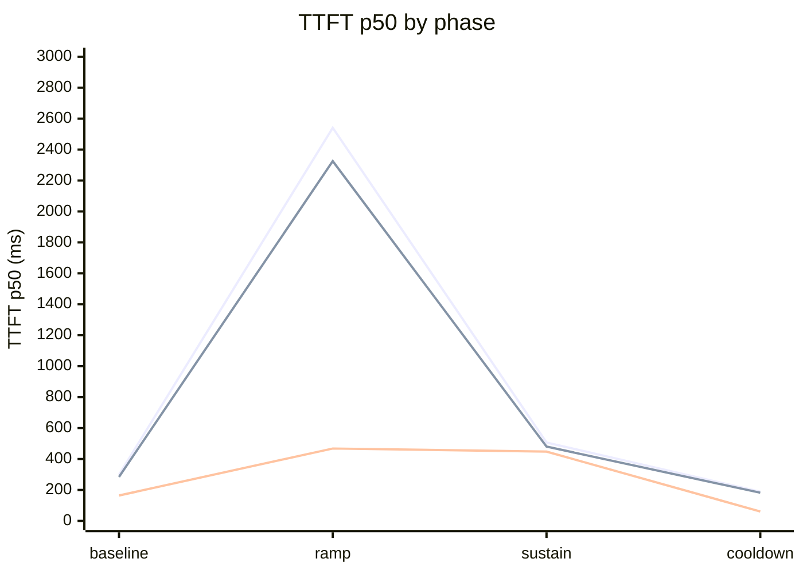
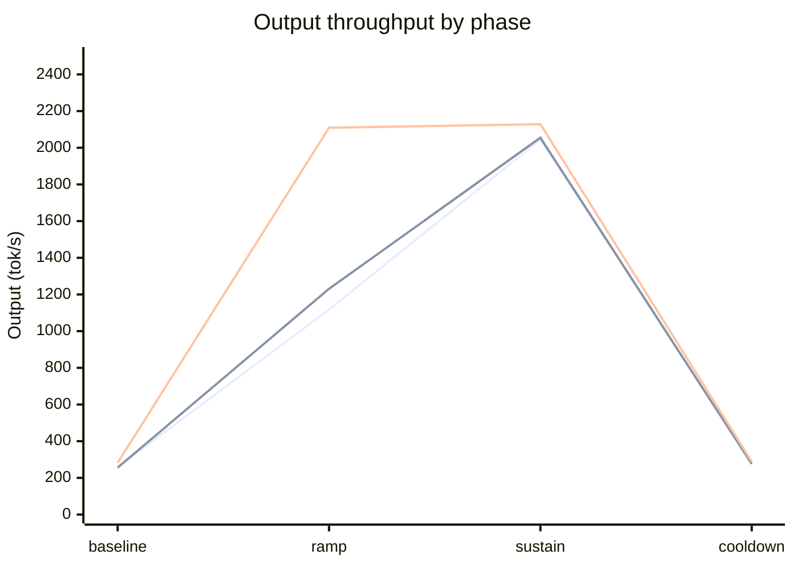

# Model Deployment Scaling Benchmark

On one node with eight H100 GPUs, `ModelDeploymentScaler` increased serving replica counts
under live traffic. Four vLLM configurations completed every measured request. SGLang failed under
sustained load, and a separate scale-out check recorded request failures at the Router.

The measurements demonstrate that `ModelDeploymentScaler` observes load changes and drives
`ModelDeployment` *`replicas`* updates promptly. End-to-end scale-out landing time in production
varies with deployment-environment factors outside the scaler's control: model weight loading,
engine startup and compute-graph compilation, and accelerator resource availability or queueing.

## Contents

- [Summary](#summary)
- [Environment](#environment)
- [Configuration](#configuration)
- [Suite 1: Scaling comparison](#suite-1-scaling-comparison)
- [Verification](#verification)
- [Benefits](#benefits)
- [Trade-offs](#trade-offs)
- [Limitations](#limitations)

## Summary

A *prefill/decode (PD)* pair separates prompt processing from token generation.
An *encode/prefill/decode (EPD)* deployment adds a separate image encoder.
The text configurations compared `Proportional`, `TokenThroughput` and `Predictive` scaling.
The multimodal configuration used `Predictive`.
[Model Deployment Scaling](scaling.md) defines the algorithms and replica guards.

Four vLLM configurations completed every measured request.
The separate lifecycle check lost requests during scale-out, so these results do not establish
uninterrupted serving. Its scale-down and post-retirement phases completed without request failures.

## Environment

| Item | Captured value |
|---|---|
| Cluster | Kubernetes v1.35.7; one CPU node and one GPU node |
| Hardware | 8 × NVIDIA H100 80 GB SXM GPUs; 128 vCPUs and 1600 GB host memory |
| Text model | `Qwen/Qwen3-8B`, artifact `qwen3-8b`, revision `b968826d9c46dd6066d109eabc6255188de91218` |
| Multimodal model | `Qwen/Qwen2.5-VL-7B-Instruct`, artifact `qwen2-5-vl-7b-instruct`, revision `cc594898137f460bfe9f0759e9844b3ce807cfb5` |
| Model delivery | Prefetched node cache, mounted at `/models` |
| vLLM image | `gpustack/runner:cuda13.0-vllm0.30.0` |
| SGLang image | `gpustack/runner:cuda12.9-sglang0.5.18` |
| Router | `llm-d-router` with cluster-internal `Service` endpoints |
| Load driver | In-cluster `default/bench-driver`; the separate lifecycle check used `case129-probe` |
| GPU allocation | `bench-gpu` `InstanceType`; one GPU per role replica, *tensor parallelism (TP)* = 1 |
| KV transfer | Default TCP path between *prefill* and *decode* |

Requests went directly from the driver to the Router's cluster-internal endpoint.
No `kubectl port-forward` carried inference traffic. vLLM roles set
`VLLM_HTTP_TIMEOUT_KEEP_ALIVE=3600`; the separate lifecycle check still observed scale-out failures.

## Configuration

Each role started with one replica and had bounds of one to two.
The scaler used `Active` mode and a 10 s sampling interval.

| Configuration | Model | Algorithm | Capacity settings |
|---|---|---|---|
| `vllm-pd-proportional` | Qwen3-8B | `Proportional` | `RunningRequests`, target `3` per role, tolerance `0.1` |
| `vllm-pd-token-throughput` | Qwen3-8B | `TokenThroughput` | *Prefill* `1200` tok/s; *decode* `300` tok/s per replica |
| `vllm-pd-predictive` | Qwen3-8B | `Predictive` | Same fallback targets; forecast capacity `2000` tok/s per role |
| `sglang-pd-token-throughput` | Qwen3-8B | `TokenThroughput` | *Prefill* `1200` tok/s; *decode* `300` tok/s per replica |
| `vllm-epd-predictive` | Qwen2.5-VL-7B-Instruct | `Predictive` | Same fallback and forecast capacities; *encode* coupled to *prefill* |

Both predictive configurations used a 30 s horizon, two minimum observations, *`qLevel: "0.5"`*
and *`qTrend: "0.3"`*. Token-based configurations retained the default 180 s stable and 60 s panic
windows, panic threshold `2`, and latency targets of 500 ms and 50 ms.

Each configuration preferred a *prefill*/*decode* ratio of `1`.
The *EPD* configuration also preferred an *encode*/*prefill* ratio of `1`.
Only *`target`* was set, so these were preferences rather than fixed ratio bands.
The observed *EPD* maxima were one *encode*, two *prefill* and two *decode* replicas.

The `vllm-pd-proportional` scaler took this form.

```yaml
apiVersion: worker.gpustack.ai/v1
kind: ModelDeploymentScaler
metadata:
  name: autoscale-vllm-pd
spec:
  targetRef:
    name: autoscaling-vllm-pd
  mode: Active  # commits the recommendation to the target
  sampling:
    intervalSeconds: 10  # sampling cadence
  roles:
    - name: prefill
      minReplicas: 1
      maxReplicas: 2
    - name: decode
      minReplicas: 1
      maxReplicas: 2
  ratios:
    - numeratorRole: prefill
      denominatorRole: decode
      target: "1"  # preferred ratio, not a fixed band
  algorithm:
    type: Proportional
    proportional:
      metric: RunningRequests  # requests per ready replica
      tolerance: "0.1"  # deadband around the target
      roleTargets:
        - name: prefill
          target: "3"  # requests per ready replica
        - name: decode
          target: "3"  # requests per ready replica
    # The token throughput configurations replaced the proportional block.
    # type: TokenThroughput
    # tokenThroughput:
    #   prefillTargetTokensPerSecond: "1200"
    #   decodeTargetTokensPerSecond: "300"
    # The predictive configurations kept those token targets and added a forecast.
    # type: Predictive
    # predictive:
    #   tokenThroughput:
    #     prefillTargetTokensPerSecond: "1200"
    #     decodeTargetTokensPerSecond: "300"
    #   horizonSeconds: 30
    #   minPoints: 2
    #   qLevel: "0.5"
    #   qTrend: "0.3"
    #   prefillTokenCapacityPerReplica: "2000"
    #   decodeTokenCapacityPerReplica: "2000"
```

The target `ModelDeployment` manifest is in
[Scaling Walkthrough](../../walkthroughs/model-deployment/scaling.md#step-1-prepare-the-target).

### Parallel schedule

The two waves shared an eight-GPU ceiling. Allocations describe maximum capacity reserved for each
concurrent sequence; they do not assert that eight GPUs served throughout every phase.

| Wave | First sequence | Second sequence | GPU ceiling |
|---|---|---|---|
| 1 | vLLM *PD*: `Proportional`, reset, then `Predictive`; up to 4 GPUs | SGLang *PD*: `TokenThroughput`, release, then a separate vLLM *PD* `TokenThroughput` deployment; up to 4 GPUs | 4 + 4 = 8 |
| 2 | vLLM *EPD* `Predictive`; up to 6 GPUs | Single-role live lifecycle check; up to 2 GPUs | 6 + 2 = 8 |

The admission check ran once before Wave 1. It created its own targets and did not overlap either wave.
Between configurations that shared a deployment, the runner deleted the scaler, waited for binding
release, then restored one replica per role.

### Workload

Text configurations used a continuous streaming client with a target input of 1024 tokens and
up to 256 output tokens. Phase durations are requested load durations; recorded wall time includes
completion of outstanding requests.

| Phase | Duration (s) | Concurrency | Multimodal requests |
|---|---:|---:|---:|
| Baseline | 45 | 2 | 9 |
| Ramp | 75 | 24 | 180 |
| Sustain | 75 | 24 | 180 |
| Cooldown | 90 | 2 | 18 |

The multimodal client used those fixed request counts, a 560-pixel generated image,
*`shared_image: false`*, a target text length of 1024 tokens and up to 256 output tokens.
Its phases were request-count bounded, so their wall times differ from the text load durations.

*Time to first token (TTFT)* measures delay before the first streamed token.
*Inter-token latency (ITL)* measures gaps between streamed tokens.
Latency percentiles use successful requests and the client's percentile calculation.
Output throughput divides successful output tokens by the phase's recorded wall time.
Failed requests remain in the request and error columns.

## Suite 1: Scaling comparison

The charts show *TTFT* p50 and output throughput per phase for the three vLLM *PD* configurations.
The lines are, in order, `vllm-pd-proportional`, `vllm-pd-token-throughput` and `vllm-pd-predictive`.





Both `ramp` and `sustain` run at concurrency 24. In `ramp`, `vllm-pd-proportional` and
`vllm-pd-token-throughput` exceed 2300 ms *TTFT* p50 and cap near single-replica throughput
(1117–1231 tok/s) while the second replica starts. Once that replica is Ready in `sustain`,
*TTFT* p50 drops below 510 ms and output throughput nearly doubles above 2040 tok/s at the same
concurrency, while `vllm-pd-predictive` enters `ramp` already scaled and holds below 470 ms.

### vLLM proportional PD

Configuration: `vllm-pd-proportional`.

| Phase | Requests | Errors | *TTFT* p50 (ms) | *TTFT* p99 (ms) | *ITL* p50 (ms) | *ITL* p99 (ms) | Output (tok/s) |
|---|---:|---:|---:|---:|---:|---:|---:|
| baseline | 46 | 0 | 298.564 | 408.832 | 6.412 | 11.227 | 258.325 |
| ramp | 346 | 0 | 2540.853 | 5648.778 | 9.662 | 18.393 | 1117.481 |
| sustain | 615 | 0 | 506.734 | 2704.049 | 9.525 | 17.441 | 2044.782 |
| cooldown | 98 | 0 | 188.231 | 396.106 | 6.445 | 10.531 | 274.402 |

### vLLM token throughput PD

Configuration: `vllm-pd-token-throughput`.

| Phase | Requests | Errors | *TTFT* p50 (ms) | *TTFT* p99 (ms) | *ITL* p50 (ms) | *ITL* p99 (ms) | Output (tok/s) |
|---|---:|---:|---:|---:|---:|---:|---:|
| baseline | 46 | 0 | 284.481 | 389.265 | 6.527 | 10.844 | 256.117 |
| ramp | 378 | 0 | 2325.222 | 5384.105 | 9.683 | 17.682 | 1230.879 |
| sustain | 617 | 0 | 480.418 | 4020.449 | 9.463 | 16.921 | 2054.687 |
| cooldown | 98 | 0 | 182.044 | 403.547 | 6.446 | 10.502 | 276.51 |

### vLLM predictive PD

Configuration: `vllm-pd-predictive`.

| Phase | Requests | Errors | *TTFT* p50 (ms) | *TTFT* p99 (ms) | *ITL* p50 (ms) | *ITL* p99 (ms) | Output (tok/s) |
|---|---:|---:|---:|---:|---:|---:|---:|
| baseline | 51 | 0 | 164.044 | 303.918 | 6.364 | 10.52 | 282.371 |
| ramp | 635 | 0 | 467.906 | 2099.983 | 9.333 | 16.619 | 2109.251 |
| sustain | 641 | 0 | 447.864 | 2909.804 | 9.316 | 16.683 | 2128.27 |
| cooldown | 103 | 0 | 60.883 | 364.602 | 6.356 | 10.485 | 288.484 |

### SGLang token throughput PD

Configuration: `sglang-pd-token-throughput`.

| Phase | Requests | Errors | *TTFT* p50 (ms) | *TTFT* p99 (ms) | *ITL* p50 (ms) | *ITL* p99 (ms) | Output (tok/s) |
|---|---:|---:|---:|---:|---:|---:|---:|
| baseline | 50 | 0 | 165.869 | 338.252 | 6.513 | 25.694 | 273.838 |
| ramp | 738 | 3 | 254.654 | 12393.727 | 7.15 | 28.832 | 2215.393 |
| sustain | 2899 | 2534 | 803.553 | 3629.195 | 6.969 | 27.752 | 1174.755 |
| cooldown | 1921 | 1884 | 189.41 | 256.882 | 6.426 | 25.2 | 105.225 |

### vLLM predictive EPD

Configuration: `vllm-epd-predictive`.

| Phase | Requests | Errors | *TTFT* p50 (ms) | *TTFT* p99 (ms) | *ITL* p50 (ms) | *ITL* p99 (ms) | Output (tok/s) |
|---|---:|---:|---:|---:|---:|---:|---:|
| baseline | 9 | 0 | 277.229 | 2025.801 | 6.051 | 10.031 | 201.984 |
| ramp | 180 | 0 | 1437.248 | 4623.104 | 9.457 | 18.319 | 1407.333 |
| sustain | 180 | 0 | 479.805 | 2502.224 | 7.527 | 16.049 | 1951.521 |
| cooldown | 18 | 0 | 208.498 | 266.302 | 5.968 | 10.166 | 266.625 |

The SGLang failure signature was `Failed to get kvcache from prefill instance, it might be dead`.
Its error-heavy phases do not establish healthy serving capacity. The recorded investigation
associated the failures with the documented [TCP port exhaustion](engine-versions.md#limitations)
limitation. The [TIME-WAIT reuse setting](../../reference/settings.md#sglang-time-wait-reuse) needs
kubelet configuration before use; a successful rerun with that setting was not captured.

## Verification

### Scale-out timing

Scale-out lead measures the interval from ramp start to the first sampled desired count above one.
It uses deployment status, so it does not measure when a newly added replica first became Ready
or served a request. A count already above one at ramp start is reported as zero with an explicit flag.

| Configuration | Lead (s) | Above one before ramp | Maximum desired counts | Maximum Ready counts |
|---|---:|---|---|---|
| `vllm-pd-proportional` | 30 | No | *Prefill* 2, *decode* 2 | *Prefill* 2, *decode* 2 |
| `vllm-pd-token-throughput` | 0 | Yes | *Prefill* 2, *decode* 2 | *Prefill* 2, *decode* 2 |
| `vllm-pd-predictive` | 0 | Yes | *Prefill* 2, *decode* 2 | *Prefill* 2, *decode* 2 |
| `sglang-pd-token-throughput` | 0 | Yes | *Prefill* 2, *decode* 2 | *Prefill* 2, *decode* 2 |
| `vllm-epd-predictive` | 0 | Yes | *Encode* 1, *prefill* 2, *decode* 2 | *Encode* 1, *prefill* 2, *decode* 2 |

Both token throughput and predictive configurations scaled during baseline.
The zero lead therefore does not isolate a forecasting benefit.
The recorded maxima summarize each role across samples; they are not a synchronized GPU utilization trace.

### Retirement

The separate single-role lifecycle check confirmed a new Ready replica served requests, then reduced
the desired count from two to one. It observed `Disqualified` and `Draining`, followed by one Ready survivor.
Its scale-down and post-retirement phases completed with zero failed requests.

| Lifecycle phase | Requests | Errors | Observation |
|---|---:|---:|---|
| Scale-out (`up`) | 13073 | 7 | Router returned HTTP 503 with `connection termination` |
| Two replicas (`two`) | 14810 | 0 | Expanded deployment served requests |
| Scale-down (`down`) | 1880 | 0 | Retirement observed while traffic continued |
| One replica (`one`) | 942 | 0 | One Ready survivor served requests |

These values come from the standalone lifecycle rerun. The earlier check embedded in Wave 2 also
failed during scale-out, with 3 failures among 10579 requests. Admission passed all 45 checks;
the standalone lifecycle check passed 10 checks and failed its all-phases completion check.

The benchmark configuration timelines sampled `Disqualified` for the proportional and token-based
*PD* configurations. Predictive *PD* also sampled `Admitted` and `Aborted`.
The *EPD* timeline captured no retirement state. These sets do not establish complete retirement sequences.

The [retirement protocol](shutdown.md#retirement-protocol) uses `Draining` followed by `Deleting`
before release completes. Kubernetes can display a deleting `Pod` as `Terminating`.
`Terminating` is not a retirement state. The captures do not include every transition, and zero client
errors in the two scale-down phases do not prove every in-flight request survives every retirement.

Two later runtime-acceptance runs measured the same contracts on an eight-GPU *H100* node with the
scaler active and operator build `dev-73b405c6`.

The first scaled a *vLLM* multi-Server deployment by hand through one to two to one replicas. The
Router's worker set followed every edit, the pinned `round_robin` policy split sixteen requests
eight and eight across the two workers at two replicas, both workers stayed healthy, and the
deployment still served after the scale-back. The run completed 21 checks with zero failures.

The second retired one of two replica groups of a *SGLang* [External DP](external-dp.md) deployment
at data parallelism 2. The Router's worker set held every member throughout — two workers for one
group of two, four for two groups of two, and two again after the scale-down.

The endpoint withdrawal reached the Router in 21 seconds, and the retired members were deleted 70
seconds after the patch, past the 60-second disaggregated handoff grace window, which the
retirement honored. Eight checks passed; the one failing row had timed the endpoint withdrawal
against that window, a measurement defect in the case rather than a product finding.

Both runs cover one node, one shape each and one recorded cycle. They do not establish multi-node
behavior or a general scaling claim.

## Benefits

Predictive *PD* had lower ramp median *TTFT* than proportional *PD*: 467.906 versus 2540.853 ms.
Its ramp throughput was 2109.251 versus 1117.481 tok/s. It entered the ramp with extra replicas
already requested, so this comparison includes different capacity at ramp start.

## Trade-offs

Cooldown lasted 90 s for text configurations, while the stored downward stabilization window was
300 s. Several final snapshots still requested two replicas per role.
Cooldown completion therefore does not establish a full return to the initial allocation.

## Limitations

The measurements cover one node, two models and one recorded comparison per configuration, with
a separate SGLang retry. They do not establish multi-node performance or general algorithm rankings.
The SGLang table uses the retry's complete phase artifacts; its earlier interrupted run is excluded.

The text and multimodal clients perform different work and use different phase stopping rules.
Their throughput values cannot establish a serving-mode speedup. Image tags identify the configured
builds; the capture does not establish identical installed engine package versions across configurations.

Zero errors in the four vLLM benchmark configurations describe their measured requests.
The independent scale-out failures and incomplete retirement traces prevent an availability guarantee.
The [Scaling Walkthrough](../../walkthroughs/model-deployment/scaling.md) distinguishes configuration
examples from captured lifecycle evidence.

---

**See also** — [Model Deployment Scaling](scaling.md) (algorithm and guard contracts) ·
[Scaling Walkthrough](../../walkthroughs/model-deployment/scaling.md) (configuration and observation) ·
[Model Deployment Shutdown](shutdown.md) (retirement and drain limits)

**Next** → [Scaling Walkthrough](../../walkthroughs/model-deployment/scaling.md)
