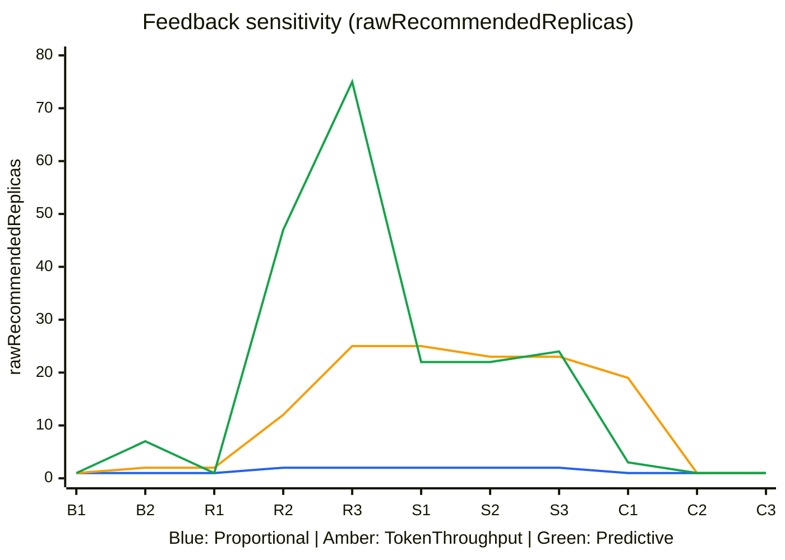
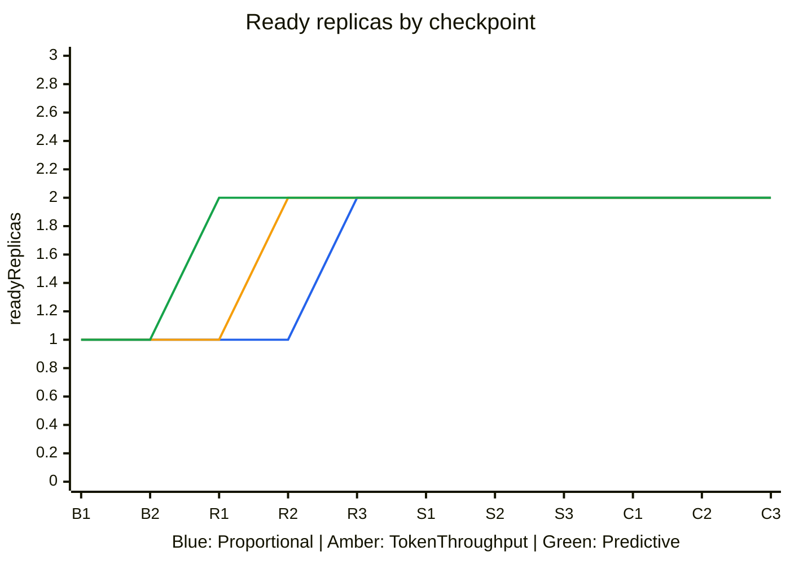
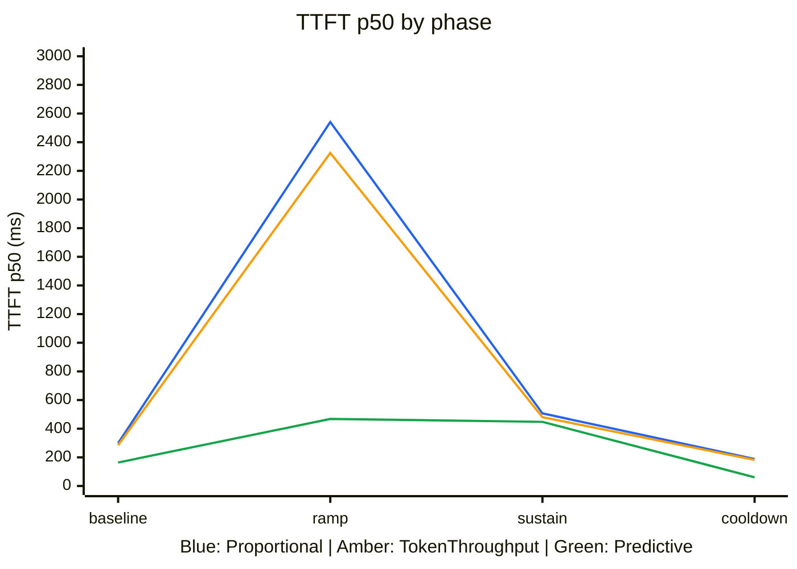
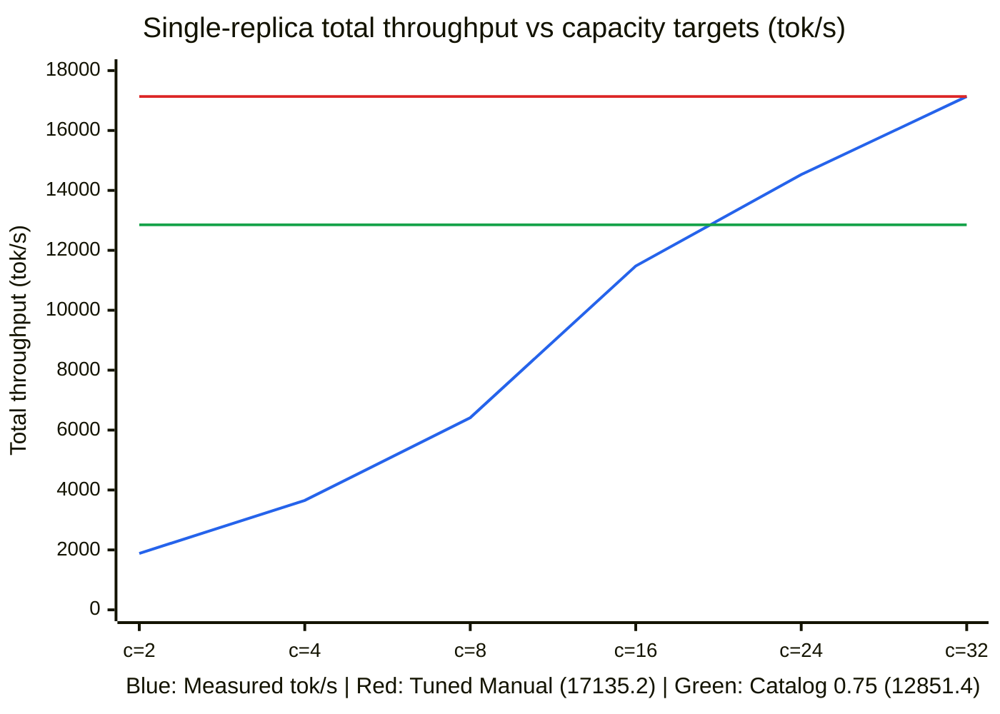
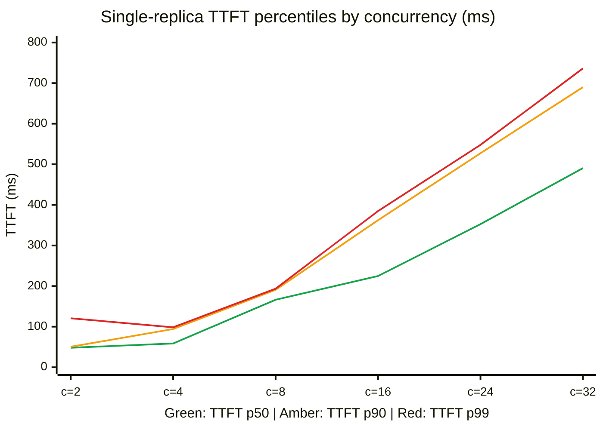
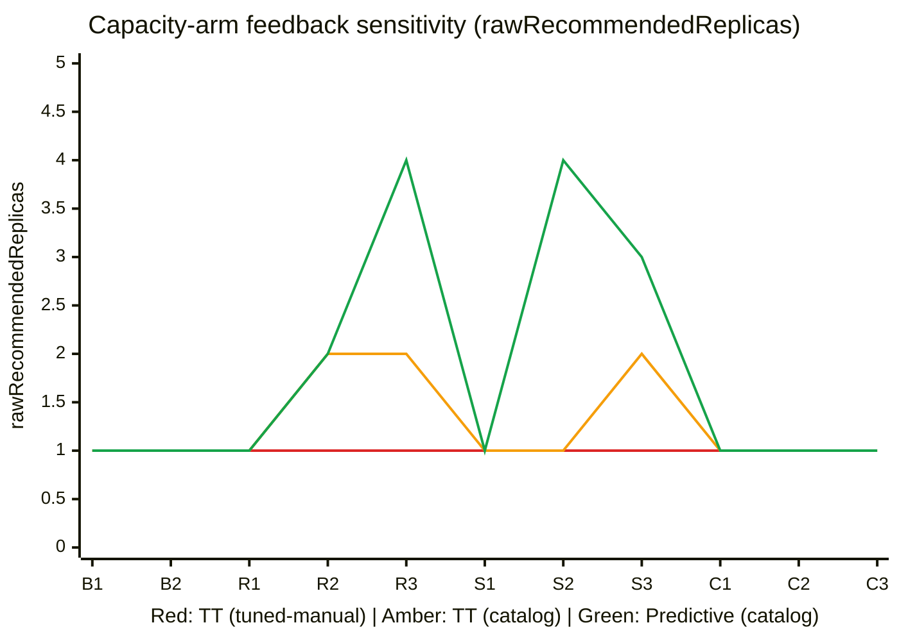
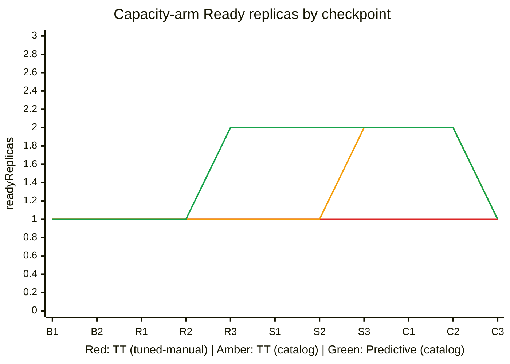
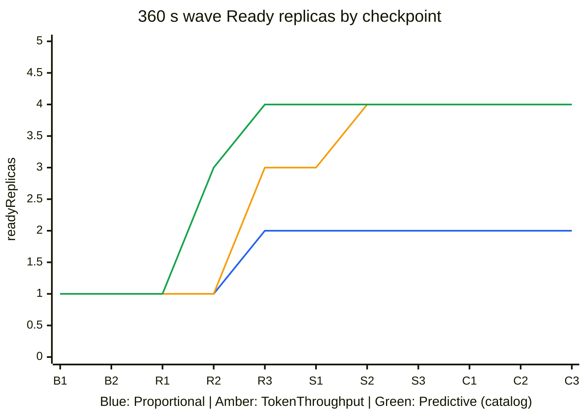
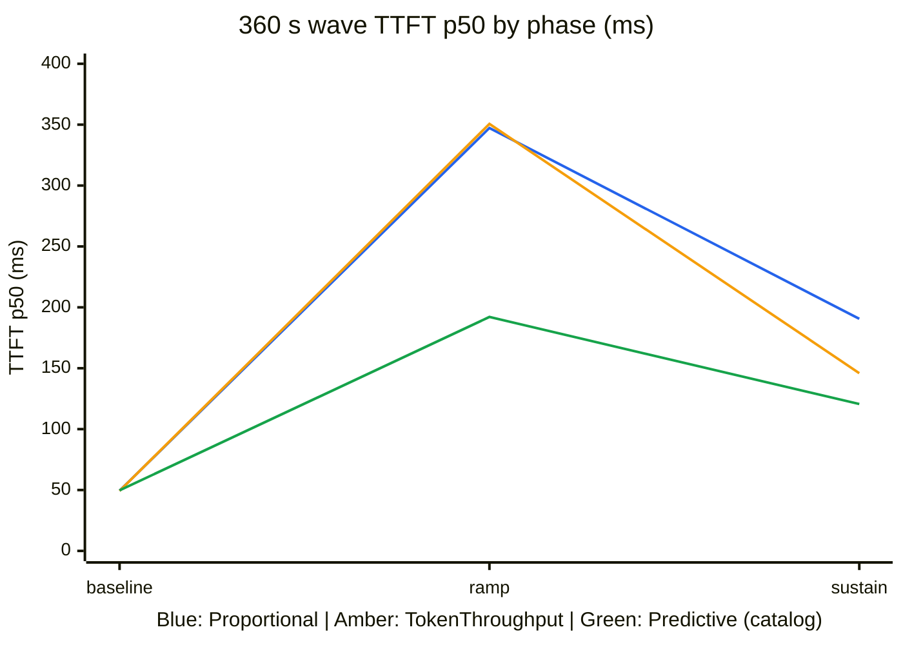

# Model Deployment Scaling Benchmark

Two hardware suites evaluate `ModelDeploymentScaler`. Suite 1 ran five disaggregated configurations
on one node with eight H100 GPUs. Suite 2 evaluated offline capacity priors, three-arm serial
comparisons, algorithm sensitivity, embedded InferenceX priors and multi-node disaggregation on
four nodes with one H200 GPU each.

In these runs, `ModelDeploymentScaler` observed load changes, resolved offline capacity priors and
updated `ModelDeployment` *`replicas`* promptly. Production scale-out times also depend on model
weight loading, engine startup, compute-graph compilation and accelerator queueing, all outside the
scaler's control.

## Contents

- [Summary](#summary)
- [Environment](#environment)
- [Configuration](#configuration)
- [Suite 1: Scaling comparison](#suite-1-scaling-comparison)
- [Suite 2: Capacity priors](#suite-2-capacity-priors)
- [Verification](#verification)
- [Benefits](#benefits)
- [Trade-offs](#trade-offs)
- [Limitations](#limitations)

## Summary

A *prefill/decode (PD)* pair separates prompt processing from token generation.
An *encode/prefill/decode (EPD)* deployment adds a separate image encoder.
Suite 1 compared `Proportional`, `TokenThroughput` and `Predictive` scaling on an eight-H100 node.
Suite 2 evaluated `Server` capacity priors and multi-node *PD*/*EPD* scaling across four H200 nodes.
[Model Deployment Scaling](/gpustack-operator/main/docs/modules/model-deployment/scaling/index.md) defines the algorithms, capacity priors and replica guards.

In Suite 1, four vLLM configurations completed every measured request, while a separate lifecycle
check lost requests during scale-out. In Suite 2, all 18 single-*Server* capacity-comparison rounds,
all three 360-second sensitivity runs, the embedded `openai/gpt-oss-120b` catalog check, and the
vLLM *PD* `Proportional` and *EPD* `Predictive` runs completed with zero failed requests or full
retirement recovery.

## Environment

| Item | Suite 1 (H100 single-node) | Suite 2 (H200 multi-node) |
|---|---|---|
| Cluster | Kubernetes v1.35.7; one CPU node and one GPU node | Kubernetes v1.35.7; one CPU node (`4` vCPU, `16` GB) and four GPU nodes |
| Hardware | 8 × NVIDIA H100 80 GB SXM GPUs; 128 vCPUs, 1600 GB RAM | 4 × NVIDIA H200 140 GB SXM GPUs (`1` GPU, `16` vCPUs, `200` GB RAM per node) |
| Text models | `Qwen/Qwen3-8B` (`b968826d9c46dd6066d109eabc6255188de91218`) | `Qwen/Qwen3-8B` (`bf16`) and `openai/gpt-oss-120b` (`fp4`, `d782fd43...`) |
| Multimodal model | `Qwen/Qwen2.5-VL-7B-Instruct` (`cc594898...`) | `Qwen/Qwen3-VL-8B-Instruct` (`0c351dd0...`) |
| Model delivery | Prefetched node cache, mounted at `/models` | Prefetched node cache, mounted at `/models` |
| vLLM image | `gpustack/runner:cuda13.0-vllm0.30.0` | `gpustack/runner:cuda13.0-vllm0.30.0` |
| SGLang image | `gpustack/runner:cuda12.9-sglang0.5.18` | `gpustack/runner:cuda12.9-sglang0.5.18` |
| Router / Service | `llm-d-router` with cluster-internal `Service` endpoints | Target-owned `Service` for `Server`; `llm-d-router` / `sglang-router` for *PD*/*EPD* |
| Load driver | In-cluster `default/bench-driver`; `case129-probe` for lifecycle | In-cluster `default/bench-driver` on the dedicated CPU node |
| GPU allocation | `bench-gpu` `InstanceType`; 1 GPU per replica, *TP* = 1 | `gpustack--nvidia-h200-linux-amd64`; 1 GPU per replica, *TP* = 1 |

Requests went directly from the driver to the Router's cluster-internal endpoint.
No `kubectl port-forward` carried inference traffic. vLLM roles set
`VLLM_HTTP_TIMEOUT_KEEP_ALIVE=3600`; the separate lifecycle check still observed scale-out failures.

## Configuration

Each role started with one replica and had bounds of one to two.
The scaler used `Active` mode and a 10 s sampling interval.

| Configuration | Model | Algorithm | Capacity settings |
|---|---|---|---|
| `vllm-pd-proportional` | Qwen3-8B | `Proportional` | `RunningRequests`, target `3` per role, tolerance `0.1` |
| `vllm-pd-token-throughput` | Qwen3-8B | `TokenThroughput` | *Prefill* `1200` tok/s; *decode* `300` tok/s per replica |
| `vllm-pd-predictive` | Qwen3-8B | `Predictive` | Same fallback targets; forecast capacity `2000` tok/s per role |
| `sglang-pd-token-throughput` | Qwen3-8B | `TokenThroughput` | *Prefill* `1200` tok/s; *decode* `300` tok/s per replica |
| `vllm-epd-predictive` | Qwen2.5-VL-7B-Instruct | `Predictive` | Same fallback and forecast capacities; *encode* coupled to *prefill* |

Both predictive configurations used a 30 s horizon, two minimum observations, *`qLevel: "0.5"`*
and *`qTrend: "0.3"`*. Token-based configurations retained the default 180 s stable and 60 s panic
windows, panic threshold `2`, and latency targets of 500 ms and 50 ms.

Each configuration preferred a *prefill*/*decode* ratio of `1`.
The *EPD* configuration also preferred an *encode*/*prefill* ratio of `1`.
Only *`target`* was set, so these were preferences rather than fixed ratio bands.
The observed *EPD* maxima were one *encode*, two *prefill* and two *decode* replicas.

The `vllm-pd-proportional` scaler took this form.

```yaml
apiVersion: worker.gpustack.ai/v1
kind: ModelDeploymentScaler
metadata:
  name: autoscale-vllm-pd
spec:
  targetRef:
    name: autoscaling-vllm-pd
  mode: Active  # commits the recommendation to the target
  sampling:
    intervalSeconds: 10  # sampling cadence
  roles:
    - name: prefill
      minReplicas: 1
      maxReplicas: 2
    - name: decode
      minReplicas: 1
      maxReplicas: 2
  ratios:
    - numeratorRole: prefill
      denominatorRole: decode
      target: "1"  # preferred ratio, not a fixed band
  algorithm:
    type: Proportional
    proportional:
      metric: RunningRequests  # requests per ready replica
      tolerance: "0.1"  # deadband around the target
      roleTargets:
        - name: prefill
          target: "3"  # requests per ready replica
        - name: decode
          target: "3"  # requests per ready replica
    # The token throughput configurations replaced the proportional block.
    # type: TokenThroughput
    # tokenThroughput:
    #   prefillTargetTokensPerSecond: "1200"
    #   decodeTargetTokensPerSecond: "300"
    # The predictive configurations kept those token targets and added a forecast.
    # type: Predictive
    # predictive:
    #   tokenThroughput:
    #     prefillTargetTokensPerSecond: "1200"
    #     decodeTargetTokensPerSecond: "300"
    #   horizonSeconds: 30
    #   minPoints: 2
    #   qLevel: "0.5"
    #   qTrend: "0.3"
    #   prefillTokenCapacityPerReplica: "2000"
    #   decodeTokenCapacityPerReplica: "2000"
```

The target `ModelDeployment` manifest is in
[Scaling Walkthrough](/gpustack-operator/main/docs/walkthroughs/model-deployment/scaling/index.md#step-1-prepare-the-target).

### Parallel schedule

The two waves shared an eight-GPU ceiling. Allocations describe maximum capacity reserved for each
concurrent sequence; they do not assert that eight GPUs served throughout every phase.

| Wave | First sequence | Second sequence | GPU ceiling |
|---|---|---|---|
| 1 | vLLM *PD*: `Proportional`, reset, then `Predictive`; up to 4 GPUs | SGLang *PD*: `TokenThroughput`, release, then a separate vLLM *PD* `TokenThroughput` deployment; up to 4 GPUs | 4 + 4 = 8 |
| 2 | vLLM *EPD* `Predictive`; up to 6 GPUs | Single-role live lifecycle check; up to 2 GPUs | 6 + 2 = 8 |

The admission check ran once before Wave 1. It created its own targets and did not overlap either wave.
Between configurations that shared a deployment, the runner deleted the scaler, waited for binding
release, then restored one replica per role.

### Workload

Text configurations used a continuous streaming client with a target input of 1024 tokens and
up to 256 output tokens. Phase durations are requested load durations; recorded wall time includes
completion of outstanding requests.

| Phase | Duration (s) | Concurrency | Multimodal requests |
|---|---:|---:|---:|
| Baseline | 45 | 2 | 9 |
| Ramp | 75 | 24 | 180 |
| Sustain | 75 | 24 | 180 |
| Cooldown | 90 | 2 | 18 |

The multimodal client used those fixed request counts, a 560-pixel generated image,
*`shared_image: false`*, a target text length of 1024 tokens and up to 256 output tokens.
Its phases were request-count bounded, so their wall times differ from the text load durations.

*Time to first token (TTFT)* measures delay before the first streamed token.
*Inter-token latency (ITL)* measures gaps between streamed tokens.
Latency percentiles use successful requests and the client's percentile calculation.
Output throughput divides successful output tokens by the phase's recorded wall time.
Failed requests remain in the request and error columns.

## Suite 1: Scaling comparison

The charts trace algorithm feedback sensitivity (`rawRecommendedReplicas`), Ready serving replicas
(`readyReplicas`) across phase checkpoints (`B1–B2` baseline, `R1–R3` ramp, `S1–S3` sustain,
`C1–C3` cooldown) and resulting *TTFT* p50 for **blue** (`vllm-pd-proportional`), **amber**
(`vllm-pd-token-throughput`) and **green** (`vllm-pd-predictive`).







Both `ramp` and `sustain` run at concurrency 24. Because manual token targets sat below baseline
traffic, `vllm-pd-token-throughput` (`raw = 2`) and `vllm-pd-predictive` (`raw = 7`) requested scale-out
at `B2`, so `vllm-pd-predictive` entered `ramp` (`R1`) with two Ready replicas and held *TTFT* p50
below 470 ms while `vllm-pd-proportional` waited until `R2` (`2540.853` ms in `ramp`, `506.734` ms in `sustain`).

### vLLM proportional PD

Configuration: `vllm-pd-proportional`.

| Phase | Requests | Errors | *TTFT* p50 (ms) | *TTFT* p99 (ms) | *ITL* p50 (ms) | *ITL* p99 (ms) | Output (tok/s) |
|---|---:|---:|---:|---:|---:|---:|---:|
| baseline | 46 | 0 | 298.564 | 408.832 | 6.412 | 11.227 | 258.325 |
| ramp | 346 | 0 | 2540.853 | 5648.778 | 9.662 | 18.393 | 1117.481 |
| sustain | 615 | 0 | 506.734 | 2704.049 | 9.525 | 17.441 | 2044.782 |
| cooldown | 98 | 0 | 188.231 | 396.106 | 6.445 | 10.531 | 274.402 |

### vLLM token throughput PD

Configuration: `vllm-pd-token-throughput`.

| Phase | Requests | Errors | *TTFT* p50 (ms) | *TTFT* p99 (ms) | *ITL* p50 (ms) | *ITL* p99 (ms) | Output (tok/s) |
|---|---:|---:|---:|---:|---:|---:|---:|
| baseline | 46 | 0 | 284.481 | 389.265 | 6.527 | 10.844 | 256.117 |
| ramp | 378 | 0 | 2325.222 | 5384.105 | 9.683 | 17.682 | 1230.879 |
| sustain | 617 | 0 | 480.418 | 4020.449 | 9.463 | 16.921 | 2054.687 |
| cooldown | 98 | 0 | 182.044 | 403.547 | 6.446 | 10.502 | 276.51 |

### vLLM predictive PD

Configuration: `vllm-pd-predictive`.

| Phase | Requests | Errors | *TTFT* p50 (ms) | *TTFT* p99 (ms) | *ITL* p50 (ms) | *ITL* p99 (ms) | Output (tok/s) |
|---|---:|---:|---:|---:|---:|---:|---:|
| baseline | 51 | 0 | 164.044 | 303.918 | 6.364 | 10.52 | 282.371 |
| ramp | 635 | 0 | 467.906 | 2099.983 | 9.333 | 16.619 | 2109.251 |
| sustain | 641 | 0 | 447.864 | 2909.804 | 9.316 | 16.683 | 2128.27 |
| cooldown | 103 | 0 | 60.883 | 364.602 | 6.356 | 10.485 | 288.484 |

### SGLang token throughput PD

Configuration: `sglang-pd-token-throughput`.

| Phase | Requests | Errors | *TTFT* p50 (ms) | *TTFT* p99 (ms) | *ITL* p50 (ms) | *ITL* p99 (ms) | Output (tok/s) |
|---|---:|---:|---:|---:|---:|---:|---:|
| baseline | 50 | 0 | 165.869 | 338.252 | 6.513 | 25.694 | 273.838 |
| ramp | 738 | 3 | 254.654 | 12393.727 | 7.15 | 28.832 | 2215.393 |
| sustain | 2899 | 2534 | 803.553 | 3629.195 | 6.969 | 27.752 | 1174.755 |
| cooldown | 1921 | 1884 | 189.41 | 256.882 | 6.426 | 25.2 | 105.225 |

### vLLM predictive EPD

Configuration: `vllm-epd-predictive`.

| Phase | Requests | Errors | *TTFT* p50 (ms) | *TTFT* p99 (ms) | *ITL* p50 (ms) | *ITL* p99 (ms) | Output (tok/s) |
|---|---:|---:|---:|---:|---:|---:|---:|
| baseline | 9 | 0 | 277.229 | 2025.801 | 6.051 | 10.031 | 201.984 |
| ramp | 180 | 0 | 1437.248 | 4623.104 | 9.457 | 18.319 | 1407.333 |
| sustain | 180 | 0 | 479.805 | 2502.224 | 7.527 | 16.049 | 1951.521 |
| cooldown | 18 | 0 | 208.498 | 266.302 | 5.968 | 10.166 | 266.625 |

The SGLang failure signature was `Failed to get kvcache from prefill instance, it might be dead`.
Its error-heavy phases do not establish healthy serving capacity. The recorded investigation
associated the failures with the documented [TCP port exhaustion](/gpustack-operator/main/docs/modules/model-deployment/engine-versions/index.md#limitations)
limitation. The [TIME-WAIT reuse setting](/gpustack-operator/main/docs/reference/settings/index.md#sglang-time-wait-reuse) needs
kubelet configuration before use; a successful rerun with that setting was not captured.

## Suite 2: Capacity priors

Suite 2 ran across four single-GPU H200 nodes and a dedicated CPU load-driver node. It evaluated
offline capacity priors on unrouted single-`Pod` `Server` deployments before re-running the
five disaggregated *PD* and *EPD* configurations across multiple nodes.

### Single-replica sweep

One `Qwen/Qwen3-8B` (`bf16`, `vllm`, `gpusPerReplica: 1`, `tensorParallel: 1`) `Server` replica
served six 60-second concurrency levels (`1024` input and `256` output tokens, zero failed
requests) to construct the offline `ConfigMap` catalog profile:

| Concurrency | Requests | Total (`tok/s`) | Output (`tok/s`) | *TTFT* p50 / p90 / p99 (ms) | *ITL* p50 / p90 / p99 (ms) | `tok/s/user` |
|---:|---:|---:|---:|---|---|---:|
| 2 | 88 | 1882.56 | 370.234 | 48.084 / 50.489 / 120.712 | 5.217 / 5.341 / 5.623 | 185.228 |
| 4 | 172 | 3653.261 | 718.409 | 58.658 / 94.228 / 98.486 | 5.291 / 5.421 / 5.768 | 179.723 |
| 8 | 296 | 6414.232 | 1261.357 | 166.364 / 190.725 / 193.563 | 5.658 / 5.796 / 6.398 | 157.755 |
| 16 | 544 | 11477.608 | 2257.225 | 224.723 / 362.343 / 384.708 | 5.774 / 5.944 / 6.838 | 141.231 |
| 24 | 672 | 14527.811 | 2857.152 | 352.587 / 527.173 / 547.8 | 6.346 / 6.556 / 9.713 | 119.205 |
| 32 | 800 | 17135.159 | 3369.918 | 490.591 / 689.956 / 736.115 | 6.576 / 6.824 / 20.012 | 105.395 |





Under the P95 targets of *`ttftTargetMilliseconds: "2000"`* and *`itlTargetMilliseconds: "33"`*,
every measured point passed (`ExplicitSaturation`). `Catalog.Resolve` selected `17135.159`
tokens/s at concurrency `32` (**red**) as the seed capacity and applied *`headroom: "0.75"`*
to derive `12851.37` tokens/s (**green**), which crosses the measured throughput curve (**blue**)
between `c = 16` (`11477.608` tok/s) and `c = 24` (`14527.811` tok/s).

### Capacity-arm rounds

Eighteen serial rounds (`3` alternating repeats per arm for `TokenThroughput` and `3` for
`Predictive`) compared `frozen-manual` (`20000` tok/s), `tuned-manual` (`17135.159` tok/s) and
`catalog` (`12851.37` effective tok/s from the sweep `ConfigMap`) across `baseline` (`30` s,
`c = 2`), `ramp` (`45` s, `c = 24`), `sustain` (`45` s, `c = 24`) and `cooldown` (`30` s, `c = 0`):

| Algorithm | Arm | Valid repeats | Ready replica-s (median / min–max) | Peak Ready | Ramp *TTFT* p50 / p99 (ms) | Sustain *TTFT* p50 / p99 (ms) | Sustain *ITL* p50 / p99 (ms) |
|---|---|---:|---|---:|---|---|---|
| `TokenThroughput` | `frozen-manual` | 3 / 3 | 237.239 (232.445–309.809) | 1 | 350.355 / 551.351 | 319.235 / 529.512 | 6.349 / 9.931 |
| `TokenThroughput` | `tuned-manual` | 3 / 3 | 237.094 (234.374–304.551) | 1 | 348.907 / 548.91 | 321.352 / 517.771 | 6.345 / 9.776 |
| `TokenThroughput` | `catalog` | 3 / 3 | 317.04 (289.786–331.45) | 2 | 350.432 / 553.104 | 343.842 / 522.326 | 6.346 / 9.365 |
| `Predictive` | `frozen-manual` | 3 / 3 | 393.755 (366.408–396.625) | 2 | 336.061 / 549.38 | 194.733 / 315.066 | 5.797 / 7.679 |
| `Predictive` | `tuned-manual` | 3 / 3 | 392.089 (370.123–392.919) | 2 | 350.769 / 564.252 | 206.453 / 370.607 | 5.744 / 8.301 |
| `Predictive` | `catalog` | 3 / 3 | 423.031 (392.662–679.002) | 2 | 349.685 / 554.122 | 189.511 / 364.141 | 5.741 / 9.839 |





The three lines in both checkpoint charts plot **red** (`TokenThroughput` `tuned-manual`),
**amber** (`TokenThroughput` `catalog`) and **green** (`Predictive` `catalog`).
All 18 rounds completed with zero failed requests, verified UID-preconditioned cleanup and full
return to the one-replica baseline.

Under `TokenThroughput`, both unmargined manual arms stayed at one replica (`raw = 1` throughout)
because single-replica throughput at concurrency 24 (`~14.5k` tok/s) sat below the `17135.159`
tok/s saturation seed.

The `TokenThroughput` `catalog` arm (`0.75` headroom) grew to two replicas (`raw = 2` at `R2`) in
all three repeats, but vLLM startup and CUDA graph compilation took ~76 s (`99.6–105.6` s from ramp
start), so the second replica became Ready at `S3` near the end of the 45 s `sustain` window and
produced no `sustain` *TTFT* reduction (`343.842` ms vs `321.352` ms).

Under `Predictive`, the 300 s Kalman linear-trend forecast scaled all three arms early (`15.1–21.9`
s from ramp start; Ready at `R3`, `81.9–94.6` s), cutting `sustain` median *TTFT* p50 to `189.511`
ms (`catalog`), `194.733` ms (`frozen-manual`) and `206.453` ms (`tuned-manual`).

### Algorithm sensitivity

A longer 360-second wave (`baseline` 60 s at `c = 2`, `ramp` 90 s at `c = 24`, `sustain` 90 s at
`c = 24`, `cooldown` 120 s at `c = 0`, `maxReplicas: 4`) compared `Proportional` (`RunningRequests`
target `8`), `TokenThroughput` (`14000` tok/s) and catalog-backed `Predictive` (`12851.37`
effective tok/s) against the [Scaling Simulation](/gpustack-operator/main/docs/modules/model-deployment/scaling-simulation/index.md) metrics (*TTFT* <= `2000` ms, *ITL* <= `33` ms):

| Algorithm | Phase | Requests | Failed | True SLO | Goodput (`req/s`) | *TTFT* p50 / p90 / p99 (ms) | *ITL* p50 / p90 / p99 (ms) | Output (`tok/s`) |
|---|---|---:|---:|---:|---:|---|---|---:|
| `Proportional` | `baseline` | 88 | 0 | 1.0 | 1.447 | 49.439 / 50.846 / 75.688 | 5.217 / 5.346 / 5.61 | 370.386 |
| `Proportional` | `ramp` | 1008 | 0 | 1.0 | 11.045 | 347.282 / 527.093 / 545.355 | 6.349 / 6.681 / 11.18 | 2827.554 |
| `Proportional` | `sustain` | 1244 | 0 | 1.0 | 13.618 | 190.555 / 325.042 / 338.779 | 5.75 / 6.008 / 7.864 | 3486.167 |
| `TokenThroughput` | `baseline` | 88 | 0 | 1.0 | 1.448 | 49.263 / 51.251 / 76.935 | 5.213 / 5.339 / 5.606 | 370.565 |
| `TokenThroughput` | `ramp` | 1008 | 0 | 1.0 | 11.041 | 350.591 / 527.408 / 551.491 | 6.345 / 6.693 / 10.942 | 2826.369 |
| `TokenThroughput` | `sustain` | 1272 | 11 | 0.9914 | 13.807 | 145.939 / 171.786 / 262.921 | 5.795 / 6.025 / 12.969 | 3534.61 |
| `Predictive` | `baseline` | 88 | 0 | 1.0 | 1.447 | 49.742 / 51.305 / 76.375 | 5.214 / 5.344 / 5.598 | 370.495 |
| `Predictive` | `ramp` | 1244 | 0 | 1.0 | 13.625 | 192.093 / 325.727 / 340.679 | 5.746 / 6.004 / 7.8 | 3487.99 |
| `Predictive` | `sustain` | 1383 | 0 | 1.0 | 15.18 | 120.59 / 187.599 / 195.3 | 5.596 / 5.847 / 7.21 | 3886.136 |





In the 360-second wave (**blue** `Proportional`, **amber** `TokenThroughput`, **green**
`Predictive`), catalog-backed `Predictive` brought three replicas Ready by `R2`
and all four Ready by `R3`, lowering `ramp` *TTFT* p50 from `347.282–350.591` ms to `192.093` ms
and `sustain` *TTFT* p50 to `120.59` ms (`3886.136` output tok/s, zero failed requests).

### Embedded catalog

To verify zero-configuration resolution against the embedded `pkg/worker/scaling/priors/priors.yaml`
catalog, an `openai/gpt-oss-120b` (`fp4`, `vllm`, `1 × H200`) `Server` deployment ran with
*`capacityPrior: {}`* and no `catalogRef` or identity annotations.

The controller inferred `Server/openai/gpt-oss-120b/fp4/vllm/nvidia-h200/gpus=1,tp=1,ep=1,pp=1,dp=1,ldp=1,cp=1`
(`profileDigest: sha256:47d96f0e...`), selected `seedTokensPerSecond: "6405.44"` (`ExplicitSaturation`
under P95 *TTFT* `2000` ms and *ITL* `33` ms) and set `effectiveTokensPerSecond: "4804.08"`.

A 60-second sustain check at concurrency 8 completed `176` requests with zero errors at `4862.388`
total tokens/s (`915.002` output tokens/s, *TTFT* p50 / p90 / p95 `96.185 / 225.437 / 238.947` ms,
*ITL* p50 / p90 / p95 `10.958 / 11.713 / 12.014` ms) — within 1.2% of the embedded effective prior.

### Disaggregated H200 rerun

Re-running the five disaggregated configurations across the four single-GPU H200 nodes (`Qwen3-8B`
for *PD* and `Qwen3-VL-8B-Instruct` in `1R1E2P1D` for *EPD*) produced these phase summaries:

| Configuration | Phase | Requests | Errors | *TTFT* p50 / p99 (ms) | *ITL* p50 / p99 (ms) | Output (`tok/s`) |
|---|---|---:|---:|---|---|---:|
| `vllm-pd-proportional` | `ramp` / `sustain` | 405 / 396 | 0 / 0 | 2302.954 / 3049.929 (p99: 4451.863 / 3960.101) | 8.443 / 8.305 (p99: 17.251 / 16.239) | 1317.793 / 1277.5 |
| `vllm-pd-token-throughput` | `ramp` / `sustain` | 106047 / 379 | 105965 / 0 | 2893.8 / 3009.197 (p99: 5559.696 / 4658.621) | 8.073 / 8.122 (p99: 15.248 / 15.483) | 279.875 / 1227.049 |
| `vllm-pd-predictive` | `ramp` / `sustain` | 107447 / 364 | 107367 / 0 | 2719.156 / 3146.237 (p99: 30051.934 / 6013.353) | 8.282 / 8.309 (p99: 16.401 / 16.66) | 273.052 / 1177.547 |
| `sglang-pd-token-throughput` | `ramp` / `sustain` | 1245 / 2904 | 906 / 2904 | 2203.669 / - (p99: 3620.957 / -) | 5.723 / - (p99: 22.806 / -) | 1151.088 / 0 |
| `vllm-epd-predictive` | `ramp` / `sustain` | 180 / 180 | 0 / 0 | 943.066 / 1044.397 (p99: 3678.427 / 3493.704) | 8.285 / 8.215 (p99: 15.968 / 16.934) | 1617.037 / 1475.286 |

On four 1-GPU nodes, `vllm-pd-proportional` scaled *decode* (`1 -> 2`, lead `24` s) and
`vllm-epd-predictive` scaled *prefill* (`1 -> 2`) with zero errors across all four phases.
When `vllm-pd-token-throughput` and `vllm-pd-predictive` added a second *prefill* replica during
high-rate text `ramp`, the Router returned fast HTTP 503s until the new prefill worker finished
registration, then served `sustain` and `cooldown` with zero errors.

## Verification

### Scale-out timing

Scale-out lead measures the interval from ramp start to the first sampled desired count above one.
It uses deployment status, so it does not measure when a newly added replica first became Ready
or served a request. A count already above one at ramp start is reported as zero with an explicit flag.

| Configuration | Lead (s) | Above one before ramp | Maximum desired counts | Maximum Ready counts |
|---|---:|---|---|---|
| `vllm-pd-proportional` (H100) | 30 | No | *Prefill* 2, *decode* 2 | *Prefill* 2, *decode* 2 |
| `vllm-pd-token-throughput` (H100) | 0 | Yes | *Prefill* 2, *decode* 2 | *Prefill* 2, *decode* 2 |
| `vllm-pd-predictive` (H100) | 0 | Yes | *Prefill* 2, *decode* 2 | *Prefill* 2, *decode* 2 |
| `sglang-pd-token-throughput` (H100) | 0 | Yes | *Prefill* 2, *decode* 2 | *Prefill* 2, *decode* 2 |
| `vllm-epd-predictive` (H100) | 0 | Yes | *Encode* 1, *prefill* 2, *decode* 2 | *Encode* 1, *prefill* 2, *decode* 2 |
| `Server` `TokenThroughput` `catalog` (H200) | 22–28 | No | *Server* 2 | *Server* 2 |
| `Server` `Predictive` `catalog` (H200) | 15–22 | No | *Server* 2 | *Server* 2 |

In Suite 1, both token throughput and predictive configurations scaled during baseline, so the zero
lead does not isolate a forecasting benefit. In Suite 2, all single-`Server` configurations started
`ramp` at one Ready replica; `Predictive` committed growth at `15.1–21.9` s into `ramp` against
`22.2–28.2` s for `TokenThroughput` `catalog`.

### Retirement

The separate single-role lifecycle check confirmed a new Ready replica served requests, then reduced
the desired count from two to one. It observed `Disqualified` and `Draining`, followed by one Ready survivor.
Its scale-down and post-retirement phases completed with zero failed requests.

| Lifecycle phase | Requests | Errors | Observation |
|---|---:|---:|---|
| Scale-out (`up`) | 13073 | 7 | Router returned HTTP 503 with `connection termination` |
| Two replicas (`two`) | 14810 | 0 | Expanded deployment served requests |
| Scale-down (`down`) | 1880 | 0 | Retirement observed while traffic continued |
| One replica (`one`) | 942 | 0 | One Ready survivor served requests |

These values come from the standalone lifecycle rerun. The earlier check embedded in Wave 2 also
failed during scale-out, with 3 failures among 10579 requests. Admission passed all 45 checks;
the standalone lifecycle check passed 10 checks and failed its all-phases completion check.

The benchmark configuration timelines sampled `Disqualified` for the proportional and token-based
*PD* configurations. Predictive *PD* also sampled `Admitted` and `Aborted`.
The *EPD* timeline captured no retirement state. These sets do not establish complete retirement sequences.

The [retirement protocol](/gpustack-operator/main/docs/modules/model-deployment/shutdown/index.md#retirement-protocol) uses `Draining` followed by `Deleting`
before release completes. Kubernetes can display a deleting `Pod` as `Terminating`.
`Terminating` is not a retirement state. The captures do not include every transition, and zero client
errors in the two scale-down phases do not prove every in-flight request survives every retirement.

A later runtime-acceptance run scaled a *vLLM* multi-Server deployment by hand through one to two
to one replicas. The Router's worker set followed every edit, the pinned `round_robin` policy
split sixteen requests eight and eight across the two workers at two replicas, both workers
stayed healthy, and the deployment still served after the scale-back. The run completed 21
checks with zero failures.

A second run retired one of two replica groups of a *vLLM* [External DP](/gpustack-operator/main/docs/modules/model-deployment/external-dp/index.md) deployment
at data parallelism 2. The Router's worker set held every member throughout — two workers for one
group of two, four for two groups of two, and two again after the scale-down.

The endpoint withdrawal reached the Router in 21 seconds, and the retired members were deleted 70
seconds after the patch, past the 60-second disaggregated handoff grace window, which the
retirement honored. Eight checks passed; the one failing row had timed the endpoint withdrawal
against that window, a measurement defect in the case rather than a product finding.

A third run drove a *SGLang* *PD* deployment of one *prefill* and one *decode* replica with the
scaler active: 29 checks passed with zero failures, warnings or blocked rows. The deployment
published each role's group independently, the four content classes served through the
`sglang-gateway`, the thinking switch held on the arithmetic, Chinese and JSON requests, and the
Mooncake transfer over the direct leg moved 54 MB across six transfers with zero failures.

The scaler read the engine's waiting-request counter during a transfer and recorded 24 waiting
requests on the *decode* role; under load the *decode* role grew to two replicas, and both roles
returned to their floor of one with no retirement outstanding.

In Suite 2, all 12 single-`Server` rounds that scaled to two replicas (`3` `TokenThroughput`
`catalog` rounds and all `9` `Predictive` rounds) completed retirement and returned to one Ready
replica with zero failed requests before cleanup.

## Benefits

In Suite 1, predictive *PD* had lower ramp median *TTFT* than proportional *PD* (`467.906` vs
`2540.853` ms) and higher ramp throughput (`2109.251` vs `1117.481` tok/s), though low manual
targets caused it to enter `ramp` already scaled.

In Suite 2, starting from an equal one-replica baseline on H200, applying the `0.75` catalog
headroom resolved both manual-threshold failure modes: `TokenThroughput` scaled `1 -> 2` at `c = 24`
where unmargined saturation capacities (`17135.159` tok/s) stayed at one replica, and the embedded
`openai/gpt-oss-120b` (`fp4`) prior matched measured sustain throughput within 1.2% (`4862.388` vs
`4804.08` tok/s).

When paired with `Predictive`, the 300 s Kalman forecast offset the ~76 s vLLM startup to cut
45-second `sustain` *TTFT* p50 from `343.842` ms to `189.511` ms (`maxReplicas: 2`) and 90-second
`sustain` *TTFT* p50 from `145.939–190.555` ms to `120.59` ms (`maxReplicas: 4`, `3886.136` output
tok/s, zero failed requests).

## Trade-offs

In Suite 1, cooldown lasted 90 s while downward stabilization was 300 s, so several final snapshots
still requested two replicas. In Suite 2's 45-second `sustain` rounds, `TokenThroughput` `catalog`
expended `317.04` median `readyReplicaSeconds` (`+33.7%` over manual's `237.094` s) without
lowering `sustain` *TTFT* p50 because vLLM startup (~76 s) consumed most of the short load window.

Because `Predictive` amplifies initial ramp slopes (`rawRecommendedReplicas` reaching `4–75` during
`ramp`), production configurations pair *`horizonSeconds`* (`180–300` s) with
*`behavior.scaleUp.maxStepReplicas`* to bound single-pass growth; see
[Step 3: Choose an algorithm](/gpustack-operator/main/docs/walkthroughs/model-deployment/scaling/index.md#step-3-choose-an-algorithm).

## Limitations

Suite 1 covers one eight-H100 node and one recorded comparison per configuration. Suite 2 covers
four single-H200 nodes (`Qwen3-8B`, `gpt-oss-120b`, `Qwen3-VL-8B-Instruct`). Neither suite
establishes a universal algorithm ranking or an optimal headroom margin across workloads.

The text and multimodal clients perform different work and use different phase stopping rules.
Their throughput values cannot establish a serving-mode speedup. Image tags identify the configured
builds; the capture does not establish identical installed engine package versions across configurations.

Zero errors in the single-`Server` rounds and selected *PD*/*EPD* runs describe those measured
requests only. Multi-node *PD* prefill scale-out under high-rate text traffic produced transient
Router HTTP 503s during worker registration, and SGLang *PD* reproduced Mooncake KV transfer errors.
The [Scaling Walkthrough](/gpustack-operator/main/docs/walkthroughs/model-deployment/scaling/index.md) distinguishes configuration
examples from captured lifecycle evidence.

---

**See also** — [Model Deployment Scaling](/gpustack-operator/main/docs/modules/model-deployment/scaling/index.md) (algorithm and guard contracts) ·
[Scaling Walkthrough](/gpustack-operator/main/docs/walkthroughs/model-deployment/scaling/index.md) (configuration and observation) ·
[Model Deployment Shutdown](/gpustack-operator/main/docs/modules/model-deployment/shutdown/index.md) (retirement and drain limits)

**Next** → [Scaling Walkthrough](/gpustack-operator/main/docs/walkthroughs/model-deployment/scaling/index.md)
