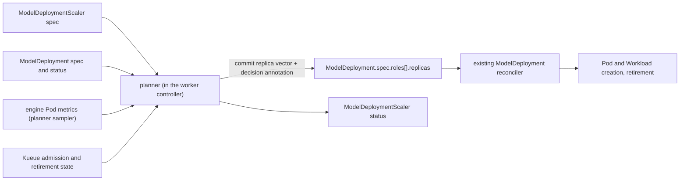

# Spec: ModelDeployment Scaler — Metric-Driven Per-Role Replica Planning

Status: Shipped
Type: Feature

## Summary

A `ModelDeployment` today changes its per-role replica counts only when a person edits
`spec.roles[].replicas`. This spec adds a `ModelDeploymentScaler` resource and a planner inside the
operator. The planner samples each role's engine metrics, runs a user-selected algorithm, applies
per-role bounds, per-role pacing, direction-preserving cross-role ratio projection and a
resource-rebalance stage, and commits the next replica vector to the same `spec.roles[].replicas`
field. The existing reconciler stays the only executor. Three algorithms ship behind one Go
interface: `Proportional` (simple, low cost), `TokenThroughput` (smooth, burst-tolerant) and
`Predictive` (fast, high cost). One binding with a term number gives the planner sole write access
to the replica fields while it is active. The spec also widens retirement adoption so that a
scale-down in progress never blocks the next scale-up, exempts never-scheduled unadmitted increments
from retirement so timed-out scale-ups retract cleanly, and replaces the indefinite disaggregated
retirement hold with a 60-second post-withdrawal grace window followed by two consecutive idle reads
so `Prefill`, `Decode`, and External-DP replicas can scale down behind a Router. Success is a
smooth, rule-following adjustment that is committed and observable; the spec does not promise that
each committed target gets admitted or becomes ready.

## Motivation

### Current state

These facts hold at commit `fe455ea0`. Each one shapes a requirement below.

1. **One executable target exists.** `spec.roles[].replicas` is read by Pod rendering,
   convergence, status `Desired`, the per-role PodGroup count, joint admission and the metrics
   coverage check. The spec hash zeroes it, so a replica change restarts no surviving replica
   ([model_deployment_render.go](../pkg/worker/controllers/worker/model_deployment_render.go),
   [model_deployment.go](../pkg/worker/controllers/worker/model_deployment.go)).
2. **No scaling surface exists.** The CRD declares only the `status` subresource and no `/scale`.
   The role list is a list-map keyed on `name`. `replicas` has `minimum=1`, `maximum=1024`
   ([model_deployment.go API](../api/worker/v1alpha1/model_deployment.go)). A single scalar
   `/scale` cannot carry a vector of role counts, so HPA and KEDA cannot drive it directly.
3. **Scale-up is admitted per replica, with a joint barrier.** Each replica is its own Kueue pod
   group ([Role Replica Admission Unit](2026-09-19-role-replica-admission-unit.md)). In a
   multi-role deployment, replicas added in the same edit wait for each other and hold their
   quota. A set that stays Pending for 30 minutes is parked and needs manual action
   (`_JointAdmissionInfeasibleAfter` in
   [model_deployment_joint_admission.go](../pkg/worker/controllers/worker/model_deployment_joint_admission.go)).
4. **Scale-down runs through the retirement protocol**
   ([model_deployment_retirement.go](../pkg/worker/controllers/worker/model_deployment_retirement.go),
   [shutdown.md](../docs/modules/model-deployment/shutdown.md)):
   - The protocol keeps one reservation per deployment. While a reservation is in flight or
     retained, every other removal is held.
   - Budgets: 30 s withdrawal, 240 s drain, 30 s settle, 300 s overall.
   - Without `spec.router`, an admitted running replica always aborts after the 30 s
     withdrawal budget.
   - `Aborted` retains Pods, Workload and quota. It is terminal until a retry annotation
     (`modeldeployment.gpustack.ai/retirement-retry`) or a scale-up that re-declares the
     ordinal. Only the `Aborted` state can be adopted that way.
   - A scale-up that re-declares an ordinal under a non-aborted reservation creates nothing. The
     reconciler waits until the old Pods are deleted, then creates a new replica. **A scale-down in
     progress therefore blocks a scale-up of the same ordinal for up to 300 s, and then throws away
     a warm replica.**
   - An undeclared ordinal whose Pods are still `Pending` and scheduling-gated is also handed to
     `refuseModelDeploymentRemoval` today. Because an unscheduled Pod has no running container or
     metrics endpoint, the retirement drain holds for 240 s and aborts, retaining the unadmitted Pod
     and its Pending Workload instead of removing them.
5. **The disaggregated gate is keyed on the Pod command, not on the role kind.** The gate holds
   vLLM data-parallel External, Hybrid and MultiPort shapes, and SGLang `--disaggregation-mode`
   members, in both `observeModelDeploymentRetirementDrained` and `modelDeploymentDrainCollector.Drain`,
   and then aborts when the 240 s drain budget ends
   (`modelDeploymentDrainDisaggregated` in
   [model_deployment_drain_collector.go](../pkg/worker/controllers/worker/model_deployment_drain_collector.go)).
   A vLLM Prefill or Decode replica without those DP flags goes straight to the idle-read path.
   In addition, `modelDeploymentRetirementReplicaFacts` uses `modelDeploymentDrainDisaggregated`
   to decide whether every member of a replica answers (`modelDeploymentAnsweringAll`), which
   conflates External-DP membership with cross-role handoff. This spec separates the two and
   replaces the indefinite disaggregated hold with a fixed 60-second post-withdrawal grace window
   followed by two consecutive idle reads (F9).
6. **The metrics subresource is not a planner data source.** It exposes instantaneous gauges
   (`running`, `waiting`, `decode-transfer-waiting`) and latency means between two reads. It keeps
   the previous read in handler memory, per apiserver replica, shared by every caller. Two callers
   therefore cut each other's windows. It reads at most 64 Pods within an 8 s budget. It exposes no
   prompt or generation token counters
   ([model_deployment.metrics.go](../pkg/worker/extensionapis/worker/model_deployment.metrics.go),
   [metrics.md](../docs/modules/model-deployment/metrics.md)). Latency values are means and
   cannot give p95 or p99.
7. **Other limits.** Elastic EP roles require `replicas == 1`
   ([model_deployment_elastic.go](../pkg/worker/webhooks/worker/model_deployment_elastic.go)).
   The MD webhook can refuse a scale-up when a generated Service or member name gets too long
   ([webhook model_deployment.go](../pkg/worker/webhooks/worker/model_deployment.go)). Every
   primary storage kind in `api/worker/v1alpha1` must also expose a public `v1` proxy view in
   `api/worker/v1` and `pkg/worker/extensionapis` (`TestEveryStorageKindHasPublicProxy` in
   [setup_test.go](../pkg/worker/extensionapis/setup_test.go)). Nothing in the repository guards
   who writes `replicas`.

### Prior art

The research below was done on 2026-10-21. The URLs pin the revision that was read.

| Source | Signal | How the P:D split is chosen | What this spec takes |
|---|---|---|---|
| Kubernetes HPA ([doc @1ffcdb2](https://github.com/kubernetes/website/blob/1ffcdb2a3c3a4a3ebfc23473929072262a1bfaea/content/en/docs/concepts/workloads/autoscaling/horizontal-pod-autoscale.md)) | `ceil(current × observed / target)`, tolerance 0.1 | n/a | `Proportional` formula; 300 s scale-down stabilization as a rolling maximum |
| AIBrix APA/KPA ([@52b8834](https://github.com/vllm-project/aibrix/blob/52b8834e6223eac7ca5c050b44486aa29b44a1a6/pkg/controller/podautoscaler/algorithm/kpa.go)) | KPA stable window 180 s, panic window 60 s, panic threshold 2.0; no scale-down in panic | One independent autoscaler per role | Stable/panic windows for `TokenThroughput` |
| Knative KPA ([knative-v1.23.0](https://github.com/knative/serving/blob/knative-v1.23.0/pkg/autoscaler/scaling/autoscaler.go)) | Stable 60 s, panic 10 %, threshold 200 % | n/a | Same panic semantics |
| HeteroScale, ByteDance ([arXiv 2508.19559](https://arxiv.org/abs/2508.19559)) | Decode TPS is the primary production signal. Prefill uses "KV cache missed prefill TPS". Decode GPU utilization is "ineffective". Latency is "cliff-like" and serves only as a negative-feedback guard with tiered fixed steps | Fixed ratio from pressure tests; P and D always scale together; transient imbalance caused TTFT spikes; dynamic ratio is future work | Token-throughput signals; latency as a guard; co-scaling inside a ratio range |
| TokenScale ([arXiv 2512.03416](https://arxiv.org/abs/2512.03416)) | Token arrival rate over profiled per-stage token velocity | Each stage sized from its own token rate | Per-replica token capacity as the capacity input |
| Dynamo Planner ([@4f42be7](https://github.com/ai-dynamo/dynamo/blob/4f42be7bebd96ea0199088840549397809f80a92/docs/fern/pages/developer-guide/knowledge-base/modular-components/planner/planner-design.md)) | Throughput loop every 180 s from a predictor (constant, ARIMA, Kalman, Prophet) sets a floor. Load loop every 5 s moves ±1. Scale-down only if consolidation `N/(N-1)` stays under 0.8 × SLO | Perf model per role | `Predictive` structure; Kalman defaults `q_level=1.0`, `q_trend=0.1`, `r=10`, `min_points=5` |
| Dynamo budget guard ([budget.py @4f42be7](https://github.com/ai-dynamo/dynamo/blob/4f42be7bebd96ea0199088840549397809f80a92/components/src/dynamo/planner/core/budget.py)) | — | At the budget ceiling, growth is admitted only as an atomic opposing rebalance: the donor's own signal must say down. It "refuses to invent a donor". Scale-down patches go before scale-up | Default `Opposing` rebalance |
| Mooncake ([arXiv 2407.00079](https://arxiv.org/abs/2407.00079)) | — | Acting on current decode load caused P/D anti-phase oscillation | Decode scale-down grace after a decode scale-up |
| Arrow ([arXiv 2505.11916](https://arxiv.org/abs/2505.11916)), BlitzScale ([arXiv 2412.17246](https://arxiv.org/abs/2412.17246)) | — | Role flipping and mutation; D→P is the riskier direction because requests hold memory before decode | Role flipping is a Non-Goal; decode donation is opt-in |

### Goals

1. **G1.** A user can attach a `ModelDeploymentScaler` to a `ModelDeployment` in the same
   namespace. The user declares per-role bounds, cross-role ratio bounds, an algorithm and its
   parameters, a step and stabilization behavior, a rebalance policy, a mode (`Shadow` or
   `Active`) and `suspend`.
2. **G2.** In `Active` mode, the planner commits a replica vector to `spec.roles[].replicas` when
   its algorithm and constraint stages produce a vector that differs from the current one. A
   commit does not wait for earlier targets to become ready. The only exceptions are the pending
   scale-up guard and the in-flight retirement guard (F7.4). Execution outcome is reported, not
   required.
3. **G3.** Every committed vector satisfies every per-role bound and every ratio bound. Each
   regular commit respects the step limits, stabilization windows and execution guards by
   projecting ratios inside the per-role paced intervals. Two corrective writes are exempt from
   pacing while still satisfying bounds and ratios: the cohort retraction in F8.1 and the coupled
   abort restore in F8.2.
4. **G4.** While a Scaler is bound in `Active` mode and not suspended, only the planner can change
   the bound replica fields. The API server refuses other writers. Suspend, switching to `Shadow`,
   and delete hand write access back. A decision computed before suspend cannot commit after it.
5. **G5.** A scale-down in progress never delays a scale-up. A scale-up that re-declares a
   retiring ordinal before `Deleting` cancels that retirement and keeps the warm replica.
6. **G6.** When `spec.router` is configured, a `Prefill`, `Decode`, or External-DP replica
   retires after Router withdrawal is confirmed, a fixed 60-second handoff grace window in
   `Draining` elapses, and every answering member passes two consecutive complete idle reads. A
   scale-down that still cannot complete (for example, no Router or busy past the 240 s drain
   budget) does not freeze the deployment: after `Aborted`, the planner restores a ratio-valid
   target vector so the reservation clears, records the outcome, and applies a cooldown before it
   tries again.
7. **G7.** An unadmitted scale-up cohort never reaches the 30-minute park while the controller is
   running. The planner schedules a deadline wakeup, retracts the unadmitted cohort back to the
   last admitted baseline vector, and the executor removes the unscheduled Pending Pods and
   Workloads immediately without entering retirement.
8. **G8.** Under resource exhaustion, the planner can move capacity from one role to another
   that draws from the same quota pool. By default it does this only as an opposing rebalance.
   As an opt-in, it can follow a role priority order. The scale-down commits first.
9. **G9.** Three algorithms ship behind one Go interface: `Proportional`, `TokenThroughput` and
   `Predictive`. A new algorithm needs one interface implementation plus one enum value and its
   parameter block, and no change to the constraint, rebalance or commit stages.
10. **G10.** `Shadow` mode runs the full pipeline and writes recommendations to Scaler status
    only. It never changes `ModelDeployment`.
11. **G11.** Scaler status answers, without other tools: the bound target and term; observation
    freshness, coverage and missing signals; the raw and constrained recommendation with
    reasons; the last commit; and the last scale-down and rebalance outcomes.

### Non-Goals

- An SLO model built on latency percentiles. The current data has only window means.
- A per-request router or engine decoder-side release proof. This spec uses a coarse 60-second
  post-withdrawal grace window plus two consecutive idle reads instead.
- Role flipping (turning a decode instance into a prefill instance in place) and KV migration.
- Scale-to-zero. Per-role bounds keep `minReplicas >= 1`, matching the MD schema.
- Changes to `size`, `instanceType`, `resources` or Elastic EP width.
- HPA, KEDA or a `/scale` subresource on `ModelDeployment`.
- An offline profiling pipeline. `Predictive` takes capacity from the Scaler spec.
- Cross-namespace targets and more than one Scaler per deployment.
- A global budget shared across deployments.

## Proposal

The data flow is one-way and has one writer:



Each planning pass runs these stages in order:

1. **Observe.** Sample the target's engine Pods. Build a per-role observation from the planner's
   own windows, together with current targets, ready and admitted counts (from owned Workloads
   and Pods), and retirement state.
2. **Correct.** Before computing a new step, check whether a pending scale-up cohort has timed
   out (F8.1) or a planner-initiated retirement has reached `Aborted` (F8.2). If so, emit the
   coupled corrective vector first.
3. **Recommend.** The selected algorithm returns an unconstrained per-role vector and a reason
   for each role.
4. **Bound and Pace.** Clamp each role to `[minReplicas, maxReplicas]` and compute each role's
   allowed step interval `[floor_i, ceil_i]` from stabilization windows, step caps, cooldowns,
   and pending/retirement guards.
5. **Project Ratios.** Project the recommendation into every declared ratio range within the
   intersection of `[minReplicas, maxReplicas]` and `[floor_i, ceil_i]`.
6. **Rebalance.** If resource exhaustion is observed on a role, apply the rebalance policy within
   bounds and ratios.
7. **Commit.** In `Active` mode, write the vector if it differs from the current one. In both
   modes, write status.

### User Stories

#### Story 1

As a platform operator running a Prefill/Decode deployment, I want the operator to change the
prefill and decode replica counts as the token load shifts, inside a ratio range I set, so that
the P:D split follows the traffic without manual edits.

#### Story 2

As a platform operator, I want to pick an algorithm that matches the scenario (cheap and simple,
smooth under bursts, or fast and aggressive), so that I can trade resource cost against reaction
speed per deployment.

#### Story 3

As a platform operator on a fixed quota, I want the operator to shrink decode to free capacity
for prefill when prefill cannot be admitted, so that the deployment uses the quota where the load
is.

#### Story 4

As a platform operator, I want a scale-down that is still draining to never hold up the next
scale-up, so that a sudden burst is never stuck behind a retirement.

#### Story 5

As a platform operator, I want to run a Scaler in shadow mode first and read its
recommendations, so that I can check its behavior before I let it write.

#### Story 6

As a platform operator, I want to suspend or delete a Scaler and get manual control back with
the current replica counts, so that I can intervene during an incident.

#### Story 7

As an algorithm developer, I want to add a new algorithm by implementing one Go interface, so
that better algorithms can replace the shipped ones without changes to the safety stages.

### Core Features & Acceptance Criteria

The API shape below is the target contract for `v1alpha1` and its aggregated `v1` proxy view.

```yaml
apiVersion: worker.gpustack.ai/v1alpha1
kind: ModelDeploymentScaler
metadata:
  name: qwen-pd
  namespace: team-a
spec:
  targetRef:
    name: qwen-pd              # immutable; a ModelDeployment in this namespace
  mode: Shadow                 # Shadow | Active; default Shadow
  suspend: false
  intervalSeconds: 15          # minimum 5, maximum 300; default 15
  roles:
    - name: prefill
      minReplicas: 1
      maxReplicas: 8
      tokenCapacityPerReplica: 40000   # cache-missed prompt tokens/s one replica serves
    - name: decode
      minReplicas: 2
      maxReplicas: 16
      tokenCapacityPerReplica: 6000    # generation tokens/s one replica serves
  ratios:
    - numerator: prefill
      denominator: decode
      min: "0.25"
      max: "1"
  algorithm:
    type: TokenThroughput      # Proportional | TokenThroughput | Predictive
    tokenThroughput:
      stableWindowSeconds: 180
      panicWindowSeconds: 60
      panicThreshold: "2.0"
      latencyGuard:
        itlMilliseconds: 50
        ttftMilliseconds: 500
  behavior:
    scaleUp:
      stabilizationWindowSeconds: 0
      maxStepPercent: 100
      maxStepReplicas: 4
    scaleDown:
      stabilizationWindowSeconds: 300
      cooldownAfterAbortSeconds: 300
  rebalance:
    policy: Opposing           # Disabled | Opposing | Priority; default Opposing
    pendingTimeoutSeconds: 300 # minimum 60, maximum 1200; default 300
    priority: [prefill, decode]  # read only by Priority
```

#### F1. Scaler API, public `v1` view, and validation

- The resource is namespaced, stored in `worker.gpustack.ai/v1alpha1` with a `status`
  subresource, and exposed in the `worker.gpustack.ai/v1` aggregated API with `DELETE`, `LIST`,
  `WATCH` and `status` support (`TestEveryStorageKindHasPublicProxy` and
  `TestEveryCRDViewServesDelete`).
- AC1.1: Admission refuses a Scaler if any of these holds:
  - `targetRef` names another namespace (unrepresentable in the type) or is changed on update
    (`targetRef` is immutable).
  - A role name is not in the target (when the target exists at admission time) or has a
    custom `command` take-over (which emits no managed scrape annotations).
  - A role has `elasticEp` set.
  - `minReplicas < 1`, or `maxReplicas > 1024`, or `minReplicas > maxReplicas`.
  - `maxReplicas` would make a generated Service or member name exceed the MD webhook's length
    limit.
  - A ratio names an unknown role, duplicates an existing `(numerator, denominator)` pair, or
    has `min > max`, or a non-positive value.
  - The algorithm parameter block does not match `algorithm.type`.
  - A role lacks a parameter the selected algorithm requires (`target` for `Proportional`;
    `tokenCapacityPerReplica` for `TokenThroughput` and `Predictive` on `Server`, `Prefill`, and
    `Decode` roles). An `Encode` role may appear in `roles` and `ratios`; under
    `TokenThroughput` or `Predictive` it must be coupled by a ratio to a `Prefill` or `Decode`
    role because encoders emit no token counters.
  - `intervalSeconds` is outside `[5, 300]`, or `rebalance.pendingTimeoutSeconds` is outside
    `[60, 1200]`.
- AC1.2: A target that does not exist yet is admitted. The Scaler then waits with condition
  `Bound=False`, reason `TargetNotFound`, and re-runs target validation at binding time once the
  target appears.
- AC1.3: Ratio values and thresholds use Kubernetes `resource.Quantity` decimal strings.
  Admission refuses floats or invalid quantities.
- AC1.4: Each ratio is checked on integer replica counts as `numerator / denominator`. Admission
  runs a bounded integer feasibility check over the declared `roles` and `ratios`; if no integer
  vector inside all per-role bounds satisfies all ratios, admission refuses the Scaler with the
  conflicting constraints named.

#### F2. Binding, term and single-writer enforcement

- AC2.1: In `Active` mode when not suspended, the Scaler controller binds by writing
  `modeldeployment.gpustack.ai/scaler-binding` (JSON carrying `scalerUID`, `scalerName`, and
  monotonic `term`) on the target MD with a `resourceVersion` precondition. If a binding to
  another live Scaler UID exists, the new Scaler gets `Bound=False`, reason `AlreadyBound`, and
  writes nothing.
- AC2.2: Each commit writes `spec.roles[].replicas` and
  `modeldeployment.gpustack.ai/scaler-decision` (carrying `term`, `decisionID`, and `vector`
  digest) in one update with a `resourceVersion` precondition.
- AC2.3: While `modeldeployment.gpustack.ai/scaler-binding` is present on an MD with `term > 0`,
  the MD validating webhook refuses an update that changes any role's `replicas` unless both
  hold: the requester username equals
  `serviceaccount.MakeUsername(systemname.NamespaceName, kuberess.SystemRoutingServiceName)`
  (default `system:serviceaccount:gpustack-system:gpustack-operator-worker`), and the incoming
  decision annotation's `term` equals the binding `term`.
- AC2.4: The webhook refuses changes to `modeldeployment.gpustack.ai/scaler-binding` or
  `modeldeployment.gpustack.ai/scaler-decision` by any requester other than the worker service
  account. One recovery exception exists when the webhook is reachable: any requester with
  `update` on the MD can remove those annotations if a live `APIReader.Get` confirms the
  referenced `ModelDeploymentScaler` object is `NotFound` or has a different `UID`. A transient
  read error does not grant removal.
- AC2.5: First takeover is accepted only if the current MD vector lies inside every bound and
  ratio, and every target role passes the target-level checks in AC1.1. Otherwise the Scaler
  reports `BoundsConflict` or `RatioConflict`, keeps the binding, and commits nothing.
- AC2.6: Status records the bound MD UID. If the MD is deleted or its UID changes, the binding
  becomes invalid. The Scaler reports `TargetReplaced` and does not bind the replacement object
  until the Scaler spec is edited.
- AC2.7: A policy edit on the Scaler that excludes the current MD vector stops new regular
  commits and reports `BoundsConflict` or `RatioConflict`. The binding stays in place. The
  planner does not converge on its own toward the new bounds.

#### F3. Suspend, mode transitions, delete and shadow

- AC3.1: Setting `suspend: true` or switching `mode` from `Active` to `Shadow` makes the
  controller first remove `modeldeployment.gpustack.ai/scaler-binding` from the MD (one update
  with a `resourceVersion` precondition) and only then report `Suspended` or `Shadow`. After the
  binding annotation is removed, any stale commit computed with the old term fails on
  `resourceVersion` conflict or term mismatch, and the planner drops it. The MD keeps its
  current vector.
- AC3.2: Setting `suspend: false` in `Active` mode, or switching `mode` from `Shadow` to
  `Active`, re-validates the current MD vector as in AC2.5 and binds a strictly higher `term`.
- AC3.3: Deleting a Scaler removes the binding annotation through a finalizer and keeps the MD
  and its vector. The MD never gets an owner reference to the Scaler.
- AC3.4: In steady `Shadow` mode, the planner runs every stage against observed MD state and
  writes recommendations to Scaler status only. The MD carries no binding annotation, and the
  webhook allows manual edits.

#### F4. Planner sampler

- AC4.1: The planner scrapes the target's engine Pods directly, inside the worker controller. It
  keeps its own rolling sample ring per `(scalerUID, podUID)` in controller memory. It does not
  call the metrics subresource and does not share window state with it.
- AC4.2: The sampler reads these series, per role and per engine:
  - running and waiting gauges (`vllm:num_requests_running`, `vllm:num_requests_waiting`,
    `sglang:num_running_reqs`, `sglang:num_queue_reqs`);
  - SGLang `sglang:num_decode_transfer_queue_reqs` on `Decode` roles;
  - prompt, generation, and cached-prompt token counters (`vllm:prompt_tokens_total`,
    `vllm:generation_tokens_total`, `vllm:prefix_cache_hits_total`,
    `vllm:prefix_cache_queries_total`, `sglang:prompt_tokens_total`,
    `sglang:generation_tokens_total`,
    `sglang:prefill_effective_tokens_total{mode="input|device_hit|host_hit|storage_hit"}`),
    filtering SGLang multi-rank counters to `tp_rank="0"` (and `pp_rank="0"`) so tensor-parallel
    ranks do not multiply token counts;
  - KV usage (`vllm:kv_cache_usage_perc`, `sglang:token_usage`);
  - TTFT and ITL histograms (`vllm:time_to_first_token_seconds`,
    `vllm:inter_token_latency_seconds`, `sglang:time_to_first_token_seconds`,
    `sglang:inter_token_latency_seconds`).
- AC4.3: The sampler reuses the existing scrape limits (64 Pods, concurrency 32, 2 s per Pod,
  8 s per pass, 1 MiB body limit), transport and TLS rules. Two passes on the same target never
  overlap.
- AC4.4: Each observation records sample time, elapsed window length, Pod coverage, container
  restart count, and signal states (`Fresh`, `Idle`, `Missing`, `Stale`) with reasons. A counter
  reset (`delta < 0`) or a container restart invalidates that Pod's previous window sample. A
  missing signal is never treated as zero.
- AC4.5: Without a `Fresh` or `Idle` observation of every signal the algorithm requires across
  all ready replicas of a role, the role holds its target and reports `WaitingForMetrics`.
- AC4.6: When a Pod's request and token counters are readable and show zero new requests/tokens
  and zero `running`/`waiting` gauges over the window, an unincremented latency histogram
  (`count delta == 0`) is classified as `Idle` rather than `Missing`, so an idle deployment can
  scale down to `minReplicas`. Conversely, any partial Pod coverage or missing/stale counter on
  a role forbids scale-down of that role and permits scale-up only when the readable subset
  already exceeds the scale-up threshold.

#### F5. Algorithm interface and the three algorithms

- AC5.1: One Go interface in `pkg/worker/scaling/algorithm` takes the per-role observations, the
  algorithm's parameters, the evaluation timestamp, and the prior `PredictorState` value. It
  returns a desired count and a reason per role, plus the updated `PredictorState` value. It has
  no access to the Kubernetes client, the wall clock, or the constraint stages.
- AC5.2: `Proportional` (scenario: simple, cheap):
  - Formula: `desired = ceil(readyReplicas × observedPerReady / target)` per role, where
    `observedPerReady` is the sum of `running + waiting` (plus `decode-transfer-waiting` on
    SGLang Decode) across ready replicas divided by `readyReplicas`. Using `readyReplicas` as the
    multiplier avoids double-counting unready pending replicas.
  - No change happens when `observedPerReady / target` lies inside `[1 - tolerance, 1 + tolerance]`
    (default `tolerance: "0.1"`).
- AC5.3: `TokenThroughput` (scenario: smooth, tolerates bursts):
  - Prefill demand (tokens/s) is cache-missed prompt tokens per second (`max(promptDelta - cachedDelta, 0) / windowSeconds`
    on vLLM, or `prefill_effective_tokens_total{mode="input"}` rate on SGLang). Decode demand is
    generation tokens per second. A Server role uses the sum of both.
  - Desired count is `ceil(demand / tokenCapacityPerReplica)`, computed separately over
    `stableWindowSeconds` (default 180 s) and `panicWindowSeconds` (default 60 s).
  - Panic starts when `panicDesired / readyReplicas >= panicThreshold` (default `"2.0"`).
  - During panic, the role uses `max(stableDesired, panicDesired)` and never scales down. Panic
    ends after one full `stableWindowSeconds` below `panicThreshold`.
  - If the window carries `Fresh` latency observations and window-mean ITL or TTFT exceeds
    `latencyGuard`, the recommendation is at least `ceil(current × 1.10)` (or
    `ceil(current × 1.20)` when latency exceeds twice the guard). An `Idle` latency window does
    not trigger the guard and does not block scale-down.
- AC5.4: `Predictive` (scenario: fast, high cost):
  - A Kalman local-linear-trend predictor (`level`, `trend`, `2×2` covariance matrix `P`, with
    defaults `qLevel="1.0"`, `qTrend="0.1"`, `r="10.0"`, `minPoints=6`, `horizonSeconds=300`)
    updates on each slow interval and forecasts token demand (tokens/s). It sets a replica floor
    `floor = ceil(max(forecastDemand, 0) / tokenCapacityPerReplica)`.
  - A fast correction loop (every `intervalSeconds`) adds `+1` above `max(current, floor)` when
    the latency guard is exceeded.
  - It recommends `max(current - 1, floor)` only when `current > 1`, latency is not violated,
    and consolidated per-replica load `(currentDemand / (current - 1)) <= 0.8 × tokenCapacityPerReplica`
    (dimensionally consistent in tokens/s per replica).
  - Predictor state is stored in Scaler status with a bounded history ring (at most 32 points
    per role). During warm-up (`points < minPoints`) or after state loss, the algorithm returns
    the `TokenThroughput` result and reports `PredictorWarmingUp`.
- AC5.5: Unit tests drive each algorithm with recorded signal traces and a fake clock. They
  assert the recommendation sequence. For each algorithm, a test shows that the algorithm can be
  replaced without changes to stages 4–7.

#### F6. Joint pacing and ratio projection

- AC6.1: Per role, `Bound and Pace` computes an allowed target interval `[floor_i, ceil_i]`
  inside `[minReplicas_i, maxReplicas_i]`:
  - On the scale-up side, `ceil_i` is capped by `max(current_i + maxStepReplicas, ceil(current_i × (1 + maxStepPercent/100)))`
    (matching HPA `selectPolicy: Max`), and forced to `current_i` when the role's pending guard
    (AC7.4) is active.
  - On the scale-down side, `floor_i` is bounded below by the rolling maximum of recommendations
    over `scaleDown.stabilizationWindowSeconds`, by `current_i - 1` (at most one replica removed
    per role per pass), and forced to `current_i` when a retirement is already active on the MD
    (`md.Status.Retirement != nil`), when the role is in `cooldownAfterAbortSeconds`, or when a
    Decode role is inside its post-scale-up oscillation grace (AC7.3).
- AC6.2: `Project Ratios` finds an integer vector inside `∏_i [floor_i, ceil_i]` that satisfies
  every declared ratio `min <= numerator / denominator <= max` and minimizes L1 distance to the
  paced recommendation while preserving direction (it never decreases a role whose algorithm did
  not ask to decrease, and never increases a role past `ceil_i`). Because the Existing MD
  reconciler already serializes multiple role retirements one reservation at a time, a coupled
  fixed-ratio scale-down (such as `(2, 2) -> (1, 1)` under `min: "1", max: "1"`) commits atomically
  in one update when `md.Status.Retirement == nil`.
- AC6.3: If no integer vector inside `∏_i [floor_i, ceil_i]` satisfies all ratios, the planner
  holds the current MD vector and reports `RatioConflict` (if the current vector itself violates
  ratios) or `PacingBounded` (if step caps or a pending guard temporarily prevent a coupled
  move).
- AC6.4: A vector that changes several roles is committed in one update.

#### F7. Pacing and guards

- AC7.1: Per role, scale-up uses `scaleUp.stabilizationWindowSeconds` (default 0 s) and
  `maxStepReplicas` / `maxStepPercent`. Scale-down uses `scaleDown.stabilizationWindowSeconds`
  (default 300 s, rolling maximum) and at most 1 replica per role per pass when no retirement is
  active.
- AC7.2: After a Decode role scales up, Decode scale-down is held for one
  `scaleDown.stabilizationWindowSeconds` window (Mooncake oscillation guard).
- AC7.3: Pending scale-up guard. The planner inspects the deployment's owned Kueue `Workload`s
  by role and ordinal (`isModelDeploymentWorkloadAdmitted`). While any declared ordinal of a
  role has an unadmitted Workload (including one waiting at the joint-admission barrier), the
  planner sets `ceil_i = current_i` so no further increase is committed for that role.
- AC7.4: In-flight retirement guard. While `md.Status.Retirement != nil`, the planner sets
  `floor_i = current_i` for every role so no new scale-down is committed until the active
  retirement completes or is adopted. Scale-up remains unblocked (`ceil_i` unaffected).
- AC7.5: An unchanged vector is never written again.

#### F8. Execution awareness and coupled recovery

- AC8.1: When the planner commits a scale-up, it records the pre-commit `baselineVector` and the
  added ordinals' pending deadline in Scaler status. It schedules `RequeueAfter` at
  `min(intervalSeconds, remainingPendingTimeout)`. If any role's added ordinal stays unadmitted
  (`!isModelDeploymentWorkloadAdmitted`) past `pendingTimeoutSeconds`, the planner atomically
  retracts the entire unadmitted scale-up cohort back to `baselineVector` (which already
  satisfies all bounds and ratios) and records `ResourceExhausted` for the unadmitted role(s).
  Because `pendingTimeoutSeconds <= 1200` and `intervalSeconds <= 300`, retraction is issued
  well before the 1800-second `_JointAdmissionInfeasibleAfter` park bound.
- AC8.2: When the planner commits a scale-down, it records the `preScaleDownVector` in Scaler
  status. If `md.Status.Retirement` reaches `Aborted` for an ordinal removed by that commit, the
  planner restores `preScaleDownVector` (or the nearest ratio-valid vector that re-declares the
  aborted ordinal). Adoption in the MD reconciler then clears the `Aborted` reservation. The
  planner records `ScaleDownAborted` with the retirement reason and holds scale-down of that
  role for `cooldownAfterAbortSeconds`.
- AC8.3: The planner never deletes Pods or Workloads directly. It never writes the
  `modeldeployment.gpustack.ai/retirement-retry` annotation.
- AC8.4: The planner reads owned Kueue `Workload` admission conditions, `ModelDeployment.status`,
  and `status.retirement` to pace and recover. It treats `Unknown` readiness or serving state as
  unknown, never as zero.

#### F9. Retirement adoption, disaggregated grace window, and unadmitted removal (worker reconciler changes)

- AC9.1: If a scale-up re-declares the ordinal of a reservation in `Admitted`, `Disqualified`,
  `Withdrawing`, `Draining` or `Aborted`, and the target's members keep the same UIDs and pass
  `modelDeploymentRetirementAdoptable`, the reconciler cancels the reservation. The replica
  becomes eligible again through the existing reversible `endpoint-eligible` label.
- AC9.2: From `Deleting` on, behavior does not change. The delete completes, and the ordinal is
  recreated on a subsequent pass.
- AC9.3: Creating replicas for other ordinals or other roles never waits on a reservation. This
  is the current behavior; a regression test locks it.
- AC9.4: A replica is classified as disaggregated for the retirement drain grace window if its
  member Pods carry `modeldeployment.gpustack.ai/role-kind` in `{"prefill", "decode"}`, SGLang
  `--disaggregation-mode prefill|decode`, or vLLM data-parallel load-balance `External`,
  `Hybrid`, or `MultiPort`. Answering-member selection (`modelDeploymentAnsweringShapeOf` via
  `modelDeploymentRetirementMemberExternalDP`) stays keyed on vLLM `External`, `Hybrid`, or
  `MultiPort` DP alone, so a multi-Pod leader-served `Prefill` or `Decode` replica still answers
  through its leader (`member-index=0`). Unknown or malformed parallelism flags still hold as
  unsupported.
- AC9.5: In `Draining` (entered only after Router withdrawal is confirmed), a disaggregated
  replica is held for a fixed 60-second grace window
  (`modelDeploymentRetirementDisaggregatedGraceWindow = 60 * time.Second`) measured from
  `PhaseStartedAt`. Once the 60-second window elapses, `observeModelDeploymentRetirementDrained`
  and `modelDeploymentDrainCollector.Drain` run the ordinary two-consecutive-idle-reads check on
  the answering members within the remaining 240-second `Draining` budget and commit deletion
  when idle. Without `spec.router`, withdrawal still holds and aborts at 30 seconds.
- AC9.6: In `refuseModelDeploymentRemoval`, an undeclared replica that is not held by the active
  reservation and whose members were never scheduled (`Spec.NodeName == ""`, `Status.PodIP == ""`,
  `Status.Phase == core.PodPending`, no `endpoint-eligible: "true"` label) and whose group
  `Workload` is not admitted (`!isModelDeploymentWorkloadAdmitted`) is not admitted into the
  retirement protocol. Instead, `refuseModelDeploymentRemoval` returns `false` so the reconciler
  deletes its Pending Pods and group Workload immediately. If admission or scheduling won the
  race before the pass ran, the replica enters ordinary retirement.
- AC9.7: `shutdown.md` and the code comments on adoption, disaggregated retirement, and
  unadmitted removal are updated to match AC9.1–AC9.6.

#### F10. Resource rebalance

- AC10.1: Rebalance is considered only between roles whose `InstanceType`s resolve to the same
  Kueue `ClusterQueue` (via `NodeQueue`). For roles on different queues, the planner reports
  `RebalanceNotApplicable`.
- AC10.2: `Opposing` (default): if role A records `ResourceExhausted` and role B's own
  unconstrained recommendation is `< current_B`, the planner commits `B - 1` first (provided the
  resulting vector satisfies all bounds and ratios) and records a pending rebalance transaction
  in Scaler status. It commits A's increase only after B's retirement completes (`status.retirement == nil`
  and B's old Workload is gone). If B's retirement aborts, F8.2 restores B and cancels the
  rebalance transaction for that cycle.
- AC10.3: `Priority`: if role A records `ResourceExhausted`, the planner may decrease a
  lower-priority role B (later in `rebalance.priority`) down toward `minReplicas_B` even when
  B's own recommendation is hold, following the same two-step transaction as AC10.2. At most one
  priority donation step is taken per exhaustion episode; if A's subsequent retry still times
  out (for example due to topology or node shape rather than shared pool credits), the planner
  records `RebalanceBlocked` and does not drain further donors until load or spec changes.
- AC10.4: Every rebalance step must satisfy bounds and ratios. A donor decrease that would
  violate a ratio is not taken, and the planner reports `RebalanceBlocked`.
- AC10.5: `Disabled` turns the stage off.

#### F11. Status and observability

- AC11.1: Conditions: `Bound`, `Active`, `MetricsReady`, `Blocked`. Reasons include
  `TargetNotFound`, `AlreadyBound`, `TargetReplaced`, `BoundsConflict`, `RatioConflict`,
  `PacingBounded`, `WaitingForMetrics`, `PredictorWarmingUp`, `Suspended`, `ShadowMode`,
  `ResourceExhausted`, `ScaleDownAborted`, `RebalanceNotApplicable` and `RebalanceBlocked`.
- AC11.2: Status records the binding (`targetUID`, `term`), the last observation summary per
  role, the raw and the constrained recommendation per role with reasons, the last commit
  (`decisionID`, `term`, `vector`, `baselineVector`, `timestamp`, `targetGeneration`), the active
  pending cohort or rebalance transaction, the last scale-down outcome, and the bounded
  `PredictorState` per role.
- AC11.3: After an operator restart, the planner rebuilds status from the binding and the
  decision annotation on the MD. It never re-commits a vector only because status lacks it.
  It never restores an older vector from the original manifest. If stabilization history is
  lost, it waits one full `scaleDown.stabilizationWindowSeconds` before any scale-down.
- AC11.4: The planner emits Kubernetes events for commits, cohort retractions, retirement abort
  restores, and rebalance steps.

#### F12. Documentation

- AC12.1: A new guide page `docs/modules/model-deployment/scaling.md` covers the API, the three
  algorithms with their scenarios and failure modes, the constraint stages, binding and GitOps
  `ignoreDifferences`, and the execution limits from Current state 4 and 5 (including the
  accepted 60-second late-handoff limit and fail-closed webhook behavior).
- AC12.2: `docs/README.md` module map, `docs/modules/model-deployment/_index.md`, `status.md`,
  `shutdown.md` and `site/data/navigation.yaml` are updated in the same change. `make lint docs`
  passes.

### Delivery Phases

1. **PoC gate (T1).** Verify metric window isolation, pinned token counter series names, and
   retraction/adoption baselines in unit tests.
2. **Executor prefactor (T2).** F9: pre-delete adoption, 60-second disaggregated drain grace in
   retirement and collector, and immediate removal of unscheduled unadmitted increments. Runs in
   parallel with T1, T3, T4.
3. **Algorithm package (T3).** F5: `Algorithm` interface and `Proportional`, `TokenThroughput`,
   and `Predictive` implementations with trace tests.
4. **API, `v1` proxy view, and admission webhooks (T4).** F1, F2, F3: `ModelDeploymentScaler`
   CRD + `v1` extension-apiserver handler + Scaler webhook + MD single-writer fence.
5. **Planner sampler and constraint/ratio solver (T5, T6).** F4, F6, F7 in parallel after T3/T4.
6. **Scaler reconciler and execution awareness (T7).** F2, F3, F8, F11.
7. **Quota-pool rebalance stage (T8).** F10.
8. **Documentation and site navigation (T9).** F12.

### Notes / Constraints / Caveats

Decisions taken with the user:

- **D1. Success criterion.** A smooth, rule-following committed adjustment is the outcome. Admission
  and readiness are reported, not required. Scale-down is judged on whether it can proceed, not
  on capacity.
- **D2. Scope.** P/D ratio adjustment is in v1, including scale-down commits for P/D roles.
- **D3. All three algorithms ship in v1** behind one interface.
- **D4. Predictive capacity** comes from `tokenCapacityPerReplica` on the Scaler. Predictor state
  lives in Scaler status. Warm-up falls back to `TokenThroughput`.
- **D5. API names describe behavior** (`Proportional`, `TokenThroughput`, `Predictive`). The guide
  maps them to scenarios.
- **D6. Single writer** uses a binding annotation with a term on the MD, enforced by the MD
  webhook using the worker ServiceAccount identity (`gpustack-operator-worker`), matching the
  existing `NodeModelStoreWebhook` pattern.
- **D7. Retirement adoption** widens to every state before `Deleting`. This changes the shipped
  S1 protocol ([S1 spec](2026-10-01-s1-router-qualification-and-drain.md)) and its code
  comment. The user ruled on it.
- **D8. Rebalance** defaults to Dynamo-style `Opposing`. `Priority` donation is opt-in. Exhaustion
  is detected as Pending admission past `pendingTimeoutSeconds`, and only within one quota pool.
- **D9. Coarse P/D retirement release.** Instead of per-request decoder-side release
  verification or unconditional refusal, disaggregated replicas (vLLM and SGLang
  `Prefill`/`Decode`, plus External-DP) wait a fixed 60-second grace window in `Draining` after
  Router withdrawal is confirmed, then require two consecutive complete idle reads before
  deletion. Unscheduled unadmitted replicas bypass retirement on retraction so Pending Pods and
  Workloads are cleaned up immediately.
- **D10. Public `v1` proxy view and `Encode` roles.** `ModelDeploymentScaler` is exposed in both
  `v1alpha1` (storage CRD) and `v1` (aggregated API proxy view) as required by
  `TestEveryStorageKindHasPublicProxy`. `Encode` roles are permitted in `roles` bounds and
  `ratios` (scaling via ratio coupling under `TokenThroughput` / `Predictive` or directly under
  `Proportional`).

### Boundaries

- **Always:**
  - Commit only through `spec.roles[].replicas` with a `resourceVersion` precondition and the
    current term.
  - Treat missing signals as missing, never as zero; distinguish `Idle` windows (zero request
    and token delta with zero active gauges) from `Missing` sources.
  - Keep the MD and its current vector when a Scaler is suspended, switched to `Shadow`, or
    deleted.
  - Update `docs/README.md`, `docs/modules/model-deployment/_index.md` and
    `site/data/navigation.yaml` in the same change as a new page.
  - Run `make generate` after API or webhook edits, and re-run `make generate` after `make lint`
    whenever lint touches API/webhook sources. Run `make lint` and `make lint docs`.
- **Ask first:**
  - Any change to retirement states, budgets or the disaggregated gate beyond F9.
  - Any new field on `ModelDeployment` spec or status.
  - Changing the defaults of `mode` or `rebalance.policy`.
  - Adding a fourth algorithm or a predictor other than Kalman.
- **Never:**
  - Delete Pods or Workloads from the planner, or write the retirement-retry annotation.
  - Write the replica fields without the binding term, or from a second component.
  - Make the Scaler an owner of the MD.
  - Commit a vector outside the declared bounds and ratios.
  - Put spec task identifiers in Go comments.

### Risks and Mitigations

- P/D anti-phase oscillation (Mooncake) → Use token-throughput signals, a rolling-maximum
  scale-down window, the decode scale-down grace from AC7.2, and direction-preserving
  projection.
- Retracting an unadmitted increment enters retirement and aborts after 240 s because Pending
  Pods have no running container → Exempt never-scheduled, unadmitted replicas from
  `refuseModelDeploymentRemoval` (AC9.6) so retracting `replicas` deletes the Pending Pods and
  their group Workload immediately.
- Independent per-role step pacing invalidates a ratio, or a 1-replica deployment-wide scale-down
  cap blocks a fixed-ratio `(2, 2) -> (1, 1)` scale-down → Compute per-role paced intervals
  first, then project ratios inside `∏_i [floor_i, ceil_i]` (AC6.1–AC6.3), and allow at most 1
  replica decrement per role when `status.retirement == nil` since the MD reconciler already
  serializes actual retirements one reservation at a time.
- Single-role retraction or abort-restore violates a ratio or leaves sibling roles stuck at the
  joint-admission barrier → Retract the entire unadmitted scale-up cohort back to
  `baselineVector` (AC8.1), hold new scale-downs while `status.retirement != nil` (AC7.4), and
  restore `preScaleDownVector` on abort (AC8.2).
- `modelDeploymentDrainCollector.Drain` independently refuses disaggregated members even after
  the retirement state machine waits 60 seconds → Update `model_deployment_drain_collector.go`
  alongside `model_deployment_retirement.go` so only unknown or malformed parallelism flags are
  refused, while valid disaggregated shapes run idle gauge reads after the 60-second grace
  window (AC9.4, AC9.5).
- Idle roles have zero histogram observations (`count == 0`) and would be blocked from scaling
  down if latency means were required on idle windows → Classify unincremented histograms on
  verified zero-traffic windows as `Idle` rather than `Missing` (AC4.6).
- `QuotaReserved` in MD status does not prove Kueue admission behind the joint barrier, and a
  long sampling interval could miss the 30-minute park deadline → Observe owned Kueue
  `Workload` admission directly, cap `intervalSeconds <= 300` and
  `pendingTimeoutSeconds <= 1200`, and schedule `RequeueAfter` at
  `min(intervalSeconds, remainingPendingTimeout)` (AC7.3, AC8.1).
- Editing `targetRef` or switching `Active -> Shadow` leaves an orphan binding fence on the MD
  → Make `targetRef` immutable (AC1.1) and clear the binding annotation before completing
  an `Active -> Shadow` or `suspend: true` transition (AC3.1).
- A prefill request running longer than the 60-second disaggregated grace window hands off to a
  decoder after that decoder already passed its two idle reads → Neither `preStop` (which
  exits as soon as two local reads are idle) nor `scaleDown.stabilizationWindowSeconds` bounds
  an already-dispatched >60 s prefill. This is an accepted limit of the coarse 60-second grace
  design (D9); operators with multi-minute prefills must keep decode `minReplicas` at the
  required floor.
- The webhook is unavailable and blocks MD edits → The webhook is fail-closed (`failurePolicy: Fail`).
  AC2.4 recovers an orphaned binding when the Scaler is deleted while the webhook is up; if the
  webhook Pod itself is down, recovery follows the cluster's standard webhook restoration path.
- GitOps reverts planner commits → The webhook refuses the GitOps write, so the conflict is
  visible. The guide shows `ignoreDifferences` for `spec.roles[].replicas` and the two scaler
  annotations.
- Scaler status grows with predictor history → Bound the history ring to 32 points per role.

## Design Details

### Commands

Execution environment: **local host** (`go1.26.9 darwin/arm64` verified with
`GODEBUG=gotypesalias=0 CGO_ENABLED=1 go test ./pkg/worker/kvcache/router`). Run code
generation, unit and integration tests, lint, docs lint, and binary builds locally in this
worktree. Remember that `make lint` formats files in place (`goimports-reviser` and
`golangci-lint --fix`), so always run `make generate` after `make lint` if API or webhook files
were touched. Cluster e2e verification runs only when an explicit Kubernetes context and
namespace are selected.

```bash
make generate                                                                                      # regenerate deepcopy, CRDs, v1 proxy, client, protobuf, webhooks
GODEBUG=gotypesalias=0 CGO_ENABLED=1 go test -race ./pkg/worker/scaling/algorithm/...              # unit-test the three scaling algorithms
GODEBUG=gotypesalias=0 CGO_ENABLED=1 go test -race ./pkg/worker/controllers/worker/...             # unit-test retirement, sampler, constraints, planner, rebalance
GODEBUG=gotypesalias=0 CGO_ENABLED=1 go test -race ./pkg/worker/webhooks/worker/...                # unit-test Scaler admission and MD single-writer fence
GODEBUG=gotypesalias=0 CGO_ENABLED=1 go test -race ./pkg/worker/extensionapis/...                  # verify v1 proxy coverage (TestEveryStorageKindHasPublicProxy)
make lint                                                                                          # Go and shell lint
make lint docs                                                                                     # docs, spec contract, and Hugo site checks
make build                                                                                         # cross-check binary compilation
```

### Project Structure

```text
api/worker/v1alpha1/model_deployment_scaler.go                      # v1alpha1 ModelDeploymentScaler CRD types and markers
api/worker/v1/model_deployment_scaler.go                            # v1 aggregated API proxy type
pkg/worker/extensionapis/worker/model_deployment_scaler.go          # v1 CRUD + status proxy handler and table convertor
pkg/worker/extensionapis/worker/model_deployment_scaler_test.go     # table convertor and proxy view tests
pkg/worker/extensionapis/worker/model_deployment_scaler_poc_test.go # PoC-B window cut and PoC-F token counter parser tests
pkg/worker/extensionapis/setup.go                                   # register ModelDeploymentScalerHandler (existing file)
pkg/worker/scaling/algorithm/algorithm.go                           # Algorithm interface, Observation, Recommendation, PredictorState
pkg/worker/scaling/algorithm/proportional.go                        # Proportional algorithm
pkg/worker/scaling/algorithm/token_throughput.go                    # TokenThroughput (stable/panic windows + latency guard)
pkg/worker/scaling/algorithm/predictive.go                          # Predictive (Kalman local-linear-trend + fast correction)
pkg/worker/scaling/algorithm/algorithm_test.go                      # trace-driven unit tests for all three algorithms
pkg/worker/webhooks/worker/model_deployment_scaler.go               # ModelDeploymentScaler validating webhook
pkg/worker/webhooks/worker/model_deployment_scaler_test.go          # Scaler admission unit tests
pkg/worker/webhooks/worker/model_deployment.go                      # MD binding/term single-writer fence (existing file)
pkg/worker/webhooks/worker/model_deployment_test.go                 # MD fence and orphan recovery unit tests (existing file)
pkg/worker/webhooks/setup.go                                        # register ModelDeploymentScalerWebhook (existing file)
pkg/worker/controllers/worker/model_deployment_retirement.go        # F9 pre-delete adoption, 60s grace, unadmitted removal (existing file)
pkg/worker/controllers/worker/model_deployment_retirement_test.go   # F9 retirement and adoption tests (existing file)
pkg/worker/controllers/worker/model_deployment_drain_collector.go   # F9 allow gauge reads on valid disaggregated shapes (existing file)
pkg/worker/controllers/worker/model_deployment_drain_collector_test.go # F9 collector tests (existing file)
pkg/worker/controllers/worker/model_deployment_scaler_sampler.go    # per-Scaler engine Pod scraper and rolling windows
pkg/worker/controllers/worker/model_deployment_scaler_sampler_test.go # sampler unit tests
pkg/worker/controllers/worker/model_deployment_scaler_constraints.go # bounds, pacing, stabilization, ratio projection solver
pkg/worker/controllers/worker/model_deployment_scaler_constraints_test.go # constraint and ratio projection unit tests
pkg/worker/controllers/worker/model_deployment_scaler.go            # Reconciler setup, binding lifecycle, status & restart recovery
pkg/worker/controllers/worker/model_deployment_scaler_planner.go    # 7-stage planning pass, cohort retraction, abort restore
pkg/worker/controllers/worker/model_deployment_scaler_rebalance.go  # Opposing and Priority quota-pool rebalance
pkg/worker/controllers/worker/model_deployment_scaler_rebalance_test.go # rebalance unit tests
pkg/worker/controllers/worker/model_deployment_scaler_test.go       # end-to-end reconciler integration tests with fake client
pkg/worker/controllers/setup.go                                     # register ModelDeploymentScalerReconciler (existing file)
docs/modules/model-deployment/scaling.md                            # new user guide for ModelDeploymentScaler
docs/modules/model-deployment/_index.md                             # link scaling.md (existing file)
docs/modules/model-deployment/status.md                             # document scaler annotations and retirement updates (existing file)
docs/modules/model-deployment/shutdown.md                           # document pre-delete adoption and 60s P/D grace (existing file)
docs/README.md                                                      # update Model Deployment module map entry (existing file)
site/data/navigation.yaml                                           # add scaling to model-deployment nav order and labels (existing file)
```

### Code Style

Follow the existing API, webhook, and controller conventions (`AGENTS.md`):

- Use `+k8s:validation:*` markers, `+k8s:crd-gen:*` on `v1alpha1`, and `+k8s:apireg-gen:*` on
  `v1`, with explicit `protobuf` tags on every field.
- State the contract in plain, short comments (upper-case lead sentence for invariant rules, no
  emoji, no decorative symbols, and never put spec task identifiers in Go comments).
- Match operator identity in `ModelDeploymentWebhook` using the exact pattern from
  [node_model_store.go](../pkg/worker/webhooks/worker/node_model_store.go):
  `serviceaccount.MakeUsername(r.Namespace, r.ServiceAccount)` defaulted from
  `systemname.NamespaceName` and `kuberess.SystemRoutingServiceName`.
- Inject a `clock` function on reconcilers and samplers (`func() time.Time`, defaulting to
  `time.Now`) so every window, grace period, cooldown, and timeout is deterministic in
  table-driven tests.

### PoC Gate

All four PoC questions are answered in **T1** and **T2** via deterministic local tests before
the dependent planner stages land:

| ID | Question | Method | Exit criterion |
|---|---|---|---|
| PoC-B | Do two callers of the metrics subresource cut each other's windows? | Unit test in `model_deployment_scaler_poc_test.go` driving `ModelDeploymentMetricsHandler.OnGet` from two interleaved callers | Confirmed: window durations shrink to the gap between the two callers' reads; locks F4.1 |
| PoC-C | Does retracting an unadmitted P/D increment before 30 min clean up Pending Pods and Workloads without parking? | Unit test in `model_deployment_retirement_test.go` (with AC9.6 unadmitted bypass) and `model_deployment_joint_admission_test.go` | Confirmed: Pending Pods and group Workload are deleted on retraction and `_JointAdmissionParkedMarker` is never written |
| PoC-E | Does a scale-up of a retiring ordinal wait for the retirement today, and does widening adoption cancel it? | Unit test in `model_deployment_retirement_test.go` scaling 4→3 then 3→4 during `Admitted`, `Disqualified`, `Withdrawing`, and `Draining` | Confirmed: pre-change waits/holds; post-F9 cancels the reservation and keeps the same-UID warm replica eligible |
| PoC-F | Which token counters do the pinned engine images export, and how are rank labels handled? | Fixture and parser test in `model_deployment_scaler_poc_test.go` against `testdata/model_deployment_metrics/` | Confirmed series for vLLM (`vllm:prompt_tokens_total`, `vllm:generation_tokens_total`, `vllm:prefix_cache_hits_total`, `vllm:prefix_cache_queries_total`) and SGLang (`sglang:prompt_tokens_total`, `sglang:generation_tokens_total`, `sglang:prefill_effective_tokens_total{mode="input|device_hit|host_hit|storage_hit"}` filtered to `tp_rank="0"`) |

### Implementation Plan

Tasks `T1`, `T2`, and `T4` have disjoint `Owns:` globs and `Blocked by: None`, so they can start
in parallel. `T3` depends only on `T1`, and `T5` and `T6` run in parallel once `T3` and `T4`
land. All `make generate` outputs are owned exclusively by `T4` to prevent concurrent generator
writes.

- [x] **T1 · PoC gate: metric window interference and pinned engine token-counter fixtures**
      Blocked by: None
      Owns: `pkg/worker/extensionapis/worker/model_deployment_scaler_poc_test.go`, `pkg/worker/extensionapis/worker/testdata/model_deployment_metrics/**`
      Gate: review
      Acceptance: Prove PoC-B (two interleaved callers to `ModelDeploymentMetricsHandler` shorten each other's counter/histogram windows) and PoC-F (verify and lock the exact Prometheus token-counter series and rank labels in `testdata/model_deployment_metrics/` for both vLLM and SGLang, including cache-missed prompt token calculation and `tp_rank="0"` deduplication).
      Verify: `GODEBUG=gotypesalias=0 CGO_ENABLED=1 go test -race ./pkg/worker/extensionapis/worker`

- [x] **T2 · Executor prefactor (F9): pre-delete retirement adoption, 60-second disaggregated grace, and unadmitted increment removal**
      Blocked by: None
      Owns: `pkg/worker/controllers/worker/model_deployment_retirement.go`, `pkg/worker/controllers/worker/model_deployment_retirement_test.go`, `pkg/worker/controllers/worker/model_deployment_drain_collector.go`, `pkg/worker/controllers/worker/model_deployment_drain_collector_test.go`
      Gate: review
      Acceptance: Satisfy AC9.1–AC9.6. Widen `adoptsModelDeploymentRetirement` to cancel reservations in `Admitted`, `Disqualified`, `Withdrawing`, `Draining` and `Aborted` when the ordinal is re-declared and same-UID members pass `modelDeploymentRetirementAdoptable` (while `Deleting` and `Settling` still complete). Separate `modelDeploymentRetirementMemberExternalDP` (vLLM `External`, `Hybrid`, `MultiPort` DP only for `modelDeploymentAnsweringShapeOf`) from disaggregated drain classification (`role-kind` in `{"prefill", "decode"}`, SGLang `--disaggregation-mode`, or vLLM External/Hybrid/MultiPort DP). Hold disaggregated replicas in `Draining` for `modelDeploymentRetirementDisaggregatedGraceWindow = 60 * time.Second` from `PhaseStartedAt`, then allow `observeModelDeploymentRetirementDrained` and `modelDeploymentDrainCollector.Drain` to complete via two consecutive idle reads on the answering members (while still refusing malformed or unknown parallelism). In `refuseModelDeploymentRemoval`, return `false` for an unreserved, never-scheduled (`NodeName == ""`, `PodPending`, no `endpoint-eligible` label), unadmitted replica so retracting a pending scale-up deletes its Pods and Workload immediately.
      Verify: `GODEBUG=gotypesalias=0 CGO_ENABLED=1 go test -race ./pkg/worker/controllers/worker`

- [x] **T3 · Pluggable algorithm package (F5): `Algorithm` interface, `Proportional`, `TokenThroughput`, and `Predictive`**
      Blocked by: T1
      Owns: `pkg/worker/scaling/algorithm/**`
      Gate: review
      Acceptance: Satisfy AC5.1–AC5.5. Implement the pure `Algorithm` interface and value types (`RoleObservation`, `SignalState`, `RoleRecommendation`, `PredictorState`) with no client or wall-clock dependencies. Implement `Proportional` (using `readyReplicas` multiplier and `1 ± tolerance` deadband), `TokenThroughput` (cache-missed prompt TPS for Prefill, generation TPS for Decode, sum for Server, KPA stable/panic windows, panic sticky hold, tiered TTFT/ITL latency guard, and `Idle` window handling), and `Predictive` (Kalman local-linear-trend slow loop setting a replica floor, fast `+1` latency correction, `-1` consolidation check `(currentDemand / (N - 1)) <= 0.8 * tokenCapacityPerReplica`, bounded 32-point history, and warm-up fallback to `TokenThroughput`). Table-driven trace tests verify recommendation sequences and pluggability.
      Verify: `GODEBUG=gotypesalias=0 CGO_ENABLED=1 go test -race ./pkg/worker/scaling/algorithm/...`

- [x] **T4 · Scaler API, `v1` proxy view, admission webhook, and `ModelDeployment` single-writer fence (F1, F2, F3)**
      Blocked by: None
      Owns: `api/worker/v1alpha1/model_deployment_scaler.go`, `api/worker/v1alpha1/zz_generated*.go`, `api/worker/v1alpha1/generated.*`, `api/worker/v1/model_deployment_scaler.go`, `api/worker/v1/zz_generated*.go`, `api/worker/v1/generated.*`, `api/worker/zz_generated*.go`, `pkg/kubeclients/**`, `pkg/worker/extensionapis/worker/model_deployment_scaler.go`, `pkg/worker/extensionapis/worker/model_deployment_scaler_test.go`, `pkg/worker/extensionapis/setup.go`, `pkg/worker/webhooks/worker/model_deployment_scaler.go`, `pkg/worker/webhooks/worker/model_deployment_scaler_test.go`, `pkg/worker/webhooks/worker/model_deployment.go`, `pkg/worker/webhooks/worker/model_deployment_test.go`, `pkg/worker/webhooks/setup.go`, `pkg/worker/webhooks/worker/zz_generated*.go`
      Gate: review
      Acceptance: Satisfy AC1.1–AC1.4 and AC2.3–AC2.4. Add `v1alpha1.ModelDeploymentScaler`, `v1.ModelDeploymentScaler`, and `ModelDeploymentScalerHandler` so `TestEveryStorageKindHasPublicProxy`, `TestEveryCRDViewServesDelete`, and `TestPublicClientStatusMethodsMatchHandlers` pass. Implement `ModelDeploymentScalerWebhook` enforcing immutable `targetRef`, role existence, no custom `command`, no `elasticEp`, replica bounds `[1, 1024]`, generated name length at `maxReplicas`, decimal quantities, bounded integer feasibility across `roles` and `ratios`, algorithm parameter matching (including `Encode` ratio-coupling rule), and `intervalSeconds` / `pendingTimeoutSeconds` bounds. Extend `ModelDeploymentWebhook` to fence `spec.roles[].replicas` and the scaler annotations when bound, admitting writes only from `serviceaccount.MakeUsername(systemname.NamespaceName, kuberess.SystemRoutingServiceName)` with a matching `term`, plus the orphan-binding removal escape hatch verified via live `APIReader.Get`.
      Verify: `make generate && GODEBUG=gotypesalias=0 CGO_ENABLED=1 go test -race ./api/... ./pkg/worker/extensionapis/... ./pkg/worker/webhooks/worker/...`

- [x] **T5 · Per-Scaler engine metrics sampler (F4)**
      Blocked by: T1, T4
      Owns: `pkg/worker/controllers/worker/model_deployment_scaler_sampler.go`, `pkg/worker/controllers/worker/model_deployment_scaler_sampler_test.go`
      Gate: review
      Acceptance: Satisfy AC4.1–AC4.6. Scrape owned engine Pods directly with per-Scaler rolling sample rings, non-overlapping pass guard per target, 64-Pod cap, 32-way concurrency, 2 s per-Pod and 8 s per-pass timeouts, and 1 MiB response cap. Parse gauges, token counters (with `tp_rank="0"` filtering on SGLang and cache-missed prompt token deltas), KV usage, and TTFT/ITL histograms. Classify signals into `Fresh`, `Idle` (zero request/token delta and zero active gauges), `Missing`, and `Stale` (including counter reset and container restart invalidation).
      Verify: `GODEBUG=gotypesalias=0 CGO_ENABLED=1 go test -race ./pkg/worker/controllers/worker`

- [x] **T6 · Constraint, pacing, and direction-preserving ratio projection solver (F6, F7)**
      Blocked by: T3, T4
      Owns: `pkg/worker/controllers/worker/model_deployment_scaler_constraints.go`, `pkg/worker/controllers/worker/model_deployment_scaler_constraints_test.go`
      Gate: review
      Acceptance: Satisfy AC6.1–AC6.4 and AC7.1–AC7.5. Compute per-role `[floor_i, ceil_i]` intervals from `[minReplicas, maxReplicas]`, HPA `selectPolicy: Max` scale-up steps, 1-replica-per-role scale-down steps, rolling-maximum stabilization windows, Mooncake post-scale-up decode grace, per-role pending Workload guard, and deployment-wide active-retirement scale-down guard. Project recommendations into all declared ratios inside `∏_i [floor_i, ceil_i]` preserving direction and enabling atomic fixed-ratio co-scaling (such as `(2, 2) -> (1, 1)` when `status.retirement == nil`). Hold and report `RatioConflict` or `PacingBounded` when no feasible integer vector exists in the interval.
      Verify: `GODEBUG=gotypesalias=0 CGO_ENABLED=1 go test -race ./pkg/worker/controllers/worker`

- [x] **T7 · Scaler reconciler: binding lifecycle, Shadow/Active commit, coupled recovery, and status (F2, F3, F8, F11)**
      Blocked by: T2, T5, T6
      Owns: `pkg/worker/controllers/worker/model_deployment_scaler.go`, `pkg/worker/controllers/worker/model_deployment_scaler_planner.go`, `pkg/worker/controllers/worker/model_deployment_scaler_test.go`, `pkg/worker/controllers/setup.go`
      Gate: review
      Acceptance: Satisfy AC2.1–AC2.2, AC2.5–AC2.7, AC3.1–AC3.4, AC8.1–AC8.4, and AC11.1–AC11.4. Register `ModelDeploymentScalerReconciler` in `pkg/worker/controllers/setup.go`. Implement finalizer and MD binding annotation management (`resourceVersion` precondition, monotonic term, term removal before `Suspended` or `Shadow`, `AlreadyBound` and `TargetReplaced` checks). Run the 7-stage pipeline; in `Active` mode commit `spec.roles[].replicas` + `scaler-decision` annotation; in `Shadow` mode write status only. Observe owned Kueue `Workload` admission to track pending scale-up cohorts, schedule deadline wakeups (`min(intervalSeconds, remainingPendingTimeout)`), and atomically retract timed-out cohorts to `baselineVector`. Restore `preScaleDownVector` when a planner-removed ordinal reaches `Aborted` in `md.Status.Retirement` (triggering F9 adoption) and apply `cooldownAfterAbortSeconds`. Rebuild state across restarts from MD annotations without re-committing or reverting to manifest counts.
      Verify: `GODEBUG=gotypesalias=0 CGO_ENABLED=1 go test -race ./pkg/worker/controllers/worker`

- [x] **T8 · Quota-pool resource rebalance stage (F10)**
      Blocked by: T7
      Owns: `pkg/worker/controllers/worker/model_deployment_scaler_rebalance.go`, `pkg/worker/controllers/worker/model_deployment_scaler_rebalance_test.go`
      Gate: review
      Acceptance: Satisfy AC10.1–AC10.5. Check whether roles share the same Kueue `ClusterQueue` via `InstanceType` and `NodeQueue` (`RebalanceNotApplicable` otherwise). Implement two-step `Opposing` (default, donor's own recommendation is down) and `Priority` (opt-in, lower-priority donor above `minReplicas`, bounded to one donation attempt per exhaustion episode) transactions inside bounds and ratios: commit donor `B - 1` first, persist transaction state in Scaler status, and commit receiver `A + 1` only after B's retirement completes and releases quota (or cancel and restore on donor abort).
      Verify: `GODEBUG=gotypesalias=0 CGO_ENABLED=1 go test -race ./pkg/worker/controllers/worker`

- [x] **T9 · Owning documentation, module map, and site navigation (F12)**
      Blocked by: T2, T4, T7, T8
      Owns: `docs/modules/model-deployment/scaling.md`, `docs/modules/model-deployment/_index.md`, `docs/modules/model-deployment/status.md`, `docs/modules/model-deployment/shutdown.md`, `docs/README.md`, `site/data/navigation.yaml`
      Acceptance: Satisfy AC9.7 and AC12.1–AC12.2. Write `docs/modules/model-deployment/scaling.md` covering the API, scenario-to-algorithm table, constraint and rebalance stages, binding/fencing, GitOps `ignoreDifferences`, fail-closed webhook behavior, and the accepted 60-second late-handoff limit. Update `shutdown.md` and `status.md` for F9, and register `scaling.md` in `docs/README.md`, `docs/modules/model-deployment/_index.md`, and `site/data/navigation.yaml`.
      Verify: `make lint docs && make lint && make build`

### Test Plan

[x] I/we understand the owners of the involved components may require updates to existing tests to make this code solid enough prior to committing the changes necessary to implement this enhancement.

#### Prerequisite testing updates

- Add `pkg/worker/extensionapis/worker/model_deployment_scaler_poc_test.go` and token-counter fixtures under `pkg/worker/extensionapis/worker/testdata/model_deployment_metrics/` (T1) to prove window cutting on `ModelDeploymentMetricsHandler` (PoC-B) and lock the vLLM and SGLang token-counter series names and `tp_rank="0"` deduplication (PoC-F).
- Update existing disaggregated retirement expectations in `pkg/worker/controllers/worker/model_deployment_retirement_test.go` and `pkg/worker/controllers/worker/model_deployment_drain_collector_test.go` (T2) where tests previously asserted an unconditional hold on disaggregated replicas in `Draining`, replacing them with pre-60 s grace-hold and post-60 s two-idle-reads completion assertions while preserving unknown/malformed parallelism refusal.

#### Unit tests

- `pkg/worker/scaling/algorithm`: 2026-10-21 - 90% coverage target; table-driven trace tests for `Proportional` (using `readyReplicas`, `1 ± tolerance` deadband, zero ready replicas), `TokenThroughput` (cache-missed prompt TPS, generation TPS, Server sum, stable/panic window entry and exit, tiered TTFT/ITL guard, `Idle` vs `Missing` latency windows), and `Predictive` (Kalman local-linear-trend forecast floor, fast `+1` correction, `-1` consolidation check `(currentDemand / (N - 1)) <= 0.8 * capacity`, 32-point history cap, warm-up fallback to `TokenThroughput`).
- `pkg/worker/controllers/worker`: 2026-10-21 - 85% coverage target on added/modified files:
  - Retirement & collector (`model_deployment_retirement_test.go`, `model_deployment_drain_collector_test.go`): adoption from `Admitted`, `Disqualified`, `Withdrawing`, `Draining` and `Aborted` with same-UID qualified members; refusal on UID mismatch, health failure, or `Deleting`/`Settling`; 60 s disaggregated grace boundary (`59s` held vs `60s` drained) for vLLM `Prefill`/`Decode`, SGLang `--disaggregation-mode`, and vLLM External/Hybrid/MultiPort DP; leader-only answering (`member-index=0`) on multi-Pod leader-served P/D vs all-member answering on External DP; immediate removal of unscheduled unadmitted replicas without entering retirement.
  - Sampler (`model_deployment_scaler_sampler_test.go`): irregular intervals, counter reset, container restart under same Pod UID, Pod UID replacement, cache-hit > prompt counter guard, `Idle` vs `Missing` vs `Stale` classification, 64-Pod cap, non-overlapping scrape guard.
  - Constraints & ratios (`model_deployment_scaler_constraints_test.go`): joint pacing + ratio projection (`(4, 2)` with fixed ratio `2` and unequal step caps; fixed ratio `(2, 2) -> (1, 1)` co-scaling; narrow decimal ranges with integer holes; pending guard blocking coupled increase without violating ratios).
  - Rebalance (`model_deployment_scaler_rebalance_test.go`): `Opposing` and `Priority` two-step transactions on shared `ClusterQueue`, `RebalanceNotApplicable` across distinct queues, `RebalanceBlocked` when ratio forbids donor decrement or after a failed priority donation attempt.
- `pkg/worker/webhooks/worker`: 2026-10-21 - 85% coverage target; table cases for immutable `targetRef`, unknown role, custom `command` role, `elasticEp` role, bounds `[1, 1024]`, generated name length at `maxReplicas`, impossible integer ratios, `Encode` role with and without ratio coupling, MD replica fence against manual/GitOps user vs `gpustack-operator-worker` SA with matching/stale `term`, and orphan-binding removal when the referenced Scaler is `NotFound` vs UID-replaced vs live.
- `pkg/worker/extensionapis`: 2026-10-21 - 85% coverage target; `TestEveryStorageKindHasPublicProxy`, `TestEveryCRDViewServesDelete`, `TestPublicClientStatusMethodsMatchHandlers`, and `ModelDeploymentScaler` table convertor columns.

#### Integration tests

- Fake-client controller + webhook integration in `pkg/worker/controllers/worker/model_deployment_scaler_test.go`:
  - Two Scalers competing for one MD (`Bound=True` vs `AlreadyBound`); `Active -> Shadow`, `suspend: true/false`, and finalizer deletion clearing the binding before status transition; stale `resourceVersion` / old-`term` commit rejection.
  - Pending Workload behind the joint-admission barrier vs admitted-unready Pod vs preempted old ordinal: verify pending guard and deadline wakeup (`min(intervalSeconds, remainingPendingTimeout)`) retract the entire unadmitted cohort back to `baselineVector` and delete Pending Pods/Workloads without parking.
  - Coupled recovery on `Aborted` retirement: scale down `(4, 4) -> (3, 4)`, simulate retirement `Aborted`, verify planner restores `(4, 4)`, reconciler adopts the warm replica and clears `status.retirement`, and planner enforces `cooldownAfterAbortSeconds`.
  - Operator restart recovery: rebuild binding term, last commit, and stabilization hold from MD annotations without duplicate commits or reverting to manifest replicas.
- Negative controls (each verified to fail when its guard is mutated): manual/GitOps replica edit while `Active`; forged term from non-operator identity; orphan recovery rejected when Scaler UID still exists or API read errors; partial scrape coverage blocking scale-down; single-role retraction that would break a fixed ratio.

#### e2e tests

- Local unit and fake-client integration tests are the required gate for this spec. When an explicit GPU/kind cluster context is selected for end-to-end verification (`gpustack-operator-e2e`), run:
  - Quota-limited P/D scale-up timeout and cohort retraction before the 30-minute joint-admission park.
  - `Opposing` and `Priority` rebalance between `prefill` and `decode` roles sharing one Kueue `ClusterQueue`.
  - Disaggregated P/D scale-down behind a managed Router (`60s` post-withdrawal grace + two consecutive idle reads) and mid-drain scale-up adoption keeping the warm replica UID.

## Alternatives

- **A `/scale` subresource plus HPA or KEDA.** Rejected: `/scale` carries one number, and the
  target is a vector of role counts. One HPA per role (the AIBrix model) cannot enforce ratios or
  rebalance, and each HPA would be a second writer.
- **A `mode: auto | manual` field on the MD.** Rejected: who writes is decided by the binding. A
  mode field duplicates that and adds a published field to the MD.
- **A `scalerRef` field in MD spec.** Rejected: it changes a published API for a control
  relationship that an annotation plus the webhook can express.
- **Detection only (no webhook fence).** Rejected: it is cheaper, but GitOps and the planner would
  overwrite each other. Single-writer would be a hope, not a property.
- **The planner avoids scaling up a role while that role retires.** Rejected: it does not meet
  the user's requirement that a scale-down never blocks a scale-up.
- **Scenario names in the API (`Economy`, `Smooth`, `Rapid`).** Rejected: a scenario name hides
  which parameters apply. A later retune would change behavior under the same name.
- **An offline profile CR for Predictive capacity.** Rejected for v1: a profiling pipeline is a
  project of its own. The capacity field can later be filled from a profile.
- **Online regression from load to latency for Predictive.** Rejected for v1: the current latency
  data is window means only, so the regression would be weak.
- **Read from the metrics subresource.** Rejected: its windows are shared across callers and
  apiserver replicas, and it exposes no token counters.
- **Two separate specs: Scaler first, P/D ratio later.** Rejected by the user: ratio adjustment is
  the main value.
- **Fixed P:D ratio (HeteroScale).** Rejected as the only mode: the user wants the ratio to move
  inside a range. A fixed ratio is still possible with `min == max`.

## Open Questions

None on the v1 contract. Default parameter values (HPA tolerance `0.1`, KPA `180s`/`60s`, Dynamo
Kalman `qLevel="1.0"`, `qTrend="0.1"`, `r="10.0"`, `minPoints=6`) ship as documented starting
points and are validated in `Shadow` mode before switching a deployment to `Active`.
