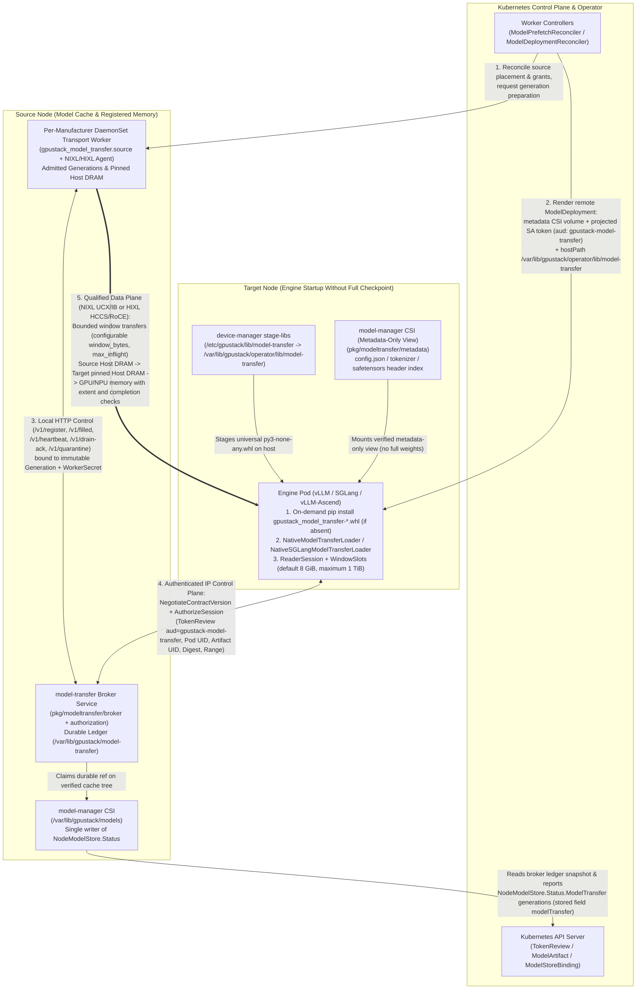

# Spec: Portable Remote Weight Loading with NIXL and HIXL

Status: Shipped
Blocked on: Production promotion still requires backend safety, native numerical equivalence, large-manifest pressure and the remaining engine/hardware gates. The implementation is substantially complete; both test environments have been removed. The final NVIDIA run retained a formal runtime-observer evidence failure despite successful serving.
Type: Feature

## Summary

Add an opt-in `model-transfer` capability for remote checkpoint loading.
Reuse `ModelArtifact` for content identity and `ModelPrefetch` for source residency intent.
Allow a qualified `ModelDeployment` loader to receive weights into device memory through NIXL or HIXL.
The successful remote path must not require a complete checkpoint on the destination filesystem.
Provide a transport-independent reader contract and explicit engine adapters.
The two-node Ascend 910B2 runs completed model loading, inference, lifecycle and concurrency
checks; the large-manifest pressure case failed before completing a native read.
Production promotion still requires the applicable safety and hardware qualification gates.
The reader, native loaders, broker, bounded source paging and managed delivery implementation
are substantially complete. Recorded NVIDIA runs cover full-resident and paged 80B loading,
235B broadcast and successful inference. Implementation completion does not close the promotion
gates below; optional integrations retain separate acceptance and follow-up work.
The PoC results at the end distinguish demonstrated capabilities from remaining acceptance work.

## Motivation

### Goals

- Let platform operators prepare reusable weight sources before inference replicas start.
- Let inference users avoid repeated destination downloads and filesystem reads on a qualified remote load.
- Let engine maintainers adapt one reader contract without adopting the GPUStack control plane inside their engine.
- Preserve immutable artifact identity, namespace authorization, complete cache publication, and bounded resource use.
- Demonstrate correct device data, correct model initialization, and bounded failure for each supported combination.
- Separate source preparation, metadata delivery, weight transfer, engine initialization, and serving readiness in measurements.
- Establish the first supported combinations from PoC evidence rather than inferred library support.

Success requires the acceptance criteria below and the applicable PoC gates.
A fast byte-transfer microbenchmark alone does not qualify an engine adapter.
PoC failures must update the supported scope, resource requirements, or proposal before implementation proceeds.

### Non-Goals

- Universal compatibility with every model, checkpoint format, engine, or parallel topology in the first release.
- Restoring arbitrary engine object graphs or processed device snapshots as the primary transfer format.
- Replacing inference all-to-all, EPLB, native Elastic EP membership, or router protocols.
- Enabling GPUStack Scale Down admission or repairing upstream Elastic EP as part of this feature.
- Qualifying ROCm without hardware, or treating CUDA results as ROCm evidence.
- Cross-vendor device-memory transfers between CUDA and CANN.
- Remote compilation-cache distribution or migration of live CUDA Graph objects.
- A fixed speedup, fixed device staging size, zero source CPU use, or automatic in-process recovery after every failure.
- Automatic full destination persistence in the initial remote path.

## Proposal

### Required outcome and responsibility boundaries

The primary data format is the original, verified checkpoint representation.
The engine retains responsibility for parameter mapping, sharding, quantization, derived state, and finalization.
The model-transfer capability supplies authenticated metadata and checkpoint tensors or ranges to the engine's load phase.
Device staging is permitted; direct placement into final parameter storage is an optional qualified optimization.
The phrase "direct device loading" does not promise zero copies or zero temporary device memory.

| Owner | Required responsibility |
|---|---|
| `ModelArtifact` | Immutable content identity and current authorization basis; no rank-specific runtime state in its identity. |
| `ModelPrefetch` | Opt-in source preparation on explicitly selected nodes; separately report disk and registered-memory readiness. |
| `ModelStore` / `ModelStoreBinding` | Preserve existing filesystem policy and prefetch accounting; add explicit policy for new memory consumption. |
| `NodeModelStore` and `model-manager` | Verified source publication, effective node policy, node-local observations, and integration with existing delivery. |
| `model-transfer` source runtime | Registered source memory, generation-scoped sessions, transfer health, drain, and safe reclamation. |
| Portable client and engine adapter | Target-device allocations, transfer completion, tensor lifetime, load-group agreement, and engine handoff. |
| `ModelDeployment` | Artifact reference, qualified adapter injection, effective delivery observations, startup limits, and serving gates. |
| Engine-native EP/EPLB | Online membership, expert placement, native migration, and topology commit. |

These are ownership contracts, not fixed process or package boundaries.
Keep vendor-runtime failure outside the Go CSI publication path.
Do not pass an ordinary device pointer across processes and assume that another process can register or access it.
Any IPC-based optimization requires a separate capability and lifetime proof.

### Implementation scope

Plan the reader and adapters from the accepted PoC results below.
Local contract work can proceed while hardware qualification remains open.
Only passing combinations may be advertised as supported.

| Order | Recommended outcome | Qualification boundary |
|---|---|---|
| First | A portable reader/session contract and a verified local-file implementation. | Content identity, range validation, ownership, per-operation completion, and bounded admission work without RDMA. |
| Next | Native engine adapters in the engine process. | The engine owns the target tensor, mapping, and finalization. The Ascend functional runs do not replace numerical equivalence or hardware qualification. |
| Then | Remote loading through the same reader, integrated with existing artifact, prefetch, and deployment contracts. | A real model loads and runs a forward pass without a complete destination checkpoint or a hidden download. Source authorization, isolation, and safe reclamation remain mandatory. |
| Later | An optional ModelExpress strategy over the same reader and session lifecycle. | Qualify its mutation and fallback behavior independently; it need not replace the GPUStack artifact service. |
| Separate | Coexistence with engine-native NIXL EP and expert migration. | Native migration keeps ownership of live tensors and topology changes; cold loading must not duplicate its transfer work. |

Use documented engine extension routes as configurability evidence.
Test the behavior introduced by our adapter, including metadata probes and no-checkpoint startup.
Do not repeat upstream configuration tests without a concrete integration concern.
Use verified safetensors checkpoints and qualify each model, precision, and topology separately.
Ascend functional runs cover a dense TP model and an MoE TP/EP model; quantization and other shapes need their own acceptance cases.
This sequence does not waive a security gate or authorize another hardware round.

### Source image configuration and build targets

Keep `model-prefetch-warmup-image` on its lightweight Python Alpine default.
Use one editable `model-artifact-source-worker-images` JSON map with manufacturer keys and full image references.
An empty object disables source preparation; a missing manufacturer never falls back to another vendor.
Accelerator-free source nodes retain the NVIDIA host-memory path. Reject ambiguous mixed-manufacturer selection.
The chart initializes this map through `modelTransfer.images`. Replace the two unreleased scalar image Settings and chart fields.
An image update drains the old source Pod before creating its replacement. Host runtime versions do not select image tags.

Build the NVIDIA variant from CUDA 12.9.1.
Pin Torch to its CUDA 12.9 build so NIXL selects its cu12 backend. Publish `<version>-cuda12.9` tags.
CANN variants use `<version>-cann9.2[-<soc>]` tags and pinned CANN/HIXL dependencies.
A runtime-version tag does not guarantee compatibility with every host driver or device generation.

Supply the HIXL Python wheel and `libcann_hixl.so` from the same build.
Install the Python wheel under its dedicated prefix and replace the runtime image's resolved
`libcann_hixl.so` with the library from that same build.
The host supplies its driver libraries through the Ascend container runtime or explicit mounts.
Loading a HAL stub does not establish usable initialization, memory registration, or transport.

The source-image probes compared CANN 9 bases for 910B, A3 and A5 on 910B2 hosts.
Tests on 910B hardware qualify only the tested base-image/runtime behavior, not A3 or A5 hardware.

Follow `pack/mirrored-mooncake/Dockerfile`: use one Dockerfile with stable `cuda`, `rocm` and `cann` final targets.
Keep exact runtime versions and image tags in overridable build arguments. Image references carry no digest pins.
The chart includes the ROCm source image alongside CUDA and CANN. ROCm runtime
qualification and the remaining source-factory integration are follow-up work.
Hardware and image validation remain separate.

| Target | Default runtime base | Published tag suffix | Backend artifacts |
|---|---|---|---|
| `cuda` | CUDA 12.9.1 runtime, Ubuntu 24.04 | `-cuda12.9` | NIXL 1.5.2 with Torch 2.13.0+cu129 and pinned dependencies |
| `rocm` | ROCm 7.2.3, Ubuntu 24.04 | `-rocm7.2` | NIXL 1.5.0 with Torch 2.13.0+rocm7.2; packaging only |
| `cann` | CANN 9.2.0, 950, Ubuntu 22.04, Python 3.12 | `-cann9.2-a5` | HIXL Python wheel and native library from the same pinned build |

Build the universal `gpustack_model_transfer` wheel once in a common stage. Keep vendor dependencies in separate branches.
Use a matching CANN development image to compile the HIXL wheel and native library, then copy both into the runtime stage.
Pin the HIXL source revision and verify fetched inputs; normal builds must not depend on manually copied local binaries.
Retain the dedicated HIXL Python path and the runtime image's native-library location.
Host driver libraries and tools remain runtime mounts, not image build inputs.

Reuse the existing image workflow's `target`, build-argument, tag, and platform inputs instead of adding a separate build pipeline.
Publish only architectures supported by the selected base and successfully built backend artifacts.
Do not add a separate CPU target in this revision; that choice does not qualify accelerator-free source operation.
Keep the Python Alpine disk warm-up image independent from these targets.

Build checks cover packaging and native dependencies; real driver loading, endpoint creation, and transfer need separate runtime checks.
The deployment must start the actual server and transport worker; neither an arbitrary-command wrapper nor `sleep infinity` provides that integration.
NVIDIA image/runtime acceptance remains deferred to the user-selected CUDA 13 hardware stage.

### Server deployment and network ownership

Treat `model-transfer` as an administrator-managed node delivery service.
Deploy one DaemonSet per manufacturer, initially NVIDIA and Ascend, with one instance on each selected source node.
Keep `model-manager` responsible for downloads, verified disk caches, and CSI mounts; reuse its verified content for source residency.
Model resources express delivery intent; the process performing a download or engine load is the transfer client.

Use privileged device access comparable to `device-manager`, including the required InfiniBand and vendor device nodes.
The Ascend container uses its image's CANN runtime and mounts the host's `/usr/local/Ascend/driver` read-only for driver libraries and tools.
Do not mount the host's entire `/usr/local/Ascend` over the image's CANN installation.
Supply required DCMI dependencies and loader paths; driver access does not establish a device-free HIXL source.

Let NIXL/UCX and HIXL discover usable resources and establish compatible connections through their supported interfaces.
Do not add an application-level HCA negotiation protocol or require server-side compute-network classification.
Allow server automatic selection, including UCX's unrestricted device candidate set, and explicit administrator restrictions.
Mount visibility and a successful import do not establish that the selected payload path works.

The chart uses these conventions:
`modelTransfer.env` is a map and `modelTransfer.extraArgs` is an appended argument list.
Follow the device-manager ordering: backend defaults, user environment, then managed identity variables.
Pass backend environment to the transport process; preserve the existing argument append behavior.
Do not introduce `extraEnv` or a separate server-network configuration object.

Client endpoint selection belongs to the [RDMA network-selection capability](../docs/modules/rdma/network-topology.md).
Consume its client handoff through the appropriate backend adapter when available; do not duplicate its selection policy here.
Keep HIXL Device RoCE discovery separate from Host RoCE. Exposing `hccn_tool` supports discovery but cannot create unsupported protocol capabilities.
Server-auto/client-selected operation remains a distinct hardware acceptance case; earlier symmetric selections do not qualify it.

This revision replaces one resource-holder Pod per content generation with a shared server serving separately admitted generations.
The actual server containers must carry their memory budget; preserve namespace grants, generation identity, leases, drain, and quarantine.
Privileged device access replaces per-model exclusive device requests, but runtime device consumption remains a node system-resource concern.
The local controller implementation no longer creates reservation Pods. Its resource-free
tests do not establish native source or cluster acceptance.

### Source service startup contract

One Pod per vendor per selected node, two containers: the broker from the operator image
(`gpustack-operator model-transfer`) and the transport worker from that vendor's
model-transfer source image. The broker serves the worker control wire on loopback
`127.0.0.1:9250` — the existing worker endpoints plus `/v1/assignments` — and engine
sessions on port `9251` over TLS 1.2+ with a chart-managed serving certificate; the
engine listener never exposes worker routes. The durable ledger lives under a
per-vendor subdirectory of `/var/lib/gpustack/model-transfer` so two vendor Pods on one
node never collide in paths, ports, or generation tokens. The worker learns its work
through a broker-minted Pod-local bootstrap credential the broker writes into a
restrictive memory-backed `emptyDir` file shared by the two containers.

Fill admission runs in the broker: it reconciles `ModelPrefetch` source intents whose
placement selects its node, revalidating the live Prefetch UID, artifact UID and digest,
resolved positive byte total, node selection, the optional `ModelStoreBinding` sourceMemory grant,
and manufacturer image eligibility, before calling the existing `AdmitFill`. One intent
revision maps to one reservation; retired, changed, or deleted intents drain. Grant and
size numbers are never accepted from a worker or client message, and per-generation
secrets flow only on that loopback channel — no secret, address, or registration key
enters status, logs, or command argv.

The worker registers, fills the manifest's referenced safetensors files from the verified
published tree into pinned host memory, and only then reports `filled` — carrying registration
descriptors bound to the worker's Pod UID, backend, generation plus digest, and lease
lifetime. Descriptors remain private to the broker and source worker. Engine sessions
open on the TLS listener: TokenReview
(`gpustack-model-transfer` audience) plus the live Pod UID through the existing
authorizer, then `AdmitSession`; the response carries the exact authenticated portable manifest,
its raw SHA-256, the canonical artifact digest, and the source Pod/native instance identity.
The client registers its own bounded HOST staging window; the source initiates WRITE into
that target after authenticating and validating its session, incarnation and tensor range.
The interface withholds source keys but does not establish hardware source isolation.
Requested ranges validate against the authorized
manifest, and the manifest's `SourceGeneration` stays distinct from the broker's opaque
generation token. The managed render hands the engine its session endpoint, CA bundle,
server name, and projected identity; the client is an authenticated native reader that
registers its own windows in the engine process. The CPU reference reader exists only as
explicit test injection, never a production fallback. A broker restart preserves unknown
sessions, worker registrations, and budget charges; refill never revives a retired
generation; budgets charge actual held backing until shared backing is proven.

The native payload loopback listener uses port `9252` and the existing Pod-local bootstrap
credential. Persist operation ownership and `dispatching` before forwarding; a lost response,
missing job or changed source incarnation thereafter means UNKNOWN and never permits repost.
Bind each request to source Pod/native instance/generation/lease, target Pod/process instance,
session, registration UUID and window incarnation. One outstanding operation owns a window.
Native terminal status precedes digest validation and synchronized target copy; target consumer
acknowledgement and peer revocation precede window reuse. These are separate transitions.

Session closing prevents new operations and retains charges. The authenticated owner can
retry status, acknowledgement and close after grant revocation without gaining new reads.
Release requires private source close plus target consumer synchronization and native cleanup;
bounded receipts make retry idempotent and prevent closed session IDs from reopening.
Timeout, Pod deletion, lease expiry and process exit are not physical memory or fence proof.
Unknown state keeps the entire backend ownership graph while its process remains alive and
holds durable quota after a process loss until a separately qualified external fence.

Image rollout uses `OnDelete`: stop admissions and assignments, drain every generation and
session, verify the actual current Python instance reports no active/unknown/retained native
state, and acknowledge that exact instance before deleting that exact Pod UID. Removing a
vendor entry from the chart image map, or disabling the source runtime, lets Helm delete
the corresponding DaemonSet directly. This is an operator maintenance action performed
when the affected workload is stable; it does not wait for the image-rollout drain
acknowledgement. Deletion alone does not prove native release or clear unknown charges.

### Binding-wide reservation authority

When present, SourceMemory Bytes/Registrations/Sessions are Binding-wide grants, so no node may
spend the whole grant on its own. One ConfigMap per Binding UID lives in the operator/source
service namespace (never the tenant namespace), named for the full Binding UID; its
single JSON document carries bounded reservation entries (256 entries, 256 KiB), each
binding the Binding UID, node scope, ledger identity, immutable generation, intent
UID/generation, digest, namespace, and the reserved registered bytes, registrations, and
live session owners (per Pod UID/ns/artifact/digest/generation/reservation/authority
records — never scalar-only counters). Every change is a resourceVersion CAS with
bounded retries; corrupt, negative, mismatched, over-cap, or API-unavailable state is
unavailable/unknown, never an empty set. Before any admission the Binding pins the
authority ConfigMap's UID and an epoch through a reserved immutable annotation (Binding
update webhook protected); admission requires the pin, and after pinning a missing,
recreated, or corrupt authority fails closed and holds local charges. A node persists a
private prepared generation record BEFORE the global CAS reservation — prepared records
expose nothing (no assignment, no descriptor, no worker registration) — and the
assignment appears only after both local and global durable confirmation, replaying
with the same identities after a crash. A missing local record is not evidence that a
globally admitted generation never started; only positively unexposed prepared work or
an actual release/fence cancels. Admissions CAS against the live Binding UID and grant
summed across every entry of all nodes/vendors; growth admits, deletion or replacement
drains while charges hold. Registered resident bytes and registrations charge the
Binding grant; node fill/runtime/quarantine overhead charges the node-physical ceiling.
Reservation objects carry no credentials, native keys, or pointers, and object absence
or expiry is never native reclamation proof.

### Policy Placement and Compatibility

Retain the existing `ModelDeploymentModel` boundary: it references weights and contains no provisioning or download policy.
Use the administrator's cluster delivery configuration to opt into remote delivery and select Require remote or Prefer remote.
Do not put a source URI, credential, source-pool policy, or fallback policy into the deployment's model block.
This preserves the [published model-reference contract](../api/worker/v1alpha1/model_deployment.go).
It gives the first release a cluster-level rollout boundary rather than independent per-deployment policy.
Finer workload policy requires a later explicit API decision.

Apply these precedence rules:

- Claim and image artifacts retain their existing delivery paths and remain outside initial model-transfer qualification.
- Without remote opt-in, hub artifacts follow the current Engine/Node setting.
- With remote opt-in, a managed hub role uses remote delivery only after its adapter and source eligibility checks pass.
- Require remote blocks unsupported combinations with a reason; Prefer remote permits only an identity-preserving declared fallback.
- Artifacts requiring verified-node delivery, including filtered or anchored identities, may use remote only from the same verified manifest.
- Their fallback remains verified Node delivery; an unrestricted Engine download must not bypass that constraint.

Report remote delivery distinctly from Node mounting and Engine downloading.
Extend the stored and public v1 delivery views together, with schema generation and all affected delivery branches reviewed.
Test existing status consumers against the new outcome; do not label remote as Node to hide an unsupported enum value.
Before downgrade, disable remote delivery and converge workloads onto a supported legacy path.
Keep artifact references immutable and use the existing controlled rollout behavior for delivery-setting changes.

Extend `ModelPrefetch` with an explicit opt-in source-preparation intent, rather than creating a second artifact identity resource.
For that intent, require `placement.nodeSelector` or `placement.instanceTypes`; refuse omitted placement.
Do not derive remote source nodes from consumer deployments.
Prefetches without this intent retain current placement defaults, warm-up behavior, and status meaning.
Disk `readyNodes` still counts complete published trees; report transfer availability separately.
Use the prefetch's namespace binding as the entitlement owner for its additional source-memory reservation.
Add a separate administrator-granted memory limit; existing disk quota and `allowPinned` do not grant it.
Charge each namespace its admitted reservation even when physical bytes are shared, while deduplicating physical occupancy by verified content.
Read-session admission and fairness use separate administrator limits and do not infer an unlimited read grant from prefetch retention.

### User Stories

#### Story 1

As a platform operator, I want to prefetch an artifact onto selected source nodes and prepare transferable weight ranges.
I want separate disk and transfer readiness so that I can distinguish durable availability from temporary memory residency.

#### Story 2

As an inference user, I want a qualified `ModelDeployment` to load weights from an authorized remote source into device memory.
I want this path to work without a complete destination checkpoint so that new replicas avoid that prerequisite.
If the path cannot satisfy its contract, I want a bounded, visible outcome that follows my declared fallback policy.

#### Story 3

As an engine maintainer, I want a documented reader and adapter contract with a local reference implementation.
I want to integrate it with a native loader or a qualified ModelExpress strategy without depending on their internal object layouts.
I want native Elastic EP to retain ownership of online migration so that cold-load acceleration can coexist with later reconfiguration.

#### Story 4

As a maintainer, I want ordered PoC gates and explicit machine requirements before production implementation.
I want execution to follow the current HIXL-first repair sequence with separate CUDA and CANN qualification so that support claims match evidence.
I want failed gates to revise the supported combinations rather than become undocumented exceptions.

### Core Features & Acceptance Criteria

#### Artifact identity and source readiness

- Begin with resolved Hugging Face or ModelScope artifacts backed by an existing verified node-cache tree.
- Preserve the existing `Expected` digest identity contract where a verified peer tree supplies the manifest.
- If resolved size is unknown, derive and verify the manifest byte total before reserving source memory.
- Unknown size must not become zero-cost memory admission.
- Qualify private cold-source prefetch and credential delivery independently; an existing warm source does not prove that path.
- Exclude claim and image sources from initial model-transfer qualification unless an equivalent verified-manifest contract is established.
- Bind every metadata bundle, source generation, and load attempt to the same artifact UID and manifest digest.
- Verify file identity, size, tensor offsets, dtype, shape, bounds, and integer overflow before exposing a tensor.
- The model-manager verifies checkpoint content before cache publication; ModelPrefetch pins that publication.
- Transfer validates authorization, immutable artifact and generation identity, metadata, paths, sizes,
  tensor layouts, address bounds and completion. It does not compute checkpoint or tensor payload hashes.
- The reader contract carries layout only. External acceptance harnesses compare deterministic bytes;
  their checks are outside measured transfer/copy intervals.
- Source memory must remain immutable while readers can access it; transport CRC alone does not establish artifact integrity.
- Declare a source ready only for the ranges that its stated generation can actually serve.
- Distinguish verified disk availability from registered-memory readiness and current session admission.
- Keep existing `NodeModelStore` cache `Ready` and `ModelPrefetch.readyNodes` meanings intact.
- A daemon restart or lost registration invalidates its transfer readiness without erasing durable disk availability.
- Reserve enough source host memory for the complete selected checkpoint and the declared overhead.
- HIXL can register bounded source windows; qualify window switching, concurrent consumers, and recovery separately.
- Partial host-memory residency, refill, and multiple-source assembly need their own successful PoCs before support is advertised.

#### Metadata-first destination delivery

- Apply the administrator's opt-in remote delivery configuration when rendering managed `ModelDeployment` roles.
- Supply the complete required configuration, tokenizer, indexes, and loader metadata before engine initialization needs them.
- Derive metadata from the same verified artifact; bind derived tensor descriptors to that identity and source generation.
- Include authenticated tensor-header information or an equivalent configuration-probe interface before model construction.
- Compare effective dtype, embedding tying, quantization, and architecture with native loading from the complete artifact.
- Do not assume that missing weight files cause a configuration error; some helpers silently infer a different configuration.
- A tensor index alone does not prove that an engine's safetensors-header probe will use it.
- Qualify the pre-loader integration hook or reject the combination; do not create invalid truncated weight files to fool a probe.
- Keep the metadata view separate from the existing complete published checkpoint tree.
- Do not mount a partial weight directory through the current complete-tree CSI contract.
- Reject a missing or filtered-out required metadata file with an actionable reason.
- Do not allow config or tokenizer helpers to fetch an unpinned revision or an undeclared full checkpoint.
- A destination with no full checkpoint must complete a qualified remote load and serve a correctness probe.
- Measure file writes in all destination caches, volumes, and helper containers during this experiment.
- Metadata, engine logs, compilation outputs, and bounded transport bookkeeping are allowed and reported separately.
- Creating a complete checkpoint in `tmpfs` is not evidence of streaming into device memory.
- Existing delivery behavior remains available when remote delivery is not selected.

#### Portable reader and engine adapters

- Define a versioned contract for capability discovery, immutable descriptors, load-attempt identity, reads, completion, cancellation, and release.
- Include supported checkpoint formats, memory types, maximum request sizes, alignment, tensor ownership, and device visibility in capabilities.
- Distinguish requested transport settings, applied settings, and an independently observed effective backend.
- Report a rejected backend option explicitly; do not silently omit it and claim the requested RDMA path.
- If the effective backend is unknown, retain that result for functional qualification only.
- Separate control-plane and data-plane network selection in the transport contract.
- Use an authenticated, reachable IP control path for manifest exchange, workload identity, and leases; select the payload path separately.
- Client selection consumes the RDMA selection contract; server selection follows the server deployment revision above. Use source host-memory NUMA locality and target accelerator affinity where available.
- Native IB, RoCE, and integrated NPU networks require different discovery evidence; `sm_lid` and `PIX`/`PXB` are not universal admission rules.
- Report incompatible or failed endpoint selection explicitly. A NIC name, PCIe distance, or separate subnet alone does not prove its storage/compute role or device-direct capability.
- Support backend automatic selection and explicit restrictions according to the client/server roles. Process-wide UCX changes must not disturb another engine context.
- Do not reject server-side `UCX_NET_DEVICES=all` solely because multiple network planes exist. Qualify server-auto/client-selected operation separately and retain administrator overrides through `env`.
- Support configurable windows with an `8 GiB` default and a `1 TiB` ceiling per slot. Validate each hardware configuration, additional rail, and performance benefit independently.
- Provide a local verified-file implementation to validate the same adapter contract without RDMA.
- An adapter must not require changes to model architecture code for a claimed supported model.
- `NativeModelTransferLoader` for vLLM and vLLM-Ascend and `NativeSGLangModelTransferLoader` for SGLang delegate model-specific mapping and loading to the engine. They handle dense and MoE/EP layouts and hybrid accelerator plus CPU parameter placement without binding to model-specific names.
- The adapters accept CUDA and ROCm (`cuda` or `hip`), Ascend (`npu` or `privateuseone`), and `cpu` device types. Code paths and local tests do not qualify a hardware combination.
- The reader streams through configurable windows. `GPUSTACK_MODEL_TRANSFER_MAX_WINDOW_BYTES` defaults to `8 GiB` and accepts up to `1 TiB`. Where the native backend supports window offsets, it coalesces contiguous safetensors spans per file. `GPUSTACK_MODEL_TRANSFER_TP_MODE` selects `broadcast` or `all`.
- Qualify native vLLM and SGLang adapters on CUDA, with separately recorded versions and model coverage.
- Record each engine's actual extension route and image owner; a loader registry is not assumed to exist.
- SGLang qualification must choose and test its private-loader, remote backend, or versioned patch route.
- Document required engine-image changes and patch maintenance; portable does not mean zero engine changes.
- Qualify vLLM-Ascend on the supplied CANN hardware; neither a CUDA adapter nor a torch_npu buffer probe qualifies its loader.
- Begin engine correctness with a small dense safetensors model and a declared precision.
- Add at least one representative sharded or quantized model before claiming that capability.
- Record draft/MTP, tied tensors, mixed architectures, TP, PP, and EP as separate qualified or unsupported dimensions.
- An unsupported format, tensor size, or topology must be detected before unsafe model mutation where possible.
- Broad portability means a stable adaptation contract, not automatic support for an unmodified arbitrary engine.

#### Device ownership, integrity, and load-group safety

- The target engine process owns or explicitly imports target allocations through a qualified device API.
- Default tensor outputs have independent storage or an explicit lifetime that the adapter can enforce.
- The initial adapter assembles an owned checkpoint tensor through bounded transfer windows. Tensor size and transfer-window size have separate budgets; rank-local sharding is a later qualified optimization.
- Permit borrowed storage only when the consumer's retention and asynchronous work are proven compatible.
- Do not reuse a slot until transfer completion, device visibility, collectives, and every consumer have released it.
- A network completion observed by the CPU does not by itself prove device-stream visibility.
- Release load-only windows and registrations before KV-capacity profiling, after their qualified completion/consumer fences.
- Validate oversized, zero-element, misaligned, non-contiguous, and retained tensors within the adapter's declared contract.
- Reject a tensor that exceeds the qualified budget; do not silently allocate unbounded staging memory.
- Account for model storage, transfer staging, validation scratch, allocator retention, and runtime context memory separately.
- A fixed validation scratch buffer does not prove fixed total transfer memory or bounded long-term process RSS.
- Account for active allocations and allocator-reserved memory separately, including validation and final tensor reductions.
- The source runtime must declare any NPU or GPU context requirement; the CANN PoC did not qualify an accelerator-free source.
- Use one artifact identity and a consistent manifest/order within each actual loading group.
- A loading group means engine ranks whose weight-loading collective sequence must agree; it is distinct from independent consumer replicas.
- Define loading groups from engine topology; do not assume a whole node is always one broadcast group.
- Record logical bytes, remote bytes, collective bytes, and repeated checkpoint reads per group.
- Correctness requires no missing parameters, unexpected aliasing, or duplicate non-idempotent finalization.
- Perform declared numerical comparisons and task evaluation against the native loader.
- Deterministic text output is supplementary evidence, not the sole correctness test.
- A failed rank must cause a bounded group outcome; cleanup must not wait forever on a final barrier.

#### Source memory policy and lifecycle

- Opt-in source preparation must have administrator-set physical memory and registration limits.
- Reserve verified resolved bytes atomically before source fill; webhook projections alone cannot enforce concurrent admission.
- Server-container memory requests and limits must cover admitted resident/fill/runtime memory and quarantine. An unresolved artifact or stale zero-node count cannot authorize a zero-cost allocation.
- Define tenant retention and concurrent-read admission separately from physical content deduplication.
- Existing binding `quota.bytes` counts filesystem usage; it is not a general runtime memory enforcement boundary.
- Do not relabel its existing usage as registered memory or assume it already enforces new quotas.
- Report resident bytes, reserved bytes, registration count, active sessions, rejected admission, and applied policy.
- Preserve single-writer ownership for node spec/status and prefetch pin aggregation.
- Source preparation must obey real allocator, memlock, NUMA, cgroup, and backend limits.
- The privileged server accesses devices as a node service; track its runtime consumption as system overhead rather than reserving an exclusive device per model.
- Do not turn the existing accelerator-free disk warm-up Pod into an implicit GPU reservation.
- Eviction first stops new sessions, then revokes or isolates old access and drains in-flight operations.
- Confirm the required disconnect before deregistration and release.
- A lease timeout starts recovery; it does not prove that remote DMA has stopped.
- Track terminal state for every submitted operation, including later retries and stale-generation probes.
- A prior successful operation must not make a later timeout eligible for normal cleanup.
- Unknown completion or failed disconnect must retain the affected registration, buffer, and engine until a qualified fence or reclamation rule applies.
- Process exit, empty process lists, and device memory returning to baseline are observations, not independent drain proofs.
- If quiescence cannot be proven, quarantine that registration generation and bound its retained resource cost.
- A generation must never expose recycled addresses containing different artifact or tenant bytes.
- Retain source-file references during pool fill, and protect active transfers independently of existing CSI mount references.
- Daemon crash, rolling upgrade, model addition, and model eviction must have observable, bounded outcomes.

#### Bounded source residency

- Both NIXL and HIXL admit a complete immutable manifest while pinning only a resident batch.
  `GenerationRecord.TotalBytes` and `Registrations` retain the full file plan;
  `ResidentBudgetBytes` is an immutable admitted ceiling, and `ResidentBytes` reports current residency.
  New local and Binding-wide reservations charge the resident ceiling plus 10% overhead.
  Legacy prepared records retain their original global charge on replay.
- `GPUSTACK_MODEL_TRANSFER_SOURCE_RESIDENT_BUDGET_BYTES` defaults to zero (use admission).
  Positive values round down to 2 MiB with a 1 GiB floor. The effective ceiling also respects
  the namespace grant, node limit, and HIXL's existing resident setting (16 GiB by default).
  A paged window must hold the largest complete shard and the 1 GiB floor. Admission refuses
  clamping when no verified file manifest establishes those sizes.
- The additive work-order field `residentBudgetBytes` carries that ceiling. An absent field
  preserves legacy full-residency admission. `/v1/filled` reports only actual resident descriptors;
  each must name a distinct, complete safetensors file of the admitted manifest. Their total must
  fit the ceiling. This report does not lower the manifest registration quota. An older worker
  that reports the entire oversized checkpoint is refused by the broker.
- Initial fill, restore and page-in copy only the selected resident files through bounded 1 MiB
  reads with at most eight workers. They validate file extents and tensor ranges but do not hash
  payloads or scan nonresident files. Cache publication owns content verification.
- Both backends retain per-file operation counts through native posting, completion and consumer
  acknowledgement. Once a page miss waits, newer resident requests cannot extend its drain.
  Polling and acknowledgements still advance. The generation thread drains active peers before
  swapping. Every old RDMA registration must be revoked before any old allocation is freed.
  Shared files retain their allocations; only newly selected files are copied before the complete
  new batch is registered. Any uncertain deregistration, free or registration
  retains the ownership graph and quarantines the generation; no unknown charge is released.
- NIXL source allocations use page-aligned anonymous mappings pinned through Torch's CUDA/HIP
  `cudaHostRegister` binding. Eviction calls `cudaHostUnregister` and closes the mapping after RDMA
  deregistration. This avoids cached pinned tensors retaining old allocations or rounding shard
  requests to a larger cache size class. Target pinned-tensor allocation is unchanged. HIXL retains
  its explicit ACL allocate/free owner. Native page rounding and bounded control metadata remain
  covered by reservation overhead.
- HIXL owned host blocks keep file length separate from native registration length. Allocate
  a 2 MiB-rounded extent plus 2 MiB of address-alignment space for every positive size, choose
  an aligned address inside it, and zero the registered tail. Free only the original allocation.
  Filled descriptor lengths and transfer bounds retain the original file length. Source admission,
  page selection and residency counters charge the full backing extent before the separate 10%
  reservation overhead. Old admissions cannot silently gain padding space on replay.
  Target slots deduct address-alignment space from their normalized budgets before allocating;
  direct loader windows have a 4 MiB minimum and two slots need at least 8 MiB. Native region
  alignment does not require tensor offsets or payload lengths to be rounded.
  The reference `HixlReader` uses aligned owned windows and the same full-backing accounting,
  with a 4 MiB per-window floor. Arbitrary borrowed buffers keep their real storage bounds.
  Failed construction with uncertain deregistration retains all remaining registrations,
  buffers, the engine owner and the full reservation until a qualified fence.
- Idle release retains the grant and manifest. New work rebuilds only the initial resident batch.
  CPU-injected tests establish ownership, bounds and protocol behavior; native CUDA/HIP/HIXL memory
  accounting, performance and live consumer behavior require separate hardware qualification.

#### Authorization and data-plane isolation

- Authorize a workload through its current Pod identity and a resolved artifact in its own namespace.
- Check Pod UID, artifact UID, digest, requested ranges, source generation, and session admission.
- Use a dedicated workload identity flow; do not give an engine the model-manager ServiceAccount token.
- Preserve current artifact revalidation and anchored-identity semantics rather than silently redefining source access rules.
- Prevent one session's RDMA credentials from exposing unrelated or unauthorized registered bytes.
- Prevent consumers from modifying source weights through WRITE, ATOMIC, or a writable imported mapping.
- Test raw data-plane operations; a client-side READ-only API does not enforce source immutability.
- Distinguish a source-window WRITE negative from a normal WRITE into the destination window.
- A timed-out stale-address request and one unchanged snapshot do not qualify revocation, source read-only access, or absence of a late write.
- Prove the memory-registration boundary that enforces this rule for each backend.
- Trust the source service as infrastructure; do not trust a consumer to enforce source permissions or prove them through checksums.
- Authenticate source control endpoints and descriptor provenance; do not inherit disabled server verification from a benchmark client.
- Reject unrelated control connections and bound startup retries within the attempt deadline; message-format validation is not peer authentication.
- An HTTP range check or signed range descriptor is insufficient if the exported memory key grants broader access.
- Use a qualified registration boundary or trusted transfer mediator when direct keys cannot enforce the required isolation.
- Compare target-initiated READ with source-initiated WRITE into target staging; do not prescribe pull before isolation is proven.
- A push design must prove that connection setup does not still disclose writable source credentials.
- Local remote-metadata invalidation is not proof that the source revoked an already disclosed hardware key.
- Record the revocation granularity and affected readers for each backend; do not assume per-session keys or revoke APIs exist.
- Authentication failure, denied content, stale generation, capacity exhaustion, and unavailable source must remain distinguishable.
- Source restart, Pod deletion, and session revocation must prevent new access and trigger the required data-plane drain.
- No raw keys, pointers, workload tokens, or tenant content names may leak through shared status or logs.
- Existing mounted models need not stop inference when a later artifact revalidation blocks new sessions.

#### Failure and fallback policy

The administrator's remote delivery configuration exposes two behavioral policies; final field spelling belongs to planning.

| Policy | Required behavior |
|---|---|
| Require remote | Wait or retry within declared startup limits, then report failure. Never materialize a complete destination checkpoint automatically. |
| Prefer remote | Use remote when qualified and available. Permit declared complete local delivery after visible fallback; count all resulting storage and traffic. |

- Make the selected policy explicit in delivery configuration and echo its effective value in deployment observations.
- Do not describe a fallback-to-disk run as a successful no-destination-checkpoint run.
- Before model mutation, a load group may choose another authorized source or a qualified local path.
- If fallback requires a different volume template, recreate the affected replica/load group with a visible bounded fallback attempt. Never pre-mount a complete Node tree in the initial remote Pod.
- Verified-node-only fallback recreates with Node delivery; it must not become an unrestricted Engine download.
- After partial mutation, reuse the process only if the engine has a verified reset contract.
- Otherwise terminate the attempt and rebuild the affected worker or load group within the declared limit.
- Native fallback is not available immediately when no complete local tree exists.
- Permission, identity, and integrity failures must not become a way to bypass authorization through another strategy.
- Cap time spent retrying, waiting for local publication, draining, and restarting.
- Declare numeric startup, read, connect, group-failure, drain, and quarantine limits before each PoC or supported configuration runs.
- Report the selected backend, effective source, fallback reason, attempt result, and serving gate without leaking secrets.
- A control-channel timeout before backend submission tests a different boundary from a submitted operation with an observed nonterminal backend state.
- Require the latter evidence before qualifying in-flight cancellation or failure recovery.

#### ModelExpress integration

Full managed support is deferred to
[enhancement #809](https://github.com/gpustack/gpustack-operator/issues/809).
The current constrained adapter disables artifact transfer, VMM and peer publication.
The following constraints remain applicable to later integration work.

- Keep the portable reader independent of ModelExpress internal context types.
- Supply a qualified external inference strategy adapter for versions exposing `MX_LOAD_PLUGIN` and iterator loading.
- Use the supported single-plugin insertion point; the reviewed built-in chain cannot be reordered or removed through that hook.
- Insert before `rdma`, or disable earlier P2P consumption through a qualified configuration.
- Every reachable earlier strategy must satisfy GPUStack identity and authorization; otherwise refuse that composition.
- Under Require remote, a missing, unavailable, or skipped GPUStack plugin must terminate before another strategy runs.
- Under either policy, every reachable later strategy must also preserve GPUStack identity, authorization, and delivery constraints.
- Route tensor application and engine postprocessing through the qualified engine adapter exactly once.
- Report mutation truthfully so that a partially changed model cannot be treated as clean fallback state.
- Make backend availability and chosen strategy consistent across the actual loading group.
- Under Require remote, prevent later ModelExpress strategies from silently downloading a full checkpoint.
- At the reviewed commit, use the chain's terminal `StrategyRecoveryError` path for forbidden fallback, with offline guards as a second boundary.
- Test that the plugin wrapper preserves that terminal error and does not convert it into a recoverable strategy failure.
- Under Prefer remote, route any allowed downgrade through GPUStack's declared verified-delivery policy before native loading continues.
- Do not use an ordinary recoverable plugin failure to enter an unqualified server-cache, P2P, or native path.
- Do not require the ModelExpress Rust server for GPUStack source identity and verified host-memory service.
- Do not register the new model as an external Stage-2 source automatically.
- Return a non-publishable result, or an equivalently proven gate, so finalize and publication cannot expose a source implicitly.
- Pin the exact plugin-capable commit or image; do not infer availability from an older release tag.
- The reviewed ModelExpress entry is a CUDA qualification target; it does not provide a CANN accelerator adapter.
- Test native and ModelExpress entry paths separately; one path passing does not qualify the other.

#### Native Elastic EP coexistence

- Use model-transfer for initial load and independent-replica load where the normal loader executes.
- Preserve engine-native dummy allocation and migration when an online joiner bypasses ordinary checkpoint loading.
- Record that a loader plugin alone does not accelerate such a joiner's real weight migration.
- Keep loading sessions and staging budgets separate from long-lived EP communication buffers.
- Test `all2all_backend=nixl_ep` explicitly when claiming NIXL EP coexistence; generic native resize alone is insufficient.
- Qualify same-process NIXL agents/contexts, NIC/QP and registered-memory budgets, initialization, and teardown order.
- Test both overlap and sequential release of loading resources where the selected engine permits them.
- Treat the reviewed NIXL EP example interface as version-sensitive rather than a stable public loading API.
- A qualified CUDA coexistence run must complete initial remote load and then the engine's supported native resize operation.
- Check weight correctness, serving, reader cleanup, peak memory, and native operation state after the transition.
- Repeated resizing and any shrink scenario depend on separate engine and Operator qualification.
- Do not enable dynamic EP workers as external processed-weight sources in this feature.
- Future publication requires a compatible runtime signature, topology generation, reader drain, revoke, and republish contract.
- Do not map vLLM DP counts directly to SGLang physical EP counts.
- Do not claim CANN Elastic EP from HIXL transfer or EPLB support.

#### Observable readiness and performance

Expose distinct observations for metadata ready, source available, load attempt, weights loaded, and serving ready.
Keep readiness tied to successful engine initialization and existing routing qualification.
Do not treat `/health` or source memory readiness alone as serving proof.
Under remote delivery, `WeightsReady` reflects confirmed weight loading and engine initialization for the applicable replicas.
Metadata readiness and source eligibility permit startup but do not establish `WeightsReady`.
The first replica must not wait for its own completed load before it can be created.
Keep startup-progress reasons distinct from prerequisites that block a new replica.
An already initialized replica retains its loaded-weight observation when a source later drains or fails.
Update the condition documentation and its consumers for the new delivery outcome without changing legacy mode meanings.

For every qualified run, record:

- Exact artifact revision/digest, selected file bytes, model/quantization, engine image digest, and adapter version.
- Device, NIC, topology, driver, communication library, kernel, backend, and allocator versions.
- Source fill/verify/register/connect time and whether preparation was inside the measured interval.
- Destination metadata time, load time, finalization/warmup time, and first successful serving time.
- Source cold/warm, destination absent/cold/warm, and compilation-cache state, each verified before the run.
- Total network bytes, destination writes/reads, retry traffic, host/device peaks, CPU use, and registration/session counts.
- Sample count, distribution, failures, and recovery time; never report success-only averages.
- Online inference interference and source aggregate bandwidth for concurrent consumers.

Compare native loading, existing peer-sync-then-load, local reference streaming, and remote model-transfer under matched conditions.
Use a matched TCP path where practical to distinguish protocol benefit from cache placement or reduced disk work.
Do not reuse published ModelExpress or NIXL EP speedups as the acceptance threshold for this different path.
The PoC must establish whether the deployment's actual critical path improves.
If it does not improve, retain a supported fallback and revise the promotion decision.

### Notes / Constraints / Caveats

#### Evidence baseline and support matrix

The original GPUStack source review used `3f1b3e00ba8517163f3be926c973ec5a8a45354e` on `main`.
This revision uses root `main` at `34090bd740f1da32b423033c1e53380295b7bfc1`.
This baseline records the earlier review; the implementation and later functional runs are described below.
The existing CSI checks publication before binding the tree.
The existing prefetch uses accelerator-free CSI warm-up Pods and reports filesystem residency.
Neither path originally implemented metadata-only remote weight delivery.
See the [CSI driver](../pkg/modelmanager/driver/driver.go), [prefetch types](../api/worker/v1alpha1/model_prefetch.go),
and [binding types](../api/worker/v1alpha1/model_store_binding.go).

| Combination | Intended qualification | Current limit |
|---|---|---|
| NIXL + CUDA + vLLM | First device-transfer and native-loader gates. | Fixed-window synthetic transfers demonstrated. Allocator-reserved growth, full staging accounting, source isolation, fault recovery, and native loading remain open. |
| NIXL + CUDA + SGLang | Second independent engine adapter. | Must prove its own topology and finalization contract. |
| HIXL + CANN + vLLM-Ascend | Qualify the engine and backend independently. | Two-node functional startup, inference, and benchmark runs passed on Ascend 910B2. Source isolation, fencing, numerical equivalence, and production promotion remain open. |
| NIXL + ROCm | Preserve transport-independent extension points. | No available test machines; unsupported until measured. |
| MindIE-Motor or another engine | Adapter opportunity after capability review. | No portable-loader support is promised by this spec. |
| ModelExpress inference strategy | Optional qualified entry path over the same reader. | Internal adapter context is version-sensitive. |
| Native CUDA Elastic EP | Separate coexistence gate. | Native migration and topology remain engine-owned. |

NIXL supports modular memory-transfer backends on Linux; library capability does not certify a model loader.
Its ROCm-enabled UCX path and CUDA NIXL EP device code are different capabilities.
Use [NIXL at the reviewed commit](https://github.com/ai-dynamo/nixl/tree/9e7800fc163e7bc5dd39aba918638562cdf1eeb7)
as the source baseline, not a guarantee for another installed build.

HIXL at `cd4c5e86f5ca5a654226b0a677eb07915540e03c` has hardware-dependent allocators and registration rules.
Its Python API documents registration before connection and disconnection before deregistration.
The same tree's README reports a FabricMem relaxation, so documentation and backend capability need reconciliation.
Keep the conservative lifecycle until the selected backend's safer dynamic path is proven.
Host/device limits differ by hardware and HDK; do not turn one platform's numbers into a global capacity claim.
The [HIXL source tree](https://gitcode.com/cann/hixl/tree/cd4c5e86f5ca5a654226b0a677eb07915540e03c)
provides the version baseline for the CANN qualification record.

The reviewed [ModelExpress strategy registration](https://github.com/ai-dynamo/modelexpress/blob/3fe38ae9f0c05a5ca58ab34f43787d94a5bab48a/modelexpress_client/python/modelexpress/load_strategy/__init__.py)
provides an external plugin extension point.
That extension point does not provide GPUStack metadata-first delivery or workload authorization by itself.

At vLLM `6abdff59301f96f6c8733c38691bd36bd2dd0066`, native EP joiners request dummy weights before native migration.
At SGLang `8fabf5e65c0e0bf9698551c2e6cfef0672e9084a`, active shrink is rejected on the reviewed main branch.
At vLLM-Ascend `31f9175f324182466877d0ab9006e75ea6a401f3`, upstream EPLB requires MRv2 and its configuration rejects Elastic EP.
These are source observations, not results from a running GPUStack engine image.
See [vLLM joiner allocation](https://github.com/vllm-project/vllm/blob/6abdff59301f96f6c8733c38691bd36bd2dd0066/vllm/distributed/elastic_ep/elastic_execute.py#L270),
[SGLang resize handling](https://github.com/sgl-project/sglang/blob/8fabf5e65c0e0bf9698551c2e6cfef0672e9084a/python/sglang/srt/managers/scheduler.py#L6062),
and [Ascend EPLB validation](https://github.com/vllm-project/vllm-ascend/blob/31f9175f324182466877d0ab9006e75ea6a401f3/vllm_ascend/platform.py#L1114).

vLLM configuration can inspect safetensors headers before the loader runs, including embedding-tying decisions.
A metadata-only directory can silently change that decision if its probes see no weight headers.
See [configuration probes](https://github.com/vllm-project/vllm/blob/6abdff59301f96f6c8733c38691bd36bd2dd0066/vllm/transformers_utils/config.py#L1452)
and [embedding configuration](https://github.com/vllm-project/vllm/blob/6abdff59301f96f6c8733c38691bd36bd2dd0066/vllm/config/model.py#L1262).

### Boundaries

- **Always:** Preserve artifact identity and existing publication/status meanings. Qualify each advertised backend and adapter with native hardware evidence.
- **Always:** Keep failure bounded, record uncertainty, and revise unsupported assumptions when a PoC disproves them.
- **Ask first:** Allocate machines, install drivers, access a cluster, build/deploy images, run hardware benchmarks, or diverge from the accepted public API contract.
- **Never:** Claim ROCm/CANN/EP support from another platform's result, recycle memory with unproven in-flight access, or silently publish partial content as complete.
- **Never:** Merge or publish this feature based solely on source review, lint, a synthetic transfer, or an upstream benchmark.

### Risks and Mitigations

- Metadata requires an engine-specific auxiliary file that is absent → Preflight the complete required bundle and qualify offline startup.
- A source pool cannot hold the checkpoint → Refuse admission visibly; qualify smaller fixtures first and require another PoC for refill.
- Concurrent source intents pass non-atomic estimates → Reserve at one authoritative node service before fill and expose source-worker memory to scheduling.
- Remote fallback needs a new volume template → Recreate the affected replica with bounded retries and a visible reason; preserve serving replicas when replacement is blocked.
- New API/runtime versions disagree → Keep opt-in off by default, test conversions and mixed delivery observations, and converge to legacy delivery before downgrade.
- Shared registration exposes other bytes → Gate direct access on backend-enforced isolation or use a trusted mediator.
- RDMA succeeds but device data is not visible → Validate device-stream dependencies with asynchronous consumers before reuse.
- Loader retention defeats a borrowed ring → Use owned outputs by default and measure the real peak allocation.
- A rank fails after partial initialization → Coordinate a bounded group failure and recreate unsafe engine state.
- Source revocation leaves live DMA → Drain/disconnect or quarantine its generation; do not free or repurpose its memory.
- Warm source preparation hides total cost → Publish source fill cost separately and inside cold-start comparisons where applicable.
- Source traffic harms serving → Bound admission, rate-limit source compute-plane NICs, and measure source CPU, memory bandwidth, NIC use, and serving latency together.
- Multi-plane hosts mix unrelated endpoints → Client pairs come from the RDMA selection contract; server-side backend-automatic discovery is allowed with administrator `env` overrides, but both sides qualify the granted pair with the vendor's fabric and topology evidence before any direct-path claim.
- Small transfer windows can bottleneck on per-chunk control and registration round-trips → Support bounded windows up to `1 TiB`, default to `8 GiB`, and qualify concurrency and multi-rail behavior separately.
- Upstream plugin or EP contracts change → Pin compatibility records and rerun affected gates before image promotion.
- Shared CANN devices are occupied → Continue local contract work, preserve tenant workloads, and require fresh device availability before the next authorized hardware run.

## Design Details

### Qualification sequence

The implementation plan below turns these acceptance gates into tasks and executable checks.
Completed byte-transfer cases need not be repeated unless the relevant implementation or runtime changes.

| Stage | Required outcome |
|---|---|
| Reader and sessions | Verify identity, tensor ranges, ownership, per-operation completion, cancellation, and release through a local-file reader. |
| First engine adapters | Load a small dense model through native vLLM on CUDA and independently through vLLM-Ascend on CANN. Compare configuration, weights, forward output, and finalization. |
| Remote backend and lifecycle | Qualify the effective transport, device visibility, bounded memory, source protection, and safe recovery after submitted operations. These can progress beside local adapter work. |
| Managed startup | Integrate artifact, prefetch, and deployment behavior. Start from metadata and remote weights without a full target checkpoint or hidden download. |
| Broader support | Qualify SGLang, multi-rank loading, quantization, concurrent readers, repeated loads, and eviction separately. |
| Optional integrations | Qualify a ModelExpress strategy over the same reader. Later qualify native NIXL EP coexistence independently. |

Treat official engine documentation as evidence of available configuration and extension routes.
Validate our adapter's behavior rather than retesting every upstream option.
Every CANN support claim requires CANN evidence; CUDA results do not qualify it.

### Resource requirements

Size reservations from the selected artifact and measured engine peak.
Use these budgets rather than synthetic-probe process sizes:

- Source RAM: resident registered weights, temporary fill/verification copies, runtime context, and OS reserve.
- Source storage: verified weights and metadata, download temporary space, and operational reserve.
- Target device memory: rank-local parameters, transfer windows, retained outputs, engine/KV/communication headroom, and quarantine.
- Target host memory: metadata, runtime context, communication, declared host staging, and OS reserve.
- Target storage under Require remote: metadata and declared auxiliary outputs; no complete checkpoint capacity prerequisite.
- Separate limits: registration count, sessions, file descriptors, aggregate bandwidth, retries, and quarantined generations.

The source reserves host memory for the complete selected checkpoint.
HIXL can register bounded source windows, but this does not remove the host-memory requirement.
Partial host-memory residency, refill, and multi-source assembly require separate qualification.

| Validation scope | Useful resources |
|---|---|
| Reader contract | Local CPU host with small verified fixtures. |
| Single-engine adapter | One compatible Linux GPU/NPU host with enough memory for the selected small model and measured load peak. |
| Remote CUDA transfer | Two compatible Linux hosts with a qualified RDMA path, sufficient registered source RAM, and a target CUDA GPU. |
| Remote CANN transfer | Two supplied Ascend 910B2 hosts with compatible CANN/HIXL runtimes and an available target NPU. Budget a source NPU context until CPU-only execution is qualified. |
| Multi-rank or contention | At least two target devices for rank groups; a separate second target host for cross-host fan-out. |
| Native EP coexistence | A separately qualified engine/topology with enough devices and runtime headroom for the chosen transition. |
| ROCm | Deferred until suitable hardware is available. |

Record exact runtime versions, GPU/NPU and NIC models, topology, allocator, registration limits, and effective transport.
For CUDA, include memlock and the selected UCX path; an active port alone does not prove usable RDMA.
Separate control and payload endpoint selection. The tested B300 layout has multiple host/accelerator network groups.
Their kernel HCA numbers, IB subnet-manager LIDs, and PCIe distances are tuple-specific observations, not portable selectors.
On the inspected 910B2 hosts, vendor NPU communication endpoints are absent from host netdev and verbs enumeration.
Use qualified vendor discovery or explicit validated endpoints; do not substitute a host-visible NIC merely because it is fastest.
Source host-memory locality and target accelerator locality can prefer different NICs.
Validate reachability and the effective backend independently of inferred network roles.
The separate RDMA network-management work owns discovery/resource classification; model-transfer must also validate its effective granted path.
For CANN, confirm device-family-specific host/device limits, source context requirements, and registration/connection ordering.
Measure intermediate pools separately; do not infer zero staging from successful transfer.
Kubernetes validation also requires explicit nodes, namespace, device/NIC allocation, quota, and workload scope.
Preserve other tenants and externally owned resources.

### Paid validation environment (historical and optional)

This section records the earlier B300 allocation recipe for reference. It is not the currently selected or authorized environment, no allocation is authorized now, and any future cloud validation needs its own explicit approval and a refreshed environment decision.

Use the standalone Terraform module at [testing/infra/computes/nebius](../testing/infra/computes/nebius/main.tf).
The earlier CUDA setup used two preemptible 8×B300 VMs in the authorized project, with one shared GPU cluster/fabric.
The checked 1-GPU B300 preset did not qualify for clustering; refresh eligibility and pair capacity before allocation.
Use history-based spot pricing with the authorized $3/GPU-hour ceiling and no implicit on-demand substitution.
Refresh advice and prices; historical quotes are not reservations.
Keep project IDs, endpoints, pricing snapshots, and execution records outside this spec.

Prepare dependencies, tests, and ownership-aware cleanup before allocation.
Begin remote experiments only after both endpoints, runtimes, control connectivity, and actual fabric connectivity are ready.
GPU cluster membership does not establish TCP control connectivity.
Use isolated Terraform states with one exact shared cluster ID; preserve borrowed clusters.
Per-operation deadlines, retry limits, and quarantine budgets remain required.
There is no global test-duration cap; preserve useful nodes while resolving recoverable failures.
After testing, retain evidence and verify cleanup against the original resource inventory.

### Commands

Run the documentation gate for this spec change:

```bash
make lint docs
```

Implementation and verification use the repository commands from the root directory:

```bash
make generate
make lint
make lint python
make lint docs
make lint chart
CGO_ENABLED=1 go test -tags 'goccy netgo' ./pkg/modeltransfer/... ./pkg/modelmanager/... ./pkg/modelstore/... ./pkg/modelartifact/...
(cd model-transfer/python && uv run pytest)
```

Run generation after API edits and again after source-fixing lint when generated output can change.
Cluster tests, image builds, and hardware commands require an agreed environment and the applicable repository workflow.
Hardware commands run only after their recorded environment gate.

### Project Structure

These committed areas define current integration ownership:

| Area | Responsibility |
|---|---|
| `api/worker/v1` and `api/worker/v1alpha1` | Public views and stored resource contracts. |
| `pkg/modelartifact` | Artifact resolution and manifest identity. |
| `pkg/modelmanager` | Node-cache publication, CSI authorization, peer delivery, and reporting. |
| `pkg/modelstore` | Effective cache policy and prefetch behavior. |
| `pkg/worker/controllers/worker` | Managed deployment rendering, status, node policy, and prefetch reconciliation. |
| `pkg/worker/webhooks/worker` | Admission and compatibility validation. |
| `pkg/worker/elasticengine` | Existing native engine resize protocol boundary. |
| `pack` and `deploy/gpustack-operator/chart` | Runtime/client packaging and explicit deployment wiring. |
| `docs/modules/model-delivery` and `docs/modules/model-deployment` | Owning usage contracts after implementation. |

Additions owned by the tasks below:

| Area | Responsibility |
|---|---|
| `pkg/modeltransfer` | Wire descriptors, workload authorization, admission, source health, metadata service, and Go command integration. |
| `model-transfer/contracts` | Language-neutral JSON schemas and golden fixtures shared across Go and Python components. |
| `model-transfer/python` | Portable Python package (`gpustack_model_transfer` managed via `uv`, `hatchling`, `ruff`, `pytest`), local reference, isolated vendor workers, engine adapters (`vllm`, `sglang`, `vllm_ascend`), and acceptance runner. |
| `model-transfer/native/hixl` | Conditional native bridge when the qualified CANN binding needs one. |
| `pack/model-transfer` | Pinned source and engine integration images. |

The label `model-transfer` names the delivered capability; it does not force one language or process layout.
Keep the reader contract usable outside the operator while retaining node and tenant policy in GPUStack.

### Code Style

Use small Go interfaces, typed failures, explicit context cancellation, and idempotent reconciliation.
Name multi-word Go files with underscores and keep generated sources generated.
Follow this existing CSI error-handling pattern:

```go
if err := d.Mounter.BindReadOnly(d.Store.PublishedTree(hex), target); err != nil {
	d.dropRef(ref)
	return nil, status.Errorf(codes.Internal, "mount: %v", err)
}
```

The snippet comes from the committed CSI driver linked above.
Native/Python adapters must preserve the host engine's tensor ownership and initialization conventions.
Do not use a swallowed exception to claim clean fallback after model mutation.

### Planned architecture and execution environment

Use a Go control service for workload authorization, admission, source generations, and Kubernetes observations.
Run vendor transport workers in separate processes from the CSI plugin.
Use a Python client in each engine process, with a native CANN bridge only if the qualified binding requires one.
Use a per-manufacturer node DaemonSet with privileged device access and bounded server memory; share admitted content generations across authorized namespace reservations.
Keep the wire contract independent of Python, vendor pointers, and engine tensor layouts.
The layout-only reader contract is version `2`; it replaces version `1` payload digest fields.
Upgrade the operator, source SDK and engine SDK together. Version `1` manifests and readers are
explicitly refused, including clients that omit version negotiation. Additive HTTP control fields
retain their existing defaults; a contract upgrade does not weaken authorization or native lifetime
fences. Published-cache content verification remains the model-manager's responsibility.

#### Component topology and server-client interaction workflow



```mermaid
sequenceDiagram
    autonumber
    participant WC as Worker Controllers<br/>(Prefetch / Deployment)
    participant Broker as Source Broker<br/>(model-transfer Go Server)
    participant SW as Source Transport Worker<br/>(Python + NIXL/HIXL)
    participant K8s as K8s API Server<br/>(TokenReview & CRDs)
    participant Engine as Target Engine Pod<br/>(vLLM / SGLang / vLLM-Ascend)

    Note over WC,SW: Phase 1 — Source Preparation & Immutable Generation Fill
    WC->>K8s: Validate placement & optional ModelStoreBinding.spec.sourceMemory grant
    Note over Broker,SW: Chart deploys the node service with vendor device access and bounded memory
    WC->>SW: Request source generation within the admitted grant
    Broker->>Broker: AdmitFill: atomically reserve physical & namespace budgets,<br/>claim store.Ref on verified disk tree, mint Generation + WorkerSecret
    SW->>Broker: POST /v1/register (workerID, generation, secret) -> leaseID
    SW->>SW: Validate published layout, fill Host DRAM & register NIXL/HIXL memory
    SW->>Broker: POST /v1/filled (leaseID, registrations) -> State = Serving
    loop Every poll_interval
        SW->>Broker: POST /v1/heartbeat (residentBytes, registrations, activeSessions) -> action (none | drain)
    end

    Note over WC,Engine: Phase 2 — Target Pod Startup & On-Demand Wheel Installation
    WC->>Engine: Create Engine Pod with metadata-only CSI mount, projected token (aud=gpustack-model-transfer),<br/>and read-only hostPath /var/lib/gpustack/operator/lib/model-transfer
    Engine->>Engine: Pre-start check: python3 -c 'import importlib.util; find_spec("gpustack_model_transfer")'<br/>Install /var/lib/gpustack/operator/lib/model-transfer/gpustack_model_transfer-*.whl ONLY if absent
    Engine->>Engine: Probe local metadata-only view (config.json, tokenizer, header index) before model mutation

    Note over Engine,Broker: Phase 3 — Version Negotiation, Session Authorization & Windowed RDMA Load
    Engine->>Broker: Open Session (clientSupportedVersions=[1], Token, PodUID, ArtifactUID, Digest, Generation)
    Broker->>Broker: NegotiateContractVersion(clientVersions, SupportedContractVersions)
    Broker->>K8s: TokenReview (aud=gpustack-model-transfer) + verify live Pod UID & resolved ModelArtifact in namespace
    Broker->>Broker: AdmitSession (check Generation == Serving, lease valid, namespace session cap)
    Broker-->>Engine: SessionID + verified Manifest & TensorDescriptors + negotiated capabilities

    loop For each tensor / TP shard in LoadPlan (preflighted against owned_output_bytes)
        Engine->>Engine: Acquire slot from WindowSlots (default 8 GiB, maximum 1 TiB)
        Engine->>SW: Request range [offset, length] (bounded by window_bytes)
        SW-->>Engine: RDMA transfer (Source Host DRAM -> Target pinned Host window) + per-op terminal state
        Engine->>Engine: Verify derived-tensor SHA-256, copy/commit to parameter tensor, mark op terminal & free slot
    end

    Engine->>Engine: Finalize model once, close ReaderSession, release all load-only staging windows, then profile KV cache
    Engine->>Broker: ReleaseSession(sessionID)

    Note over Broker,SW: Phase 4 — Drain, Eviction, or Fault Quarantine
    alt Graceful Eviction / Intent Toggle
        Broker->>Broker: Drain(generation) -> State = Draining (reject new sessions)
        SW->>Broker: POST /v1/heartbeat -> action = "drain"
        SW->>SW: Wait for active sessions to finish, disconnect & deregister memory
        SW->>Broker: POST /v1/drain-ack -> release GenerationRecord & store.Ref
    else In-Flight Timeout / Unproven DMA Completion (UNKNOWN)
        SW->>Broker: POST /v1/quarantine (reason) -> State = Quarantined
        Broker->>Broker: Retain registration, pinned memory, budget charge & store.Ref until qualified fence
    end
```

#### Configurable budgets and runtime parameters

Transfer window sizes and runtime budgets are configurable per session, deployment, and node:

| Layer | Parameter | Default / Range | Purpose |
|---|---|---|---|
| Reader / Session (`ReadBudgets`) | `window_bytes` | Default `8 GiB`; configurable in `[1 byte, 1 TiB]` | Reader staging-window budget; the native pipeline divides it across up to two slots. Tensors larger than a slot use multiple reads. |
| Reader / Session (`ReadBudgets`) | `max_inflight` | Configurable in `[1, 256]` (`MAX_INFLIGHT_OPERATIONS = 256` ceiling) | Maximum in-flight operation budget per `ReaderSession`; actual concurrency depends on the reader. |
| Reader / Session (`ReadBudgets`) | `owned_output_bytes` | Configurable positive integer (`>= 1`, must cover the largest single tensor/shard) | Per-tensor owned-output ceiling checked during `build_load_plan` preflight before any model mutation. |
| Backend (`BackendCapabilities`) | `max_request_bytes`, `alignment_bytes`, `transport` | Per-backend negotiated capabilities | Bounds single backend request size, required byte alignment (power of 2), and explicit control/payload endpoints. |
| Engine Adapter (`LoadOptions`) | `ownership`, `tie_word_embeddings`, `tp_rank`, `tp_size`, `partition_Requirement` | Per-engine load options | Controls `OWNED` vs `BORROWED` tensor storage, tied embedding aliasing, TP rank/world sharding, and Ascend format/contiguous finalization. |
| Node Broker (`model-transfer` CLI / `broker.Limits`) | `--physical-bytes`, `--max-generations`, `--max-quarantined`, `--quarantine-bytes`, `--lease-ttl` | Admin-configured per node (`MaxGenerations=8`, `MaxQuarantined=2`, `QuarantineBytes=8 GiB`, `LeaseTTL=30s`) | Node-wide registered-memory ceiling, live/quarantined generation caps, and worker heartbeat lease TTL. |
| Namespace Grant (`ModelStoreBinding.spec.sourceMemory`) | `bytes`, `registrations`, `sessions` | Optional; omit to use node ceiling; growth-only bytes and registrations when present | Per-namespace source-memory budget, registration count limit, and concurrent reader session cap. Sessions can change online. |

A verified local-file reader supplies the reference behavior before remote delivery is enabled.
The remote reader uses owned outputs and configurable bounded windows.
The managed native reader consumes these keys through vLLM's `model_loader_extra_config`.
Its defaults are an `8 GiB` window and a `4 GiB` per-tensor owned-output ceiling.
`GPUSTACK_MODEL_TRANSFER_MAX_WINDOW_BYTES` configures the window ceiling up to `1 TiB`.
`GPUSTACK_MODEL_TRANSFER_TP_MODE` selects `broadcast` (default) or `all`; in `all`, each rank's
default window divides the ceiling by TP size, with a `1 GiB` floor.
The default `max_inflight` follows the detected CPU thread count, capped at 256; `GPUSTACK_MODEL_TRANSFER_WORKERS` can override it.
The native reader can pipeline two windows: CPU preparation may overlap while native calls stay
on the owner thread, and consumer fences precede reuse. The target window budget includes native
backing alignment; output tensors have a separate budget.
Inline manifest JSON remains limited to 64 MiB. Paged roots and each tensor page are limited to
4 MiB, each page to 4,096 tensors, references to 16,384 pages and total page bytes to 512 MiB.
The overall tensor-count limit remains 1,048,576. A paged manifest does not reconstruct a whole-model
JSON document in memory. Go retains fixed-size name hashes and at most two decoded pages;
Python uses temporary SQLite indexes with a 4 MiB cache for tensor and engine descriptors.
The broker persists immutable pages separately from generation records, checks live page-read
entitlement and root identity, and admits only bounded concurrent page responses.
The nested response permits sixfold JSON string escaping plus 1 MiB of envelope space; assignment
polls return at most 16 entries and rotate within that byte budget. Source and broker operation
journals cap receipt counts at 1,048,576 and retain their separate 32 MiB byte bounds.
Broker reload checks count and bytes before admitting operations; failed reloads close admission.
Idle source operations wait for restoration on the native owner thread. Rebuild failures retain
allocated blocks and registrations, and a drain before restoration returns a known not-posted result.
The authenticated manifest is checked against the output and operation-journal ceilings before
target allocation or payload submission. Retained temporary tensors remain owned until engine
consumer synchronization at session close, so peak device memory must be measured separately.
The first adapter assembles an owned complete checkpoint tensor through bounded windows before giving it to the native weight loader.
A tensor may exceed the window size if it fits the separate owned-output budget. Reject it before mutation if that budget is insufficient.
This does not promise rank-local streaming; qualify TP traffic amplification and non-contiguous slices separately.
A retained model tensor is a separate allocation, not part of the reusable transfer-window budget.
Backend qualification must cover allocator peaks and reserved pools, including validation and finalization work.
Release loading windows and registrations before the engine profiles available KV memory, after their qualified completion fences.
Measure device-wide runtime allocations outside the framework allocator; matching live tensor bytes alone is insufficient.
Remote delivery defaults to `Disabled` and requires explicit administrator opt-in.
The backend and engine allowlists define implemented routing, not completed safety acceptance.
Administrators can explicitly enable those routes while qualification remains open; production
promotion still requires the applicable acceptance gates. A successful transport experiment alone
does not satisfy those gates.

Initial NIXL work uses the measured source-initiated WRITE direction as a candidate, not an immutability guarantee.
Qualification must still establish that connection setup and rendezvous disclose no unsafe source access.
Keep the transfer direction in backend capabilities; protected pull remains an alternative only after its own proof.
The source service is trusted infrastructure; engine consumers are not trusted to enforce source permissions.
Authenticate generation-bound layout metadata and reject stale artifact or source identities.
A target checksum or acknowledgement cannot authorize source access or prove source isolation.

The model-manager remains the single writer of node-local delivery observations.
Transport workers report generation-scoped health through the local control service.
A process restart or expired health lease invalidates transfer readiness, while published disk readiness remains unchanged.
Never let a transport worker write competing NodeModelStore status or assume that a cached READY survives a restart.
A node-local single writer reserves memory atomically before fill, using resolved verified byte totals and current grants.
Webhook estimates are preliminary; unresolved sizes and zero DesiredNodes never grant a zero-cost source allocation.
Reconstruct reservations from durable generation records and admitted source Pods after a restart.

The supported artifact format uses safetensors with verified metadata and a pinned revision.
The native engine owns parameter mapping, tensor lifetime, device visibility, and finalization.
Metadata probes must return the same configuration decisions as native loading before any weight mutation.
Do not infer multi-rail performance from the completed single-port counter checks.
Qualify each chosen source/destination rail pair; ordinal names, subnet-manager LIDs, and PCIe proximity alone do not prove reachability.
Ascend NPU communication endpoints may require vendor discovery or explicit configuration instead of a host verbs HCA.
The separate network-management work owns device discovery and resource classification; this plan consumes its results or a qualified explicit selection.
Prefer per-agent backend device selection where supported. Do not change process-wide UCX settings around another live engine context.
A configured EC/KV connector requires coexistence acceptance during native loading; it is not deferred to future Elastic EP work.

| Environment | Current availability and execution rule |
|---|---|
| Local CPU | macOS arm64 checkout; an earlier check recorded Go 1.27.3 and Python 3.11.9, not re-verified since. Use fake clients, small fixtures, and lazy vendor imports. |
| CUDA backend and engine | Linux CUDA pair required. The earlier B300 instances were destroyed; no old endpoint or READY may be reused. Prepare and approve fresh resources before hardware execution. |
| CANN backend and engine | Two user-supplied 910B2 hosts exist. Confirm device availability, exact image/runtime, control path, and vendor payload endpoint before an authorized acceptance run. Inventory access does not authorize disturbing tenant NPUs. |
| Kubernetes acceptance | No cluster is selected by this plan. Name the context, namespace, nodes, device/NIC requests, images, and cleanup ownership before execution. |
| ROCm and native EP | No ROCm hardware qualification. EP needs a separately qualified engine/topology and its own resource approval. |

Prefer remote uses a controller-managed fallback attempt and recreates the affected replica/load group when its volume template must change.
The initial remote Pod never pre-mounts a complete Node checkpoint; that would block remote startup behind CSI materialization.
Verified-node-only artifacts fall back by recreating with Node delivery. Never weaken them to an Engine download.
The cluster Require policy applies to managed hub roles even without a prepared source; missing eligibility blocks their new startup visibly.
Keep already-serving replicas when a replacement is blocked. Instance resources, claims, and image artifacts retain their existing contracts.
Track effective delivery and fallback per role/replica; a deployment aggregate cannot describe mixed outcomes as uniformly remote.

Future hardware commands consume `GPUSTACK_MODEL_TRANSFER_ACCEPTANCE_CONFIG`, a private local configuration validated before any device use.
It records the model/manifest, image tags, runtime versions, nodes, device and network selection, limits, deadlines, and ownership.
Resolved image digests may be recorded as observations; they do not replace tag-based image configuration.
The runner performs no cloud allocation and refuses incomplete or stale readiness.
Existing machine authorization does not approve changed drivers, tenant devices, or a new cluster.

### Source budget calculations

When a Binding source-memory grant is present, the controller checks a *source residency window*
`W_source` against it. It subtracts a `1 GiB` fill window and `256 MiB` runtime overhead, then
reserves one quarter of the residency for quarantine. In bytes, the maximum window is
`maxResident = ((grantBytes - 1.25 GiB) / 5) * 4`, with integer division before multiplication.

If the resolved checkpoint fits, the plan sets `W_source` to its size, with no paging in the plan.
Otherwise, the plan clamps `W_source` to `maxResident`. A small checkpoint can be smaller than
the floor when the grant itself can back the floor.

The controller's *minimum window floor* `W_min` is fixed at `1 GiB`. It checks the grant's
capacity, not its current free balance.

When `maxResident` is below the floor, a `Prefer` prefetch reports `Progressing=True` and
`SourceWindowFallback`; local delivery can use peer sync or local CSI disk loading. A `Require`
prefetch reports `Progressing=False` and `SourceWindowBelowFloor` while it waits for source capacity.

For example, request a `32 GiB` HIXL source ceiling in the chart values:

```yaml
modelTransfer:
  env:
    GPUSTACK_MODEL_TRANSFER_HIXL_RESIDENT_BUDGET_BYTES: "34359738368"
```

This ceiling does not allocate `32 GiB` by itself. The backend-independent resident budget, node
capacity, Binding grant and full model size can limit the admitted window further. The broker
also reserves 10% overhead against the effective grant and node ceiling. Native source backing, payload residency and process RSS are separate measurements;
the configured ceiling is not an allocation measurement.

An existing generation keeps its admitted budget. After applying the chart change, drain active
work and replace the source `Pod` only after the backend proves release. Prepare a fresh generation
with the new `Pod` environment to use the changed ceiling.

The broker sizes its offered window from `MemAvailable` in `/proc/meminfo`. If available RAM is
more than `1.25 × maxMemoryBytes`, it offers the maximum. Otherwise, it repeatedly multiplies the
candidate by `0.75`, stopping when available RAM exceeds it. The ceiling, floor and each step are
rounded down to a `2 MiB` (`2097152` byte) boundary. Each candidate is clamped to
`minMemoryBytes`; available RAM must exceed that floor.

The source worker checks the floor before its initial allocation when its maximum is configured
and available RAM is readable. A configured maximum of `0` derives one sixteenth of `MemTotal`,
floored at `minMemoryBytes`. If available RAM does not exceed the floor, the worker refuses source
preparation. If the maximum is unset or available RAM is unreadable, the worker skips this check.
The worker also rounds its source thresholds and dynamic steps down to `2 MiB`.

The broker omits its window offer when available RAM is unreadable or cannot clear the floor. A
`Prefer` deployment can fall back to peer sync or local loading; `Require` waits.

For example, configure a `25 GiB` node ceiling and a `32 GiB` worker limit. The HIXL setting below
keeps its default:

```yaml
modelTransfer:
  source:
    maxMemoryBytes: 26843545600
  workerResources:
    limits:
      memory: 32Gi
  env:
    GPUSTACK_MODEL_TRANSFER_HIXL_RESIDENT_BUDGET_BYTES: "17179869184"
```

With a `25 GiB` effective grant and no other charges, a `15 GiB` checkpoint passes the broker's
`16.5 GiB` reservation check. A `67 GiB` checkpoint can instead use a bounded window. With the
shown HIXL ceiling, that window is at most `16 GiB`; each referenced shard must fit. The broker
also checks the available grant, manifest and node capacity. Ascend paging observations are
scoped to the cases below; other hardware and production qualification remain open.

### Implementation Plan

The portable SDK and vendor images are included in base `03b996f44`. T2 and T3
are delivered by that base. The seven remaining task commits retain T1 and T4–T9
in order; each `Commit` line names its subject after history cleanup.
A checked task means its implementation is present; acceptance gates A1–A7 below report
hardware, safety and release outcomes independently. The follow-up fixes are folded into their
owning tasks, rather than appended as unrelated fixup commits.

- [x] **T1 · Reader contracts and source APIs**
      Commit: `feat(model-transfer): add source APIs and verified artifact layouts`.
      Delivered: Versioned identity and range contracts, source-memory APIs, generated API surfaces, verified layout publication, bounded tensor pages and local reference readers. Cache publication owns payload hashing; transfer consumes the published layout.
      Verify: `env -u GODEBUG CGO_ENABLED=1 go test -tags 'goccy netgo' ./pkg/modeltransfer/protocol/... ./pkg/modeltransfer/artifact/... ./pkg/modelstore/... ./api/worker/...`; Python `tests/contract`.

- [x] **T2 · Native transport backends**
      Upstream: Included in base `03b996f44`.
      Delivered: NIXL/HIXL adapters, explicit native ownership, bounded errors and HIXL 2 MiB address/registration alignment with full-backing accounting. Borrowed buffers retain their real bounds; failed native observations retain ownership and a prior completion proof is not overwritten.
      Verify: Python `tests/nixl`, `tests/hixl`, `tests/nixl_safety` and `tests/hixl_safety`; hardware verdicts remain separate.

- [x] **T3 · Engine adapters and readers**
      Upstream: Included in base `03b996f44`.
      Delivered: vLLM, vLLM-Ascend and SGLang loading hooks, paged metadata probes and TP descriptor exchange, owned output budgets, two-window pipelining, adaptive polling with one absolute transport deadline and conservative abort/close behavior. A constrained ModelExpress entry is present; full integration is deferred to #809.
      Verify: Python `tests/vllm`, `tests/vllm_ascend`, `tests/sglang`, `tests/client` and descriptor-page contracts.

- [x] **T4 · Broker and durable accounting**
      Commit: `feat(model-transfer): add authorized broker and durable source accounting`.
      Delivered: Live Pod and artifact authorization, authenticated immutable page reads, durable generation/session/operation ledgers, Binding-wide charges, page-aware source admission, bounded compaction and authorized orphan-authority cleanup. Transient private observation errors remain distinguishable from explicit native unknown outcomes; unresolved ownership stays charged.
      Verify: `env -u GODEBUG CGO_ENABLED=1 go test -race -tags 'goccy netgo' ./pkg/modeltransfer/...`.

- [x] **T5 · Native source lifecycle**
      Commit: `fix(model-transfer): retain native ownership during startup recovery`.
      Delivered: Published-layout fill, aligned resident batches, fair page-in, shared-block reuse, idle release/restore, session-scoped HIXL connection reuse, bounded private admission and startup recovery checks, and drain/close acknowledgement on the native owner thread. Unknown ownership remains charged until a proven fence.
      Verify: Python `tests/source` and `tests/client`; real D1, D2 and D4 results are recorded under A4.

- [x] **T6 · Managed source and replica delivery**
      Commit: `feat(model-transfer): reconcile source preparation and remote delivery`.
      Delivered: Source preparation, store coverage, metadata-only CSI mounts, engine rendering and observed delivery state, with bounded Require/Prefer fallback and unchanged non-remote delivery contracts.
      Verify: `env -u GODEBUG CGO_ENABLED=1 go test -tags 'goccy netgo' ./pkg/modelmanager/... ./pkg/worker/controllers/worker/... -run 'Test.*(ModelDeployment|Artifact|Placement|Prefetch|ModelStore|ModelTransfer)'`.

- [x] **T7 · Packaging and chart integration**
      Commit: `build(model-transfer): integrate source images and operator packaging`.
      Delivered: Vendor images, universal wheel host staging, shared source DaemonSets and source budgets, plus Linux build checks. Chart configuration uses source.maxMemoryBytes without the unpublished sourceMemoryBytes alias.
      Verify: `make lint chart`; build-pipeline self-tests. Existing-image plus frozen binary/wheel hardware runs are not whole-image rebuild acceptance.

- [x] **T8 · Qualification checks**
      Commit: `test(model-transfer): add cross-node loading benchmark cases`.
      Delivered: Fail-closed Python acceptance checks for managed startup, backend safety, lifecycle, SGLang, ModelExpress and native EP. Environment-specific execution requires an external harness; the redundant shell wrappers and configuration copies are removed. Reports distinguish local, injected and native evidence; missing hardware is never counted as PASS.
      Verify: `(cd model-transfer/python && env -u GODEBUG uv run pytest)`; `make lint python`; applicable shell checks in `make lint`.

- [x] **T9 · Documentation and evidence**
      Commit: `docs(model-transfer): document operation and qualification evidence`.
      Delivered: Public configuration and source-memory examples, measured benchmark summaries, design contracts, current acceptance results, historical failures and exact task-to-commit ownership.
      Verify: `make lint docs`; `git diff --check`; compare the seven branch task commits against T1 and T4–T9.

- [x] **T10 · Acceptance infrastructure**
      Commit: `feat(infra): add Spheron support and fix Nebius spot pricing`.
      Delivered: Spheron provider/compute/cluster fixtures, Nebius provider updates, exact decimal spot-price normalization and preparation regression tests. This supporting infrastructure is delivered in a separate pull request; its tests do not prove cloud capacity or model loading.
      Verify: Provider unit tests, Terraform fixture/validation tests and Nebius preparation tests; retained results are separate from the Ascend run.

### Acceptance status

These gates do not add commits. A failed or unrun gate remains open even when its implementation
task is checked. Qualification is specific to the recorded revision, images, hardware and case.

| Gate | Current verdict | Evidence and remaining requirement |
| --- | --- | --- |
| A1 | NO-GO / NOT-RUN | HIXL raw source access and uncoordinated endpoint-fence safety remain NO-GO; NIXL hardware safety is NOT-RUN on this candidate. Source-initiated WRITE and hidden source descriptors do not independently prove native isolation. |
| A2 | Scoped NVIDIA serving evidence | Recorded H100 vLLM cases include full-resident and paged 80B loading, full-resident 235B broadcast and SGLang functional loading. The final P1 concurrent pair served both replicas but retained a formal runtime-observer FAIL; a complete final-candidate engine/image matrix remains open. |
| A3 | Scoped PASS; promotion NO-GO | Final 35B full-source and both 235B modes loaded, returned chat content `391` with `stop`, and released resources. Native numerical equivalence and A1 still block production promotion. |
| A4 | Scoped PASS | D1 met the 60 s target/session threshold; D2 rejected old identity and replay; D4 exercised 70 generations while retaining UNKNOWN; concurrent 8B and 35B loading passed. The final NIXL P1 source normally released before teardown; its post-drain authority charge was not captured and the older quarantined generation remains unknown. Full NIXL lifecycle qualification remains open. |
| A5 | ModelExpress prototype observed; full integration DEFERRED | The pinned ModelExpress 0.8.0 source-loading entry reached Ready and served chat in eager and PIECEWISE graph modes on H100. Peer publication, compilation-cache transfer and full managed support are deferred to #809. Native NIXL Elastic EP coexistence and ROCm remain unqualified. |
| A6 | FAIL / NOT-PROVEN | The 70,000-tensor synthetic manifest produced bounded pages, but its first native read returned `WireUnknown`. Zero complete pressure rounds; repeated admission, fault recovery and memory-growth bounds are unproven. |
| A7 | Local verification only | Final Python/Go checks and applicable lint validate the local tree. Prior independent reviews retain their own revision scope; final expanded hardware acceptance and production release are not implied by history folding. |

The original source-safety result observed that HIXL `RegisterMem` has no read-only flag.
The protocol mitigates exposure through source-initiated WRITE into target-owned host windows;
unknown completion remains quarantined. This does not close the raw READ/WRITE/ATOMIC gate.

Earlier CANN 8.5 observations used 8B TP2 and 35B TP4, with approximately 13.9–14.5 GB/s per rank
cross-node and 26.2 GB/s per rank same-node. Their historical `TP_MODE=leader` spelling and traffic
claims are not current configuration instructions. Current native modes are `broadcast` and `all`;
the final CANN 9.2 runs below use 35B/235B TP8+EP.

### Final Ascend matrix

The 2026-11-06 assigned matrix ended with **seven PASS and one FAIL**. SDK suffixes below denote
`0.9.3.dev202611` builds. The Go binary SHA256 was
`5a264de74944e80e5b855313a7b08f55c2c2266e227dc0fc90c4edcd1411d224`; the 0601 wheel SHA256 was
`972a83b39ac0f24f3db53557940f97a9bc054973b3b8cb86b513dabe13c78551`.
Existing native images were reused with these frozen artifacts; no new whole-image acceptance
or Hub resolution was established. Both hosts were Ascend 910B2 using vLLM-Ascend 0.30.0/CANN 9.2.

| Case | Candidate | Result | Observed boundary |
| --- | --- | --- | --- |
| 35B full source, enlarged target | 0511 | PASS | 46.39 s; inference and normal release passed. |
| 235B full source, TP0 + broadcast | 0601 | PASS | 253.58 s; inference and normal release passed. |
| 235B full source, TP all | 0601 | PASS | 232.93 s; inference and normal release passed. |
| D1 target deletion | 0601 | PASS | Target/native owners and source session released in 24.57 s against 60 s; shared source idle release took 85.92 s separately. |
| D2 source replacement | 0511 | PASS | Orphan staging removed; old identity and operation replay refused; replacement small reads matched. |
| D4 generation compaction | 0601 | PASS | 70 native generations; retained 64 unreferenced released entries plus referenced/unknown entries; UNKNOWN survived until the owned-source fence. |
| Large manifest memory pressure | 0601 | FAIL | First native read returned `WireUnknown`; zero completed rounds, growth and repeated recovery unknown. |
| Concurrent 8B and 35B | 0511 | PASS | Shared 32 GiB source budget; inference/release passed. Derived load times 15.89/127.38 s; same-node 8B and cross-node 35B. |

The synthetic pressure fixtures are not real-model performance or Hub acceptance. The combined
TCP-materialization and local-load baselines remain 82.90 s, 282.60 s and 599.05 s for 8B, 35B
and 235B; the proposed replacement baseline runs were cancelled. These sums are not continuously
observed request-to-Ready times.

Evidence is retained locally in `.dist/hixl-fixes-20261105/final-0601/acceptance-status.json`,
with per-case files under `final-0511/` and `final-0601/`. The precise hardware results precede
the commit-history rewrite; frozen binary/wheel hashes identify the tested artifacts.

After testing, all owned source generations reported released native ownership, zero residency
and zero sessions. The two-node RKE2 server/agent installation and run-owned test data were then
removed. No owned RKE2 process, mount, CNI link or planned test path remained. Original model
caches, Ascend drivers and the `gpustack-5742`/`gpustack-5742-worker` Docker containers were
preserved with unchanged start times and mounts. See
`.dist/hixl-fixes-20261105/teardown-20261106/report.json`. Cleanup success does not change A6's failure.

### NVIDIA loading

The 2026-11-06 Nebius runs used H100 80 GB nodes. The source used Torch 2.13.0+cu129
and NIXL 1.5.2; vLLM 0.30.0 targets used Torch 2.13.0+cu130 and NIXL 1.4.1.
The SGLang 0.5.22 target used Torch 2.14.1+cu130 and NIXL 1.5.0.
These are the tested pairings, not a general native-library compatibility guarantee.

The following cases completed loading and inference. Remote times are the slowest rank's
engine load interval; source preparation, scheduling and service initialization are excluded.
The local reference adds TCP materialization to local loading, rather than measuring a
continuous request-to-Ready interval. All rows in this table used separate source and target nodes.

| Model and engine | Configuration | Source resident peak | TP-group transfer backing peak | Load time |
| --- | --- | --- | --- | --- |
| 80B vLLM TP4 | TCP materialization plus local load | Not applicable | Not applicable | 186.993863 + 206.144839 = 393.138702 s |
| 80B vLLM TP4 | Full source, all ranks | 76.42 GiB | Not recorded | 86.814544 s |
| 80B vLLM TP4 | 32 GiB source, 8 GiB target budget, all ranks | 30.01 GiB | 8 GiB | 164.373553 s |
| 80B vLLM TP4 | 32 GiB source, 64 GiB target budget, all ranks | 30.01 GiB | 40 GiB | 122.742831 s |
| 235B vLLM TP8 | TCP materialization plus local load | Not applicable | Not applicable | 539.461964 + 581.836412 = 1121.298376 s |
| 235B vLLM TP8 | 256 GiB source, broadcast | 220.19 GiB | Not fully measured; rank 0 observed 9.31 GiB | 108.887966 s |
| 80B SGLang TP4 | Full source, broadcast | 76.42 GiB | Not fully measured | 82.21 s |

The source host's 1574.84 GiB MemTotal makes its default node ceiling approximately 98.43 GiB;
the available-RAM snapshot was 1554.06 GiB. Admission also applies Binding coverage and 10%
reservation overhead. A configured target budget is an upper bound: the 64 GiB paged target
used 40 GiB of simultaneous owned backing, excluding allocator cache and model device memory.
Remote target mounts contained metadata, with no complete target checkpoint.

The full-resident 80B and baseline runs shared their observation wave with another workload.
The single paged 80B and remote 235B runs were isolated; page-cache state was warm or unknown.
Ratios derived from these runs describe the observations and do not isolate transport speedup.
Source/target native versions differ; payload RDMA, all-rail utilization, numerical equivalence
and production acceptance remain separately qualified.

The per-case records are under
`.claude/reports/2026-11-06-nebius-nixl-80b-235b/`: `execution-060846/`,
`paging-production-0933/priority-matrix/`, `completion-1004/` and
`priority-0926/priority-matrix/`. The original source base is
`sha256:67935ee62e4606471141c0ace43d9da51f43388c2c9695042ca8b0607b84a2b7`;
later test images installed frozen Python wheels without changing its native dependencies.
Full provenance and target-budget verification are in `.dist/paging-fix/docs/provenance.json`.

The final concurrent paging regression and constrained optional-loader probes are test evidence,
not additional public benchmark rows. Their reports retain raw failures, successful serving,
memory observations and missing identity proof. In particular, `p1-pair-1250/handback.md`
records a nullable pre-import module observation that kept both formal rows FAIL despite
successful inference. P1's adaptive polling and deadline changes have local regression coverage;
this run does not close all native failure or recovery gates. Later protocol/per-file paging
proposals were not implemented in this closeout.

After evidence capture, the test cluster, all run-owned GPU/CPU instances and network resources
were deleted. Terraform state is empty; the two pre-existing stopped VMs and shared GPU fabric
were preserved. `.dist/nixl-20261106/teardown-root/summary.json` records the independent checks.
Infrastructure deletion does not convert earlier unknown native ownership into a release proof.

### Test Plan

Update affected tests before accepting a new enhancement or qualifying a new hardware tuple.

#### Prerequisite testing updates

- T1 supplies manifest/range golden fixtures and a local reader; T8 supplies explicit PASS/NO-GO/NOT-RUN reporting.
- Hardware recipes verify the actual backend, owned processes, source/target identity, allocator peaks, and per-operation state.
- Keep completed PoC results as scoped regressions; replace unsafe replay cleanup and whole-tensor validation before reusing those scenarios.
- Missing prerequisites fail the runner rather than becoming a skipped test counted as a pass.

#### Unit tests

Record actual test coverage with each task rather than claiming a target percentage as a measurement.

| Area | Required observable cases | Verification |
|---|---|---|
| Reader/protocol | Digest/range overflow, zero elements, layout/alignment, identity mismatch, output retention, per-operation UNKNOWN, cancel/release idempotence. | T1 Go/Python commands; Go coverage via `go test -cover` with the same build flags. |
| API and policy | Legacy defaults, opt-in placement/update, unresolved size, absent memory grant, growth-only grant edits, concurrent reservation, namespace charge despite deduplication, conversion round trips. | T1/T6 package tests. |
| Backend clients | Descriptor rejection, no unsafe slot refill, explicit configuration rejection, stale generation, failed disconnect, retained unknown operations. | T2 fake-backend suites; these do not replace hardware qualification. |
| Source broker | Wrong audience/Pod UID/namespace/artifact/digest, deleted Pod, changed artifact authorization, expired worker lease, admission and capacity exhaustion. | T4 package tests with fake clients and a fake clock. |
| Metadata and rendering | Required header probes, separate metadata publication, forbidden full download, Require/Prefer outcomes, unchanged claim/image/node paths. | T6 package tests. |
| Engine adapters | Tied tensors, dtype, unsupported formats, finalization count, visibility dependencies, partial-mutation failure. | T3 adapter suites plus native device comparisons under A2 and A3. |

#### Integration tests

- Local source-to-reader-to-native-loader comparison runs before remote managed startup.
- In each backend profile, compare ring, retained output, and native parameter memory; collect active/reserved/peak counters and validation workspace separately.
- Qualify window sizes and in-flight counts independently. Counter evidence identifies selected ports; independent backend observations establish any direct-path claim.
- Raw owned-buffer READ/WRITE/ATOMIC negatives must enforce source protection beyond cooperative wrapper guards.
- Inject failures before submission, after observed backend submission/nonterminal state, and after completion before consumer acknowledgement. Record unobservable boundaries as UNRUN.
- Check generation revocation, quarantine limits, safe fencing, source restart, two concurrent fills competing for one remaining grant, per-namespace admission, and two-reader contention without corrupting unrelated sessions.
- Compare exact checkpoint tensors and fixed-input forward results with native loading using predeclared tolerances. Text smoke responses are supplemental. Include a tensor larger than the window, bounded refusal, TP byte counts/non-contiguous slices when advertised, and KV capacity after loader teardown.

#### e2e tests

- A2/A3 use an explicitly selected Kubernetes context, namespace, nodes, devices and images through the repository's e2e workflow.
- On an empty destination, allow only the verified metadata/auxiliary view. Disable hub network access and audit target writes while loading and serving the model.
- Demonstrate Require remote refusal without disk materialization, visible authorized Prefer fallback, source unavailable/denied/integrity failures, and bounded failed-rank recovery.
- Repeat reconciliations and controller restarts; source/metadata readiness must not masquerade as WeightsReady or serving readiness.
- Exercise absent-source Require across multiple namespaces, mixed role/replica fallback, and mutable prefetch drain without disturbing already-serving replicas.
- Exercise legacy delivery with the feature disabled, then disable remote and converge before downgrade. Old images never receive an unrecognized remote delivery contract.
- A2–A5 add only their declared engine, lifecycle, and topology scenarios. ROCm remains UNRUN without hardware.
- Retain result coverage and resource inventory; verify owned cleanup and preserved baseline after any paid run. Lint, mocks and synthetic bytes alone do not satisfy these e2e cases.

#### Independent review disposition

Design review identified memory granularity, immutable-Pod fallback, and authoritative reservation as release-blocking design gaps.
The plan addresses them through separate output/window budgets (T1/T3), recreated fallback attempts (T6/A2), and atomic pre-fill reservations with bounded shared source-service memory (T4/T5).
It also covers binding edits, health leases, metadata integrity, mixed observations, existing EC/KV coexistence, and pre-KV-profile cleanup.
The claim that push necessarily hides source credentials is not accepted as proof; A1 retains the raw access gate.
Allocator-growth causality and additional rail performance remain unknown until measured.
No review finding authorizes hardware execution or a change to published Instance, quota, or model-reference contracts.

## Alternatives

| Alternative | Assessment |
|---|---|
| Keep complete target CSI delivery, then optimize the loader | Useful as a baseline and safe local path. It cannot satisfy no-complete-destination-checkpoint startup. |
| Adopt the complete ModelExpress server/client stack | Reuses runtime P2P and strategy work, but does not replace GPUStack artifact authorization or metadata delivery. Keep an adapter option without making it the only reader. |
| Transfer processed engine object graphs | May be faster for compatible replicas, but requires layout and derived-state compatibility. Defer broad support and dynamic EP source publication. |
| Use native Elastic EP for every startup | Handles a different lifecycle and does not supply a generic initial-checkpoint path for independent replicas. |
| Put delivery/fallback policy in `ModelDeploymentModel` | Provides workload-local selection but overturns the published reference-only boundary. Retain administrator delivery configuration for this release. |
| Create a separate remote-source resource | Separates source identity but duplicates existing artifact, prefetch, and binding relationships. Use an explicit source-preparation extension with unchanged legacy defaults. |
| Give each tenant engine the shared source registration key | Simplifies pull, but may permit writes, broad reads, and revocation only at whole-registration scope. Compare protected pull with source push or mediation before selecting a backend direction. |
| Implement one engine-specific RDMA loader | Reduces initial work but duplicates identity, session, and lifecycle logic for every later engine. Prefer a common reader with thin qualified adapters. |
| Place complete weights in destination host RAM/tmpfs | Can avoid physical disk, but still needs a full destination host checkpoint. It does not establish the requested device-streaming path. |
| Read source disk through an RDMA storage backend | A useful future source mode; qualify separately. Initial host-resident sources avoid claiming that every launch is independent of source disk. |
| Use a storage-designated network for the initial device-loading path | Requires independent reachability, memory-path, and interference qualification. The initial tested path does not establish a storage-backed backend or a universal rule based on PCIe distance. |
| Let UCX auto-select every endpoint on the client | Client endpoint selection consumes the RDMA endpoint-selection contract; qualified east-west pairs are validated there. The approved server design does permit backend-automatic discovery on the source side with administrator `env` overrides — but neither side blindly trusts every candidate endpoint, and server-auto/client-selected operation stays its own acceptance case. |
| Use bounded source refill from the first release | Saves source RAM but adds backpressure, byte-range residency, concurrent readers, and backend registration constraints. Admit only after a dedicated PoC. |

## Open Questions

These questions block the corresponding support claims, not local contract work.
The implementation plan includes resolution and acceptance tasks for the selected initial scope.
Each group below names the evidence that is recorded for it. A PASS on one item does not close the others.

### Source isolation, revocation, and safe reclamation

- Does a source registration stay immutable against a peer WRITE? On HIXL, a peer WRITE outside the registration was refused at submission with `PARAM_INVALID`, and a peer WRITE into a registered window was accepted and changed the source bytes to the peer's payload. On NIXL, an earlier raw-key WRITE changed the source bytes. These are NO-GO results for source immutability. A refused request with no tracked handle does not change that.
- Does withdrawing a registration remove the peer's access to the same address? That case was not run. One unchanged snapshot after a timed-out WRITE proves neither immediate revocation nor the absence of a late write.
- What fences a submitted operation? In pinned HIXL `cd4c5e86` the client issues a batch before it allocates its completion handle, so a refused submission that returns no handle does not prove that no DMA was issued. A `local_only` registration flag, a disconnect, process exit, and another operation's completion are not that proof either. Both endpoints keep ownership until a qualified fence covers them.
- An earlier two-host run recorded a managed submission that reached no terminal state and was retained as `unknown`. Subsequent functional runs did not establish a fence for that operation. Unknown is a first-class outcome, not proof of completion.
- Startup in `pkg/modeltransfer/cmd.go` reconstructs recorded generations without inferring a native fence from Pod absence. Missing workers invalidate readiness but retain unresolved operations, sessions and native charges. The deprecated `Broker.FenceReplacedWorkerPods` wrapper follows the same rule. Listing failure also retains state.
- Earlier replacement cleanup used Pod absence as a fence. D4 and pressure-cleanup receipts additionally observed the exact old processes gone. Those controlled runs do not qualify API disappearance under node partitions, forced deletion or surviving device work. Automatic release based on Pod absence has been removed; an independently qualified native fence remains part of A1.
- The earlier submitted-operation failure retained UNKNOWN without recovery. The final large-manifest read also returned UNKNOWN; it was cleaned up through owned-source replacement, not a proven normal transfer completion. Repeated native failure/recovery and stable memory remain unproven under A6.
- Which transfer direction and backend mechanism enforce source isolation, generation revocation, and safe reclamation?

### Managed load, library pairing, and promotion

- Can the native vLLM-Ascend loader start from a metadata-only target and serve? Same-node and cross-node HIXL RoCE v2 RDMA startup and inference checks succeeded on two Ascend 910B2 nodes for `Qwen/Qwen3-8B` (TP = 2) and `Qwen/Qwen3.6-35B-A3B` (TP = 8 + EP). The architecture-agnostic `NativeModelTransferLoader` supports `broadcast` and `all` TP modes and defaults to an `8 GiB` coalesced window ceiling, configurable through `GPUSTACK_MODEL_TRANSFER_MAX_WINDOW_BYTES`. On Ascend, it stages transfers in target pinned host RAM using `aclrtMallocHost` and HIXL `MEM_HOST`; see [Benchmarks](../docs/modules/model-delivery/remote.md#benchmarks). A1 still gates source immutability and endpoint fencing. A native forward comparison and the remaining A3 evidence are also required before production promotion.
- Can a deployment place a replica on a named node? Scheduling and accelerator availability determine placement. The recorded scale-out placed the second replica on a peer node separate from the prepared source node; other placements need their own verification.
- Which HIXL library pairing does the managed path need? Two pairings transferred bytes correctly on a two-host Ascend 910B2 pair, each 16 MiB over two rounds with matching digests and an unchanged source window: the CANN toolkit's own wheel and native library on both peers, and the source-built pinned pair on the source peer against the toolkit pair on the target peer. A third pairing, the source image's own pair against the target image's toolkit pair, ran as a standalone harness transfer after the managed submission had already been quarantined. Its raw logs and result documents are retained under the run's evidence tree. Its peer and timeline review is not complete, so it is unverified. Matching digests alone do not establish that the pairing is not a cause of the managed failure. None of these results says anything about source isolation or safe reclamation.
- Which native-loader route preserves metadata probes, tensor ownership, and finalization for each first adapter?
- Can the CANN adapter apply and independently observe its required transport settings through a supported binding or native bridge? The effective transport protocol stayed unobservable in the earlier synthetic probe because the pinned binding rejected the requested global resource option.
- What fixed transfer-window and quarantine budgets remain valid under repeated loading and concurrent readers?
- What caused the observed NIXL allocator-reserved growth, and which validation or runtime allocations must the adapter budget?
- Can each backend serve a CPU-only source without reserving an accelerator?
- Which artifact sizes and registration budgets fit each backend and qualified hardware tuple?
- Which later model families, quantization methods, load groups, and draft paths justify broader qualification?
- Which source-pool layout permits model addition and eviction without disrupting unrelated sessions?
- What measured startup benefit and serving interference justify promotion for the target workload?
- Which already-qualified native EP tuple and resource envelope should a later coexistence test use?


### Current benchmark cases

Ascend/HIXL covers Qwen3-8B, Qwen3.6-35B-A3B and Qwen3-235B-A22B-W8A8.
The current NVIDIA/NIXL cases cover Qwen3-Next-80B-A3B-Instruct-FP8 and
Qwen3-235B-A22B-Instruct-2507-FP8; their measurements are under [NVIDIA loading](#nvidia-loading).
Performance tables use vLLM/vLLM-Ascend; SGLang has functional coverage.
The following Ascend baseline comparisons use separate source and target nodes.

| Model | TCP sync and materialization | Local loading | Baseline sum | Target Storage |
| --- | --- | --- | --- | --- |
| 8B TP2 | 46.00 s | 36.90 s | 82.90 s | 15.27 GiB |
| 35B TP8+EP | 202.00 s | 80.60 s | 282.60 s | 66.99 GiB |
| 235B TP8+EP | 491.21 s | 107.84 s | 599.05 s | 220.54 GiB |

Baseline is the sum of sync/materialization and local loading, not a continuous startup clock.
Remote loading uses the slowest rank and includes network transfer. Both exclude source preparation,
scheduling and warm-up. Speedup is `baseline / remote load`; time reduction is
`100 * (1 - remote load / baseline)`. Remote Target Storage is shown as `0 GiB`, ignoring metadata.

Each result is one sample. The 8B/35B baseline timer details, revisions and cache state are
incomplete. The 235B sync includes verification and polling; its local load started with zero
resident weight-file pages. Remote source pages were warm. These conditions limit causal comparisons.

### Ascend memory and loading

Two Ascend 910B2 nodes, `cann9.2-910b-vllm0.30.0`, eager mode, host transfer buffers.
35B and 235B use TP8+EP. The isolated test configuration enables HIXL qualification and uses
verified local caches; it does not establish Hub resolution or production allowlist support.

| Model and mode | Source budget | Peak payload residency | Target registrations | Load time | SDK source/target |
| --- | --- | --- | --- | --- | --- |
| 8B TP2 broadcast | Full model | 15.26 GiB | 3.72 GiB | 15.31 s | 0505/0505 |
| 8B TP2 all, default target | Full model | 15.26 GiB | 7.45 GiB | 10.78 s | 0506/0506 |
| 8B TP2 all, enlarged target | Full model | 15.26 GiB | 7.45 GiB | 12.83 s | 0506/0506 |
| 35B broadcast | 16 GiB | 15.66 GiB | 3.72 GiB | 66.33 s | 0505/0505 |
| 35B all, default target | 16 GiB | 15.66 GiB | 8.00 GiB | 101.39 s | 0506/0506 |
| 35B all, default target | 32 GiB | 31.59 GiB | 8.00 GiB | 82.42 s | 0506/0506 |
| 35B all, enlarged target | 16 GiB | 15.66 GiB | 29.78 GiB | 101.47 s | 0506/0506 |
| 35B all, full source | 80 GiB | 66.97 GiB | 29.78 GiB | 41.80 s | 0507/0506 |
| 35B all, full source | 80 GiB + 123 B | 66.97 GiB | 29.78 GiB | 46.39 s | 0511/0511 |
| 235B broadcast | 16 GiB | 15.99 GiB | 4.00 GiB | 452.83 s | 0506/0506 |
| 235B broadcast, full source | 256 GiB | 220.51 GiB | 4.00 GiB | 753.45 s | 0511/0511 |
| 235B all, full source | 256 GiB | 220.51 GiB | 31.97 GiB | 574.39 s | 0511/0511 |
| 235B broadcast, full source | 256 GiB | 220.51 GiB | 4.00 GiB | 253.58 s | 0601/0601 |
| 235B all, full source | 256 GiB | 220.51 GiB | 31.97 GiB | 232.93 s | 0601/0601 |

SDK suffixes identify `0.9.3.dev202611` builds. All rows passed chat content `391` with
finish reason `stop` and reached zero reported source residency when idle. The public full-source
35B row uses SDK 0511. Source residency and registered windows are distinct from backing allocations.

35B residency covers 23.4%, 47.2% or 100% of its weights; 235B's 16 GiB source holds 7.3%.
The complete model loads across successive batches. Increasing the 8B target budget to 32 GiB
left its actual windows unchanged. The 35B enlarged target request is 64 GiB.

| Full-source 35B allocation | SDK 0507/0506 | SDK 0511/0511 |
| --- | --- | --- |
| Source native backing | 67.00 GiB | 67.05 GiB |
| Target native backing | Not measured | 29.81 GiB |
| Target registered windows | 29.78 GiB | 29.78 GiB |
| Source/target process PSS peak | Not measured | 0.620 / 38.405 GiB |
| Slowest rank loading | 41.80 s | 46.39 s |

SDK 0511 used a target group budget of 64 GiB + 123 B; all sixteen target allocations were
2 MiB aligned and freed. The eight rank times were 42.86, 43.53, 43.16, 43.16, 43.83, 43.90,
44.44 and 46.39 s. Metadata occupied 0.022 GiB. PSS is a separate process measurement and
cannot substitute for native allocation accounting or the large-manifest memory-pressure test.

The full-source 235B broadcast run allocated 220.674 GiB of source backing and 4.004 GiB
of target backing, with a 32 GiB target group ceiling and 320 GiB global source reservation
ceiling. Both target allocations were 2 MiB aligned and freed. Source/target process PSS peaks
were 0.644/29.756 GiB. Rank loading ranged from 751.88 to 753.45 s: 0.80× the baseline speed,
or 25.8% more time. Loading, chat and idle release passed.

For this 235B broadcast case, 161 connection cycles consumed 412.92 s connecting and 247.31 s
disconnecting: 660.23 s, or 87.6% of loading time. Each disconnect deregistered 56 memory
regions. The source connects and disconnects per WRITE; repeated connection management dominates
this sample. The logs do not isolate WRITE duration or establish why the SDK 0506 case was faster.

The SDK 0601 candidate reuses a HIXL connection for an authenticated session and target window,
then disconnects on the generation thread before target release. Source page replacement still
disconnects before deregistration, so reuse is bounded by each resident batch. Local checks passed
1,174 Python tests and 94 subtests, including two-window paging, concurrent session close, close
timeout retention and late ACK handling.

SDK 0601 native small reads passed against the existing 8B cache in both full-resident and
paged-source configurations, verifying four 256 B tensors each. Full residency reused one
connection across all four operations, then disconnected once; normal close took 1.00 s.
Paging used three connections and disconnects across two resident-window replacements; normal
close took 0.96 s. Source residency, sessions and native ownership were released in both cases.
The full-source SDK 0601 235B broadcast case passed loading, inference and cleanup in 253.58 s,
using 220.67 GiB source backing and 4.00 GiB target backing. This is 2.36× the TCP-plus-local
baseline speed, or 57.7% less time, and 66.3% less time than SDK 0511's 753.45 s under the same
source and target ceilings.

The broadcast source made two connections totaling 2.82 s and two disconnects totaling 2.03 s,
with no resident-window replacements. Source session close took 2.03 s; both target allocations
were freed and all source generations released native ownership, residency and sessions.
The two target native close calls took 0.42 s and 1.03 s. These native-call timings do not
partition all load time or prove a bandwidth-only transfer cost.

The SDK 0511 full-source 235B all-rank case used 32.00 GiB of target native backing, with sixteen
allocations and matching frees. Rank loading ranged from 527.99 to 574.39 s, giving 1.04×
the baseline speed and 4.1% less time. Loading, chat and idle release passed.

The SDK 0601 all-rank rerun passed loading, chat and idle release in 232.93 s, with rank
times from 217.67 to 232.93 s. It used 220.67 GiB source backing and 32.00 GiB target backing,
with sixteen aligned target allocations and matching frees. Loading was 2.57× the TCP-plus-local
baseline speed, or 61.1% less time, and 59.4% less time than SDK 0511 under the same ceilings.
The source made sixteen connections totaling 3.32 s and sixteen disconnects totaling 1.94 s,
with no resident-window replacements. Evidence is recorded in
`.dist/hixl-fixes-20261105/final-0601/final0601-235b-all-s256-t32-r1-summary.json`.

This example shows the measured parallelism shape, not the captured benchmark manifest. HIXL
replicas are not admitted by the current routing allowlist. When supported, prepare the named
`ModelArtifact` and source first, and choose the runner and instance type for the cluster. Place
the serving replica on a different node from the source; placement is not shown:

```yaml
apiVersion: worker.gpustack.ai/v1
kind: ModelDeployment
metadata:
  name: qwen3-6-35b-a3b
  namespace: gpustack-default
spec:
  engine:
    image: quay.io/gpustack/runner:cann9.2-910b-vllm0.30.0
    name: vLLM
  model:
    artifactRef:
      name: qwen3-6-35b-a3b
    name: Qwen/Qwen3.6-35B-A3B
  roles:
    - extraArgs:
        - --tensor-parallel-size
        - "8"
        - --enable-expert-parallel
      instanceType: gpustack--ascend-910b2-linux-arm64
      kind: Server
      name: server
      replicas: 1
      resources:
        accelerator: "8"
      size: 1
      startupTimeoutSeconds: 1800
```

### Alignment and failure cases

| Case | Result | Load time |
| --- | --- | --- |
| 35B full source, default target, unaligned registration | Native registration failed; source quarantined, then fenced and released | Not completed |
| 35B full source, 64 GiB target, unaligned registration | Same registration failure; eight unknown operations, none acknowledged; fenced and released | Not completed |
| 235B full source, 220.51 GiB resident | Transfer failed before loading completed | Not completed |
| 35B SDK 0509 | Metadata endpoint identity rejection before payload transfer | Not completed |
| 35B SDK 0510 | Paged manifest comparison rejection before payload transfer | Not completed |
| 35B SDK 0511 | Complete load, inference and normal release passed | 46.39 s |
| 235B broadcast SDK 0511, full source | Complete load, inference and normal release passed | 753.45 s |
| 235B all SDK 0511, full source | Complete load, inference and normal release passed | 574.39 s |
| 235B broadcast SDK 0601, full source | Complete load, inference and normal release passed | 253.58 s |
| 235B all SDK 0601, full source | Complete load, inference and normal release passed | 232.93 s |

Native registration failures reported HIXL `503900`; they do not establish a universal source
capacity limit. Metadata failures do not measure native transport performance.

| Native alignment probe | Result |
| --- | --- |
| 35B file layout, exact lengths or allocation-only rounding | Failed |
| 35B file layout, allocations and registrations rounded to 2 MiB | 1 MiB write and byte check passed |
| Target budgets 1, 2,097,153 and 10,485,777 B | Registered 2, 2 and 8 MiB; backing 4, 4 and 10 MiB |
| Source payloads 1, 2,097,153 and 23,068,689 B | Aligned registrations passed |
| Writes 1, 1,048,577 and 2,097,169 B at offsets 0, 1 and 7 | Equal bytes, untouched tail and endpoint release passed |

D1 target deletion passed the 60 s threshold in 17.45 s with SDK 0511: the target processes
and native window owners were gone and its source session was released. Four small tensor reads
totaling 1,024 B from the existing 8B cache passed SHA256 checks over real HIXL. The Pod grace
period was 15 s. This verifies lifecycle cleanup, not complete model loading.

Shared source residency reached zero 78.64 s after deletion, including 60.66 s of idle waiting
under the separate 60 s retention policy. The source cache did not clear within the target's
60 s deadline. The earlier 27.93 s result remains a failure against its original 20 s threshold.

The SDK 0601 cached-connection D1 rerun passed the same 60 s target/session threshold in
24.57 s, with a 15 s Pod grace period, 30 s source lease TTL and 15 s reconciliation cadence.
Cached disconnect and session-close calls returned. Shared source residency reached zero in
85.92 s after deletion under its independent idle policy; this is separate from target/session
reclamation. All source generations subsequently reported released native ownership, zero
residency and zero sessions. Evidence is recorded in
`.dist/hixl-fixes-20261105/final-0601/D1.json`, `d1-cached-native-calls.json`,
`d1-source-idle-zero.json` and `current-clean-all-released.json` in that directory.

D2 source replacement passed with SDK 0511 and the existing 8B cache: the replacement broker
removed the injected orphan manifest staging entry, the old source processes were gone, and
the old generations released their native state, residency and sessions. Both the old source UID
and a complete old operation replay were refused at the replacement address. Fresh HIXL reads
of four small tensors totaling 1,024 B matched source SHA256 values; the target closed normally.

The SDK 0601 D4 run completed 70 real native generations with 8 MiB backing per generation.
Compaction retained exactly 64 unreferenced released generations; the total of 66 also included
referenced and unknown entries. The unknown generation stayed retained throughout the loop.
The first and last native reads matched bytes. The observer counted 142 allocations and 140 frees;
the unknown 8 MiB owner was retained until the exact source process was fenced. Old source PIDs
were then gone, and all generations reached released native ownership, zero residency and sessions.
`D4.json`, `d4-generations.jsonl`, `d4-native-allocation-and-fence-proof.json` and
`d4-fence-receipt.json` under `final-0601/` retain the evidence. The earlier six-generation partial
run remains historical and did not exercise the 64-generation bound.

The large-manifest fixture had 70,000 tensors, 70,000 payload bytes and 72,100,000 UTF-8 name bytes.
Its four safetensors headers were each 19,035,288 bytes. Publication produced a 3,771-byte root
and 20 pages totaling 79,870,020 bytes, with a maximum page size of 4,193,176 bytes; source native
backing was 92,274,688 bytes. This establishes page construction and source preparation, not full
pressure acceptance. The first native read returned `WireUnknown: operation outcome unknown`.
No complete round or warm-growth measurement was obtained. Broker samples were retained, but
their process attribution and steady-state meaning are not qualified; they cannot prove bounded
broker memory. See `LARGE_MANIFEST_MEMORY.json` and `large-pressure-resume.log` under `final-0601/`.
Testing stopped at the user deadline; no product fix or further hardware rerun followed. Exact
probe cleanup and owned-source fencing released retained ownership before RKE2 teardown.

The SDK 0511 concurrent 8B and 35B case passed loading, inference and cleanup with a shared
32 GiB source budget and unchanged target windows. Device mapping confirmed 8B TP2 on source
NPUs 1 and 2 through same-node HIXL, 35B TP8+EP on all target NPUs through cross-node HIXL,
and the source process on NPU0. Each model had a 16 GiB grant including reservation headroom.

After joint release, 8B became Ready in 40.08 s and 35B in 170.72 s; both were Ready at
170.72 s. Maximum rank load times were 25.44 s and 135.14 s, including startup-gate waits
of 9.55–10.19 s and 7.72–7.90 s. Matching each load and wait by Pod UID and rank process PID,
subtracting within each rank, then taking the maximum gives derived load times of 15.89 s
and 127.38 s. The load logs are rounded to 0.01 s; these are derived rather than independently
measured intervals.

The closest single-model rows took 10.78 s for 8B TP all and 101.47 s for 35B TP all with the
enlarged target window. The concurrent case shared source capacity, had less per-model source
residency and moved 8B to same-node HIXL, so the difference does not isolate concurrency cost.

Aggregate native source backing peaked at 28.44 GiB; reservations peaked at 31.9988 GiB,
below the 32 GiB cap. Per-model source backing peaks were 14.11 GiB and 14.51 GiB; target
backing was 7.45 GiB and 29.81 GiB. All observed allocations were 2 MiB aligned.

On the same source clock, submitted native operations overlapped in 145 intervals and pending
operations in 137 intervals. This establishes concurrent outstanding transfers, not simultaneous
device DMA at every instant. All 24 and 461 operations succeeded. Target allocations, frees
and normal closes matched; target processes were gone and all source generations released
native ownership, residency and sessions.

### Storage read comparison

Both nodes use XFS on a linear LVM volume across four approximately 3.2 TB HWE62P443T2M00GN
NVMe drives for `/data`. The system model path uses ext4 behind an MR9560-8i logical device;
its physical drive type and the 8B/35B baseline disk paths are not established.

| Node | NVMe path | System-disk path |
| --- | --- | --- |
| Source | 2.151 GB/s | 0.628 GB/s |
| Target | 2.202 GB/s | 0.516 GB/s |

Read-only direct I/O, 1 MiB requests, queue depth one, 15 s per path, repeating a 3 GiB extent.
These decimal rates measure the sampled extent, not array bandwidth or model startup.

### Additional model comparisons

Additional Ascend results use vLLM-Ascend 0.30.0 on 910B2. They are separate samples from the
comparison above; model revisions are unavailable. Cross-node responses stopped at the output
length limit before the requested answer, so these rows establish loading but not chat correctness.

| Model | Shape | Local load | HIXL load |
| --- | --- | --- | --- |
| 8B TP2 | Same node, broadcast | 1.8 s, warm pages | 13.3 s |
| 8B TP2 | Cross-node, broadcast | 36.9 s | 12.80 s |
| 8B TP2 | Cross-node, all, 4 GiB/rank | 36.9 s | 11.61 s |
| 8B TP2 | Cross-node, all, 16 GiB/rank | 36.9 s | 13.42 s |
| 35B TP8+EP | Same node, broadcast | 75.7 s, cache unknown | 38.2 s |
| 35B TP8+EP | Cross-node, broadcast | 80.6 s | 36.86 s |
| 35B TP8+EP | Cross-node, all, 1 GiB/rank | 80.6 s | 61.58 s |
| 35B TP8+EP | Cross-node, all, 8 GiB/rank | 80.6 s | 62.31 s |

These runs used full source residency. Target buffer estimates were 3.8 GiB for broadcast,
7.6 GiB for 8B all, and 8.0/30.0 GiB for 35B all. 8B reused compiled kernels;
35B cross-node runs cleared the graph cache. Local times exclude TCP sync.

NVIDIA uses two H100 80 GB nodes and vLLM 0.30.0 with a memlock workaround.
8B revision is `b968826d9c46`; 80B FP8 revision is `c5f5f263bdd5`.

| Model | Mode | Source resident RAM | Engine load | Result |
| --- | --- | --- | --- | --- |
| 8B TP2 | Broadcast | 15.3 GiB | 11.300147 s | Load and inference passed |
| 80B FP8 TP4 | Broadcast | 76.4 GiB | 73.583854 s | Weight loading only; readiness and chat not checked |
| 35B TP8+EP | Single buffer | 67.0 GiB | 32.245972 s | Outside the comparison scope |

Target buffer peaks and matching TCP baselines are unavailable. For 80B, native `load_weights`
and `load_model` maxima were 65.254132 and 72.468529 s, separate from the engine timer.
The requested NVIDIA matrix remains unrun because GPU capacity was unavailable.

## PoC Results: Questions and Answers

This summary records the earlier synthetic PoCs. Later findings and functional runs are identified separately.
NIXL results used B300 hosts with NIXL 1.5.0 and Torch 2.9.1+cu130.
CANN results used two Ascend 910B2 hosts with CANN/HIXL 9.2.0.
Results apply to the tested combinations; they do not establish production support.
Execution logs, hashes, attempts, and measurements remain in the PoC records.

| Question | Answer |
|---|---|
| Can NIXL move source Host DRAM bytes into CUDA memory? | Yes. Six synthetic cases through 1 GiB passed data, GPU-consumer, and selected-port counter checks on the tested B300 pair. This establishes byte transfer, not native model loading. |
| Can NIXL reuse fixed transfer windows? | Yes, within the tested scope. The fixtures used 16 MiB or 64 MiB windows with one or two operations in flight. Reuse and registration renewal passed for 16 MiB and 256 MiB payloads; 1 GiB cases had reduced repetitions. The planned 8 GiB case did not run. |
| Do the NIXL port counters prove the complete transfer path? | They support attribution to the selected InfiniBand port. They do not establish zero copies, absence of host staging, or complete allocator and runtime memory accounting. |
| Which network plane should model-transfer use? | Qualify a payload endpoint pair separately from its authenticated IP control path. B300 HCA names and IB topology are local observations; the inspected Ascend NPU network requires vendor discovery or explicit configuration. No extra-rail performance or storage-role claim follows from the transfer cases. |
| Can HIXL move source Host DRAM bytes into NPU memory? | Yes. READ- and WRITE-initiated cases through 256 MiB passed, including registration reuse and renewal. Both operations moved data from source host memory to target NPU memory. |
| Can an engine-owned NPU tensor receive and consume the bytes? | A 4 KiB torch_npu tensor was registered and consumed by native kernels in the same process. This supports the in-process adapter direction; it does not qualify a model loader. |
| Is the HIXL native-consumer path proven to use the required RDMA backend? | The earlier synthetic probe did not prove it: the tested Python transport options were rejected. Later cross-node HIXL RoCE v2 functional runs are recorded in [Benchmarks](../docs/modules/model-delivery/remote.md#benchmarks); each production tuple still needs transport qualification. |
| Does source Host DRAM imply an accelerator-free source? | No. The HIXL source initialized an NPU context. CPU-only source execution remains unqualified for the proposed service. |
| What does HIXL establish about session ordering? | Register before connection and agree on the registration cycle before transfer. Complete transfer and consumer work before normal teardown. Production planning must add generation binding, authenticated identity, and artifact authorization. |
| Are source weights protected against a peer WRITE? | Not qualified. NIXL and HIXL peer WRITE probes changed registered source bytes. Target WRITE success does not answer this question. |
| Does a timed-out stale HIXL WRITE prove revocation? | No. One later snapshot remained unchanged. This proves neither immediate revocation nor absence of a late write. |
| Has safe recovery after an in-flight operation failed been proven? | No. An earlier HIXL quarantine probe timed out before payload submission. A later submitted operation remained UNKNOWN; safe reclamation remains open. Fault tests must distinguish these boundaries. |
| Is memory usage bounded for a complete model load? | Not yet. Several NIXL window cases had stable sampled memory, but two cases showed allocator-reserved growth with cause unresolved. Validation still includes a full retained-tensor reduction. HIXL scratch reuse and its finite renewal trace also do not qualify complete-load or long-term memory bounds. |
| Can the native vLLM or vLLM-Ascend loader start without a full target checkpoint? | The earlier PoC did not demonstrate it. Later Ascend functional runs loaded and served two models without a target checkpoint; see [Benchmarks](../docs/modules/model-delivery/remote.md#benchmarks). A native forward comparison remains open. |
| Does the PoC qualify peer authentication or multi-tenant access? | No. Message checks and checksums are insufficient. Source isolation, authenticated sessions, and safe lifetime enforcement remain acceptance gates. |
| Do HIXL results already integrate ModelExpress or NIXL EP? | No. Reuse the reader/session contract for an optional ModelExpress strategy. Qualify NIXL EP coexistence separately; the engine retains ownership of live expert migration. |
| Which NIXL acceptance gates remain open? | Source-access isolation, submitted-operation faults, quarantine/recovery, and reconnect leaks remain unqualified. The latest round did not complete the required access-boundary campaign; an earlier raw-key WRITE changed source bytes. Fixed-window transfer success does not close these gates. |
| How does the plan use the PoC results? | Reuse the demonstrated window and device-consumption patterns. Qualify each backend's memory and safety gates and complete managed startup acceptance. Functional Ascend startup does not close these gates; ModelExpress and native EP remain separate integrations. |

### HIXL source-image probes

The approved probes used two arm64 910B2 hosts with driver 25.5.1 and CANN 9.2.0 containers.
HIXL commit `cd4c5e86f5ca5a654226b0a677eb07915540e03c` supplied the same Python wheel and native library for each base.
The wheel SHA-256 was `a11c0133a4490ae183664d233c2761edc18f8f85c8e6d2e4250ed26ce438087d`.
The native-library SHA-256 was `cdd661bbc9c0d0d0d62e01288f70c2bc564019cc6bd768d4508ce93f6017cc03`.

The Quay bases were `9.2.0-910b-ubuntu22.04-py3.12`, `9.2.0-a3-ubuntu22.04-py3.12`, and `9.2.0-950-ubuntu22.04-py3.12`.
Each acted as the source; an existing 910B runner was the target.
The probe manifests, loaded-library hashes, wheel and native-library checksums, stage logs,
and both-role results were retained in the operator's local scratch outside this repository;
the observations that matter for later work are distilled here.

| Case | Result on all three bases |
|---|---|
| Inherited loader paths, no host driver or NPU nodes | Import failed because `libascend_hal.so` was missing. |
| Host driver libraries only | Import passed; device-count query and initialization returned `507899`. |
| Driver libraries and management nodes, no per-NPU nodes | Device count succeeded with zero; default initialization returned `103900`, explicit Host RoCE returned `503900`. Registration was not reached. |
| NPU 2 visible, default endpoint | Initialization and 4 KiB Host memory registration passed. |
| NPU 2 visible, explicit Host RoCE | Initialization returned `103905`. |
| NPU 2 visible, source Host DRAM to target NPU WRITE | Both 4 KiB and 16 MiB passed source, expected, and target-readback SHA-256 comparisons. |

The zero-device Host RoCE failure reached HCCL's `aclrtGetSocName` query, which failed with runtime error `507008`.
With an NPU visible, HCCL rejected `DEV_TYPE_910B` for the Host RoCE endpoint and listed `DEV_TYPE_950` and `DEV_TYPE_960`.
The runner's `set_env.sh` could add a HAL stub that made no-driver import succeed; this was an import-only control.
Positive controls loaded the real host driver and the matched HIXL artifacts from their dedicated paths.

No base-specific difference was observed in this matrix.
They also do not qualify actual A3/A5 hardware, a physically NPU-free host, or an accelerator-free source service.
The tested path still needs an NPU context; the server revision changes how it obtains device access.
These byte checks do not establish RDMA attribution, safe failure recovery, or native model loading.
NVIDIA image/runtime testing remains deferred to the user-selected CUDA 13 hardware stage.

The probe results do not qualify source isolation or endpoint fencing.
