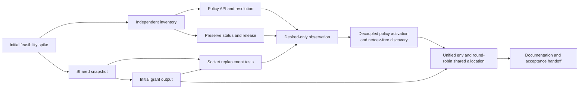

# Spec: RDMA Endpoint Discovery and Selection Filters

Status: Shipped
Type: Feature

On implementation, this design supersedes the NIC pass and RDMA link verification in
[NIC/RDMA topology](2026-09-02-devices-nic-rdma-topology.md), and the link gate and allocation response in
[RDMA extended resources](2026-09-20-rdma-extended-resource.md), for the new discovery and opt-in selection paths.
The shipped contracts remain the baseline until those changes land.

## Summary

Discover Linux RDMA endpoints without requiring an IPoIB netdev. By default, retain every endpoint that meets allocation and health requirements. Let administrators restrict that set with include/exclude filters through `DevicesRDMASelectionPolicy`. Decouple periodic hardware scanning in the Detector from policy evaluation in the Device Plugin controller so policy updates take effect immediately for subsequent advertisements and allocations without triggering hardware rescans or disrupting running containers. Unify container environment injection under `GPUSTACK_RDMA_DEVICES` (with empty-string fallback when no HCA can be picked) and spread `rdma.shared` allocations across distinct RDMA endpoints using an outer/inner round-robin loop.

## Motivation

### Goals

- Find native InfiniBand verbs devices and RoCE devices without duplicate capacity.
- Let administrators include or exclude HCAs for accelerator workloads via `DevicesRDMASelectionPolicy`.
- Decouple hardware discovery from policy evaluation: Detector scans physical hardware on its monitor cadence, while the selection reconciler evaluates policy changes against the latest hardware snapshot and updates subsequent `ListAndWatch`, `GetPreferredAllocation`, and `Allocate` responses without re-running hardware discovery.
- Leave already-allocated containers and existing RDMA grants untouched when configuration refreshes; ensure subsequent allocations immediately use the refreshed configuration.
- Expose a single unified environment variable `GPUSTACK_RDMA_DEVICES` (plus `NCCL_IB_HCA`) across `rdma`, `rdma.shared`, and `rdma.partitioned` so workloads do not need YAML or code changes when switching resource modes; inject `""` when no HCA can be picked.
- Distribute `rdma.shared` allocations across distinct RDMA endpoints first (outer round loop, inner endpoint loop) so requesting $N$ shared devices on an $N$-HCA node grants one share on each of the $N$ HCAs rather than $N$ shares on a single HCA.
- Report unknown network roles and incomplete discovery without inventing connectivity.

### Non-Goals

- Configure switches, InfiniBand subnet managers, P-Keys, VLANs, routes, IPoIB, or SR-IOV.
- Add `rdma.storage*` resources or storage-specific environment variables.
- Build a 3FS client, a KV cache system, or a general network controller.
- Allocate vendor-managed NPU ports as Linux verbs devices.
- Change AWS EFA ownership or existing scale-up fabric discovery.
- Run automatic network probes during discovery or allocation.
- Automatically classify HCAs as east-west compute or north-south storage.
- Add port selection or change the existing aggregate HCA health rule.
- Revoke, drain, or migrate running containers when policy configuration changes.
- Qualify HIXL, Mooncake, NIXL, or 3FS integrations through a generic environment variable alone.
- Resolve RDMA ownership on nodes with multiple accelerator manufacturers.

### Current implementation

The review baseline is commit `a4b463899a64d9e79c3b3c599f470f79f6701a09`, with Go 1.27.3, Kubernetes modules 0.36.5, and Kueue 0.18.11.

| Confirmed behavior | Consequence |
|---|---|
| [Interface discovery](../pkg/devicemanager/detector/network.go) enumerates `class/net`; the reverse RDMA lookup only enriches those entries. | A verbs device without a netdev has no independent inventory entry. |
| [Link checks](../pkg/devicemanager/detector/link.go) aggregate every port of one RDMA device. | A healthy port can mask a failed sibling. |
| [Endpoint selection](../pkg/deviceplugin/rdma_endpoint.go) uses bound RDMA device names and PF/VF state. | It has no workload-network selection rule. |
| [Allocation](../pkg/deviceplugin/rdma_allocate.go) includes every granted HCA name in `NCCL_IB_HCA`. | A grant can include an adapter unsuitable for the workload's peers. |
| [Shared RDMA server](../pkg/deviceplugin/rdma_server.go) does not implement `GetPreferredAllocation` and groups tokens by endpoint first. | Requesting multiple `rdma.shared` units can allocate multiple tokens from one HCA instead of spreading across distinct HCAs. |
| [Ascend discovery](../pkg/devicemanager/detector/ascend/device.go) already queries DCMI for RoCE addresses. | NPU networking does not require a fabricated host HCA entry. |

`Devices.spec.interfaces` includes ordinary and virtual network interfaces as well as RDMA-capable interfaces.
The RDMA allocator reads this shared inventory, but does not write RDMA usage into the accelerator allocation ledger in `Devices.status.groups`.
See the [Devices schema](../api/worker/v1alpha1/devices.go) and [RDMA allocation path](../pkg/deviceplugin/rdma_allocate.go).

These are source findings. They do not establish a failure in every deployed workload.

### Evidence and corrections

#### Nebius fabrics

The provider lists `us-north1-a` for B300 in region `us-north1`, and `fabric-3` for H100 in `eu-north1`.
A GPU cluster belongs to one physical fabric. P-Keys isolate GPU clusters within a shared fabric.
The provider does not promise identical HCA names, PCIe layouts, or separate storage adapters across fabrics.
See [Nebius InfiniBand fabrics](https://docs.nebius.com/compute/clusters/gpu/index#infiniband-fabrics), checked on 2026-10-30.

Archived experiments from 2026-10-29 provide two different endpoint selections:

| Sample | Observation | Limit |
|---|---|---|
| Nebius B300 host pair | A 4 KiB, 100-iteration host-buffer verbs write failed on `mlx5_0:1` and passed on `mlx5_4:1`. Both processes exited 1 in the failed run and 0 in the successful run. | Qualifies those selected paths at that time; does not identify a storage fabric. |
| Nebius H100, `eu-north1`, `fabric-3` | The same size and iteration count passed on `mlx5_0:1`; both processes exited 0. | Refutes a universal HCA-index rule; does not qualify other fabrics. |
| B300 topology capture | `mlx5_0..3` reported 100 Gbps and SYS distance to GPUs; `mlx5_4..11` reported 800 Gbps with GPU-local PIX pairs. | Affinity and rate are observations, not network roles. |

#### Ascend visibility

Read-only inventory covered two eight-NPU Ascend 910B2 hosts on 2026-10-29, using vendor stack 25.5.1 and CANN/HIXL 9.2.0 context.
Vendor queries found eight NPU RoCE endpoints per host, each reporting link up and a 200 Gbps shaper.
LLDP identified dedicated RoCE switches. None of these endpoints appeared in `class/net` or `class/infiniband`.

Host-visible RDMA devices were different adapters. Their counts differed between the two hosts, six versus two.
The storage role remains unknown. This does not prove that storage RDMA is absent or unsupported.

#### 3FS and DeepInfer

[3FS design notes](https://github.com/deepseek-ai/3FS/blob/22fca04564c7cc230fd8b9523b8b92864e1dad47/docs/design_notes.md) describe managers, metadata services, SSD storage services, and clients connected through InfiniBand or RoCE.
Storage access needs a path to storage peers. Whether that path shares the compute fabric is a deployment decision.

## Proposal

Separate hardware endpoint discovery from policy-based allocation eligibility:

1. **Hardware Discovery (`Detector`)**: Enumerate `/sys/class/infiniband` independently of `/sys/class/net` via `DetectRDMAInterfaces` / `MonitorRDMAInterfaces` and expose a copy-isolated node-local `RDMAInterfaceSnapshot` alongside `Devices.spec.interfaces`. Detector never evaluates `DevicesRDMASelectionPolicy`, and policy edits never trigger hardware rescans.
2. **Policy Reconciliation (`RDMASelectionObserver` & `DevicesReconciler`)**: Watch `Devices`, local `Node` labels, and `DevicesRDMASelectionPolicy`. Evaluate the policy against the latest hardware snapshot in memory, update `Devices.status.interfaces.rdmaSelectionPolicy` (`policyRef`, `excluded`) and root `Devices.status.conditions` (`RDMASelectionResolved`), store the active selection snapshot on `DevicesReconciler`, and notify all three RDMA device-plugin servers (`rdma`, `rdma.shared`, `rdma.partitioned`).
3. **Next-Allocation Enforcement without Drain Barriers**: Already-allocated containers and running RDMA workloads are left untouched. When the active selection updates, `ListAndWatch` marks unselected endpoints `Unhealthy` (retaining their device IDs so kubelet checkpoints remain valid while preventing new Pods from receiving unselected HCAs), and subsequent `GetPreferredAllocation` / `Allocate` calls use the updated selection.
4. **Unified Consumer Environment & Even Shared Distribution**:
   - All three RDMA resource families inject `GPUSTACK_RDMA_DEVICES` (comma-separated sorted HCA names, or `""` if no HCA can be picked) and `NCCL_IB_HCA` (`"=<names>"` or `""`).
   - `rdmaServer` enables `GetPreferredAllocation` and orders shared tokens using an outer-round / inner-endpoint loop so multi-device `rdma.shared` requests allocate one share per distinct RDMA device before repeating any device.

### User Stories

#### Story 1

As a cluster administrator, I want native verbs devices to be discovered without IPoIB, so that selection covers available host RDMA devices without requiring an IPoIB netdev.

#### Story 2

As a cluster administrator, I want policy updates to take effect immediately for subsequent Pod allocations without triggering hardware rescans or disrupting running Pods.

#### Story 3

As a workload owner, I want a single `GPUSTACK_RDMA_DEVICES` environment variable across `rdma`, `rdma.shared`, and `rdma.partitioned`, and I want `rdma.shared` requests to spread across distinct HCAs first, so that switching resource modes requires no application changes and multi-NIC shared requests mount all expected NICs.

### Core Features & Acceptance Criteria

#### Complete endpoint inventory

- Discover Linux RDMA devices and ports independently of netdev enumeration.
- Retain netdevs as optional associations. Support multiple netdevs and multiple ports without duplicate grants.
- Supplement `Devices.spec.interfaces` with netdev-free verbs devices from the detector's `RDMAInterfaceSnapshot` during RDMA interface snapshot capture.
- Keep vendor-managed NPU endpoints separate from Linux verbs endpoints.
- Preserve bounded sysfs reads, symlink-root validation, deterministic ordering, and the previous inventory after incomplete enumeration.

#### Administrator selection filters and decoupled reconciliation

- Use `DevicesRDMASelectionPolicy` as the administrator configuration source, selecting target nodes and providing optional `include` or `exclude` lists of exact HCA names.
- Limit the policy to RDMA allocation candidates. Preserve ordinary and virtual interfaces in `Devices.spec.interfaces`; the policy does not configure host or Pod networking.
- Without either filter, retain all candidates that meet the existing allocation and health rules, including netdev-free endpoints.
- `spec.include` and `spec.exclude` are mutually exclusive; setting both is rejected at admission and treated as invalid at resolution.
- An optional `spec.port` pins every selected HCA to one 1-based physical RDMA port; omission leaves every active port eligible. Admission refuses zero and negatives. Resolution fails a node closed when a selected HCA does not carry that port in its observed inventory; excluded and externally owned devices are never asked to carry it. Grants keep bare HCA names in `GPUSTACK_RDMA_DEVICES`, and `NCCL_IB_HCA` names each granted HCA with the pinned port.
- Match names exactly: `mlx5_1` must not also match `mlx5_10`. Do not infer prefixes or patterns.
- Reject malformed rules at admission. Report names absent from a complete node inventory as invalid on that node. An incomplete inventory leaves resolution unknown.
- Fail closed on configuration or resolution errors: never fall back to all adapters or retain a stale previous selection. Whenever resolution is `Invalid`, `Conflict`, or `Unknown`, clear `excluded`, report `RDMASelectionResolved=False` (or `Unknown`), and mark all RDMA candidates unhealthy / unselected so zero HCAs are eligible for new allocations until the configuration is fixed.
- Watch policy changes, Node selector changes, and inventory changes. Reconcile and notify the RDMA device-plugin servers immediately without triggering a Detector hardware rescan.

#### Allocation, preferred distribution, and consumer contract

- Keep `device.gpustack.ai/rdma`, `.rdma.shared`, and `.rdma.partitioned` and their existing accounting units.
- Enable `GetPreferredAllocationAvailable: true` on `rdmaServer` and implement `GetPreferredAllocation` using an outer-round / inner-endpoint loop so that requesting $K$ tokens spreads across distinct available RDMA endpoints first before taking a second token from the same endpoint. Interleave `ListAndWatch` shared tokens in the same round-robin order.
- Inject only the granted verbs device nodes and the available node-level `rdma_cm`. Do not mount the whole directory.
- Emit `GPUSTACK_RDMA_DEVICES` (plain comma-separated sorted HCA names) and `NCCL_IB_HCA` (`"=<names>"`) for all three RDMA resource families. When no HCA can be picked (for example, when all granted endpoints are excluded by policy), emit `GPUSTACK_RDMA_DEVICES=""` and `NCCL_IB_HCA=""`.

### Boundaries

- **Always:** Keep discovery read-only and deterministic. Preserve unknowns and public compatibility. Keep hardware detection decoupled from policy evaluation.
- **Ask first:** Add storage resource families, change existing resource units or label semantics by default, or run cluster and hardware qualification.
- **Never:** Infer storage from distance or failed compute traffic; fabricate uverbs devices for NPUs; treat HCA filters as security isolation; trigger hardware rescans on policy edits.

### Risks and Mitigations

- Ambiguous hardware role → Preserve unknown purpose and default eligibility; let administrators restrict candidates with filters.
- Shared requests land on a single NIC → Implement outer/inner round-robin endpoint selection in `GetPreferredAllocation` and interleaved token ordering in `ListAndWatch`.
- Switching between `rdma`, `rdma.shared`, and `rdma.partitioned` breaks startup scripts → Use one unified `GPUSTACK_RDMA_DEVICES` environment variable across all modes, with `""` fallback when no HCA is picked.
- Policy CRD missing during startup or upgrade → Watch the policy kind through the shared controller-runtime manager cache like every other input, with the policy CRD shipped in the operator's own CRD set; a node whose cache cannot list the policies yet publishes `Unknown` and retries on the polling interval until it lands.
- Accelerator reconciliation replaces the full status → Patch only `status.groups` with an optimistic resource-version precondition so `status.interfaces` and selection conditions survive concurrent writes.

## Design Details

### Policy API

Add the cluster-scoped `worker.gpustack.ai/v1` resource `DevicesRDMASelectionPolicy`, backed by the internal `v1alpha1` type.
Use the existing public CRUD proxy pattern. Node annotations are not a second configuration source.
Per-node resolution status belongs to `Devices.status.interfaces.rdmaSelectionPolicy` and root `Devices.status.conditions`.

| Field | Contract |
|---|---|
| `spec.nodeSelector` | Required, non-null Kubernetes label selector. `{}` explicitly matches every node. |
| `spec.include` | Optional list of exact HCA names. Mutually exclusive with `spec.exclude`. Absence or null means no inclusion restriction. |
| `spec.exclude` | Optional list of exact HCA names. Mutually exclusive with `spec.include`. Absence or null excludes none. |
| `spec.port` | Optional 1-based physical RDMA port. The schema carries `minimum: 1`; the webhook re-refuses zero and negatives. Resolution copies it into the applied selection only after every selected HCA carries it in the observed inventory, otherwise the node fails closed. Absence or null leaves every active port eligible. |

Zero matching policies means the default selection after a successful policy list and complete inventory observation.
One policy supplies the filters. More than one matching policy is a conflict, even if their rules are identical.

### Decoupled Inventory and Selection Reconciliation

1. **Detector (`pkg/devicemanager/detector/`)**:
   - Scans `/sys/class/infiniband` via `DetectRDMAInterfaces` / `MonitorRDMAInterfaces` and stores a copy-isolated `device.RDMAInterfaceSnapshot` in memory via `Detector.RDMAInterfaceSnapshot()`.
   - When the RDMA interface snapshot changes on the monitor cadence, Detector triggers a `Devices` report update and invokes `OnRDMAInterfacesChanged` to wake the reconcilers.
2. **Selection Reconciler (`pkg/deviceplugin/rdma_selection_observer.go`)**:
   - Watches this node's `Devices`, this node's `Node` (`LabelChangedPredicate`, so kubelet heartbeats and status updates never enqueue), and `DevicesRDMASelectionPolicy` (`GenerationChangedPredicate`) through the shared manager cache; each node's cache is narrowed by `CacheByObject` to its own `Devices` and `Node` (`metadata.name=<NodeName>`), so the policy informer is the only cluster-wide one, and the bounded periodic resync remains the recovery floor.
   - Reads the policy list and local `Node` through the cached `Client`, falling back to one `APIReader.Get` only while the cache has not populated the local `Node` yet, and the verbs inventory via `Detector.RDMAInterfaceSnapshot()`.
   - Calls `ResolveRDMAPolicy` to compute `RDMAPolicyResolution`.
   - When `Status` is `Default` or `Policy`:
     - Updates `policyRef` and `excluded` under `Devices.status.interfaces.rdmaSelectionPolicy`.
     - Sets `RDMASelectionResolved=True` (`NoPolicy` / `PolicyResolved`).
     - Stores the active selection snapshot on `DevicesReconciler` and triggers `notifyListeners()` so all `rdmaServer` streams immediately refresh.
   - When `Status` is `Invalid`, `Conflict`, or `Unknown`:
     - Updates `policyRef` (the matched policy for `Invalid`, or `nil` for `Conflict` / `Unknown`), clears `excluded`, and sets `RDMASelectionResolved` (`False` or `Unknown`).
     - Replaces the active selection in memory with a fail-closed empty selection (`Selected: {}`) and notifies all `rdmaServer` streams so zero HCAs are eligible for new allocations.
3. **RDMA Interface Snapshot & Endpoint Resolution (`pkg/deviceplugin/rdma_selection.go`, `rdma_endpoint.go`)**:
   - `captureRDMAInterfaceSnapshot` combines `Devices.spec.interfaces` with any netdev-free verbs devices from `Detector.RDMAInterfaceSnapshot()` and attaches the active selection filter from `DevicesReconciler`.
   - In `ListAndWatch`, unselected endpoints (or externally owned devices) keep their advertised Device IDs but report `Health: Unhealthy`.
   - In `GetPreferredAllocation` and `Allocate`, only selected endpoints are eligible to be picked.

### Preferred Allocation and Unified Environment Output

1. **Outer/Inner Loop for `rdmaServer` (`pkg/deviceplugin/rdma_server.go`)**:
   - `GetDevicePluginOptions` returns `GetPreferredAllocationAvailable: true`.
   - `GetPreferredAllocation` groups available device IDs by endpoint (`Resource` / HCA), accounts for `MustIncludeDeviceIDs`, and runs an outer round loop (`round = 0, 1, ...`) over an inner loop across all eligible endpoints in deterministic order. Each round picks at most one token per endpoint before advancing to the next round.
   - `getListAndWatchResponse` interleaves shared tokens in the same outer-round / inner-endpoint order.
2. **Unified Environment Variable (`pkg/deviceplugin/rdma_allocate.go`)**:
   - All three modes (`Exclusive`, `Shared`, `Partitioned`) emit `GPUSTACK_RDMA_DEVICES` and `NCCL_IB_HCA`.
   - When one or more selected HCAs are granted (`names = "mlx5_0,mlx5_1"`):
     - `GPUSTACK_RDMA_DEVICES`: `"mlx5_0,mlx5_1"`
     - `NCCL_IB_HCA`: `"=mlx5_0,mlx5_1"`, or `"=mlx5_0:1,mlx5_1:1"` when the active selection pins port 1 — each granted HCA named with that port, so NCCL opens the selected port rather than any port of the adapter.
   - When no selected HCA can be picked (`len(grants) == 0`):
     - `GPUSTACK_RDMA_DEVICES`: `""`
     - `NCCL_IB_HCA`: `""`

### Commands

```bash
env -u GODEBUG CGO_ENABLED=1 go test -race -count=1 -tags 'goccy netgo' ./api/worker/...
env -u GODEBUG CGO_ENABLED=1 go test -race -count=1 -tags 'goccy netgo' ./pkg/devicemanager/...
env -u GODEBUG CGO_ENABLED=1 go test -race -count=1 -tags 'goccy netgo' ./pkg/deviceplugin/...
env -u GODEBUG CGO_ENABLED=1 go test -race -count=1 -tags 'goccy netgo' ./pkg/worker/extensionapis/... ./pkg/worker/webhooks/worker/...
env -u GODEBUG CGO_ENABLED=1 go test -race -count=1 -tags 'goccy netgo' ./pkg/nodefeature/...
env -u GODEBUG make lint
make lint docs
git diff --check
```

### Implementation Plan



- [x] **T0 · Initial transition and identity spike (superseded by decoupled next-allocation design)**
      Blocked by: None.
      Owns: Historical spike tests, superseded in T4/T5 by direct next-allocation activation.

- [x] **T1 · Shared snapshot with unchanged default behavior**
      Blocked by: T0.
      Owns: `pkg/deviceplugin/rdma_selection*.go`, `pkg/deviceplugin/rdma_endpoint*.go`, `pkg/deviceplugin/rdma_server*.go`, `pkg/deviceplugin/rdma_allocate*.go`, `pkg/deviceplugin/controller.go`.

- [x] **T2 · Internal verbs observations and interface policy status**
      Blocked by: T0.
      Owns: `api/worker/{v1,v1alpha1}/devices*.go`, `pkg/device/rdma*.go`, `pkg/devicemanager/detector/rdma*.go`, `pkg/devicemanager/detector/network*.go`, `pkg/devicemanager/detector/link*.go`, `pkg/devicemanager/detector/detector*.go`.

- [x] **T3 · Policy CRUD, validation, and deterministic resolution**
      Blocked by: T2.
      Owns: `api/worker/{v1,v1alpha1}/devices_rdma_selection_policy*.go`, `pkg/worker/extensionapis/worker/devices_rdma_selection_policy*.go`, `pkg/worker/webhooks/worker/devices_rdma_selection_policy*.go`, `pkg/deviceplugin/rdma_policy*.go`.

- [x] **T4a · Preserve foreign status and independent release**
      Blocked by: T2.
      Owns: `pkg/deviceplugin/controller.go`, `pkg/deviceplugin/controller_test.go`.

- [x] **T4b · Socket transition evidence**
      Blocked by: T1, T5a.
      Owns: `pkg/deviceplugin/rdma_transition_serving_test.go`, `pkg/deviceplugin/rdma_transition_listwatch_test.go`.

- [x] **T4c · Desired-only observation**
      Blocked by: T1, T3, T4a, T4b.
      Owns: `pkg/deviceplugin/rdma_selection_observer*.go`, `pkg/devicemanager/controllers/setup.go`, `pkg/devicemanager/manager.go`, `pkg/devicemanager/manager_test.go`.

- [x] **T4 · Decoupled policy reconciliation, immediate next-allocation activation, and netdev-free verbs endpoints**
      Blocked by: T1, T3, T4a, T4b, T4c.
      Owns: `pkg/deviceplugin/rdma_selection*.go`, `pkg/deviceplugin/rdma_endpoint*.go`, `pkg/deviceplugin/rdma_server*.go`, `pkg/deviceplugin/controller.go`, `pkg/devicemanager/manager.go`, `pkg/devicemanager/manager_test.go`, removal of superseded `pkg/deviceplugin/rdma_transition_contract_test.go` and `pkg/deviceplugin/rdma_identity_contract_test.go`.
      Gate: review.
      Acceptance: Wire `Detector.RDMAInterfaceSnapshot` and active policy selection into `DevicesReconciler` and `RDMASelectionObserver`. Supplement `Devices.spec.interfaces` with netdev-free verbs devices from `RDMAInterfaceSnapshot` without duplicating bound HCAs. Watch `Node` label changes and `DevicesRDMASelectionPolicy` events through the shared manager cache — each node's cache scoped by `CacheByObject` to its own `Devices` and `Node` (`metadata.name=<NodeName>`) — in addition to `Devices` changes and bounded resync. When a valid `Policy` or `Default` resolves, publish `policyRef`, `excluded`, and `RDMASelectionResolved=True`, update the active selection on `DevicesReconciler`, and notify all RDMA servers immediately without triggering a Detector hardware rescan. When resolution is `Invalid`, `Conflict`, or `Unknown`, fail closed (clear `excluded`, select zero HCAs) and publish `RDMASelectionResolved=False` or `Unknown`. Mark unselected or externally owned endpoints `Unhealthy` in `ListAndWatch` while retaining their IDs.
      Verify: `env -u GODEBUG CGO_ENABLED=1 go test -race -count=1 -tags 'goccy netgo' ./pkg/deviceplugin/... ./pkg/devicemanager/...`; `env -u GODEBUG make lint`; `make lint docs`.

- [x] **T5a · Initial exact output from the grant path**
      Blocked by: T1.
      Owns: `pkg/deviceplugin/rdma_allocate.go`, `pkg/deviceplugin/rdma_allocate_test.go`.

- [x] **T5 · Unified `GPUSTACK_RDMA_DEVICES` environment and outer/inner round-robin `rdma.shared` allocation**
      Blocked by: T4, T5a.
      Owns: `pkg/deviceplugin/rdma_server*.go`, `pkg/deviceplugin/rdma_allocate*.go`.
      Gate: review.
      Acceptance: Unify the plain HCA environment variable across `rdma`, `rdma.shared`, and `rdma.partitioned` under `GPUSTACK_RDMA_DEVICES` (removing `GPUSTACK_RDMA_SHARED_DEVICES` and `GPUSTACK_RDMA_PARTITIONED_DEVICES`). When selected HCAs are picked for a grant, emit sorted deduplicated names in `GPUSTACK_RDMA_DEVICES` and `"=<names>"` in `NCCL_IB_HCA` and inject only their `uverbs` nodes plus optional `rdma_cm`. When no HCA can be picked (e.g., all granted endpoints are unselected by active policy), emit `GPUSTACK_RDMA_DEVICES=""` and `NCCL_IB_HCA=""`. Enable `GetPreferredAllocationAvailable: true` on `rdmaServer` and implement `GetPreferredAllocation` (plus interleaved `ListAndWatch` token ordering) with an outer-round / inner-endpoint loop so requesting $N$ `rdma.shared` units across $N$ HCAs selects one token per HCA first instead of $N$ tokens from one HCA.
      Verify: `env -u GODEBUG CGO_ENABLED=1 go test -race -count=1 -tags 'goccy netgo' ./pkg/deviceplugin/...`; `env -u GODEBUG make lint`; `make lint docs`.

- [x] **T6 · Usage documentation and acceptance handoff**
      Blocked by: T5.
      Owns: `docs/modules/rdma/*.md`, `docs/walkthroughs/rdma/network-endpoints.md`, `docs/README.md`, this spec's validation results.
      Acceptance: Update RDMA documentation to reflect unified `GPUSTACK_RDMA_DEVICES` across all modes (with empty-string fallback), round-robin `rdma.shared` distribution across HCAs, netdev-free verbs discovery, and immediate next-allocation policy activation via `DevicesRDMASelectionPolicy`. Update `docs/README.md` module map if needed. Record focused test and lint results separately from unrun cluster/hardware e2e acceptance (`gpustack-operator-e2e`).
      Verify: `make lint docs`; `git diff --check`.

### Test Plan

- [x] I/we understand the owners of the involved components may require updates to existing tests to make this code solid enough prior to committing the changes necessary to implement this enhancement.

#### Unit & Integration tests

- Verify `Detector` enumerates netdev-free verbs devices, multi-port HCAs, SR-IOV VFs, and externally owned EFA devices into `RDMAInterfaceSnapshot` via `DetectRDMAInterfaces` / `MonitorRDMAInterfaces`.
- Verify `DevicesRDMASelectionPolicy` CRUD, admission validation (including `include` / `exclude` mutual exclusion), and `ResolveRDMAPolicy` determinism across Default, Policy, Invalid, Conflict, and Unknown states.
- Verify `RDMASelectionObserver` reconciles `Devices`, `Node`, and policy events, publishes `policyRef`, `excluded`, and `RDMASelectionResolved`, preserves `status.groups`, fails closed (selects zero HCAs) on invalid/conflict/unknown updates, and immediately notifies `rdmaServer` without re-running `Detector`.
- Verify `rdmaServer` advertises netdev-free verbs devices, marks policy-excluded endpoints `Unhealthy` in `ListAndWatch`, and spreads `rdma.shared` allocations across distinct endpoints first via `GetPreferredAllocation` and interleaved token ordering.
- Verify `Allocate` emits `GPUSTACK_RDMA_DEVICES` and `NCCL_IB_HCA` for all three modes, deduplicating multiple tokens on the same HCA, and emits `""` when no HCA can be picked due to active policy exclusion.

#### e2e tests

Required before claiming runtime acceptance, and separately authorized via `gpustack-operator-e2e`:

- Exercise public API round trips for `DevicesRDMASelectionPolicy`, node label matching, `ListAndWatch` capacity updates, `rdma.shared` multi-HCA distribution, and container `GPUSTACK_RDMA_DEVICES` / `NCCL_IB_HCA` injection on a Linux cluster.

## Alternatives

| Alternative | Assessment |
|---|---|
| Classify near GPUs as compute and distant HCAs as storage | Reject: affinity does not establish purpose; the Ascend sample lacks host-visible NPU endpoints. |
| Trigger Detector hardware rescans on policy updates | Reject: couples control-plane configuration edits to slow sysfs polling; evaluating policies in the reconciler against cached hardware observations is immediate and clean. |
| Block policy updates behind node cordon/drain, podresources barriers, and local transaction files | Reject: already-allocated containers are unaffected by subsequent `ListAndWatch` health changes; marking excluded devices `Unhealthy` for future allocations satisfies next-allocation enforcement without fragile stateful barriers. |
| Separate `GPUSTACK_RDMA_SHARED_DEVICES` and `GPUSTACK_RDMA_PARTITIONED_DEVICES` variables | Reject: forces users to edit container startup scripts or YAML whenever they switch RDMA resource modes. Use `GPUSTACK_RDMA_DEVICES` for all modes. |
| Let kubelet pick `rdma.shared` tokens without `GetPreferredAllocation` | Reject: can assign multiple tokens from a single HCA, mounting only 1 NIC when the user requested 4. Use outer/inner round-robin preferred allocation. |

## Open Questions

- Exact cluster images and hardware tuples for the unrun runtime gates require separate authorization (`gpustack-operator-e2e`).
