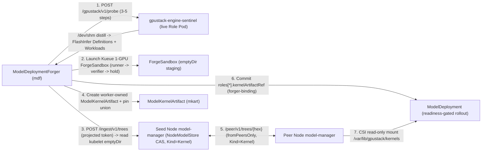

# Spec: ModelDeploymentForger and ModelKernelArtifact — Closed-Loop Kernel Probing, Forging, and NodeModelStore Delivery

Status: Building
Blocked on: Implementation of T1–T11, chart verification via gpustack-operator-chart-e2e, and end-to-end deterministic mock-Forge plus live-GPU qualification via gpustack-operator-e2e before promoting Status to Shipped.
Type: Feature

- **Related Specs**: [2026-09-25-model-artifact.md](2026-09-25-model-artifact.md) · [2026-09-25-node-model-store.md](2026-09-25-node-model-store.md) · [2026-09-27-model-peer-sync.md](2026-09-27-model-peer-sync.md) · [2026-09-27-model-prefetch.md](2026-09-27-model-prefetch.md) · [2026-09-29-model-artifact-expected-digest.md](2026-09-29-model-artifact-expected-digest.md) · [2026-10-21-model-deployment-scaler.md](2026-10-21-model-deployment-scaler.md) · [2026-11-19-model-deployment-online-runtime-control.md](2026-11-19-model-deployment-online-runtime-control.md) · [2026-11-24-cpu-mock-device-manager-and-e2e-consolidation.md](2026-11-24-cpu-mock-device-manager-and-e2e-consolidation.md)

## Summary

Introduce `ModelDeploymentForger` (`mdf`) and `ModelKernelArtifact` (`mkart`) in `worker.gpustack.ai/v1alpha1` and `worker.gpustack.ai/v1` to automate closed-loop GPU kernel specialization for live `ModelDeployment` workloads without external container registries, mutable network filesystems, or etcd-bloating `ConfigMap`s.
`gpustack-engine-sentinel` gains a dynamic 3-to-5-step short-window probe (`/gpustack/v1/probe`) backed by bounded `/dev/shm` distillation on [vLLM](https://docs.vllm.ai/en/stable/examples/features/profiling/) (sentinel-owned `torch.profiler.profile` dispatched to the rank-0 GPU worker via `collective_rpc`, gated by runtime capability detection) and [SGLang](https://github.com/sgl-project/sglang/blob/main/python/sglang/srt/entrypoints/engine.py) (in-process `TokenizerManager.start_profile` with `record_shapes=True`, bypassing HTTP admin middleware and cleaning all TP ranks' trace files), emitting standardized [FlashInfer Trace Schema](https://bench.flashinfer.ai/docs/flashinfer-trace) (`Definition`, `Workload`, `Solution`, `Trace`) records keyed by single-GPU `LocalKernelKey` (`pkg/worker/kernelkey`) while excluding dense and block-scaled GEMM and multi-GPU collective kernels.
`ModelDeploymentForger` schedules a Kueue-admitted single-GPU `ForgeSandbox` Pod (`restricted` Pod Security compliant, staging into a size-capped `emptyDir` with an independent operator-controlled `forge-verifier` init container and a terminated-runner handoff barrier), ingests verified output trees (`solutions/`, `traces/`, and `dispatch-manifest.json`) directly into the seed node's `model-manager` (`NodeModelStore` CAS `<root>/published/<hex>/tree` in `gpustack-manifest v1` format with store-local `Kind: "Kernel"` provenance), pins active and rollback-fallback digests through the single-writer `NodeModelStore.spec.pinned` union so watermark GC never evicts unbacked forged trees, replicates them across nodes via `/peer/v1/trees/{hex}` Peer Sync (`fromPeersOnly`), and promotes immutable worker-created `ModelKernelArtifact` generations onto `ModelDeployment.spec.roles[*].kernelArtifactRef` for read-only `model.csi.gpustack.ai` inline ephemeral mounts and readiness-gated rolling replacement.

## Motivation

1. **Serving workloads leave workload-specific non-GEMM GPU efficiency on the table**:
   - Production `ModelDeployment` roles run fixed model architectures, tensor/expert parallel shard degrees (`TP`, `EP`), quantization formats, and batch/sequence distributions (`Prefill` vs `Decode` vs `Server`), yet rely on generic ahead-of-time operator libraries for memory-bound and irregular kernels (fused RMSNorm/residual/quantization, RoPE + KV-cache append, MoE router top-k/permute/unpermute, ragged/paged attention, and speculative verification).
   - Meanwhile, vendor libraries (`cuBLASLt`, `hipBLASLt`, CUTLASS/DeepGEMM) already saturate hardware tensor cores on regular dense GEMM and block-scaled GEMM; attempting to synthesize dense/block-scaled GEMMs wastes sandbox GPU hours with high regression risk, whereas non-GEMM single-GPU local kernels benefit directly from shape-specialized synthesis ([FlashInfer-Bench, arXiv:2601.00227](https://arxiv.org/html/2601.00227v1)).
2. **Continuous profiling and boot-time profiler flags degrade live serving**:
   - In [vLLM](https://docs.vllm.ai/en/stable/examples/features/profiling/), `VLLM_TORCH_PROFILER_DIR` was removed in favor of boot-time `--profiler-config`, and leaving full traces active across many steps stalls decode ITL and fills `/dev/shm`. Moreover, under multi-GPU `TP > 1`, GPU kernels execute inside worker processes rather than `EngineCore`.
   - In [SGLang](https://github.com/sgl-project/sglang/blob/main/python/sglang/srt/entrypoints/engine.py), HTTP `/start_profile` is subject to HTTP admin middleware and writes per-rank trace files across every TP scheduler; `gpustack-engine-sentinel` ([`sglang/hooks.py`](../engine-sentinel/python/gpustack_engine_sentinel/sglang/hooks.py)) already runs in-process beside `TokenizerManager` and can coordinate bounded short-window capture and all-rank cleanup.
   - A transient 3-to-5-step short-window probe triggered through `gpustack-engine-sentinel` (`/gpustack/v1/probe`) captures live operator shapes into bounded `/dev/shm` staging, distills them into compact [FlashInfer Trace Schema](https://bench.flashinfer.ai/docs/flashinfer-trace) `Definition` + `Workload` JSON, and deletes all raw profiler traces immediately.
3. **Forged binary artifacts belong in `NodeModelStore`, never in `ConfigMap`s or external registries**:
   - Compiled GPU kernel trees (`.so`, `.cubin`, `.hsaco`, Triton/TileLang/CUDA caches, `Trace` records, and `dispatch-manifest.json`) routinely span megabytes to hundreds of megabytes. Storing them in `ConfigMap`s violates etcd's 1 MiB object limit, bloats API server watch memory, and lacks content-addressed digest verification.
   - Requiring an external OCI registry push or Hugging Face upload breaks air-gapped clusters and forces tenants to manage external write credentials.
   - `gpustack-operator` already ships a content-addressed node cache (`NodeModelStore`, [`store.go`](../pkg/modelmanager/store/store.go)), node-to-node TLS Peer Sync (`/peer/v1/trees/{hex}`, [`server.go`](../pkg/modelmanager/peer/server.go)), `fromPeersOnly` materialization ([`materialize.go`](../pkg/modelmanager/materialize/materialize.go)), `spec.pinned` watermark-GC immunity ([`gc.go`](../pkg/modelmanager/gc/gc.go)), and read-only inline ephemeral CSI mounts (`model.csi.gpustack.ai`, [`driver.go`](../pkg/modelmanager/driver/driver.go)). Ingesting verified `ForgeSandbox` `emptyDir` outputs directly into the co-located node's `model-manager` reuses the entire verified delivery chain with zero external storage dependencies and zero `hostPath` volumes in tenant namespaces.

### Goals

- **G1 · Immutable `ModelKernelArtifact` (`mkart`) without `ConfigMap` sources or cross-tenant digest hijacking**: Introduce namespaced `ModelKernelArtifact` (`worker.gpustack.ai/v1alpha1` and read-only-status aggregated `worker.gpustack.ai/v1` proxy) with immutable `spec`, structural-schema omission of `spec.source.configMap` plus webhook prohibition of `ConfigMap` mounts over `/var/lib/gpustack/kernels`, worker-only `spec.source.nodeStore` creation (anchored to `gpustack-manifest v1` `sha256:<64 hex>`), optional commit-pinned `huggingFace` / digest-pinned `image` import sources for tenants, and hardware/engine compatibility metadata keyed by `LocalKernelKey`.
- **G2 · Single-GPU `LocalKernelKey` and Black-Box Forge + Operator Verifier I/O Contract**: Define `pkg/worker/kernelkey` for canonical single-GPU operator identity (per-rank sharded `const` dimensions, dtypes, manufacturer, GPU architecture, engine, and normalized engine version), explicitly excluding dense GEMM, block-scaled GEMM, and multi-GPU collective communication kernels; standardize the `ForgeSandbox` input/output directory contract around [FlashInfer Trace Schema](https://bench.flashinfer.ai/docs/flashinfer-trace) (`Definition`, `Workload`, `Solution`, `Trace`) plus `dispatch-manifest.json`, backed by an operator-controlled `forge-verifier` init container that independently verifies correctness and speedup before ingestion.
- **G3 · Zero-Restart Short-Window Sentinel Probing (`/gpustack/v1/probe`) and Compile-Cache-Safe Kernel Loader**: Extend `gpustack-engine-sentinel` ([`engine-sentinel/python/`](../engine-sentinel/python/)) to run 3-to-5-step short-window profiling on live `vLLM` (sentinel-owned `torch.profiler.profile` dispatched via `collective_rpc` on rank 0) and `SGLang` (in-process `TokenizerManager.start_profile` with `record_shapes=True` and all-rank cleanup), staging raw traces in a bounded `/dev/shm/gpustack-probe/<probe_id>/` directory (`<= 64 MiB`), enforcing per-boot sentinel cooldowns, distilling hot single-GPU non-GEMM workloads into JSON, and unlinking raw traces immediately; add lazy worker/model-runner startup kernel hooks folded into the compilation cache key.
- **G4 · Co-Located `emptyDir` Ingestion, Content-Class Provenance, Single-Writer Pin Union, Peer Sync, and Authorized CSI Mounts**: Ingest verified `ForgeSandbox` `emptyDir` outputs via `model-manager`'s existing `<kubeletDir>/pods` mount using an audience-bound projected worker token (`gpustack-model-ingest`), single-pass hash-while-copy, and store-local `Kind: "Kernel"` provenance preserved across Peer Sync; extend `ModelPrefetchReconciler`'s single-writer `NodeModelStore.spec.pinned` union across `ModelTransfer`, active/rollback `ModelKernelArtifact` digests, and `ModelPrefetch` with per-node `256`-cap isolation; generalize `Materializer` for `ModelKernelArtifact` (`fromPeersOnly` over `/peer/v1/trees/{hex}`); and enforce strict `Kernel` vs `Model` content-class isolation in `driver/authorize.go`.
- **G5 · Closed-Loop `ModelDeploymentForger` (`mdf`) Lifecycle with Readiness-Gated Canary Rollout**: Coordinate `runtimeControl` steadiness, short-window probing, Kueue-admitted single-GPU `ForgeSandbox` execution, independent verification gating, `ModelKernelArtifact` publishing, single-writer `forger-binding` promotion onto `ModelDeployment.spec.roles[*].kernelArtifactRef`, **readiness-gated** canary slot replacement (holding the replacement slot until `/gpustack/v1/ready` and `/gpustack/v1/runtime_config` confirm loaded kernels before advancing to subsequent replicas), automatic rollback (including to `nil` stock kernels) with persistent `ModelKernelArtifact.status.quarantined`, and bounded multi-generation history.
- **G6 · Deterministic Mock-Forge E2E Qualification**: Ship a built-in Go `gpustack-operator forge-mock` runner (and `gpustack-operator forge-hold` / `forge-verify` helpers) requiring zero Python inside the operator image so CPU-mock Kind clusters can run deterministic end-to-end storage, CSI, Peer Sync, pin-GC, rollout, and rollback tests (`case-38.sh`), paired with a live-GPU qualification leg for real `vLLM`/`SGLang` probing and Triton kernel substitution.

### Non-Goals

- **Implementing a proprietary LLM kernel-generation agent inside `gpustack-operator`**: The operator owns probing, sandboxing, independent verification gating, content-addressed storage, peer distribution, and safe rollout; the `forge-runner` container inside `ForgeSandbox` is a pluggable black box conforming to the [FlashInfer Trace Schema](https://bench.flashinfer.ai/docs/flashinfer-trace) + `dispatch-manifest.json` contract.
- **Forging regular dense GEMM or block-scaled GEMM kernels**: Standard FP16/BF16/FP8/INT8 matmul and MXFP8/NVFP4 block-scaled GEMMs are excluded by `pkg/worker/kernelkey`.
- **Forging multi-GPU collective or fused communication kernels**: `NCCL`/`HCCS`/`RCCL` `all_reduce`, `all_gather`, `reduce_scatter`, `all_to_all`, and cross-node NVSHMEM/RDMA kernels are out of scope; `ForgeSandbox` requests exactly `1` whole accelerator card through Kueue and verifies single-GPU local kernels only.
- **`ConfigMap` or `Secret` binary kernel storage**: `ModelKernelArtifact.spec.source.configMap` is omitted from the structural schema and forbidden by design, and mounting a `ConfigMap` over `/var/lib/gpustack/kernels` on `ModelDeployment` is rejected at admission.
- **In-memory hot-patching (`dlopen` overwrite) into running GPU worker processes without Pod replacement**: Kernel promotion mutates `ModelDeployment.spec.roles[*].kernelArtifactRef`, triggering `ModelDeployment`'s readiness-gated rolling replacement so CUDA Graphs, `torch.compile` caches, and crash blast radius stay cleanly isolated per replica.
- **Probing or forging `Encode`, CPU-only (`acceleratorType == ""`), unmanaged (`role.command` set), SGLang-Ray (`ModelDeploymentRoleSupportsEngineSentinel == false`), or Elastic EP (`RoleHasElasticEP == true`) roles**: Rejected at admission, matching and narrowing the `runtimeControl` scope boundaries in [`2026-11-19-model-deployment-online-runtime-control.md`](2026-11-19-model-deployment-online-runtime-control.md) (Elastic EP's separate Ray head hash path in `model_deployment_elastic_realization.go` and dynamic collective membership are deferred to a follow-up spec).

## Proposal



### User Stories

#### Story 1
As an inference platform engineer, I want to attach a `ModelDeploymentForger` to a running `ModelDeployment`, so that hot non-GEMM operator bottlenecks on `Prefill`, `Decode`, or `Server` roles are automatically profiled over 3–5 steps, forged in an isolated Kueue-scheduled single-GPU sandbox, independently verified for numerical correctness and latency speedup, and rolled out with readiness-gated canary protection without manual profiling or image rebuilds.

#### Story 2
As a cluster storage and security administrator, I want forged kernel bundles stored as content-addressed `gpustack-manifest v1` trees tagged with `Kind: "Kernel"` inside `NodeModelStore`, created exclusively by the operator worker so tenants cannot hijack other tenants' digests or Hub weights, pinned against watermark eviction while active or held for rollback, synced peer-to-peer across GPU nodes without external registries or `ConfigMap` bloat, and mounted read-only via `model.csi.gpustack.ai` only in namespaces holding a matching resolved `ModelKernelArtifact`.

#### Story 3
As a kernel-agent researcher or operator developer, I want `ForgeSandbox` to consume standard [FlashInfer Trace Schema](https://bench.flashinfer.ai/docs/flashinfer-trace) `Definition` and `Workload` JSON files and emit `Solution`, `Trace`, and `dispatch-manifest.json` files—validated by an operator-controlled `forge-verifier` container and testable via a built-in deterministic `gpustack-operator forge-mock` runner—so that I can validate the full operator delivery pipeline deterministically and swap synthesis backends without changing operator code.

#### Story 4
As an SRE operating live traffic alongside `ModelDeploymentScaler` and `runtimeControl`, I want `ModelDeploymentForger` to coordinate cleanly with `pause` and replica autoscaling, gate kernel rollouts on canary `/gpustack/v1/ready` + loaded-kernel confirmation before replacing sibling replicas, and automatically roll back `kernelArtifactRef` (including back to stock `nil`) while persistently quarantining failed artifacts if a promoted generation fails startup readiness.

### Core Features & Acceptance Criteria

#### F1 · `ModelKernelArtifact` (`mkart`) API, Provenance Controls, `ConfigMap` Ban, and `ModelDeployment` Reference

1. **Resource contract & `v1` proxy security**:
   - Namespaced CRD in `worker.gpustack.ai/v1alpha1` (`shortName: ["mkart"]`, `categories: ["gpustack"]`, `subResources: ["status"]`) with a `worker.gpustack.ai/v1` aggregated API proxy (`GET`, `LIST`, `WATCH`, `CREATE`, `UPDATE`, `PATCH`, `DELETE`, satisfying `TestEveryStorageKindHasPublicProxy`, `TestEveryCRDViewServesDelete`, and `TestPublicClientStatusMethodsMatchHandlers`).
   - **No writable `v1` `status` subresource**: Matching [`ModelArtifactHandler`](../pkg/worker/extensionapis/worker/model_artifact.go) and [`ModelDeploymentScalerHandler`](../pkg/worker/extensionapis/worker/model_deployment_scaler.go), neither `ModelKernelArtifactHandler` nor `ModelDeploymentForgerHandler` exposes a `status` subresource on `worker.gpustack.ai/v1` (and `v1` types omit `+genclient:status`). Because the aggregated proxy writes to `v1alpha1` using the worker's own identity, exposing `v1/status` would let any caller bypass the worker-only `v1alpha1/status` guard. Status writes happen exclusively on `v1alpha1/status` guarded by `selfUsername` (`SelfSubjectReview`, matching [`model_artifact_status.go`](../pkg/worker/webhooks/worker/model_artifact_status.go)).
   - `spec` is **completely immutable after creation** (webhook-enforced). Updating kernel code creates a new `ModelKernelArtifact` generation rather than mutating an existing identity.
2. **Source union (`ModelKernelArtifactSource`), worker-only `nodeStore`, & `ConfigMap` prohibition**:
   - Tagged union requiring exactly one member set:
     - `nodeStore *ModelKernelArtifactNodeStoreSource` *(primary forge path, **worker-only creation**)*: carries `manifestDigest` (`^sha256:[a-f0-9]{64}$`), `dispatchManifestDigest` (`^sha256:[a-f0-9]{64}$`), `sizeBytes` (`> 0`), `fileCount` (`>= 2`), `seedNode` (required node name where `model-manager` first published the tree), and `forgerRef` (`name` + `uid` of the owning `ModelDeploymentForger` in the same namespace). **`ModelKernelArtifactWebhook` admits `CREATE` of `spec.source.nodeStore` only from the operator worker identity (`selfUsername`)**; tenant creation of `nodeStore` sources is refused with `NodeStoreSourceForbidden` so no tenant can hijack another tenant's forged digest, exfiltrate gated Hub weights from `NodeModelStore`, or flood the 256-entry pin list.
     - `huggingFace *ModelArtifactHubSource` *(optional tenant import path)*: reuses `ModelArtifactHubSource` with an additional kernel webhook rule requiring `revision` to be a **full 40-character lowercase hex commit SHA** (`^[a-f0-9]{40}$`, no mutable branches/tags) pointing to an exported kernel tree containing `dispatch-manifest.json` at root. (`ModelScope` is deliberately omitted in v1 to keep import resolution single-hub; adding it later is strictly additive.)
     - `image *ModelArtifactImageSource` *(optional air-gapped OCI import path)*: digest-pinned `registry/repo@sha256:<64 hex>` Kubernetes image volume (subject to the same apiserver `>= 1.35` image-volume gate as `ModelArtifact`). Because kubelet mounts OCI image volumes opaquely without exposing files to the operator, `gpustack-engine-sentinel` verifies `dispatch-manifest.json` schema and compatibility at startup.
   - **Structural + admission `ConfigMap` ban**:
     - `ModelKernelArtifactSource` defines **no `configMap` field**. Under Kubernetes's default `fieldValidation: Strict` structural CRD schema decoding, any manifest supplying `spec.source.configMap` is rejected at decode time (`strict decoding error: unknown field "spec.source.configMap"`); under non-strict decoding, the pruned empty source union is rejected by `ModelKernelArtifactWebhook`.
     - In addition, `ModelDeploymentWebhook` enforces an explicit admission rule (`ConfigMapKernelMountForbidden`) rejecting any `spec.roles[*].additionalVolumes` entry with `configMap != nil` whose `mountPath` equals or overlaps `/var/lib/gpustack/kernels`.
3. **Compatibility & `LocalKernelKey` index (`ModelKernelArtifactCompatibility`)**:
   - Declares `engine` (`"vLLM"` | `"SGLang"`), `engineVersion` (normalized runtime version string observed from probe or runner), `manufacturer` (lowercase vendor key from `pkg/nodefeature`, e.g. `"nvidia"`, `"amd"`, `"ascend"`), `architecture` (canonical architecture string from `pkg/nodefeature`, e.g. `"sm_90a"`, `"gfx942"`, `"910b"`), and `kernelKeys []string` (`1..128` canonical `LocalKernelKey` strings validated by `pkg/worker/kernelkey`).
4. **`ModelKernelArtifactStatus`**:
   - Fields: `observedGeneration`, `resolved *ModelKernelArtifactResolved` (`manifestDigest`, `dispatchManifestDigest`, `revision` for hub imports, `fileCount`, `sizeBytes`, `resolvedTime`, `lastValidatedTime`, `digestSource` in `"Forge" | "Hub"`), `nodes *ModelArtifactNodes` (same counts-only shape as `ModelArtifact`, no node names leaked), `quarantined bool`, `quarantineReason string`, `quarantineMessage string`, and `conditions []gpustack.Condition` (`Resolved` with reasons `Resolved | Resolving | SourceLost | DigestMismatch | SecretNotFound | UnsupportedSource`; `Degraded`; `Pinned` with reasons `Pinned | Unpinned | PinnedCapacityExceeded`).
   - Protection finalizer `worker.gpustack.ai/model-kernel-artifact-protection` keeps any `ModelKernelArtifact` referenced by a `ModelDeployment` (`spec.roles[*].kernelArtifactRef`) or held as `previousKernelArtifactRef` by a `ModelDeploymentForger` in `Terminating` until unreferenced.
5. **`ModelDeploymentRole.kernelArtifactRef` & `ModelDeployment` Status**:
   - Add optional `KernelArtifactRef *core.LocalObjectReference` (`json:"kernelArtifactRef,omitempty"`, **protobuf tag `25`** — tag `24` is occupied by `EngineVersion` in [`model_deployment.go:438`](../api/worker/v1alpha1/model_deployment.go), and deleted tag `18` (`elasticEp`) must never be reused) on `ModelDeploymentRole`.
   - Echo resolved kernel state on `ModelDeploymentRoleStatus.KernelArtifact *ModelDeploymentRoleKernelArtifactStatus` (`json:"kernelArtifact,omitempty"`, **protobuf tag `12`** — tags `1–11` are occupied through `RuntimeControl = 11` in [`model_deployment.go:1450`](../api/worker/v1alpha1/model_deployment.go)), carrying `artifact`, `manifestDigest`, `dispatchManifestDigest`, `delivery` (`"Node" | "Image"`), `loadedKernels` (observed count from sentinel `/gpustack/v1/runtime_config`), and `quarantined`.
   - Add deployment-level condition `KernelsReady` (alongside `WeightsReady` in [`model_deployment_status.go`](../pkg/worker/controllers/worker/model_deployment_status.go); `ModelDeploymentRoleStatus` has no per-role `Conditions` list): `True/NotApplicable` when no role sets `kernelArtifactRef`, `True/KernelsReady` when every referenced `ModelKernelArtifact` is `Resolved=True` and deliverable, `False` with `KernelArtifactNotFound | KernelArtifactNotResolved | KernelArtifactQuarantined | NodeDeliveryUnavailable | PeerSyncDisabled`.
   - Folding `KernelArtifactRef` (`omitempty`) and its resolved `manifestDigest` inside `modelDeploymentBindingHash` (`omitempty` field in [`model_deployment_render.go`](../pkg/worker/controllers/worker/model_deployment_render.go)) causes `ModelDeployment` to roll only the targeted role's replicas while leaving deployments with `kernelArtifactRef == nil` byte-for-byte unchanged (`modelDeploymentRenderVersion` stays `7`).
6. **Acceptance criteria**:
   - `api/worker/v1` and `api/worker/v1alpha1` round-trip, protobuf, OpenAPI, applyconfiguration, and `hack/check/api-descriptions.sh` checks pass cleanly.
   - Any mutation to `ModelKernelArtifact.spec`, any tenant creation of `spec.source.nodeStore`, any non-40-hex `huggingFace` revision, any dense/block-scaled GEMM or collective key in `spec.compatibility.kernelKeys`, and any `ModelDeployment` `additionalVolumes[].configMap` mounted at `/var/lib/gpustack/kernels` are rejected at admission.

#### F2 · Single-GPU `LocalKernelKey` (`pkg/worker/kernelkey`) and Black-Box Forge + Verifier Contract

1. **`LocalKernelKey` canonical algebra (`pkg/worker/kernelkey`)**:
   - Canonical deterministic format: `<engine>/<engineVersion>/<manufacturer>/<arch>/<opFamily>/<signatureHash16>`, backed by structured fields (`Engine`, `EngineVersion`, `Manufacturer`, `Arch`, `OpFamily`, `ConstAxes`, `InputDtypes`, `OutputDtypes`, `Constants`).
   - **Canonicalization & hashing rules**:
     - `ConstAxes` hashes **only static/compile-time `const` axes** (e.g. `hidden_size`, `head_dim`, `num_heads_local`, `num_kv_heads_local`, `num_experts_local`, `top_k`, `page_size`) — **never** dynamic `var` axes (`batch_size`, `seq_len`, `num_tokens`), which belong in `Workload` entries so every batch size does not explode into a separate kernel key.
     - `signatureHash16` is the first 16 lowercase hex characters (64 bits) of `SHA-256` over canonical sorted-key compact JSON (`encoding/json` deterministic marshaling of `{constAxes, inputDtypes, outputDtypes, constants}`).
     - `engineVersion` is normalized by stripping build metadata suffixes (`+cu128`, `+rocm6.3`, git commit suffixes) while keeping `major.minor.patch` (or pre-release tag), matching `ModelDeploymentEffectiveEngineVersion`.
     - `manufacturer` and `arch` vocabularies are sourced directly from `pkg/nodefeature` device labels (e.g. NVIDIA compute capability `sm_90a`, AMD ISA `gfx942`, Ascend family `910b`/`950`).
   - **Single-GPU local shard semantics**: `ConstAxes` records the **per-GPU local tensor dimensions** executed on a single accelerator rank after `TP`/`EP`/`DP` sharding. Changing a role's `TP` or `EP` degree changes the local shard dimensions and therefore produces a distinct `LocalKernelKey`, preventing cross-parallelism misbinding.
   - **Allowed `OpFamily` set**: `rmsnorm`, `layernorm`, `rope_kv_append`, `activation_quant`, `moe_router_topk`, `moe_permute_unpermute`, `paged_attention`, `ragged_prefill_attention`, `mla_local`, `speculative_verify`, `sampling_logits`, and `custom_elementwise_fusion`.
   - **Hard-excluded `OpFamily` / kernel set**:
     - Regular dense GEMM (`gemm`, `matmul`, `bmm`, `addmm`, `cublas*`, `hipblas*`, `rocblas*`, `aten::mm`, `aten::addmm`, `aten::bmm`).
     - Block-scaled GEMM (`fp8_blockwise_gemm`, `mxfp8_gemm`, `nvfp4_gemm`, `cutlass_block_scaled_gemm`, `deep_gemm*`).
     - Multi-GPU collectives (`nccl*`, `rccl*`, `hccl*`, `all_reduce`, `all_gather`, `reduce_scatter`, `all_to_all`, `fused_all_reduce*`).
2. **Black-Box `ForgeSandbox` Filesystem & [FlashInfer Trace Schema](https://bench.flashinfer.ai/docs/flashinfer-trace) Contract**:
   - Canonical schema baseline: [FlashInfer Trace Schema](https://bench.flashinfer.ai/docs/flashinfer-trace) (`flashinfer-trace` v1 layout: `Definition`, `Workload`, `Solution`, `Trace`).
   - Input directory mounted read-only at `/var/run/gpustack/forge/input/` (from an owner-referenced `ConfigMap`, `<= 512 KiB`, deleted automatically upon sandbox completion):
     - `forge-request.json`: target `LocalKernelKey` list, hardware/engine metadata, step latency baselines, per-kernel timeout, `minSpeedupRatio`, and verification tolerances (`rtol`, `atol`).
     - `definitions/<op_id>.json`: FlashInfer `Definition` objects (formal I/O tensor specs, `const`/`var` axes, and reference PyTorch mathematical specification).
     - `workloads/<op_id>.jsonl`: FlashInfer `Workload` entries distilled from the live 3–5 step probe window (concrete `var` axis dimensions and scalar/distribution descriptors; never raw user prompt tokens), plus a held-out verification subset for `forge-verifier`.
   - Output `emptyDir` (`forge-output`, `sizeLimit` default `2Gi`, max `16Gi`) written by `initContainer: forge-runner` at `/var/run/gpustack/forge/output/` (staged into `NodeModelStore` CAS tree root):
     - `dispatch-manifest.json`: top-level index (`schemaVersion: "gpustack-forge-dispatch/v1"`, `compatibility`, ordered `entries[]` mapping each `localKernelKey` + `definition` to `solutionPath`, `libraryPath` / `entrypoint`, `tracePath`, `baselineLatencyUs`, `forgedLatencyUs`, and `speedupRatio` derived from `evaluation.performance.speedup_factor`).
     - `solutions/<solution_id>.json` + `kernels/<solution_id>/*`: FlashInfer `Solution` metadata and compiled/JIT-ready single-GPU kernel artifacts (all regular files, `0444` after publication, zero symlinks).
     - `traces/<trace_id>.json`: FlashInfer `Trace` evaluation records matching upstream field layout (`definition`, `workload`, `solution`, `evaluation: {status, correctness: {max_abs_error, max_relative_error}, performance: {speedup_factor, latency_ms, reference_latency_ms}, environment, log}`).
   - **Independent operator verifier (`initContainer: forge-verifier`)**:
     - Runs after `forge-runner` exits `0`, mounting `forge-output` **read-only** and writing `verification-report.json` into a separate `emptyDir` (`forge-verified`, `sizeLimit: 16Mi`).
     - Validates every file in `dispatch-manifest.json` (schema, regular files, SHA-256 digests), independently re-executes each candidate `Solution` against its `Definition` reference implementation and held-out `Workload`s on the sandbox GPU (or validates deterministic mock contract in `Mock` mode), and asserts `evaluation.status == "PASSED"`, `evaluation.correctness.max_abs_error <= atol`, `evaluation.correctness.max_relative_error <= rtol`, and `evaluation.performance.speedup_factor >= minSpeedupRatio` (default `"1.05"`). Exits non-zero if zero candidate entries pass independent verification, preventing a buggy or malicious `External` runner from self-attesting broken kernels.
3. **Acceptance criteria**:
   - `pkg/worker/kernelkey` deterministically canonicalizes (`const` axes only, normalized `engineVersion`, `pkg/nodefeature` vocabularies), hashes, validates, and rejects dense GEMM, block-scaled GEMM, and collective operators across table-driven test vectors.
   - `pkg/worker/forger` validates `dispatch-manifest.json`, FlashInfer `Trace` fields (`max_abs_error`, `max_relative_error`, `speedup_factor`), and `verification-report.json` before permitting `NodeModelStore` ingestion.

#### F3 · `gpustack-engine-sentinel` Short-Window Probing (`/gpustack/v1/probe`) & Startup Kernel Dispatch Loader

1. **Pure-ASGI `/gpustack/v1/probe` endpoint & abuse controls**:
   - Served inside [`SentinelControlPlane`](../engine-sentinel/python/gpustack_engine_sentinel/server.py) (`POST /gpustack/v1/probe` to arm a bounded probe with `expected_boot_id` and `steps`, `GET /gpustack/v1/probe` to read state and distilled payload, `DELETE /gpustack/v1/probe` to abort/purge).
   - **Access & abuse boundaries**:
     - When a Managed Router fronts the deployment (`md.Spec.Router != nil`), north-south callers are blocked (`403`) by the Managed Router Envoy inference allowlist ([`model_deployment_router.go:1484`](../pkg/worker/controllers/worker/model_deployment_router.go)).
     - For east-west traffic (including routerless `md.Spec.Router == nil` deployments), `/gpustack/v1/probe` enforces: (a) a sentinel-local per-boot cooldown floor (`GPUSTACK_PROBE_MIN_COOLDOWN_SECONDS`, default `60`, returning `429 probe_cooldown` on spam), (b) `expected_boot_id` fencing (`409 boot_id_mismatch`), (c) at most one active probe per engine boot (`409 probe_in_progress`), (d) refusal while paused (`409 role_paused`), and (e) optional shared-secret / bearer-token gate aligned with any future `runtimecontrol` east-west auth hardening.
   - Bounds `steps` strictly to `[3, 5]` (default `4`), enforces a hard wall-clock ceiling (`<= 15s`), and stages temporary files exclusively under `/dev/shm/gpustack-probe/<probe_id>/` (keyed by per-probe UUID so `--api-server-count > 1` never clobbers sibling latches) with a `64 MiB` byte ceiling (`< 0.4%` of the default `16Gi` `shmSize`; if the user configured a smaller `shmSize`, the budget clamps to `min(64 MiB, 5% of shmSize)`). Only the API-server latch sweeps orphaned probe directories older than `60s` on startup.
2. **Engine-native short-window capture**:
   - **vLLM**: Extends `gpustack_engine_sentinel_rpc` ([`vllm/utility.py`](../engine-sentinel/python/gpustack_engine_sentinel/vllm/utility.py)) with `op="probe_start"` / `op="probe_collect"` / `op="probe_abort"` carrying `boot_id` and `probe_id`. Instead of relying on boot-time `ProfilerConfig` (which cannot be enabled post-boot) or profiling inside `EngineCore` (which runs no GPU kernels when `TP > 1`), `EngineCore` dispatches a sentinel-owned step-counted `torch.profiler.profile` (`record_shapes=True`, `activities=[CPU, CUDA/XPU/NPU]`) to the **rank-0 GPU worker** via `model_executor.collective_rpc(..., unique_reply_rank=0)` (or directly in-process when `TP=1`), wrapping `execute_model` for exactly `N` steps (`3..5`), auto-stopping on step `N`, distilling rank-0 single-GPU non-GEMM operator shapes + kernel self-times in-process, and immediately unlinking raw trace files. If the running vLLM build lacks the expected worker RPC hook, sentinel returns `422 unsupported_engine_version` explicitly. Note: under CUDA Graphs and `torch.compile`, prefill and piecewise/eager regions emit full per-aten-op shapes while full-graph decode steps emit CUDA kernel names/durations; distillation extracts eligible `OpFamily` definitions from observed op shapes and records CUDA-graph kernel hot spots in probe diagnostics.
   - **SGLang**: Extends [`SGLangSentinelBackend`](../engine-sentinel/python/gpustack_engine_sentinel/sglang/hooks.py) to invoke `TokenizerManager.start_profile` in-process (bypassing HTTP admin middleware) with `num_steps=N`, `activities=["CPU", "GPU"]`, `record_shapes=True`, and `output_dir="/dev/shm/gpustack-probe/<probe_id>"`. Because SGLang broadcasts `ProfileReq` so every TP rank writes its own `*-TP-<rank>*.trace.json.gz`, sentinel monitors the directory size against the `64 MiB` cap and `15s` wall-clock timeout (aborting and purging all files if exceeded), distills TP rank 0 once exported, and deletes **all ranks'** trace files in a `finally` block.
   - **Privacy & GEMM filter**: Distillation records only operator names, tensor shapes, strides, dtypes, and kernel durations (`Definition` + `Workload`); it **never** records input token IDs, prompt text, or raw tensor values, and strips dense GEMM, block-scaled GEMM, and collective kernels before returning JSON (`<= 512 KiB`).
3. **Startup kernel substitution from mounted `/var/lib/gpustack/kernels`**:
   - Preserves `engine-sentinel/python/pyproject.toml`'s `dependencies = []` pure-stdlib contract: `torch`, `triton`, and `flashinfer` are imported **lazily** inside engine worker/scheduler processes only when `GPUSTACK_KERNEL_ARTIFACT_DIR=/var/lib/gpustack/kernels` is set.
   - Extends `_HOOK_TARGETS` in [`__init__.py`](../engine-sentinel/python/gpustack_engine_sentinel/__init__.py) with lazy post-import hook targets for GPU execution processes:
     - vLLM: `vllm.model_executor.custom_op` and `vllm.v1.worker.gpu_model_runner` (registering verified `Solution` overrides into custom-op dispatch before `torch.compile` tracing and CUDA Graph capture).
     - SGLang: `sglang.srt.model_executor.model_runner` and `sglang.srt.layers.layernorm` / `sglang.srt.layers.rotary_embedding` (binding verified overrides before CUDA Graph capture).
   - **Compile-cache isolation**: `ModelDeployment` folds resolved `KernelManifestDigest` (`omitempty`) into `ModelDeploymentCompileCacheInput` ([`model_deployment_compile_cache.go`](../pkg/worker/controllers/worker/model_deployment_compile_cache.go)), isolating `torch.compile`/Inductor cache directories per kernel generation so stale compiled graphs never shadow newly mounted forged kernels.
   - **Wire-compatible reporting**: Each worker rank reports `loaded_kernel_keys`, `dispatch_manifest_digest`, and optional `kernel_load_error` (`unsupported_kernel_artifact`) as strictly additive optional fields inside `GET /gpustack/v1/runtime_config` (`ranks[]` + aggregated top-level summary), and the API-server latch mirrors the aggregated summary onto `GET /gpustack/v1/ready` once workers confirm boot registration — without breaking existing frozen wire-protocol fields or mutating `VLLM_PLUGINS` or container `argv`.
4. **Acceptance criteria**:
   - `pytest` suites under `engine-sentinel/python/tests/` (using fake engine/worker fixtures, zero heavy ML deps) verify 3–5 step auto-stop, `429` sentinel cooldown, `64 MiB` `/dev/shm` ceiling and all-rank raw-trace deletion, vLLM rank-0 `collective_rpc` probe + `unsupported_engine_version` fallback, SGLang in-process `TokenizerManager` probe with `record_shapes=True`, GEMM/collective filtering, zero prompt/tensor leakage, and lazy startup `dispatch-manifest.json` kernel registration + `/runtime_config` rank reporting.

#### F4 · `NodeModelStore` Local Ingestion, Content-Class Isolation, Single-Writer Pin Union, Peer Sync, and CSI Mount Authorization

1. **Authenticated local `ForgeSandbox` `emptyDir` ingestion on `model-manager`**:
   - Add `NodeModelStoreModelSourceForge = "Forge"` to `NodeModelStoreModelSource` and widen `+k8s:validation:enum=["Hub","Peer","Forge"]` in [`node_model_store.go:396`](../api/worker/v1alpha1/node_model_store.go).
   - Add `Kind string` (`json:"kind,omitempty"`, `"" | "Model"` vs `"Kernel"`) to `store.Marker` ([`store.go`](../pkg/modelmanager/store/store.go)) and optional `Kind string` (`json:"kind,omitempty"`) to `peer.Listing` ([`peer/server.go`](../pkg/modelmanager/peer/server.go)) so kernel provenance survives Peer Sync (where `Marker.Source` becomes `"Peer"`).
   - `model-manager` registers `POST /ingest/v1/trees` on its HTTPS secure port (`32444`, already reachable from `worker` under [`networkpolicy.yaml:33-39`](../deploy/gpustack-operator/chart/templates/model-manager/networkpolicy.yaml)).
   - **Hardened authentication & trust chain**:
     - The `worker` Deployment mounts a dedicated **audience-bound projected ServiceAccount token** (`audience: gpustack-model-ingest`, expiration `3600s`, path `/var/run/secrets/gpustack-model-ingest/token`), mirroring `peer/auth.go`'s `gpustack-model-peer`. The worker **never** sends its `cluster-admin` API-server token to `model-manager`.
     - `model-manager` takes a templated `--ingest-service-account=<fullname>-worker` flag (never hardcoded `gpustack-operator-worker`) and validates the bearer token via `TokenReview` bound strictly to audience `gpustack-model-ingest` and username `system:serviceaccount:<namespace>:<ingest-service-account>`.
     - When `--cert-dir` / cert-manager CA is configured on the chart, the worker verifies `model-manager`'s server certificate against the cluster CA (and documents self-signed TLS mode when cert-manager is disabled, protected from token-stealing escalation by the non-API-server `gpustack-model-ingest` audience).
     - `deploy/gpustack-operator/chart/templates/model-manager/serviceaccount.yaml` grants `pods get`, `tokenreviews create`, `modelkernelartifacts get/list/watch`, and `modeldeploymentforgers get` **unconditionally** in the `model-manager` `ClusterRole` (not gated on `modelTransfer.enabled` or `modelManager.port > 0`).
   - **Proof of worker-owned `ForgeSandbox` & TOCTOU-free ingestion**:
     - `model-manager` reads the `ForgeSandbox` `emptyDir` directly via its **existing** `<kubeletDir>/pods` mount (`<kubeletDir>/pods/<podUID>/volumes/kubernetes.io~empty-dir/forge-output` and `forge-verified/verification-report.json`) — **zero `hostPath` volumes in tenant Pods** and **zero new `hostPath` mounts on `model-manager`**.
     - Before reading a single byte, `model-manager` verifies via live `APIReader`:
       1. `ModelDeploymentForger` `<ns>/<name>` exists and its worker-only-guarded `status.roles[*].activeSandbox.podUID == req.PodUID` (preventing tenant-spoofed `ownerReferences`).
       2. Pod `<ns>/<podName>` has `UID == req.PodUID`, `Spec.NodeName == d.NodeID`, controller `ownerReference` pointing to `forger.UID`, and both `initContainerStatuses["forge-runner"]` and `initContainerStatuses["forge-verifier"]` are in `Terminated` state with `ExitCode == 0` (guaranteeing neither container can mutate `forge-output` during copy — zero TOCTOU!).
       3. `forge-verified/verification-report.json` passes schema verification and matches `forge-output/dispatch-manifest.json`.
     - **Single-pass safe copy & publish**:
       1. Walks `forge-output` through `os.OpenRoot`, opening every file with `O_NOFOLLOW|O_NONBLOCK`, checking `fstat` regular file (`Mode().IsRegular()`) and `Nlink == 1` (reusing [`pkg/modeltransfer/artifact/verify.go`](../pkg/modeltransfer/artifact/verify.go) hardening), rejecting symlinks/FIFOs/devices/path escapes, and enforcing caps (`<= 1024` files, `<= 2 GiB` total bytes, path depth `<= 16`, path length `<= 256`) BEFORE reserving capacity.
       2. Reserves disk capacity via `gc.Collector.Reserve`.
       3. Copies files into a temporary staging directory under `<root>/partial/` while hashing every copied byte in one pass (eliminating hash-then-copy TOCTOU), builds the canonical `gpustack-manifest v1` manifest via [`modelartifact.NewManifest`](../pkg/modelartifact/manifest.go) (explicitly verifying `dispatch-manifest.json` is present), creates `store.Attempt` for the computed `<hex>`, writes `manifest.json` (`0600`, `peer.Listing` with `Kind: "Kernel"`), and publishes via `Attempt.Publish(store.Marker{..., Source: "Forge", Kind: "Kernel"})`.
       4. Stamps `LastUsedTime = now`, triggers an immediate `reporter.Report` flush so `NodeModelStore.status.models` advertises the digest `Ready` before Peer Sync consumers attempt discovery, and ensures pinned/kernel entries are prioritized ahead of unpinned LRU entries under the 256-entry `status.models` cap. Zero tenant, namespace, deployment, or sandbox names are ever recorded in `NodeModelStore.status`.
2. **Single-writer `NodeModelStore.spec.pinned` union (`node_model_store_pins.go`)**:
   - Extract `recomputePinned` from [`model_prefetch.go:683`](../pkg/worker/controllers/worker/model_prefetch.go) (which already unions `ModelPrefetch` retention pins and `ModelTransfer` source-generation pins) into `node_model_store_pins.go`, keeping **`ModelPrefetchReconciler` as the sole writer** of `NodeModelStore.spec.pinned` (adding `Watches(&ModelKernelArtifact{}, enqueuePinned)` and `Watches(&ModelDeployment{}, enqueuePinned)` to `ModelPrefetchReconciler`, and updating [`node_model_store.go:136-140`](../pkg/worker/controllers/worker/node_model_store.go) comments).
   - Computes each node's `spec.pinned` as the sorted union of three voices:
     1. Admitted `ModelTransfer` source-generation digests reported on that node (highest priority).
     2. Non-deleting `ModelKernelArtifact` (`spec.source.nodeStore`) `manifestDigest`s on: (a) `seedNode` (while `Ready`), (b) any node hosting a live Pod of a `ModelDeployment` referencing that artifact (`spec.roles[*].kernelArtifactRef`), and (c) nodes holding a `previousKernelArtifactRef` protected during an in-flight `ModelDeploymentForger` rollout/verification (second priority).
     3. Live `ModelPrefetch` disk-retention pins (`spec.retention.pinned` under `allowPinned`, third priority).
   - **Per-node `256`-cap isolation**: If a node's union exceeds `NodeModelStore.spec.pinned`'s `256`-item schema cap, digests are admitted in deterministic priority order (`1 > 2 > 3`, lexicographic tie-break), excess `ModelKernelArtifact`s receive `Pinned=False` (`Reason=PinnedCapacityExceeded`) so `ModelDeploymentForger` can prune unreferenced retired generations, and one node's update failure or cap saturation **never aborts pin reconciliation for remaining nodes**.
3. **Generalized `Materializer`, Peer Sync (`fromPeersOnly`), & Content-Class CSI Mount Authorization**:
   - Add `VolumeAttrArtifactKind = "artifactKind"` in [`pkg/modelstore/config.go`](../pkg/modelstore/config.go) (empty or `"ModelArtifact"` selects `ModelArtifact`; `"ModelKernelArtifact"` selects `ModelKernelArtifact`).
   - Generalize `driver.Request` ([`driver.go:34-41`](../pkg/modelmanager/driver/driver.go)) from `*workercore.ModelArtifact` to a typed source descriptor (`Kind`, `ArtifactUID`, `HubKind`, `Repository`, `Commit`, `Filter`, `Token`, `PeersOnly`) so `Materializer` handles both `ModelArtifact` and `ModelKernelArtifact` (`nodeStore` -> `PeersOnly: true` / `fromPeersOnly`; `huggingFace` -> Hub with `nodePublishSecretRef` forwarded identically to `ModelArtifact`).
   - Sync the `ModelKernelArtifact` informer in [`pkg/modelmanager/manager.go`](../pkg/modelmanager/manager.go) (`BlockUntilSynced(true)`) before `m.ready.Store(true)`.
   - Extend [`pkg/modelmanager/driver/authorize.go`](../pkg/modelmanager/driver/authorize.go) and `driver.go`:
     - When `artifactKind == "ModelKernelArtifact"`, verify via informer cache that `ModelKernelArtifact` exists in `csi.storage.k8s.io/pod.namespace`, `UID == artifactUID`, `Resolved == True`, `status.quarantined == false`, and `status.resolved.manifestDigest == manifestDigest`.
     - **Strict `Kernel` vs `Model` content-class check**: After claiming/materializing `<hex>`, read `Store.ReadMarker(hex)`: a `ModelKernelArtifact` mount **refuses** any published tree where `marker.Kind != "Kernel"`, and a `ModelArtifact` mount (including `expectedDigest` mounts) **refuses** any published tree where `marker.Kind == "Kernel"`.
   - On a cold peer node, `Materializer.Ensure` pulls from peer `model-manager` Daemons over `/peer/v1/trees/{hex}` (`fromPeersOnly`), verifies every file digest, root `manifestDigest`, and `listing.Kind == "Kernel"`, publishes atomically with `Kind: "Kernel"`, and bind-mounts read-only onto kubelet's Pod target path (which the serving container mounts at `/var/lib/gpustack/kernels`).
   - **Seed loss & `PeerSyncDisabled` handling**:
     - If `PeerSync` is disabled on a consumer node (`PeerSyncEnabled == false` or `modelManager.port == 0`) for a multi-node `nodeStore` kernel artifact, `ModelDeployment` surfaces `KernelsReady=False` (`Reason=PeerSyncDisabled`) instead of letting Pods spin in 1-hour materializer backoff.
     - If a `nodeStore` `ModelKernelArtifact` drops to `status.nodes.ready == 0` (e.g., seed node permanently lost before peer replication), `ModelKernelArtifactReconciler` transitions `Resolved=False` (`Reason=SourceLost`) and `ModelDeploymentForger` triggers re-forging.
4. **Acceptance criteria**:
   - Forged volume attributes (wrong namespace, wrong UID, unresolved or quarantined `ModelKernelArtifact`, mismatched digest), cross-class mounts (`ModelArtifact` mounting a `Kernel` tree or `ModelKernelArtifact` mounting a `Model` tree), and tenant-created `nodeStore` artifacts all fail with explicit `PermissionDenied` / admission refusals.
   - Watermark GC above `HighPercent` evicts unpinned unreferenced Hub models while retaining pinned `Forge` trees; unpinning lets GC reclaim `<root>/published/<hex>` after the 10-minute grace window.
   - A second node with zero external Hub connectivity materializes a forged `nodeStore` digest purely from Node 1's `/peer/v1/trees/{hex}` endpoint with `Kind: "Kernel"` preserved and bind-mounts it read-only.

#### F5 · `ModelDeploymentForger` (`mdf`) CRD, Single-Writer Binding, Readiness-Gated Rollout, and Multi-Generation Closed Loop

1. **API surface (`ModelDeploymentForger`)**:
   - Namespaced CRD in `worker.gpustack.ai/v1alpha1` (`shortName: ["mdf"]`, `categories: ["gpustack"]`, `subResources: ["status"]`) and read-only-status `worker.gpustack.ai/v1` proxy view:

```yaml
apiVersion: worker.gpustack.ai/v1alpha1
kind: ModelDeploymentForger
metadata:
  name: qwen-decode-forger
  namespace: team-a
spec:
  targetRef:
    name: qwen-pd                        # immutable; ModelDeployment in this namespace
  mode: Active                           # ObserveOnly | Shadow | Active; default Shadow
  suspend: false
  roles:
    - name: decode                       # target role(s) in ModelDeployment (Server, Prefill, or Decode)
      maxKernelsPerGeneration: 4         # 1..16; top bottlenecks by GPU time share
      minSpeedupRatio: "1.05"            # decimal >= 1.01 required by forge-verifier to promote
  probe:
    steps: 4                             # 3..5 steps; default 4
    cooldownSeconds: 600                 # minimum 60; wait between probe passes
    minActiveRequests: 1                 # wait for live traffic (via DrainReader /metrics) before probing
  sandbox:
    runnerMode: External                 # External | Mock; default External
    runnerImage: gpustack/forge-runner:v0.1.0   # required when runnerMode: External
    priorityClassName: ""                # optional PriorityClass for Kueue ForgeSandbox Pod
    timeoutSeconds: 1800                 # 60..14400; per-generation sandbox deadline
    outputSizeLimit: "2Gi"               # emptyDir sizeLimit; 64Mi..16Gi; default 2Gi
    resources:
      cpu: "8"
      ram: "32Gi"
  rollout:
    maxRetainedGenerations: 3            # 1..16; older unreferenced ModelKernelArtifacts pruned
    failureTimeoutSeconds: 600           # auto-rollback to previousKernelArtifactRef (or nil) on canary failure
```

2. **`ModelDeploymentForgerStatus` & Conditions**:
   - `observedGeneration int64`
   - `binding *ModelDeploymentForgerBindingStatus` (`targetUID`, `targetName`, `term`)
   - `roles []ModelDeploymentForgerRoleStatus` (keyed by `name`):
     - `phase` (`Idle | Probing | Forging | Verifying | Publishing | Promoting`)
     - `activeGeneration int64`, `activeKernelArtifact string`, `previousKernelArtifact string`
     - `activeSandbox *ModelDeploymentForgerSandboxStatus` (`podName`, `podUID`, `nodeName`, `configMapName`, `startedAt`) — worker-only guarded, authoritative proof of sandbox ownership for `/ingest/v1/trees`
     - `observedBottlenecks []ModelDeploymentForgerBottleneck` (`localKernelKey`, `opFamily`, `gpuTimeSharePercent`, `observedAt`)
     - `generations []ModelDeploymentForgerGenerationStatus` (bounded ring buffer, max 16): `generation`, `artifactName`, `manifestDigest`, `outcome` (`Promoted | RolledBack | Failed | Skipped`), `reason`, `message`, `startedAt`, `finishedAt`
   - Conditions (`[]gpustack.Condition`): `Bound` (`Bound | TargetNotFound | AlreadyBound | TargetReplaced | InvalidBinding`), `Active` (`Active | ShadowMode | ObserveOnlyMode | Suspended`), `Blocked` (`NoBlock | RolePaused | RuntimeControlUnsynced | RetirementInProgress | SandboxQuotaPending | PeerSyncDisabled | PinnedCapacityExceeded`), `Ready` (`Idle | InProgress | RollbackCompleted | Degraded`).
3. **Single-writer `forger-binding` & coexistence with `ModelDeploymentScaler` / `runtimeControl`**:
   - In `Active` mode when `suspend: false`, `ModelDeploymentForger` acquires `modeldeployment.gpustack.ai/forger-binding` (JSON `{forgerUID, forgerName, term}`) on the target `ModelDeployment` with `resourceVersion` CAS. `ModelDeploymentWebhook` fences `spec.roles[*].kernelArtifactRef` and `forger-binding` / `forger-decision` annotations to the operator identity (`isOperatorRequest`, `<fullname>-worker`) with monotonic `term` (with the same live `APIReader.Get` orphan-recovery escape hatch as `scaler-binding` in [`model_deployment_scaler_binding.go`](../pkg/worker/controllers/worker/model_deployment_scaler_binding.go)).
   - **Orthogonal coexistence**: `scaler-binding` fences `spec.roles[*].replicas` while `forger-binding` fences `spec.roles[*].kernelArtifactRef`; both may bind the same `ModelDeployment` simultaneously without conflict.
   - **Runtime coordination**: `ModelDeploymentForger` holds probing and promotion whenever a target role has `role.Pause == true`, `roleStatus.RuntimeControl == nil || !roleStatus.RuntimeControl.Synced`, or `md.Status.Retirement != nil`.
   - **Scope validation**: `ModelDeploymentForgerWebhook` reuses `validateModelDeploymentRoleRuntimeControlScope` and additionally rejects Elastic EP roles (`runtimecontrol.RoleHasElasticEP(role) == true`) and SGLang-Ray roles (`!ModelDeploymentRoleSupportsEngineSentinel(md, role)`).
4. **Readiness-gated canary rollout in `ModelDeploymentReconciler`**:
   - Existing `ModelDeployment` replacements are recreate-style and clear each slot upon **Kueue Admission** (`replacementAdmitted` in [`model_deployment_replacement_slot.go:598-643`](../pkg/worker/controllers/worker/model_deployment_replacement_slot.go)), which is unsafe for untrusted/new GPU kernels because a `CrashLoopBackOff` replacement is still admitted and would roll the entire role before `failureTimeoutSeconds`.
   - Extend `modelDeploymentReplacementSlot` with an explicit `RequireReadiness bool` gate (set whenever a slot's hash change includes a `kernelArtifactRef` / kernel digest delta): while `RequireReadiness` is true, `replacementAdmitted` does **not** clear the slot until every member of the replacement replica is Pod `Ready` (`/gpustack/v1/ready` returns `200`) and confirms the target `dispatch_manifest_digest` on `/gpustack/v1/runtime_config`.
   - **Recreate capacity trade-off**: Because `ModelDeployment` replaces slots via recreate (deleting the old replica before creating the replacement to avoid double GPU quota), one replica of serving capacity is unavailable while each slot swaps; a 1-replica role experiences brief downtime during promotion and rollback.
5. **Six-phase closed loop (`Idle -> Probing -> Forging -> Verifying -> Publishing -> Promoting`)**:
   - **Phase 1 (`Probing`)**: Selects one healthy Ready leader Pod (`member-index == 0`, `endpoint-eligible=true`, `running >= minActiveRequests` read via `runtimecontrol.DrainReader` `/metrics` scrape), triggers `POST /gpustack/v1/probe` (`expected_boot_id`, `steps: 3..5`), polls `GET /gpustack/v1/probe`, extracts single-GPU non-GEMM `LocalKernelKey` bottlenecks, and skips forging (`outcome=Skipped`, `reason=NoEligibleBottlenecks`) if all hot kernels are already forged or GEMM/collective-bound. In `ObserveOnly` mode, records distilled bottlenecks in `status.roles[*].observedBottlenecks` and returns to `Idle`.
   - **Phase 2 (`Forging`)**: Creates an owner-referenced input `ConfigMap` (`<= 512 KiB`) and a Kueue-admitted single-GPU `ForgeSandbox` Pod (`kueue.x-k8s.io/queue-name = AcceleratorType.Status.Entrance`, requesting `1` whole accelerator card via `renderModelDeploymentResources`, `nodeSelector` matching the probed Pod's exact GPU `architecture` label, `RestartPolicy: Never`, `ActiveDeadlineSeconds: timeoutSeconds`, `automountServiceAccountToken: false`, `restricted` `SecurityContext`, optional `sandbox.priorityClassName`, `emptyDir` `forge-output` with `sizeLimit: sandbox.outputSizeLimit` and `forge-verified` with `sizeLimit: 16Mi`). Records `activeSandbox.podUID` in `ModelDeploymentForger.status` immediately after create. Reports `Blocked=True/SandboxQuotaPending` if Kueue holds admission past a grace window.
   - **Phase 3 (`Verifying`)**: Inside the same `ForgeSandbox` Pod, after `initContainer: forge-runner` exits `0`, `initContainer: forge-verifier` runs independently against `forge-output` (read-only) and writes `forge-verified/verification-report.json`. Once both init containers exit `0`, `main` (`gpustack-operator forge-hold`) holds the Pod alive in `Running` for bounded ingestion.
   - **Phase 4 (`Publishing`)**: Invokes `POST https://<seedNode-model-manager>:32444/ingest/v1/trees` with the worker's `gpustack-model-ingest` projected token, waits for `200` (which publishes `<root>/published/<hex>/tree` with `Kind: "Kernel"`, `Source: "Forge"`, and flushes `NodeModelStore.status`), deletes the `ForgeSandbox` Pod and input `ConfigMap` (kubelet automatically reclaims `emptyDir`), creates an immutable worker-owned `ModelKernelArtifact` (`<forger>-<role>-gen-<N>`), waits for `ModelPrefetchReconciler`'s single-writer pin union to pin the digest and for `ModelKernelArtifact` `Resolved=True` and `status.nodes.ready >= 1`. In `Shadow` mode, records the ready `ModelKernelArtifact` in `status` without mutating `ModelDeployment`.
   - **Phase 5 (`Promoting`)**: In `Active` mode, records `previousKernelArtifact` in `status` (which stays pinned and protected from pruning until convergence), commits `spec.roles[*].kernelArtifactRef = <new-mkart>` + `forger-decision` annotation on `ModelDeployment`, and monitors `ModelDeployment`'s readiness-gated rolling replacement (peer nodes pull `<hex>` from `seedNode` via `/peer/v1/trees/{hex}` `fromPeersOnly`).
   - **Phase 6 (Convergence, Rollback, & Multi-Generation Pruning)**: Once `md.Status.ObservedGeneration >= committedGeneration` and all live replicas of the role match the new `pod-spec-hash` and confirm `loaded_kernel_keys` on `/gpustack/v1/runtime_config` (tolerating concurrent `ModelDeploymentScaler` replica count changes), marks generation `Promoted`, releases `previousKernelArtifact` protection, and deletes retired unreferenced `ModelKernelArtifact`s beyond `maxRetainedGenerations` (releasing their `NodeModelStore.spec.pinned` entries). If the canary replacement slot fails readiness past `rollout.failureTimeoutSeconds` or reports `unsupported_kernel_artifact`, automatically reverts `spec.roles[*].kernelArtifactRef` to `previousKernelArtifact` (or `nil` to return to stock engine kernels), marks `ModelKernelArtifact.status.quarantined = true` (persisting across forger recreation), and records `outcome=RolledBack`.
6. **Observability**:
   - Prometheus metrics on `worker`: `gpustack_forger_probes_total{engine,result}`, `gpustack_forger_probe_duration_seconds{engine}`, `gpustack_forger_sandbox_runs_total{mode,result}`, `gpustack_forger_promotions_total{outcome}` (`promoted|rolled_back|failed|skipped`), `gpustack_forger_rollbacks_total{reason}`.
   - Kubernetes `Event`s on `ModelDeploymentForger` and `ModelKernelArtifact` for probe completion, sandbox admission/failure, ingestion, promotion, rollback, quarantine, and `PinnedCapacityExceeded`.
7. **Acceptance criteria**:
   - Full state-machine transitions survive `worker` controller restarts idempotently from persisted `ModelDeploymentForger.status` and `forger-decision` annotations.
   - `ObserveOnly` never launches `ForgeSandbox` or mutates `ModelDeployment`; `Shadow` builds, verifies, and pins `ModelKernelArtifact` without mutating `ModelDeployment`; `Active` gates rollout on canary readiness, tolerates concurrent `ModelDeploymentScaler` scaling, and rolls back to `previousKernelArtifact` (or `nil`) with persistent `status.quarantined = true` on simulated startup failure.

#### F6 · Built-In Go Mock Forge Runner & Full-Pipeline E2E Verification (`case-38.sh`)

1. **Deterministic Go Mock Forge Runner (`sandbox.runnerMode: Mock`)**:
   - Because the final `gpustack-operator` runtime image ([`Dockerfile:458-466`](../pack/gpustack-operator/Dockerfile)) intentionally omits `python3`, `torch`, and `triton`, `runnerMode: Mock` runs built-in Go subcommands inside the existing `gpustack-operator` image (`gpustack-operator forge-mock`, `gpustack-operator forge-verify`, and `gpustack-operator forge-hold`), requiring zero extra container images and zero Python runtime in CPU-mock Kind clusters.
   - `gpustack-operator forge-mock` reads `/var/run/gpustack/forge/input/{forge-request.json,definitions/,workloads/}`, selects the top eligible `LocalKernelKey` (e.g. `rmsnorm`), emits a deterministic hand-written replacement kernel module (`kernels/rmsnorm_mock_v1/kernel.py`), schema-valid `solutions/rmsnorm_mock_v1.json`, `traces/rmsnorm_mock_v1.json` (`evaluation.status: "PASSED"`, `max_abs_error: 0`, `max_relative_error: 0`, `speedup_factor: 1.25`), and `dispatch-manifest.json`.
   - `gpustack-operator forge-verify` verifies schema, regular-file integrity, checksums, and threshold gates into `forge-verified/verification-report.json` (while real-GPU `External` mode runs the target role's engine image with staged `gpustack-engine-sentinel` verifier to execute real GPU numerical + latency benchmarks).
2. **Contiguous E2E Case (`case-38.sh`, `cluster=any`)**:
   - Added as `.agents/skills/gpustack-operator-e2e/cases/case-38.sh` (updating the `1..38` contiguous count in `SKILL.md`, `_env-audit.sh`, and `gpustack-operator-e2e-chaos/SKILL.md`), split cleanly into two legs:
     - **Leg A — Kind / CPU-mock full pipeline (runs on every cluster)**:
       1. Admission & security refusals: `ModelKernelArtifact` `spec.source.configMap` strict-decode refusal, `ModelDeployment` `additionalVolumes[].configMap` over `/var/lib/gpustack/kernels` refusal (`ConfigMapKernelMountForbidden`), tenant `spec.source.nodeStore` creation refusal (`NodeStoreSourceForbidden`), cross-namespace CSI mount denial (`PermissionDenied`), and cross-class (`ModelArtifact` mounting `Kernel` tree) denial (`PermissionDenied`).
       2. Full 2-node `ModelDeploymentForger` (`runnerMode: Mock`) closed loop against a lightweight mock-sentinel serving Pod (implementing `/gpustack/v1/{ready,live,ack,pause,runtime_config,probe}` and `/metrics`): probe -> Kueue `ForgeSandbox` (`forge-mock` -> `forge-verify` -> `forge-hold`) -> Node 1 `emptyDir` `/ingest/v1/trees` (`Kind: Kernel`, `Source: Forge`) -> `NodeModelStore.spec.pinned` watermark-GC survival test -> Node 2 zero-Hub `/peer/v1/trees/{hex}` Peer Sync -> CSI read-only `/var/lib/gpustack/kernels` mount -> readiness-gated rolling replacement -> `gen-2` promotion & `gen-1` unpin/GC -> simulated canary readiness failure auto-rollback + `status.quarantined=true`.
     - **Leg B — Live GPU qualification (auto-skips without real NVIDIA/AMD/Ascend GPU + engine image)**:
       - Runs real 4-step `/gpustack/v1/probe` on `vLLM` and `SGLang` under active load, verifies P99 ITL stability and zero `/dev/shm` residue, executes a real GPU `ForgeSandbox` (`forge-runner` + `forge-verifier`) with a Triton `rmsnorm` `Solution`, promotes across 2 GPU nodes via Peer Sync, and confirms loaded kernels on `/gpustack/v1/runtime_config` with zero dropped requests during readiness-gated rolling replacement.
3. **Acceptance criteria**:
   - Leg A of `case-38.sh` passes on a 2-node Kind CPU-mock cluster; `bash hack/check/skills.sh`, `make lint agents-shell`, and `make lint docs` pass cleanly.

### Upgrade and Downgrade Compatibility

- **Forward-compatible `NodeModelStore` reporting**: Before `Source: "Forge"` is written to `NodeModelStore.status.models`, [`pkg/modelmanager/report/report.go`](../pkg/modelmanager/report/report.go) maps any unrecognized `Marker.Source` string to `""` (omitted) so that an older worker CRD (`enum: ["Hub","Peer"]`) never rejects `NodeModelStore` status writes after a rollback/downgrade.
- **Zero rollout churn on upgrade**: `modelDeploymentRenderVersion` stays `7`, and all existing `ModelDeployment`s with `kernelArtifactRef == nil` keep identical `pod-spec-hash` and compile-cache paths across upgrade.
- **Safe downgrade procedure**: Before downgrading to an operator version that predates `ModelKernelArtifact` / `ModelDeploymentForger`: (1) delete all `ModelDeploymentForger` resources, (2) clear `spec.roles[*].kernelArtifactRef` on any `ModelDeployment` using forged kernels and allow them to roll back to stock kernels (otherwise an older CRD schema will prune `kernelArtifactRef` on the next write, changing `pod-spec-hash` and triggering an unplanned fleet rollout), and (3) delete `ModelKernelArtifact` objects so `NodeModelStore.spec.pinned` releases forged digests for normal watermark GC.

### Notes / Constraints / Caveats

- **Code generation path constraint**: `make generate` requires the real working directory path to end in `/gpustack.ai/gpustack` ([`gen/api/main.go:55`](../gen/api/main.go)). Run `make generate` directly in `/Users/thxcode/Documents/gpustack.ai/gpustack` (or a `$HOME/.gpustack-gen/gpustack.ai/gpustack` detached worktree if building from `.claude/worktrees/*`), serialize codegen steps (`T3 -> T6`), and always re-run `make generate` after `make lint` whenever `api/` or `pkg/worker/webhooks/` files were touched.
- **No tenant leakage in `NodeModelStore`**: Because `NodeModelStore` is cluster-scoped, `status.models` entries published with `source: Forge` carry only `digest`, `state`, `sizeBytes`, `source: "Forge"`, `referenced`, and `lastUsedTime`—never namespace, `ModelDeployment`, `ModelDeploymentForger`, `ModelKernelArtifact`, or sandbox Pod names.
- **`/dev/shm` probe safety**: Probe staging under `/dev/shm/gpustack-probe/<probe_id>/` is capped at `min(64 MiB, 5% of shmSize)` (`< 0.4%` of the default `16Gi` `shmSize`) and unlinked across all TP ranks in a `finally` block immediately after distillation, with stale-directory sweeps run exclusively by the API-server latch on startup.
- **External runner image governance**: Clusters running `sandbox.runnerMode: External` may optionally restrict allowed runner image prefixes via a cluster-level operator `Setting` (`forger-allowed-runner-image-prefixes`); unset permits any pullable image within the namespace's own trust domain, still subject to `forge-verifier` gating and `restricted` PSA isolation.

### Boundaries

- **Always:**
  - Omit `spec.source.configMap` from `ModelKernelArtifactSource`, reject `ConfigMap` mounts over `/var/lib/gpustack/kernels` on `ModelDeployment`, and keep binary kernel artifacts exclusively in content-addressed storage (`NodeModelStore`, OCI image digest, or commit-pinned Hub).
  - Restrict `spec.source.nodeStore` creation on `ModelKernelArtifact` to the operator worker identity (`selfUsername`) and enforce store-local `Kind: "Kernel"` vs `"Model"` isolation on every CSI mount.
  - Exclude regular dense GEMM, block-scaled GEMM, and multi-GPU collective communication kernels from `LocalKernelKey` forge targets.
  - Omit writable `status` subresources on `worker.gpustack.ai/v1` proxies for `ModelKernelArtifact` and `ModelDeploymentForger`.
  - Stage `ForgeSandbox` outputs in a size-capped `emptyDir` verified by `forge-verifier` and ingested after both init containers exit `0`, using the dedicated `gpustack-model-ingest` projected token.
  - Maintain `NodeModelStore.spec.pinned` through `ModelPrefetchReconciler` as the single writer (`node_model_store_pins.go`) with per-node 256-cap isolation.
  - Preserve `VLLM_PLUGINS`, `--load-format`, `pyproject.toml`'s `dependencies = []`, and container `argv` untouched in `gpustack-engine-sentinel`.
  - Update `docs/README.md`, `docs/reference/README.md`, `.agents/skills/gpustack-operator-docs/references/page-map.md`, `site/data/navigation.yaml` (public guides only — never `docs/reference/` pages), and E2E skill docs in the same change, and run `make lint`, `make lint python`, `make lint agents-shell`, `make lint chart`, and `make lint docs`.
- **Ask first:**
  - Changing `NodeModelStore` on-disk layout version (`gpustack-model-store v1`) or `gpustack-manifest v1` format (none needed; forged trees use standard `gpustack-manifest v1`).
  - Allowing multi-GPU or cross-node `ForgeSandbox` jobs, or enabling Elastic EP forging.
  - Enabling in-process live binary hot-patching without rolling `ModelDeployment` Pods.
- **Never:**
  - Add `spec.source.configMap` to `ModelKernelArtifact` or store `.so` / `.cubin` / `.hsaco` blobs in Kubernetes `ConfigMap`s or `Secret`s.
  - Mount `hostPath` volumes (including `/var/lib/gpustack/models` or host staging directories) into tenant `ForgeSandbox` Pods.
  - Send the worker's default `cluster-admin` ServiceAccount token to `model-manager` `/ingest/v1/trees`.
  - Expose a writable `status` subresource on `worker.gpustack.ai/v1` for `ModelKernelArtifact` or `ModelDeploymentForger`.
  - Capture or persist user prompt text, token IDs, or raw activation tensors during `/gpustack/v1/probe` distillation.
  - Put spec task IDs (`T1`, `F2`, etc.) or decorative symbols in Go/Python/shell comments.

### Risks and Mitigations

- **Risk:** `ModelDeployment` replacements clear on Kueue Admission (`replacementAdmitted`), so a broken forged kernel that enters `CrashLoopBackOff` or hangs CUDA Graph capture would roll across every replica in seconds before `failureTimeoutSeconds` → **Mitigation:** Extend `modelDeploymentReplacementSlot` with a kernel-rollout `RequireReadiness` gate that holds the canary slot until `/gpustack/v1/ready` and `/gpustack/v1/runtime_config` confirm loaded kernels before replacing any sibling replica.
- **Risk:** A tenant creates a `ModelKernelArtifact` with `spec.source.nodeStore.manifestDigest` naming another tenant's forged kernel or a gated Hub weight digest from cluster-scoped `NodeModelStore.status.models`, or floods the 256-entry `spec.pinned` cap → **Mitigation:** `ModelKernelArtifactWebhook` restricts `CREATE` of `spec.source.nodeStore` exclusively to the operator worker identity (`selfUsername`); store-local `Kind: "Kernel"` provenance (preserved across Peer Sync) blocks cross-class mounts in both directions (`ModelKernelArtifact` cannot mount `Model` trees; `ModelArtifact`/`expectedDigest` cannot mount `Kernel` trees).
- **Risk:** `ModelPrefetchReconciler.recomputePinned` ([`model_prefetch.go:683`](../pkg/worker/controllers/worker/model_prefetch.go)) already unions `ModelPrefetch` and `ModelTransfer` pins; a second controller writing `NodeModelStore.spec.pinned` would overwrite pins, or one node exceeding 256 pins would abort the pass for all nodes → **Mitigation:** Keep `ModelPrefetchReconciler` as the sole writer via `node_model_store_pins.go` (watching `ModelKernelArtifact` and `ModelDeployment`) with deterministic priority (`ModelTransfer > Active/Rollback ModelKernelArtifact > ModelPrefetch`) and per-node error isolation.
- **Risk:** Sending the worker's `cluster-admin` ServiceAccount token over self-signed HTTPS or ingesting from a still-running sandbox enables credential theft or hash-then-copy TOCTOU tampering → **Mitigation:** Mint a dedicated `gpustack-model-ingest` audience-bound projected token (unusable against the Kubernetes API server); run `forge-runner` and `forge-verifier` as `initContainers` so both have exited `0` before `model-manager` reads the Pod's `emptyDir` via `<kubeletDir>/pods` with single-pass streaming hash-while-copy (`os.OpenRoot`, `O_NOFOLLOW|O_NONBLOCK`, `Nlink == 1`).
- **Risk:** A buggy or malicious `External` runner self-attests `status: "PASSED"` and inflated speedup in `traces/` → **Mitigation:** Operator-controlled `initContainer: forge-verifier` mounts `forge-output` read-only and independently re-runs correctness (`max_abs_error`, `max_relative_error`) and latency (`speedup_factor`) checks against held-out workloads before writing `forge-verified/verification-report.json`.
- **Risk:** Seed node is permanently lost before any peer replicates a `nodeStore` tree, or a consumer node has `PeerSyncEnabled == false` → **Mitigation:** Surface `KernelsReady=False/PeerSyncDisabled` when Peer Sync is disabled on consumer nodes; transition `ModelKernelArtifact` to `Resolved=False/SourceLost` when `status.nodes.ready == 0` so `ModelDeploymentForger` re-forges cleanly.
- **Risk:** Torch profiler trace spikes `/dev/shm` usage or stalls decode latency if controller crashes mid-probe, or east-west Pods spam `/gpustack/v1/probe` → **Mitigation:** Sentinel enforces hard `3..5` step auto-stop inside the worker/scheduler loop, `15s` wall-clock timeout, `min(64 MiB, 5% of shmSize)` directory-size watcher, per-boot cooldown (`429 probe_cooldown`), immediate all-rank trace deletion, and API-server-latch startup sweep.
- **Risk:** `torch.compile` / Inductor cache reuses stale compiled graphs over newly mounted forged kernels, or `TP`/`EP` degree edits invalidate local shapes → **Mitigation:** Fold `KernelManifestDigest` into `ModelDeploymentCompileCacheInput` to isolate compile caches per kernel generation; `LocalKernelKey` encodes per-GPU `const` shard dimensions so mismatched entries in `dispatch-manifest.json` are cleanly skipped (falling back to stock engine kernels) until the next forge pass.

## Design Details

### Commands

**Build and test environment (confirmed):**
- **Local workstation (`darwin/arm64`, Go `1.27.3`, `uv` + `ruff`)**: Code generation (`make generate`), Go unit/webhook/controller/store tests (`CGO_ENABLED=1`), Python sentinel unit tests (`uv --directory engine-sentinel/python run pytest`), Helm chart generation/lint (`make generate chart && make lint chart`), and repository static gates (`make lint`, `make lint python`, `make lint agents-shell`, `make lint docs`).
- **Cluster E2E environment (local 2-node CPU-mock Kind cluster and/or remote Linux GPU cluster via explicit `KUBECONFIG`)**: Linux bind-mount tests (`docker run --privileged`), Helm chart verification (`gpustack-operator-chart-e2e`), deterministic mock-Forge E2E pipeline (`case-38.sh` Leg A), and live NVIDIA/AMD/Ascend `vLLM` + `SGLang` qualification (`case-38.sh` Leg B).

```bash
# Regenerate deepcopy, register, apiservice, CRDs, v1 conversion, protobuf, applyconfiguration, and webhooks
make generate

# Run unit tests for new kernelkey, forger, modelstore, and modelmanager packages
CGO_ENABLED=1 go test -tags 'goccy netgo' -race ./pkg/worker/kernelkey/... ./pkg/worker/forger/... ./pkg/modelstore/... ./pkg/modelmanager/...

# Run API, extension API proxy, webhook, and controller unit/integration tests
CGO_ENABLED=1 go test -tags 'goccy netgo' -race ./api/worker/v1/... ./api/worker/v1alpha1/... ./pkg/worker/extensionapis/... ./pkg/worker/runtimecontrol/...
CGO_ENABLED=1 go test -tags 'goccy netgo' -race ./pkg/worker/webhooks/worker/... -run 'TestValidateModelDeployment|TestModelKernelArtifact|TestModelDeploymentForger'
CGO_ENABLED=1 go test -tags 'goccy netgo' -race ./pkg/worker/controllers/worker/... -run 'TestModelPrefetch|TestRecomputePinned|TestNodeModelStoreReconcileKeepsThePinnedField|TestRenderModelDeployment|TestModelDeploymentGoldenYAML|TestModelDeploymentLegacyRender|TestModelKernelArtifact|TestModelDeploymentForger'

# Run Python gpustack-engine-sentinel unit tests and ruff checks
uv --directory engine-sentinel/python run pytest -v
make lint python

# Regenerate and lint Helm chart RBAC / templates, E2E skill contiguity, Go sources, and docs/specs
make generate chart
make lint chart
bash hack/check/skills-selftest.sh
bash hack/check/skills.sh
make lint agents-shell
make lint
make lint docs
```

### Project Structure

| Path | Responsibility |
| --- | --- |
| `api/worker/v1alpha1/model_kernel_artifact.go`, `api/worker/v1/model_kernel_artifact.go` | `ModelKernelArtifact` (`mkart`) storage CRD and read-only-status aggregated `v1` API types (`nodeStore`, `huggingFace`, `image` sources; `configMap` omitted; `LocalKernelKey` compatibility; `Resolved`, `Nodes`, and `Quarantined` status). |
| `api/worker/v1alpha1/model_deployment_forger.go`, `api/worker/v1/model_deployment_forger.go` | `ModelDeploymentForger` (`mdf`) storage CRD and read-only-status aggregated `v1` API types (`targetRef`, `ObserveOnly`/`Shadow`/`Active` modes, `probe`, `sandbox`, `rollout`, `forger-binding` constants, and multi-generation + `activeSandbox` status). |
| [`api/worker/v1alpha1/model_deployment.go`](../api/worker/v1alpha1/model_deployment.go), [`api/worker/v1alpha1/node_model_store.go`](../api/worker/v1alpha1/node_model_store.go) | Adds `ModelDeploymentRole.KernelArtifactRef` (protobuf tag `25`), `ModelDeploymentRoleStatus.KernelArtifact` (protobuf tag `12`), and `NodeModelStoreModelSourceForge = "Forge"` (`enum=["Hub","Peer","Forge"]`). |
| `pkg/worker/kernelkey/` | Canonical single-GPU `LocalKernelKey` parser, `const`-axes canonicalizer, 16-hex SHA-256 fingerprint, normalized `engineVersion`, `pkg/nodefeature` hardware vocabularies, and dense/block-scaled GEMM + collective exclusion rules. |
| [`engine-sentinel/python/gpustack_engine_sentinel/`](../engine-sentinel/python/gpustack_engine_sentinel/) | Adds `/gpustack/v1/probe` (`probe.py`, cooldown + `/dev/shm` watcher), `vLLM` rank-0 `collective_rpc` `torch.profiler.profile` (`vllm/utility.py`), `SGLang` in-process `TokenizerManager.start_profile` with `record_shapes=True` and all-rank cleanup (`sglang/hooks.py`), lazy worker/model-runner startup `dispatch-manifest.json` loader (`kernel_loader.py`), and `forge_verifier.py` for GPU verification. |
| [`pkg/modelstore/config.go`](../pkg/modelstore/config.go), [`pkg/modelmanager/`](../pkg/modelmanager/), [`deploy/gpustack-operator/chart/templates/model-manager/`](../deploy/gpustack-operator/chart/templates/model-manager/), [`deploy/gpustack-operator/chart/templates/worker/deployment.yaml`](../deploy/gpustack-operator/chart/templates/worker/deployment.yaml) | Adds `VolumeAttrArtifactKind`, store-local `Marker.Kind` (`Kernel` vs `Model`) + `peer.Listing.Kind`, generalized `driver.Request`, authenticated `POST /ingest/v1/trees` (`ingest/`, `--ingest-service-account`, kubelet `emptyDir` reader, single-pass hash-while-copy), forward-compatible `report.go`, `ModelKernelArtifact` + content-class CSI authorization, worker projected `gpustack-model-ingest` token, and unconditional `model-manager` RBAC. |
| `pkg/worker/forger/`, [`cmd/gpustack-operator/main.go`](../cmd/gpustack-operator/main.go) | [FlashInfer Trace Schema](https://bench.flashinfer.ai/docs/flashinfer-trace) (`Definition`, `Workload`, `Solution`, `Trace`), `dispatch-manifest.json`, and `verification-report.json` Go types/validators, Kueue `ForgeSandbox` Pod builder (`forge-runner` -> `forge-verifier` -> `forge-hold`), `/ingest/v1/trees` projected-token client, and built-in Go `forge-mock` / `forge-verify` / `forge-hold` subcommands. |
| [`pkg/worker/runtimecontrol/`](../pkg/worker/runtimecontrol/) | Extends sentinel HTTP client with `StartProbe`, `GetProbe`, and `DeleteProbe` (`/gpustack/v1/probe`, `5s` per-call timeout) and additive `loaded_kernel_keys` / `dispatch_manifest_digest` parsing on `ReadyResponse` and `RuntimeConfigState`. |
| [`pkg/worker/extensionapis/worker/`](../pkg/worker/extensionapis/worker/), [`pkg/worker/webhooks/worker/`](../pkg/worker/webhooks/worker/) | Public `v1` proxy handlers/table convertors (no writable `v1/status`) plus validating webhooks for `ModelKernelArtifact` (worker-only `nodeStore` & `status` guards), `ModelDeploymentForger`, and `ModelDeployment` (`forger-binding` fence + `ConfigMapKernelMountForbidden`). |
| [`pkg/worker/controllers/worker/`](../pkg/worker/controllers/worker/) | Shared `node_model_store_pins.go` single-writer union helper (owned by `ModelPrefetchReconciler`), `ModelKernelArtifactReconciler`, `ModelDeployment` `/var/lib/gpustack/kernels` CSI rendering, `KernelsReady` condition, compile-cache key isolation, readiness-gated canary replacement slot, and `ModelDeploymentForgerReconciler`. |
| [`.agents/skills/gpustack-operator-e2e/`](../.agents/skills/gpustack-operator-e2e/SKILL.md), [`.agents/skills/gpustack-operator-e2e-chaos/SKILL.md`](../.agents/skills/gpustack-operator-e2e-chaos/SKILL.md), [`docs/`](../docs/README.md), [`site/data/navigation.yaml`](../site/data/navigation.yaml) | Contiguous `case-38.sh` (`cluster=any`, Kind + live-GPU legs), user guide `docs/modules/model-deployment/forger.md`, reference page `docs/reference/model-deployment-forger-internals.md`, updates to existing delivery/deployment docs, `docs/reference/README.md`, `page-map.md`, module map, and site nav (guides only). |

### Code Style

All Go, Python, and shell code follows [`AGENTS.md`](../AGENTS.md) (`snake_case` filenames, explicit error handling, table-driven tests, plain comments stating invariants without task IDs or decorative symbols). CSI mount authorization extends the pure-function pattern in [`pkg/modelmanager/driver/authorize.go`](../pkg/modelmanager/driver/authorize.go):

```go
// authorizeKernelMount decides whether a Pod in podNamespace may mount a forged or imported
// kernel tree, from the Pod's namespace as kubelet reports it and the ModelKernelArtifact as
// the API reports it.
//
// THE VOLUME'S ATTRIBUTES ARE HINTS. Every attribute must agree with a Resolved, unquarantined
// ModelKernelArtifact in the Pod's own namespace, and the published marker must carry Kind Kernel,
// so knowing a manifest digest never grants cross-namespace or cross-class access.
func authorizeKernelMount(
	podNamespace string, attrs mountAttributes, mka *workercore.ModelKernelArtifact,
) (rule, message string)
```

### Implementation Plan

Task DAG (`{T1 ∥ T2 ∥ T3} -> {T4 ∥ T5 ∥ T6} -> {T7 ∥ T8} -> T9 -> {T10 ∥ T11}`):
Tasks `T1`, `T2`, and `T3` start concurrently with disjoint `Owns:` globs (`T3` owns the initial `make generate` across `api/` and `pkg/kubeclients/`; `T6` runs `make generate` after `T3` finishes to regenerate webhooks). Once `T1` and `T3` land, `T4`, `T5`, and `T6` run in parallel (`T8` can also start as soon as `T1`, `T2`, `T3`, and `T4` complete). `T7` owns `model_deployment.go` and `model_deployment_replacement_slot.go` for CSI rendering, `KernelsReady`, compile-cache isolation, and the readiness-gated canary rollout slot. `T9` wires the full `ModelDeploymentForger` control loop, followed by `T10` and `T11` in parallel.

- [x] **T1 · Single-GPU `LocalKernelKey` algebra, GEMM/collective exclusion, and canonical hashing**
      Blocked by: None
      Owns: `pkg/worker/kernelkey/**`
      Gate: review
      Acceptance: Implements canonical `LocalKernelKey` formatting, parsing, deterministic per-rank `const`-axes-only SHA-256 (`signatureHash16`) hashing, normalized `engineVersion` parsing, `pkg/nodefeature` manufacturer/architecture compatibility matching, allowed single-GPU `OpFamily` registry, and strict rejection of regular dense GEMM, block-scaled GEMM (`fp8`/`mxfp8`/`nvfp4`), and multi-GPU collective ops (`all_reduce`, `all_gather`, `reduce_scatter`, `all_to_all`, `nccl`/`rccl`/`hccl`), with table-driven tests verifying TP/EP shard-change key differentiation and dynamic `var`-axis invariance (supports F1, F2).
      Verify: `CGO_ENABLED=1 go test -tags 'goccy netgo' -race -cover ./pkg/worker/kernelkey/...`

- [x] **T2 · Sentinel 3–5 step `/gpustack/v1/probe`, `/dev/shm` distillation, lazy startup kernel loader, and GPU verifier**
      Blocked by: None
      Owns: `engine-sentinel/python/**`
      Gate: review
      Acceptance: Preserves `dependencies = []` in `pyproject.toml`; adds `/gpustack/v1/probe` (`POST`/`GET`/`DELETE`) to `gpustack_engine_sentinel` with `expected_boot_id` fencing, per-boot cooldown (`429 probe_cooldown`), `[3, 5]` step clamp, `15s` wall-clock cap, `min(64 MiB, 5% of shmSize)` `/dev/shm/gpustack-probe/<probe_id>/` budget, immediate all-rank raw-trace deletion, and API-server-latch-only startup stale sweep; implements vLLM rank-0 `collective_rpc` `torch.profiler.profile` (`vllm/utility.py`, with `unsupported_engine_version` capability gate) and SGLang in-process `TokenizerManager.start_profile` (`sglang/hooks.py`, `record_shapes=True`, all-rank cleanup); emits distilled FlashInfer Trace `Definition` + `Workload` JSON (filtering GEMM/collectives, zero prompt/tensor data); adds lazy worker/model-runner startup `dispatch-manifest.json` loader (`kernel_loader.py`) reporting per-rank `loaded_kernel_keys` + `dispatch_manifest_digest` additively on `/gpustack/v1/runtime_config` and `/gpustack/v1/ready` without mutating `VLLM_PLUGINS` or `argv`; ships `gpustack_engine_sentinel.forge_verifier` for live-GPU `forge-verifier` execution (supports F2, F3).
      Verify: `uv --directory engine-sentinel/python run pytest -v && make lint python`

- [x] **T3 · `ModelKernelArtifact` & `ModelDeploymentForger` APIs, read-only-status `v1` proxy views, and code generation**
      Blocked by: None
      Owns: `api/worker/v1alpha1/model_kernel_artifact*.go`, `api/worker/v1alpha1/model_deployment_forger*.go`, `api/worker/v1alpha1/model_deployment.go`, `api/worker/v1alpha1/node_model_store.go`, `api/worker/v1alpha1/zz_generated*.go`, `api/worker/v1alpha1/generated.*`, `api/worker/v1/model_kernel_artifact*.go`, `api/worker/v1/model_deployment_forger*.go`, `api/worker/v1/zz_generated*.go`, `api/worker/v1/generated.*`, `api/worker/zz_generated*`, `pkg/kubeclients/**`, `pkg/worker/extensionapis/worker/model_kernel_artifact*.go`, `pkg/worker/extensionapis/worker/model_deployment_forger*.go`, `pkg/worker/extensionapis/setup.go`, `pkg/worker/extensionapis/setup_test.go`
      Gate: review
      Acceptance: Defines `v1alpha1` & `v1` `ModelKernelArtifact` (`mkart`, omitting `configMap` source, adding `status.quarantined`) and `ModelDeploymentForger` (`mdf`, full `status` and `activeSandbox` schema), adds `ModelDeploymentRole.KernelArtifactRef` (protobuf tag `25`), `ModelDeploymentRoleStatus.KernelArtifact` (protobuf tag `12`), and `NodeModelStoreModelSourceForge = "Forge"` (`enum=["Hub","Peer","Forge"]`), registers read-only-status `v1` proxy handlers and table convertors in `pkg/worker/extensionapis/setup.go` (no writable `v1/status` subresource), runs `make generate` cleanly (updating `api/worker/zz_generated.openapi.violation_exceptions`), and passes `TestEveryStorageKindHasPublicProxy`, `TestEveryCRDViewServesDelete`, `TestPublicClientStatusMethodsMatchHandlers`, and `hack/check/api-descriptions.sh` (supports F1, F4, F5).
      Verify: `CGO_ENABLED=1 go test -tags 'goccy netgo' -race ./api/worker/v1/... ./api/worker/v1alpha1/... ./pkg/worker/extensionapis/... && bash hack/check/api-descriptions.sh .`

- [ ] **T4 · `model-manager` `/ingest/v1/trees`, `Kind: Kernel` provenance, generalized `Materializer`, CSI isolation, and chart RBAC/tokens**
      Blocked by: T1, T3
      Owns: `pkg/modelstore/config.go`, `pkg/modelstore/config_test.go`, `pkg/modelmanager/**`, `deploy/gpustack-operator/chart/templates/model-manager/**`, `deploy/gpustack-operator/chart/templates/worker/deployment.yaml`, `deploy/gpustack-operator/chart/values.yaml`, `deploy/gpustack-operator/chart/values.schema.json`, `deploy/gpustack-operator/chart/README.md`, `deploy/gpustack-operator/chart/README.md.gotmpl`
      Gate: review
      Acceptance: Adds `VolumeAttrArtifactKind` in `pkg/modelstore`; adds `Marker.Kind` (`Kernel` vs `Model`) and `peer.Listing.Kind` preserved across Peer Sync; maps unknown `Marker.Source` to `""` in `report.go` for downgrade safety and prioritizes pinned/kernel entries under the 256-entry `status.models` cap; adds `--ingest-service-account` flag in `pkg/modelmanager/cmd.go`; implements `POST /ingest/v1/trees` on `model-manager` (`TokenReview` bound to audience `gpustack-model-ingest` and templated `<fullname>-worker` SA, live `APIReader` check against `ModelDeploymentForger.status.roles[*].activeSandbox.podUID` + `NodeName` + controller `ownerRef` + `forge-runner`/`forge-verifier` `Terminated.ExitCode == 0`, kubelet `emptyDir` read via `os.OpenRoot` + `O_NOFOLLOW|O_NONBLOCK` + `Nlink == 1` + file/size caps before `gc.Collector.Reserve`, single-pass hash-while-copy verifying `dispatch-manifest.json` + `verification-report.json`, `manifest.json` `0600` `peer.Listing` with `Kind: "Kernel"`, atomic `Attempt.Publish` with `Source: "Forge"` and `Kind: "Kernel"`, immediate `reporter.Report` flush, zero tenant names in `NodeModelStore.status`); syncs `ModelKernelArtifact` informer in `manager.go`; generalizes `driver.Request` and `Materializer` for `ModelKernelArtifact` (`nodeStore` -> `fromPeersOnly`, `huggingFace` -> Hub with `nodePublishSecretRef`); enforces namespace/UID/Resolved/unquarantined/digest AND `Kernel`-vs-`Model` content-class isolation in `driver/authorize.go` and `driver.go`; mounts projected `gpustack-model-ingest` token on `worker/deployment.yaml`, grants unconditional `pods get`, `tokenreviews create`, `modelkernelartifacts`, and `modeldeploymentforgers` RBAC on `model-manager`, and regenerates chart schema/docs (supports F4).
      Verify: `CGO_ENABLED=1 go test -tags 'goccy netgo' -race -cover ./pkg/modelstore/... ./pkg/modelmanager/... && make generate chart && make lint chart`

- [x] **T5 · Single-writer `NodeModelStore.spec.pinned` union helper and `ModelKernelArtifactReconciler`**
      Blocked by: T1, T3
      Owns: `pkg/worker/controllers/worker/node_model_store_pins*.go`, `pkg/worker/controllers/worker/node_model_store.go`, `pkg/worker/controllers/worker/model_prefetch.go`, `pkg/worker/controllers/worker/model_prefetch_pinned_test.go`, `pkg/worker/controllers/worker/model_kernel_artifact*.go`
      Gate: review
      Acceptance: Extracts `recomputePinned` into `node_model_store_pins.go` keeping `ModelPrefetchReconciler` as the sole writer (adding `Watches` for `ModelKernelArtifact` and `ModelDeployment` enqueuing `__pinned__`, and updating `node_model_store.go` comments), computing the deterministic per-node union with priority `ModelTransfer > Active/Rollback ModelKernelArtifact > ModelPrefetch` and per-node 256-cap isolation (`PinnedCapacityExceeded` without aborting remaining nodes); implements `ModelKernelArtifactReconciler` with protection finalizer `worker.gpustack.ai/model-kernel-artifact-protection`, resolving `nodeStore` (verifying `Ready` digest + worker-owned provenance, transitioning to `Resolved=False/SourceLost` when `nodes.ready == 0`), `huggingFace` (40-hex commit), and `image` sources, and aggregating `status.nodes` (supports F1, F4).
      Verify: `CGO_ENABLED=1 go test -tags 'goccy netgo' -race ./pkg/worker/controllers/worker/... -run 'TestModelPrefetch|TestRecomputePinned|TestNodeModelStoreReconcileKeepsThePinnedField|TestModelKernelArtifact'`

- [x] **T6 · Validating webhooks: worker-only `nodeStore` & `status` guards, `ConfigMapKernelMountForbidden`, and `forger-binding`**
      Blocked by: T1, T3
      Owns: `pkg/worker/webhooks/worker/model_kernel_artifact*.go`, `pkg/worker/webhooks/worker/model_deployment_forger*.go`, `pkg/worker/webhooks/worker/model_deployment.go`, `pkg/worker/webhooks/worker/model_deployment_test.go`, `pkg/worker/webhooks/worker/zz_generated.webhooks.go`, `pkg/worker/webhooks/setup.go`
      Gate: review
      Acceptance: Implements `ModelKernelArtifactWebhook` (full `spec` immutability, worker-only `CREATE` for `spec.source.nodeStore` -> `NodeStoreSourceForbidden`, tagged-union check, 40-hex commit rule on `huggingFace`, image-volume k8s version gate on `image`, `pkg/worker/kernelkey` compatibility & GEMM/collective rejection, worker-only `v1alpha1/status` guard using `selfUsername` matching `validateModelArtifactStatus`); implements `ModelDeploymentForgerWebhook` (immutable `targetRef`, `validateModelDeploymentRoleRuntimeControlScope` reuse + Elastic EP & SGLang-Ray exclusion, `[3, 5]` probe steps, `minSpeedupRatio >= 1.01`, sandbox/rollout bounds, worker-only `status` guard); extends `ModelDeploymentWebhook` to enforce `ConfigMapKernelMountForbidden` on `additionalVolumes[].configMap` overlapping `/var/lib/gpustack/kernels`, validate `spec.roles[*].kernelArtifactRef` scope, and enforce `modeldeployment.gpustack.ai/forger-binding` + `forger-decision` single-writer term fence alongside `scaler-binding` (with live `APIReader.Get` orphan recovery); runs `make generate` cleanly (supports F1, F2, F5).
      Verify: `CGO_ENABLED=1 go test -tags 'goccy netgo' -race ./pkg/worker/webhooks/worker/... -run 'TestValidateModelDeployment|TestModelKernelArtifact|TestModelDeploymentForger'`

- [ ] **T7 · `ModelDeployment` `kernelArtifactRef` CSI rendering, `KernelsReady`, compile-cache isolation, readiness-gated canary slot, and golden fixtures**
      Blocked by: T2, T4, T5, T6
      Owns: `pkg/worker/controllers/worker/model_deployment.go`, `pkg/worker/controllers/worker/model_deployment_replacement_slot.go`, `pkg/worker/controllers/worker/model_deployment_kernel*.go`, `pkg/worker/controllers/worker/model_deployment_render.go`, `pkg/worker/controllers/worker/model_deployment_render_test.go`, `pkg/worker/controllers/worker/model_deployment_compile_cache.go`, `pkg/worker/controllers/worker/model_deployment_status.go`, `pkg/worker/controllers/worker/model_deployment_golden_yaml_test.go`, `pkg/worker/controllers/worker/model_deployment_legacy_render_test.go`, `pkg/worker/controllers/worker/testdata/golden-render/**`, `pkg/worker/controllers/worker/testdata/legacy-render/**`
      Gate: review
      Acceptance: Adds `Watches(&ModelKernelArtifact{})` and deployment-level `KernelsReady` condition (`KernelArtifactNotFound`, `KernelArtifactNotResolved`, `KernelArtifactQuarantined`, `NodeDeliveryUnavailable`, `PeerSyncDisabled`) in `model_deployment.go` + `model_deployment_status.go`, holding new replica creation while leaving running Pods untouched; renders read-only `gpustack-kernels` volume (`model.csi.gpustack.ai` with `artifactKind: "ModelKernelArtifact"`, `artifact`, `artifactUID`, `manifestDigest`, and optional `nodePublishSecretRef` for `huggingFace`, or OCI image volume for `image`) mounted at `/var/lib/gpustack/kernels` plus `GPUSTACK_KERNEL_ARTIFACT_DIR=/var/lib/gpustack/kernels`; folds resolved `KernelManifestDigest` (`omitempty`) into `modelDeploymentBindingHash` and `ModelDeploymentCompileCacheInput` while keeping `kernelArtifactRef == nil` renders byte-identical (`modelDeploymentRenderVersion == 7`); adds `RequireReadiness` canary gate on `modelDeploymentReplacementSlot` for kernel-delta rollouts so sibling replicas are never torn down before the canary passes `/gpustack/v1/ready` + loaded-kernel confirmation; updates golden YAML scenarios and passes `-count=2` determinism + `TestModelDeploymentLegacyRender` checks (supports F1, F3, F4, F5).
      Verify: `CGO_ENABLED=1 go test -count=2 -tags 'goccy netgo' -race ./pkg/worker/controllers/worker/... -run 'TestRenderModelDeployment|TestModelDeploymentGoldenYAML|TestModelDeploymentLegacyRender|TestModelDeploymentKernel'`

- [ ] **T8 · FlashInfer Trace / `dispatch-manifest.json` validator, Kueue `ForgeSandbox` builder, projected-token ingest client, and built-in Go mock runner**
      Blocked by: T1, T2, T3, T4
      Owns: `pkg/worker/forger/**`, `pkg/worker/runtimecontrol/probe*.go`, `pkg/worker/runtimecontrol/client.go`, `pkg/worker/runtimecontrol/client_test.go`, `cmd/gpustack-operator/main.go`
      Gate: review
      Acceptance: Implements `pkg/worker/forger` (FlashInfer Trace `Definition`/`Workload`/`Solution`/`Trace` using upstream `evaluation.correctness.{max_abs_error,max_relative_error}` & `evaluation.performance.speedup_factor`, `dispatch-manifest.json`, and `verification-report.json` schema validators, Kueue-admitted `restricted`-PSA `ForgeSandbox` Pod builder with `forge-runner` -> `forge-verifier` -> `forge-hold` `emptyDir` pipeline and GPU `architecture` `nodeSelector`, and projected-token `POST /ingest/v1/trees` client); adds built-in Go subcommands `forge-mock`, `forge-verify`, and `forge-hold` wired in `cmd/gpustack-operator/main.go` (zero Python required in `gpustack-operator` image); adds `/gpustack/v1/probe` client methods (`StartProbe`, `GetProbe`, `DeleteProbe` with `5s` timeout) and additive kernel-loader fields on `ReadyResponse`/`RuntimeConfigState` in `pkg/worker/runtimecontrol/` (supports F2, F3, F4, F6).
      Verify: `CGO_ENABLED=1 go test -tags 'goccy netgo' -race -cover ./pkg/worker/forger/... ./pkg/worker/runtimecontrol/...`

- [ ] **T9 · `ModelDeploymentForgerReconciler`: closed-loop state machine, rollout verification, auto-rollback, persistent quarantine, and pruning**
      Blocked by: T5, T6, T7, T8
      Owns: `pkg/worker/controllers/worker/model_deployment_forger*.go`, `pkg/worker/controllers/setup.go`
      Gate: review
      Acceptance: Registers `ModelDeploymentForgerReconciler` and `ModelKernelArtifactReconciler` in `pkg/worker/controllers/setup.go`; manages `forger-binding` lifecycle (`ObserveOnly`, `Shadow`, `Active`, `suspend`, finalizer cleanup, restart recovery); coordinates with `role.Pause`, per-role `status.roles[*].runtimeControl.synced`, and `status.retirement`; uses `DrainReader` `/metrics` for `minActiveRequests` and selects leader Pod (`member-index == 0`); executes `Idle -> Probing -> Forging -> Verifying -> Publishing -> Promoting` per target role, persists `activeSandbox.podUID` before calling `/ingest/v1/trees`, deletes sandbox Pod + input `ConfigMap` after ingestion, pins both active and `previousKernelArtifact` across rollout, confirms convergence via `observedGeneration` + `pod-spec-hash` + `/gpustack/v1/runtime_config` `loaded_kernel_keys`, auto-rolls back to `previousKernelArtifact` (or `nil`) on `failureTimeoutSeconds` or `unsupported_kernel_artifact` while setting `ModelKernelArtifact.status.quarantined = true`, prunes retired unreferenced generations beyond `maxRetainedGenerations`, and emits Prometheus metrics + Kubernetes Events (supports F5).
      Verify: `CGO_ENABLED=1 go test -tags 'goccy netgo' -race ./pkg/worker/controllers/worker/... -run 'TestModelDeploymentScaler|TestModelDeploymentForger|TestModelKernelArtifact'`

- [ ] **T10 · Deterministic mock-Forge end-to-end suite (`case-38.sh`) and skill index sync**
      Blocked by: T9
      Owns: `.agents/skills/gpustack-operator-e2e/cases/case-38.sh`, `.agents/skills/gpustack-operator-e2e/cases/_env-audit.sh`, `.agents/skills/gpustack-operator-e2e/SKILL.md`, `.agents/skills/gpustack-operator-e2e-chaos/SKILL.md`
      Gate: review
      Acceptance: Authors self-contained `.agents/skills/gpustack-operator-e2e/cases/case-38.sh` (`1..38` contiguous, `cluster=any`) with Leg A (Kind/CPU-mock: `ConfigMap` strict-decode refusal, `ConfigMapKernelMountForbidden`, `NodeStoreSourceForbidden`, cross-namespace & cross-class CSI denials, and full 2-node `ModelDeploymentForger` `runnerMode: Mock` loop against a mock-sentinel Pod covering probe -> Kueue `ForgeSandbox` -> Seed Node `emptyDir` CAS Ingest -> Pin GC-immunity -> Peer Node zero-Hub Peer Sync -> CSI Read-Only Mount -> Readiness-Gated Rolling Replacement -> Gen-2 Promotion & Gen-1 Unpin/GC -> Canary Fault Auto-Rollback & `status.quarantined=true`) and Leg B (live GPU auto-skipping without GPU); updates `_env-audit.sh`, `gpustack-operator-e2e/SKILL.md`, and `gpustack-operator-e2e-chaos/SKILL.md` (`1..38`), and passes `hack/check/skills.sh`, `make lint agents-shell`, and `make lint docs` (supports F6).
      Verify: `bash hack/check/skills-selftest.sh && bash hack/check/skills.sh && make lint agents-shell && make lint docs`

- [ ] **T11 · Owning user guide, internals reference, existing-doc alignment, module map, and site navigation**
      Blocked by: T9
      Owns: `docs/modules/model-deployment/forger.md`, `docs/reference/model-deployment-forger-internals.md`, `docs/modules/model-deployment/_index.md`, `docs/modules/model-deployment/configuration.md`, `docs/modules/model-delivery/_index.md`, `docs/modules/model-delivery/prefetch.md`, `docs/modules/model-delivery/operations.md`, `docs/reference/model-delivery-node-store.md`, `docs/reference/model-deployment-parameters.md`, `docs/reference/model-deployment-status.md`, `docs/reference/README.md`, `docs/README.md`, `.agents/skills/gpustack-operator-docs/references/page-map.md`, `site/data/navigation.yaml`
      Gate: review
      Acceptance: Authors `docs/modules/model-deployment/forger.md` (public guide with zero links to `docs/reference/`: concepts, `ObserveOnly`/`Shadow`/`Active` workflow, custom Forge runner + verifier contract, `ModelDeploymentScaler` + `runtimeControl` coexistence, recreate capacity trade-off, rollback/quarantine, and upgrade/downgrade operations) and `docs/reference/model-deployment-forger-internals.md` (`LocalKernelKey` grammar, FlashInfer Trace + `dispatch-manifest.json` schema, `/gpustack/v1/probe` wire contract, `/ingest/v1/trees` security rules, `Kind: Kernel` isolation, and `NodeModelStore` pin lifecycle); updates existing delivery/deployment docs to align with `Source: Forge` and the 3-voice pin union; registers the reference page in `docs/reference/README.md` and `page-map.md`, updates `_index.md` files, `docs/README.md` module map, and `site/data/navigation.yaml` (public guides only — never `docs/reference/`); passes `make lint docs && make lint` (supports F1–F6).
      Verify: `make lint docs && make lint`

### Test Plan
[ ] I/we understand the owners of the involved components may require updates to existing tests to make this
code solid enough prior to committing the changes necessary to implement this enhancement.

#### Prerequisite testing updates
- Extend `TestEveryStorageKindHasPublicProxy`, `TestEveryCRDViewServesDelete`, and `TestPublicClientStatusMethodsMatchHandlers` expectations in `pkg/worker/extensionapis/setup_test.go` so both `ModelKernelArtifact` and `ModelDeploymentForger` are enforced by the repository-wide public-API proxy gates (with read-only status on `v1`, T3).
- Update `pkg/worker/controllers/worker/model_prefetch_pinned_test.go` to verify that `ModelPrefetchReconciler` preserves `ModelTransfer`, active/rollback `ModelKernelArtifact`, and `ModelPrefetch` pins through `node_model_store_pins.go` with per-node 256-cap isolation (T5).
- Verify existing `TestModelDeploymentGoldenYAML` (bumping expected scenario count from `41`) and `TestModelDeploymentLegacyRender` fixtures stay byte-for-byte unchanged when `spec.roles[*].kernelArtifactRef` is unset (`modelDeploymentRenderVersion == 7`, T7).

#### Unit tests
Every added Go and Python package targets `>= 85%` statement coverage with deterministic table-driven tests:
- `pkg/worker/kernelkey`: `2026-11-26` - `90%` — canonical key round-trip, `const`-axes hashing + `var`-axis invariance, TP/EP shard-dimension sensitivity, normalized `engineVersion`, `pkg/nodefeature` vocabularies, allowed `OpFamily` classification, and rejection of dense GEMM, block-scaled GEMM (`fp8`/`mxfp8`/`nvfp4`), and multi-GPU collectives.
- `engine-sentinel/python`: `2026-11-26` - `90%` — `/gpustack/v1/probe` concurrency/pause/`expected_boot_id`/`429` cooldown guards, `[3, 5]` step auto-stop, `min(64 MiB, 5% of shmSize)` `/dev/shm` ceiling and immediate all-rank raw-trace unlink, vLLM rank-0 `collective_rpc` probe + `unsupported_engine_version` fallback, SGLang in-process `TokenizerManager.start_profile` with `record_shapes=True`, GEMM/collective distillation filter, zero prompt/tensor capture, lazy worker/model-runner `dispatch-manifest.json` loader, and `forge_verifier`.
- `pkg/worker/forger`: `2026-11-26` - `85%` — FlashInfer Trace (`Definition`, `Workload`, `Solution`, `Trace` upstream field names), `dispatch-manifest.json`, and `verification-report.json` validation, Kueue `ForgeSandbox` Pod rendering (`External` and `Mock`, `restricted` PSA, `emptyDir` staging, GPU `architecture` `nodeSelector`), `forge-mock`/`forge-verify`/`forge-hold` subcommands, and projected-token `/ingest/v1/trees` client error classification.
- `pkg/modelmanager` & `pkg/modelstore`: `2026-11-26` - `85%` — `POST /ingest/v1/trees` auth (`gpustack-model-ingest` audience `TokenReview`, wrong SA/audience, unverified/spoofed sandbox Pod UID, non-terminated init container, symlink/hardlink/FIFO/path-escape rejection, file/byte caps before `Reserve`, single-pass hash-while-copy, `Source: "Forge"` + `Kind: "Kernel"` marker, `0600` `manifest.json` `peer.Listing`, immediate report flush), `authorizeKernelMount` + content-class (`Kernel` vs `Model`) refusals, generalized `Materializer` `fromPeersOnly` peer pull, forward-compatible `report.go` unknown-source mapping, and `gc.Collector` preserving pinned `Forge` trees while evicting unpinned Hub trees.
- `pkg/worker/webhooks/worker`: `2026-11-26` - `85%` — `ModelKernelArtifact` immutability, worker-only `nodeStore` creation (`NodeStoreSourceForbidden`), 40-hex `huggingFace` commit check, `validateModelKernelArtifactStatus` (`selfUsername`), `ModelDeploymentForger` validation (including Elastic EP & SGLang-Ray exclusion), and `ModelDeployment` `ConfigMapKernelMountForbidden` + `forger-binding`/`scaler-binding` orthogonal coexistence and orphan recovery.
- `pkg/worker/controllers/worker`: `2026-11-26` - `85%` — single-writer `node_model_store_pins.go` union + per-node `256`-cap isolation, `ModelKernelArtifactReconciler` (`SourceLost` + protection finalizer), `ModelDeployment` `/var/lib/gpustack/kernels` CSI rendering, `KernelsReady`, compile-cache isolation, `RequireReadiness` canary replacement slot, and `ModelDeploymentForgerReconciler` state machine (`ObserveOnly`, `Shadow`, `Active`, `pause`/per-role `runtimeControl.synced` holds, rollout timeout auto-rollback to `previousKernelArtifact` or `nil`, persistent `status.quarantined`, and `maxRetainedGenerations` pruning).

#### Integration tests
- Fake-client multi-controller integration in `pkg/worker/controllers/worker/model_deployment_forger_test.go`:
  - End-to-end reconcile loop driving `ModelDeploymentForgerReconciler` + `ModelKernelArtifactReconciler` + `ModelPrefetchReconciler` (single-writer pin union) + `ModelDeploymentReconciler` (readiness-gated canary slot) against `httptest` sentinel (`/gpustack/v1/probe`, `/gpustack/v1/ready`, `/gpustack/v1/runtime_config`, `/metrics`) and `httptest` `model-manager` (`/ingest/v1/trees`), verifying `gen-1` promotion, `gen-2` promotion with `gen-1` unpinning, simultaneous `ModelDeploymentScaler` replica scaling without `forger-binding` conflict, canary readiness gate halting rollout before sibling replicas are touched, and automatic rollback to `previousKernelArtifact` (and `nil`) with persistent `status.quarantined = true`.
- Linux filesystem + Peer Sync integration in `pkg/modelmanager/`:
  - Two in-process `model-manager` instances (`node-a`, `node-b`) over real `store.Store` directories and TLS `peer.Server`/`peer.Puller`: ingest forged `emptyDir` output tree on `node-a` via `/ingest/v1/trees` (`Kind: "Kernel"`), verify zero Hub server calls when `node-b` mounts the `ModelKernelArtifact` via `Driver.NodePublishVolume` (`fromPeersOnly`), verify `Kind: "Kernel"` survives peer sync and blocks `ModelArtifact` mounts, verify read-only `0444`/`0555` modes, and verify watermark GC retains pinned trees and reclaims them once unpinned.
- Helm chart & static lint integration:
  - `make generate chart && make lint chart`, `gpustack-operator-chart-e2e`, `bash hack/check/skills-selftest.sh && bash hack/check/skills.sh`, `make lint`, `make lint python`, `make lint agents-shell`, and `make lint docs`.

#### e2e tests
- **2-Node Kind Cluster (`case-38.sh` Leg A, `cluster=any`, `runnerMode: Mock`)**:
  - Verify `ModelKernelArtifact` with `spec.source.configMap` fails strict decoding, `ModelDeployment` `additionalVolumes[].configMap` over `/var/lib/gpustack/kernels` fails admission (`ConfigMapKernelMountForbidden`), tenant `spec.source.nodeStore` creation fails (`NodeStoreSourceForbidden`), and cross-namespace / cross-class CSI mounts fail (`PermissionDenied`).
  - Run `ModelDeploymentForger` (`mode: Active`, `runnerMode: Mock`) against a 2-replica mock-sentinel `ModelDeployment` spanning `node-1` and `node-2`: verify `/gpustack/v1/probe` distillation, Kueue `ForgeSandbox` (`gpustack-operator forge-mock` -> `forge-verify` -> `forge-hold`), `NodeModelStore` (`node-1`) `Source: Forge` + `Kind: Kernel` publication from `emptyDir`, `spec.pinned` protection under induced cache high-watermark GC, zero-Hub `/peer/v1/trees/{hex}` replication onto `node-2`, read-only `/var/lib/gpustack/kernels/dispatch-manifest.json` mount inside replaced Pods, readiness-gated canary rollout, `gen-2` promotion + `gen-1` pin cleanup, and simulated canary failure auto-rollback + `status.quarantined=true`.
- **Live GPU Cluster Qualification (`case-38.sh` Leg B, NVIDIA `vLLM` + `SGLang`, required before promoting `Status` to `Shipped`)**:
  - Trigger real 4-step `/gpustack/v1/probe` under active continuous load on `vLLM` and `SGLang`, verify P99 ITL stability and zero `/dev/shm` residue across all TP ranks, run a Kueue single-GPU `ForgeSandbox` substituting a real Triton `rmsnorm` `Solution` independently verified by `forge-verifier` against [FlashInfer Trace Schema](https://bench.flashinfer.ai/docs/flashinfer-trace), promote via `NodeModelStore` + Peer Sync across 2 GPU nodes, confirm `loaded_kernel_keys` on `/gpustack/v1/runtime_config`, and verify zero dropped client requests during readiness-gated rolling replacement.

## Alternatives

1. **Store forged kernels in `ConfigMap`s or `Secret`s (`spec.source.configMap`)**:
   - Rejected: Compiled `.so` / `.cubin` / `.hsaco` binaries and multi-op Triton caches routinely exceed etcd's 1 MiB limit, bloat apiserver/controller watch memory across the cluster, and bypass `NodeModelStore` content-addressed verification and watermark management.
2. **Require an external OCI registry or S3/Hugging Face upload for every forged generation**:
   - Rejected as primary path: Introduces external network dependencies, registry push credentials inside tenant namespaces, and image-pull overhead on air-gapped GPU clusters. `NodeModelStore` CAS + `/peer/v1/trees/{hex}` Peer Sync delivers verified content-addressed trees wholly in-cluster, while optional commit-pinned `huggingFace` and digest-pinned `image` sources on `ModelKernelArtifact` still let operators export/import promoted bundles across clusters.
3. **Mount `hostPath` `/var/lib/gpustack/models` or `/var/lib/gpustack/forge-staging` into `ForgeSandbox` Pods**:
   - Rejected: Violates `restricted` Pod Security Admission in tenant namespaces, lacks kubelet `ephemeral-storage` accounting and automatic garbage collection, and risks host cache corruption. Staging in a size-capped Pod `emptyDir` read by `model-manager` through its existing `<kubeletDir>/pods` mount after `forge-runner` and `forge-verifier` init containers terminate keeps `ForgeSandbox` `restricted`-compliant, TOCTOU-free, and automatically cleaned up by kubelet.
4. **Trust self-attested `Trace` files from `External` runner images without independent verification**:
   - Rejected: A buggy or untrusted runner image could claim `status: "PASSED"` and inflated speedups for numerically wrong kernels. Running an operator-controlled `initContainer: forge-verifier` mounting `forge-output` read-only provides an independent numerical and performance gate before `NodeModelStore` ingestion.
5. **Rely on existing admission-gated `ModelDeployment` replacement without a readiness gate**:
   - Rejected: Existing `ModelDeployment` replacements clear slots upon Kueue Admission (`replacementAdmitted`), so a crashing or CUDA-Graph-hanging kernel would tear down every replica in seconds before `failureTimeoutSeconds` fires. Adding a `RequireReadiness` gate for kernel-delta slots bounds blast radius to a single canary slot.
6. **Hot-patch `dlopen` / Python monkey-patches directly into live serving Pods via `runtimeControl` without rolling Pods**:
   - Rejected: Active `vLLM` and `SGLang` workers capture CUDA Graphs / ACLGraphs over static kernel function pointers during warmup; mutating kernel pointers mid-flight either leaves graph-captured decode paths unchanged or crashes live in-flight requests across all replicas simultaneously.
7. **Include dense GEMM, block-scaled GEMM, or NCCL/HCCS collective kernels in forge targets**:
   - Rejected: Vendor BLAS/CUTLASS libraries already operate near hardware roofline on dense/block-scaled matmuls, while multi-GPU collective kernels cannot be validated inside a single-GPU sandbox and risk distributed hangs or silent numerical drift.

## Open Questions

- **None for v1.** Key design choices confirmed:
  - **Rollout gate**: Automatic per-slot `RequireReadiness` gate on `modelDeploymentReplacementSlot` for kernel-delta rollouts (no `partition` API field in v1).
  - **`ForgeSandbox` staging**: `restricted`-PSA-compliant Pod `emptyDir` (`sizeLimit`) read by `model-manager` via its existing `<kubeletDir>/pods` mount after `forge-runner` and `forge-verifier` exit `0` (preserving `model.csi.gpustack.ai` as strictly read-only).
  - **Multi-node seed threshold**: Promote once `status.nodes.ready >= 1` on `seedNode`, with on-demand Peer Sync on CSI mount and automatic `SourceLost` re-forging if `seedNode` is lost prior to replication (pre-promotion peer warm-up / `minSeedReplicas` deferred to v1.1 if needed).
- **Deferred follow-ups**:
  - Once `ModelArtifact` LoRA delivery (`spec.model.loraAdapters`) lands in [`2026-11-19-model-deployment-online-runtime-control.md`](2026-11-19-model-deployment-online-runtime-control.md), `LocalKernelKey` can add LoRA-rank specialized `sgmv`/`bgmv` `OpFamily` entries without changing `ModelKernelArtifact` or `NodeModelStore`.
  - Elastic EP forging (integrating `model_deployment_elastic_realization.go`'s separate head-Pod hash path and dynamic collective membership) is deferred to a follow-up spec.
